# [Android CTF] `frida` hook 工具基础使用(一)

- 原帖：https://www.52pojie.cn/forum.php?mod=viewthread&tid=1746855
- 抓取时间：2026-11-01T21:48:15

## `frida` hook 工具

- Created time: December 3, 2022 12:04 PM
- Last edited time: February 16, 2023 2:34 PM
- Tags: 安全

### `frida` 的常见命令速查

```bash
frida-ls-devices # 列出所有设备

frida-ps -U # 列出usb设备的进程

frida-ps -Ua # 列出正在跑的应用

frida-ps -Uai # 列出所有安装的应用

frida-ps -D xxxxx # 连接指定的设备，设备id可以从第一条命令获得

# 启动应用并注入脚本 后面会提到这两者的区别
frida -U -l exploit.js -f com.xxx.yyy

# 应用已经在运行，注入脚本
frida -U -l exploit.js "XXXX"
```

### `frida` 基础

`frida` 是一款基于 `python+javascript` 的 hook 框架，可运行在 android、ios、linux、win 等各个平台，主要使用的动态二进制插桩技术。

`pip` 命令安装 `frida` 和 `frida-tools`：

```bash
pip install frida
pip install frida-tools
```

查看 `python` 安装的 `frida` 版本：

```bash
frida --version
```

之后在 PC 端和手机端分别安装 `frida` 和 `frida-server`，并且版本要一致。

之后在手机端运行 `frida-server`，并将手机端的端口转发到 PC 端，以便 PC 端的 `python` 脚本和手机端的 `frida-server` 通信。可以使用 `adb` 命令来实现端口转发，这一步似乎并不是必须的，不转发好像也可以。例如：

```bash
adb forward tcp:27042 tcp:27042
adb forward tcp:27043 tcp:27043
```

可以使用 `frida-ps -U` 命令来查看手机上的进程信息，以便选择要 hook 的目标进程。

简单概括下：

- 下载好对应的 `frida server`，这个在官方的 GitHub release 页面去找，注意如果用电脑模拟器（如夜神模拟器，则对应架构位 `x86` 而不是 `arm`）
- `adb` 连接模拟器，`push` 第一步下载好的 server 到目录 `/data/local/tmp`（一般是这个目录），`chmod a+x` 后启动
- `pip install frida frida-tools`
- 输入 `frida-ps -U` 可以看到手机的进程列表，此时就配置成功了

### 编写、运行 hook 脚本

启动并注入一个 hook 脚本：

```bash
frida -U -l exploit.js -f com.xxx.yyy
```

一些简单的编写用法，如果熟悉了 `java` 反射会很好理解。

如果要使用一个 `string`，因为 `java.lang.String` 是一个类，所以我们需要 `new` 出来（其余的类如果想要用到类方法同理，如果是静态方法则不需）：

```javascript
var x = Java.use("java.lang.String").$new("xxxxxxxx")
```

如果要用到某个类的某个静态方法（类方法则需要先 `new` 对象）：

```javascript
Java.use("com.xxx.yyy").method(param1, param2)
```

如果要 hook 某个方法：

```javascript
Java.perform(function() {
    var class = Java.use("com.xxx.yyy")
    classs.方法名.implementation = function(param1, param2){
      send(); // 打印日志
            return this.xxxx    // hook 返回值     
    }
})
```

基础的用法可以说就这么多。

### 踩坑 && 技巧

`jadx` 支持直接复制 `frida` 代码片段，可以省去不少功夫。

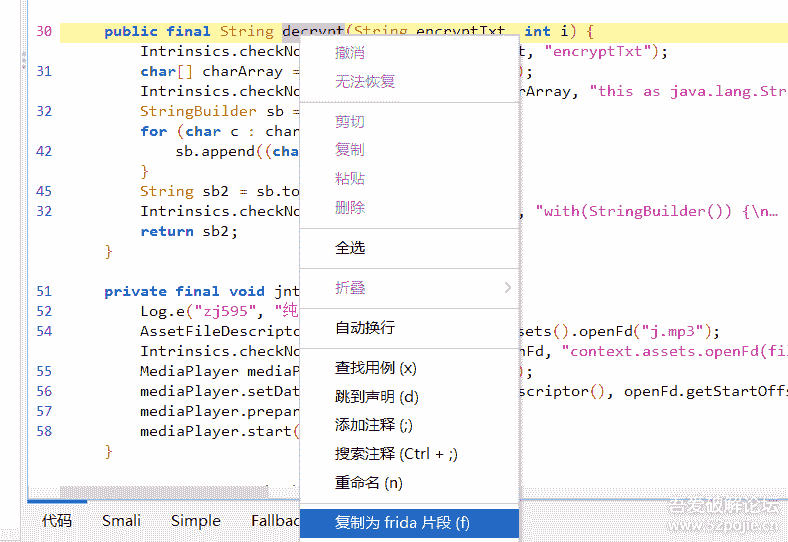

`Untitled.png`（58 KB，下载次数：3） · 2023-2-16 15:59 上传 · [附件下载](https://www.52pojie.cn/forum.php?mod=attachment&aid=MjU5MTA0M3w2ZTk2YWE3OHwxNzkzNTY5NjkzfDE2ODA4NnwxNzQ2ODU1&nothumb=yes)

hook 方法需要指定参数：

```javascript
// JS 代码
Java.perform(function () {
    var MainActivity = Java.use("com.example.MainActivity"); // 获取类引用
    var a = MainActivity.a.overload("int", "int", "long"); // 指定要 hook 的重载方法的参数类型
    a.implementation = function (x, y, z) { // 替换重载方法的实现
        console.log("x: " + x + ", y: " + y + ", z: " + z); // 打印参数
        var result = this.a(x, y, z); // 调用原始的重载方法
        console.log("result: " + result); // 打印返回值
        return result; // 返回原始的值
    };
});
```

如果有些函数没有参数，则 `overload` 不需要指定：

```javascript
// JS 代码
Java.perform(function () {
    var MainActivity = Java.use("com.example.MainActivity"); // 获取类引用
    var onCreate = MainActivity.onCreate.overload(); // 指定要 hook 的函数的重载类型，不传入任何参数
    onCreate.implementation = function () { // 替换函数的实现
        console.log("onCreate() is called"); // 打印日志
        this.onCreate(); // 调用原始的函数
    };
});
```

### 示例

#### hook `MainActivity` 方法示例

参照官方文档的示例，apk 也可以下载：[官方文档示例](https://frida.re/docs/examples/android/#:~:text=import%20frida%2C%20sys%20def%20on_message%28message%2C%20data%29%3A%20if%20message%5B%27type%27%5D,print%28%27%20%201.1%20%5D%20Running%20CTF%27%29%20script.load%28%29%20sys.stdin.read%28%29)

`jadx` 分析下逻辑，可以看到要求 `this.n` 和 `this.m` 要相差为 1，并且 `this.cnt + 1` 后等于 1000。

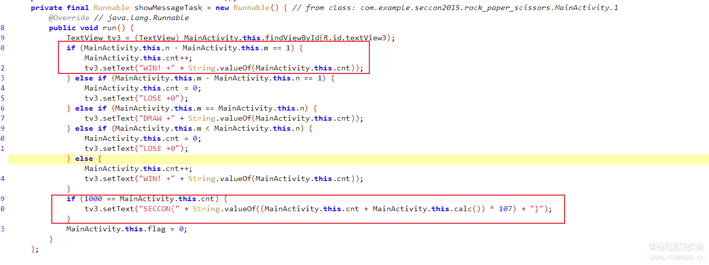

`Untitled 1.png`（60.92 KB，下载次数：4） · 2023-2-16 16:01 上传 · [附件下载](https://www.52pojie.cn/forum.php?mod=attachment&aid=MjU5MTA0NHxhYzdiYzhlMnwxNzkzNTY5NjkzfDE2ODA4NnwxNzQ2ODU1&nothumb=yes)

那么什么时候会修改这几个变量呢？往下看到了 `onClick` 方法。

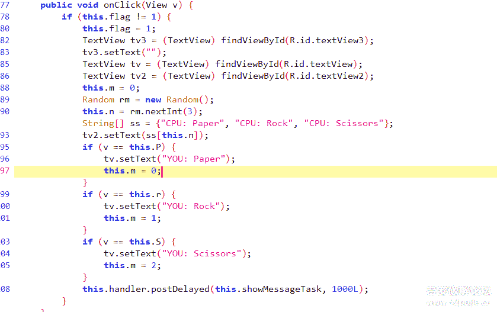

`Untitled 2.png`（44.76 KB，下载次数：4） · 2023-2-16 16:01 上传 · [附件下载](https://www.52pojie.cn/forum.php?mod=attachment&aid=MjU5MTA0NXw2NTZlODkxMnwxNzkzNTY5NjkzfDE2ODA4NnwxNzQ2ODU1&nothumb=yes)

那么就可以编写 `js` 脚本，hook `onClick` 方法：

```javascript
Java.perform (() => {
  // 选择类
  const MainActivity = Java.use ('com.example.seccon2015.rock_paper_scissors.MainActivity');
  // 选择onClick方法
  const onClick = MainActivity.onClick;
  // hook onClick
  onClick.implementation = function (v) {
        // 函数被调用的时候打印一条消息
    send ('onClick');
    //调用原始的onClick方法
    onClick.call (this, v);
    // 调用完之后修改m,n,cnt的值
    this.m.value = 0;
    this.n.value = 1;
    this.cnt.value = 999;
        // frida控制台打印结果
        // hook结束
    console.log ('Done:'  JSON.stringify (this.cnt));
  };
});
```

运行命令：

```bash
frida -U -l .\seccon2015.js rock_paper_scissors
```

执行后会进入 `frida` 的 shell，日志消息会打印出来。

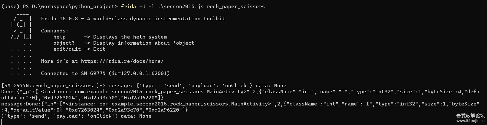

`Untitled 3.png`（75.08 KB，下载次数：4） · 2023-2-16 16:01 上传 · [附件下载](https://www.52pojie.cn/forum.php?mod=attachment&aid=MjU5MTA0NnxmM2JlYzNkYnwxNzkzNTY5NjkzfDE2ODA4NnwxNzQ2ODU1&nothumb=yes)

`frida` 也提供了 `python` 方式调用，不过有个坑点在代码注释中，个人更喜欢用 `js` 的方式：

```python
import frida, sys
def on_message(message, data):
    if message['type'] == 'send':
        print("\n-  {0}".format(message['payload']))
    else:
        print(message)

jscode = """ 
...复制上面的jscode
"""

# 注意这里有一个坑点，attach的时候不用输入全包名
process = frida.get_usb_device().attach('rock_paper_scissors')
script = process.create_script(jscode)
script.on('message', on_message)
print('\n-  Running CTF')
script.load()
sys.stdin.read()
```

找了下原因：

```python
import frida

process = frida.get_usb_device().enumerate_processes() # 枚举所有的process
```

此时发现实际的 process 名字，所以代码中直接写 `rock_paper_scissors` 而不是完整的包名：

```text
Process(pid=2982, name="rock_paper_scissors", parameters={})
```

运行效果：

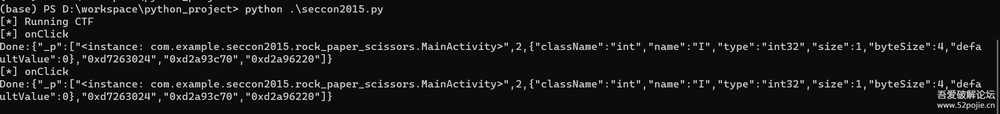

`Untitled 4.png`（44.69 KB，下载次数：4） · 2023-2-16 16:01 上传 · [附件下载](https://www.52pojie.cn/forum.php?mod=attachment&aid=MjU5MTA0N3wyMzlmYTE0YXwxNzkzNTY5NjkzfDE2ODA4NnwxNzQ2ODU1&nothumb=yes)

此时应用上就打印出了 flag。

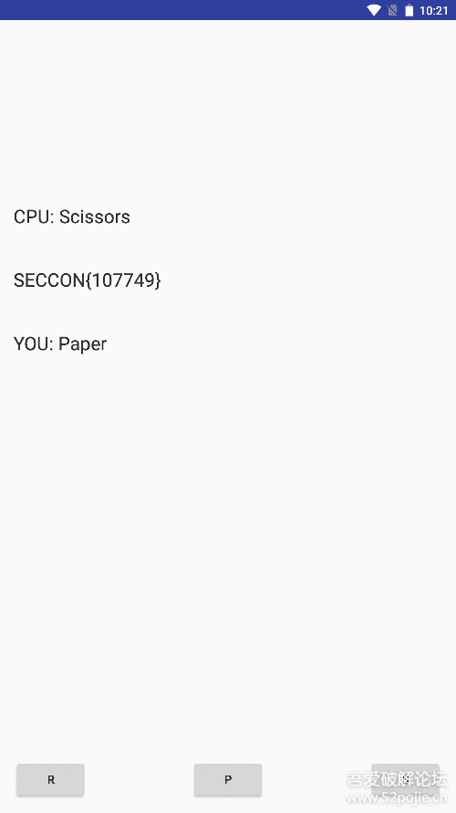

`Untitled 5.png`（22.96 KB，下载次数：5） · 2023-2-16 16:01 上传 · [附件下载](https://www.52pojie.cn/forum.php?mod=attachment&aid=MjU5MTA0OHxkMzA1MzMyNHwxNzkzNTY5NjkzfDE2ODA4NnwxNzQ2ODU1&nothumb=yes)

#### 吾爱破解红包第三题

`jadx` 分析下逻辑，只要 `check` 函数返回的结果等于 999 即可获得 flag。

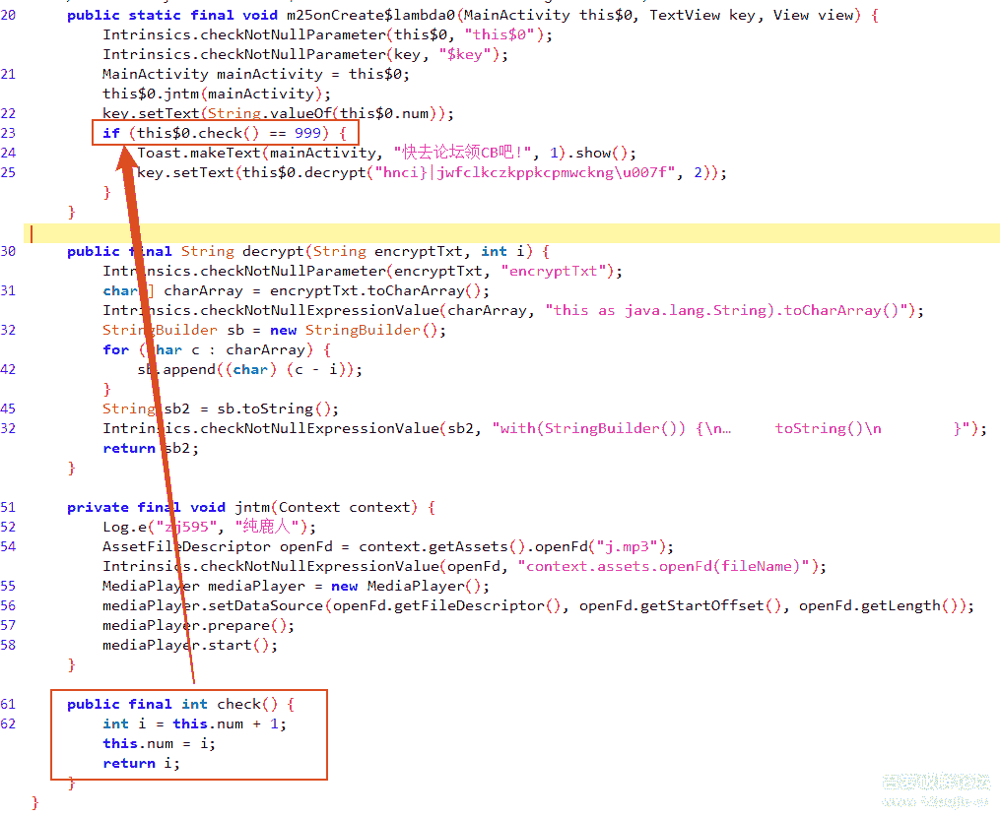

`Untitled 6.png`（85.92 KB，下载次数：2） · 2023-2-16 16:01 上传 · [附件下载](https://www.52pojie.cn/forum.php?mod=attachment&aid=MjU5MTA0OXw5MjNhYTU0NXwxNzkzNTY5NjkzfDE2ODA4NnwxNzQ2ODU1&nothumb=yes)

因此直接 hook `MainActivity` 下的 `check` 方法即可，返回 999：

```javascript
function main(){
    Java.perform(function(){
        var activity = Java.use("com.zj.wuaipojie2023_3.MainActivity");
        var check_method = activity.check.overload(); // 这里实际没有重载，因此不需要
        check_method.implementation = function(arg){
            // send('check');
            check_method.call(this);
            return 999
        }
    })
}
setImmediate(main)
```

点几下就可以获得 flag 了。


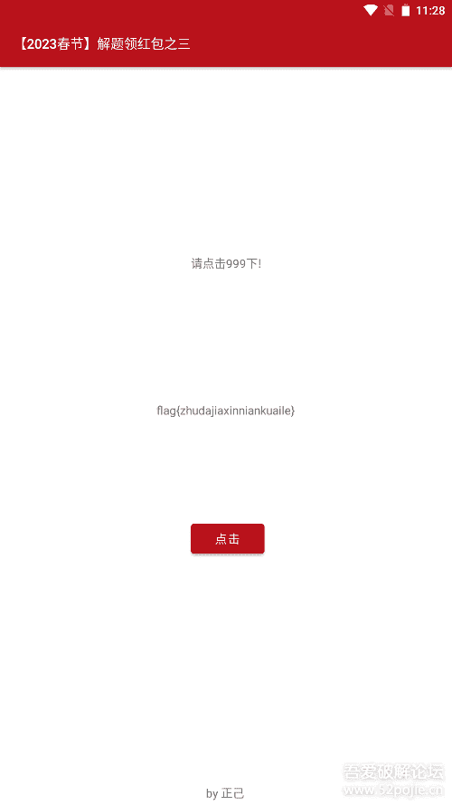

`Untitled 7.png` (22.47 KB, 下载次数: 3)

[附件下载](https://www.52pojie.cn/forum.php?mod=attachment&aid=MjU5MTA1MHxkZjY4MjVjZHwxNzkzNTY5NjkzfDE2ODA4NnwxNzQ2ODU1&nothumb=yes)

2023-2-16 16:01 上传

## hook rsa加密

一次比赛中，有一个关卡是破解apk，（源文件遗失）`jadx`获得源码发现是一个RSA加密，这里有个坑搞了半天。

安卓的RSA和java包中的实现不一样，需要手动下载一个`BouncyCastleProvider.jar`包，引入项目后修改代码即可运行。

其实最简单的方案就是用`frida`进行hook。

实现的代码如下:

```javascript
function main(){
    Java.perform(function(){
        var enc = Java.use("java.lang.String").$new("F3RSCi59ewpMm+dIGtiAn752tBQ0TPx7tCayrCXrrwyG2gtlUJ3C82rcrfgg2A4X7XfhXWGidsJgGDzbD9JwvzGbKMHTK5kxJUf1EJ605R/Rv2N+6Jtr54wQAKbqGyU8g/rUhLUf/EgNqPPYTQ6fa4LqFEMTrPm/UZMvL/4yTNhFoM5vQbceQeD9QNATh6kdYEzLfRdWbv/ESllURlgZbQsc7+pHC8Sg9wVh/2MGZHKzZI8a67Usqhk8ojmfgN5ABodQ2z1DOCICg7AH+l+3fx6eOn1dup/Q1hpCHVCgtojMOPfoLcxICY5LkSonrFjAKzv4JHO/f5ihFXX8Dr4MFw=="); // new一个string
        var PrivateKey = Java.use("java.lang.String").$new("MIIEvwIBADANBgkqhkiG9w0BAQEFAASCBKkwggSlAgEAAoIBAQDcscawF6Fy4Smk\nqwOy2W/IcewNTYzHe9ZFV6w1dqrZ+sRBRD6Sapv7k4deLF9ziYsWXfcDNuvG2HN6\nAgk6CeN5QHUj7OiJmTnitHAQFIw7Ed6O3uyE64i3dhZIKh7oAies6EMpfKusXIZ6\nt1lFwVVpPjlrW6435j/nW5X0OeaRRk89zOxIbzAhS0yxArkMSecy9lr+UwzWQhFO\nW4+O/ywesds9VdCuycx2S/1zbG7BwJP507nTxstLkUnet0BHqXH3tH8cRXXDyFo1\n13gBgrBZ7Y79Z7T39B+21qq7RxfwvPDqu6Rq3p9cOUQCwfJSWlHYBVtYOME04vZP\nkZj/PqLhAgMBAAECggEBAL9QLRkBoydfISZqSW6FJ23vs91kWKGlLH44HkTKdhk4\nVWDus/9hA472uOZeOPCDT1s4YaUbuxBJGvGtSipR4CuAQQu/l2WQuqlYGb0W0ulx\n+CiJ/ybKt12ytGYifWBKXfJ59Z7FQFzOaJWA05awnkX5dvUmKMS0iLkan8dzWfic\nCn379Jn/bLmRXSTKgWNMi9toT4kNhnr2/cf1ah1i2MHHZb4ZMdC9rqnSvyzFRAFM\nuess0Qg8ckyoNzx2daP9vXapn8rg6B/MFBZqjorwyv0KJms/S6W/YKw88OixM/J3\nxlBsk8QHJqaL5IZW6/QeIHJk4K6o9+3fTxtHEjcWoAECgYEA8ASApzgATrHUFVdT\nZ6ZohLFMyQQZzaKLtZhBRfenASrWQSpHHcGdF15C45fik/vohZvF/byrHLkwvosp\nvC6BHyF7toJDrTEWBo/xymGNYmovr0keMUc3T4aRomaERz0gY8CLhKpHMKJrVtgj\nkHlAGqkRZB6AAlcEQUSOyvYziyECgYEA62Pg4xMw1BfJKSfLhCoaWHeWBMAbuZ8K\ncEOLIO8CtGKwXRLBe6MUKTDnHt7aXawVd/j6jk27uhD8p1noYqbsAexzMIKAAzic\nI6fsCVgUfvRZzhaQ98xyBO34AmAtzhJQEg65TnybyEf8tC5xPSegCzzYA5w8QfaM\necRq8V8R38ECgYEAkRNXpDuATBDGzaN8AXGfSV1VuUcmRZpTcg82nREFO/pliPwC\nAmVuC5rpOWIsDSC9ukyezzEECJeTdAjv0BQX7fYyLe3s9DlwQ8Ur9BUk/XCLpBrB\nCi4uq33+dzgaCmlTM5hFfInj/+ycjuCUFpaDfdnlbivVWhS4uK601M8d9qECgYEA\nuxel1ZaZRtqo/tcsgZ3dVtemG5x97OmmKFjnKoQOiEWwnCmeM6EJEzxVV0oWEkIG\nxlbU/2p1fYym5HUnqdG24EiJvdLb4LOMFyMPDtY9ZDLfdlilXO/Y6GYkq+66OYKA\ntfmR+/o679OX3bbUNqFaKdRwdV4m3t8SBG7D+Zlw4YECgYAp2B4F1WOu5H/P0yC6\n6Hn/FGcQec8ty6MCPlH1km9dQBS3jMvBAFpmnMv+hWiR4W93tOHRqRndR6VFC/dX\n+io76NklgjQGteUJ/Nawhg0sDpWCUGECRypwbNTgmhcrmu/RF1B22rO8sckPXXeB\nDzVmjKFXgpDDIJ0eDUTQbqEEMw=="); // new一个string
        var encB64Decode = Java.use("com.chaos.view.example.Base64Utils").decode(enc); // 调用Base64Utils的decode方法
        var loadPrivateKey = Java.use("com.chaos.view.example.RSAUtils").loadPrivateKey(PrivateKey); // 调用RSAUtils的loadPrivateKey方法

        var res = Java.use("java.lang.String").$new(Java.use("com.chaos.view.example.RSAUtils").decryptDataPrivate(encB64Decode, loadPrivateKey)); // 调用RSAUtils的decryptDataPrivate解密方法

        var qaq = Java.use("com.chaos.view.example.Qaq").decode(res, 127);
        console.log(qaq);
    })

}
setImmediate(main)
```

调用`frida -U -l xxx.js`

## `owasp.mstg.uncrackable1` 绕开root检测

apk有root检测，`jadx`查看逻辑发现判断是写在`a.a`函数的。

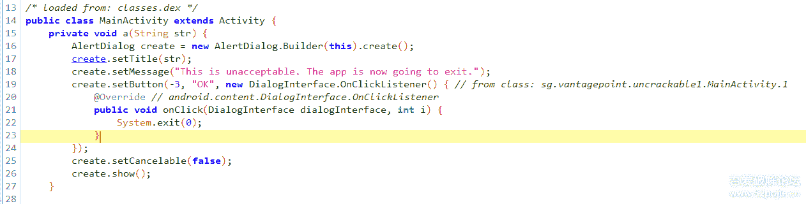

`Untitled 8.png` (40.04 KB, 下载次数: 5)

[附件下载](https://www.52pojie.cn/forum.php?mod=attachment&aid=MjU5MTA1MXw0OWJhNmFlYnwxNzkzNTY5NjkzfDE2ODA4NnwxNzQ2ODU1&nothumb=yes)

2023-2-16 16:01 上传

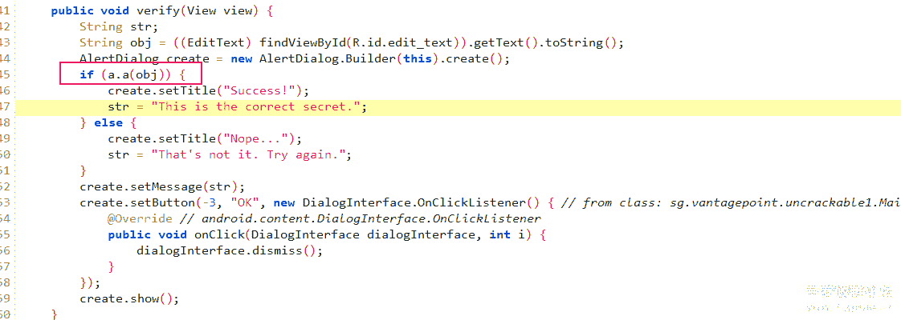

`Untitled 9.png` (43.23 KB, 下载次数: 1)

[附件下载](https://www.52pojie.cn/forum.php?mod=attachment&aid=MjU5MTA1MnxkYzAwYmJmZXwxNzkzNTY5NjkzfDE2ODA4NnwxNzQ2ODU1&nothumb=yes)

2023-2-16 16:01 上传

跟进下`a.a`方法，简单点就直接hook返回结果为true好了。

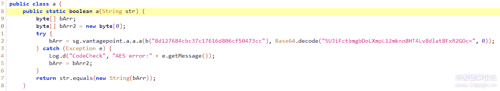

`Untitled 10.png` (30.85 KB, 下载次数: 2)

[附件下载](https://www.52pojie.cn/forum.php?mod=attachment&aid=MjU5MTA1M3w1OThmODMzYXwxNzkzNTY5NjkzfDE2ODA4NnwxNzQ2ODU1&nothumb=yes)

2023-2-16 16:01 上传

首先绕开root检测，找一个大神公开的脚本：

[https://codeshare.frida.re/@dzonerzy/fridantiroot/](https://codeshare.frida.re/@dzonerzy/fridantiroot/)

然后试一下就成功绕开了root。

```bash
frida -U --codeshare dzonerzy/fridantiroot -f "owasp.mstg.uncrackable1"
```

接下来就是hook下：

```javascript
Java.perform(() => {
    // 找到a类
    const a = Java.use('sg.vantagepoint.uncrackable1.a');

    // 找到a方法，虽然没有重载但还是指定下参数类型
    const a_method = a.a.overload("java.lang.String");
    a_method.implementation = function (v) {
      // 打印一条消息表示hook了
      send('a method call');

      // call原方法
      a_method.call(this, v);

      return true; // hook 原函数的返回值
    };
  });
```

接下来在通过`-l`去运行自己的脚本，`--codeshare`是运行的绕开root检测到脚本。

```bash
frida -U --codeshare dzonerzy/fridantiroot -l .\uncrackable1.js -f "owasp.mstg.uncrackable1"
```

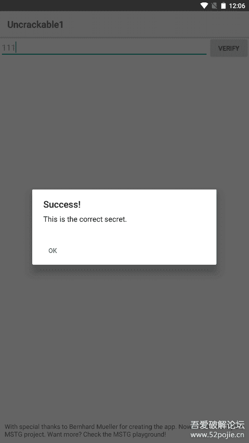

`Untitled 11.png` (32.89 KB, 下载次数: 2)

[附件下载](https://www.52pojie.cn/forum.php?mod=attachment&aid=MjU5MTA1NHxlMDBmNGQ4ZnwxNzkzNTY5NjkzfDE2ODA4NnwxNzQ2ODU1&nothumb=yes)

2023-2-16 16:01 上传

## `owasp.mstg.uncrackable2`

这里的逻辑类似第一个，但是方法是位于native lib中的，因此需要去hook [`libfoo.so`](http://libfoo.so)中的函数。

hook native方法的模版如下：

```javascript
Java.perform(() => {        
        setTimeout(function(){
            Interceptor.attach(Module.findExportByName('libfoo.so', 'xxxx'),{

                onEnter: function(args){
                                    // 这里修改函数进入的时的参数
                },

                onLeave: function(retval){
                                    // 这里修改函数的返回值
                }

            });
        },2000);

});
```

参考模版代码，可以写出如下hook脚本：

```javascript
Java.perform(() => {

        setTimeout(function(){

            Interceptor.attach(Module.findExportByName('libfoo.so', 'Java_sg_vantagepoint_uncrackable2_CodeCheck_bar'),{

                onEnter: function(args){

                },

                onLeave: function(retval){

                    console.log(retval);

                    retval.replace(ptr(1));

                    console.log(retval);

                }

            });

        },2000);

});
```

注意这里的坑：

这里要区分下`frida` hook的两种方式。

- 注入

  ```bash
  frida -U -l .\uncrackable2.js "Uncrackable Level 2" # 注入对应的进程
  ```

- 启动

  ```bash
  frida -U -l .\uncrackable2.js -f owasp.mstg.uncrackable2 # 启动对应的进程
  ```

我最开始用的是`-f`导致程序一开始其实没有加载到[`libfoo.so`](http://libfoo.so)，为这个问题找了半天解决办法，甚至一度以为夜神模拟器就是不支持。

最后整理出的两种均可用的代码，只要加上`setTimeout()`就行了。

注意第一次运行失败，第二次才会成功。

```bash
frida -U --codeshare dzonerzy/fridantiroot -l .\uncrackable2.js -f owasp.mstg.uncrackable2
```

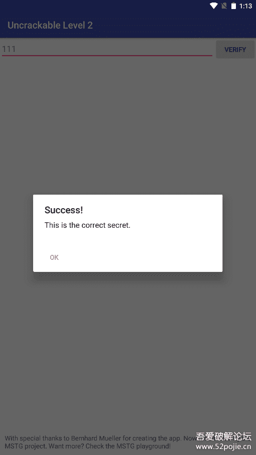

`Untitled 12.png` (33.47 KB, 下载次数: 4)

[附件下载](https://www.52pojie.cn/forum.php?mod=attachment&aid=MjU5MTA1NXw3N2IzMmY1NnwxNzkzNTY5NjkzfDE2ODA4NnwxNzQ2ODU1&nothumb=yes)

2023-2-16 16:01 上传

参考[https://1337.dcodx.com/mobile-security/owasp-mstg-crackme-2-writeup-android](https://1337.dcodx.com/mobile-security/owasp-mstg-crackme-2-writeup-android)这里给出了去hook native中的`strncmp`方法的代码。

```javascript
Java.perform(() => {

        console.log("
```


- Hijacking the onClick button
- ACTION NEEDED: Insert the string "I want your secret asap" as input

```javascript
var clazz_main = Java.use('sg.vantagepoint.uncrackable2.MainActivity$1')

clazz_main.onClick.implementation = function () {
    console.log('onCLick() is replaced ');
};

console.log()

console.log('ACTION NEEDED: Insert the string "I want your secret asap" as input')

console.log()

setTimeout(function () {
    Interceptor.attach(Module.findExportByName('libfoo.so', 'strncmp'), {
        onEnter: function (args) {
            if (Memory.readUtf8String(args[1]).length == 23 && Memory.readUtf8String(args[0]).includes("I want your secret asap")) {
                console.log()
                console.log()
                console.log("*******SECRET********")
                console.log(Memory.readUtf8String(args[1]))
                console.log("*******SECRET********")
                console.log()
                console.log()
            }
        },
        onLeave: function (retval) {
        }
    });
}, 2000);
});
```

运行即可

```bash
frida -U -l .\uncrackable2.js "Uncrackable Level 2"
```

4> `owasp.mstg.uncrackable3`

这个就没办法用原来绕过 root 的脚本了，得换新思路，准备放到后面来写
