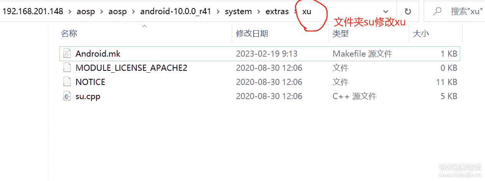
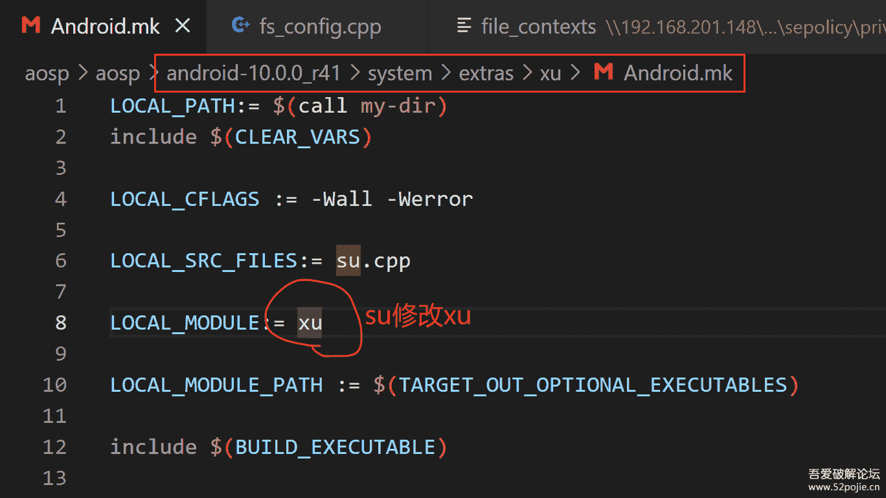
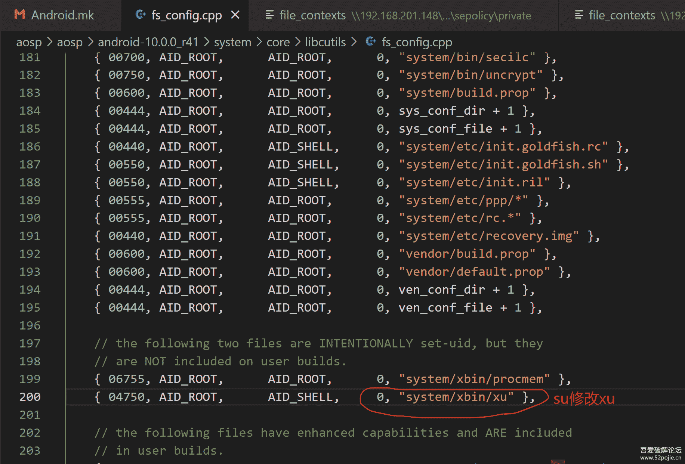
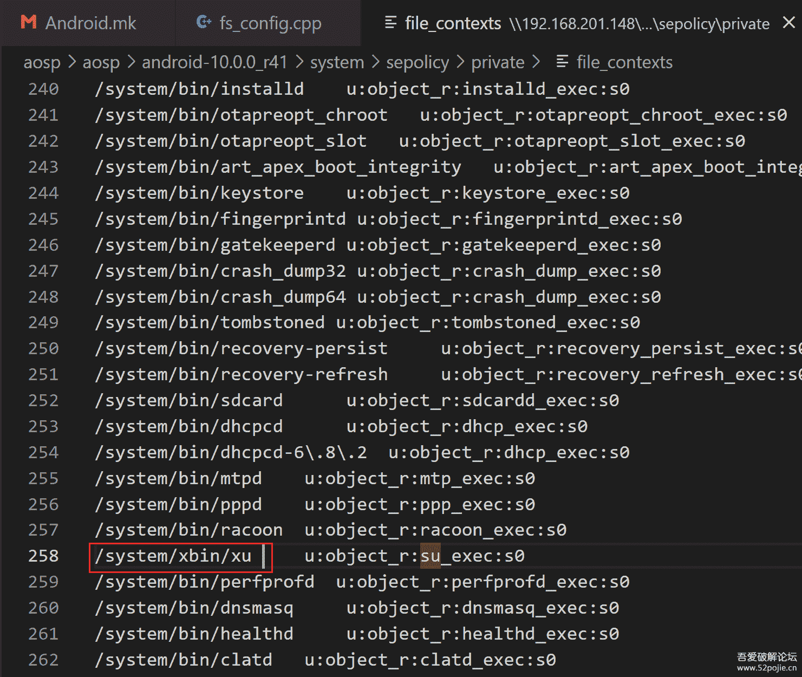
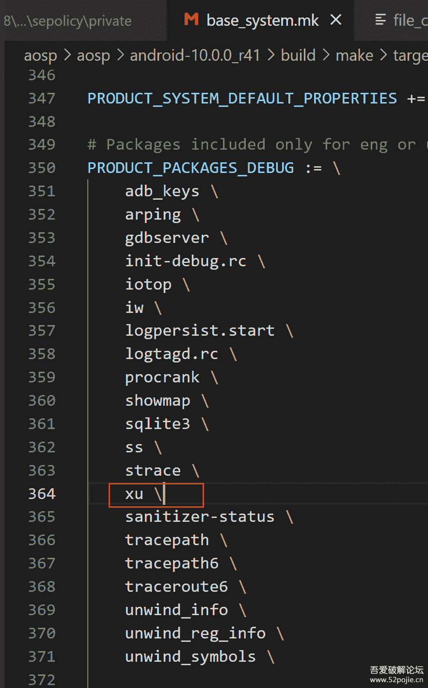
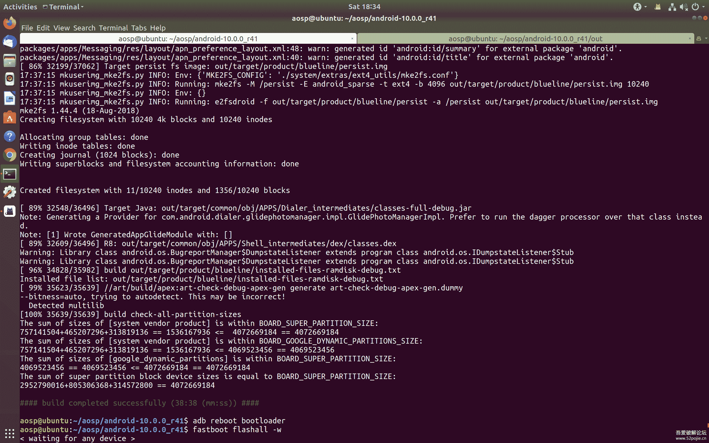
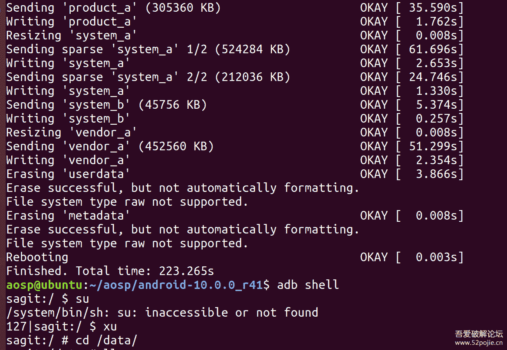
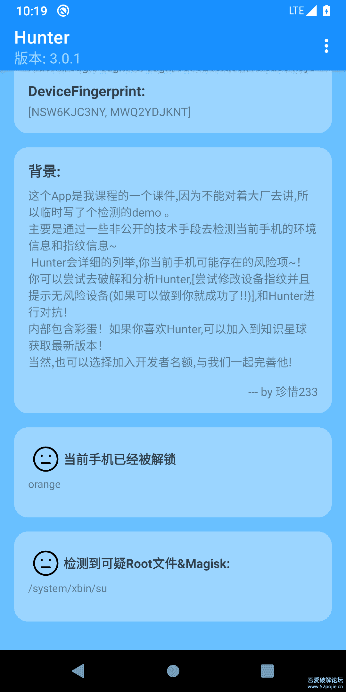
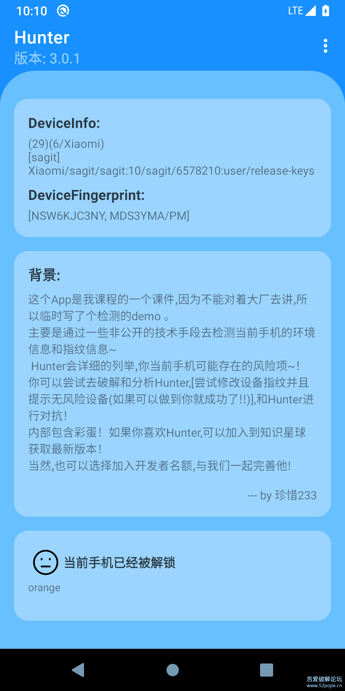

# [Android 原创] AOSP Android 10定制`su`名字隐藏root

- 原帖: <https://www.52pojie.cn/forum.php?mod=viewthread&tid=1748098>
- 抓取时间: 2026-11-01T21:48:07

## 背景


封面.jpg (33.47 KB, 下载次数: 0)

2023-2-19 21:42 上传

哔站，退役debug选手：[https://www.bilibili.com/video/BV1yb411X7zX](https://www.bilibili.com/video/BV1yb411X7zX)

哔站视频：[Android改机系列AOSP 10定制隐藏`su`规避root检查](https://player.bilibili.com/player.html?aid=224679496)

Android10自定义`su`文件名字，规避root检查。

环境：

- vm Ubuntu 18.04
- AOSP 10_r41分支
- Pixel 3

目标：修改`su`为`xu`，命名可以是其他。

## su名字定制和需要修改的文件

需要修改的文件具体路径如下：

```
android-10.0.0_r41\system\extras\su
android-10.0.0_r41\system\extras\xu\Android.mk
android-10.0.0_r41\system\core\libcutils\fs_cofnig.cpp
android-10.0.0_r41\system\sepolicy\private\file_contexts
android-10.0.0_r41\system\sepolicy\prebuilts\api\29.0\private\file_contexts
android-10.0.0_r41\system\sepolicy\prebuilts\api\28.0\private\file_contexts
android-10.0.0_r41\system\sepolicy\prebuilts\api\27.0\private\file_contexts
android-10.0.0_r41\system\sepolicy\prebuilts\api\26.0\private\file_contexts
android-10.0.0_r41\build\make\target\product\base_system.mk
```

### su文件夹

将`android-10.0.0_r41\system\extras\su`修改为`android-10.0.0_r41\system\extras\xu`。



Snipaste_2023-02-19_10-22-38.png (47.8 KB, 下载次数: 0)

2023-2-19 21:39 上传

### su对应的mk文件

文件：`android-10.0.0_r41\system\extras\xu\Android.mk`

将`su`修改为`xu`。



Snipaste_2023-02-19_10-24-31.png (118.67 KB, 下载次数: 1)

2023-2-19 21:39 上传

### fs_cofnig.cpp

文件：`android-10.0.0_r41\system\core\libcutils\fs_cofnig.cpp`

将`su`修改为`xu`。



Snipaste_2023-02-19_10-28-05.png (373.44 KB, 下载次数: 1)

2023-2-19 21:39 上传

### file_contexts

需要修改的文件如下：

```
android-10.0.0_r41\system\sepolicy\private\file_contexts
android-10.0.0_r41\system\sepolicy\prebuilts\api\29.0\private\file_contexts
android-10.0.0_r41\system\sepolicy\prebuilts\api\28.0\private\file_contexts
android-10.0.0_r41\system\sepolicy\prebuilts\api\27.0\private\file_contexts
android-10.0.0_r41\system\sepolicy\prebuilts\api\26.0\private\file_contexts
```

将`su`修改为`xu`。



Snipaste_2023-02-19_10-29-35.png (362.69 KB, 下载次数: 0)

2023-2-19 21:39 上传

### base_system.mk

文件：`android-10.0.0_r41\build\make\target\product\base_system.mk`

将`su`修改为`xu`。



Snipaste_2023-02-19_10-48-57.png (171.84 KB, 下载次数: 1)

2023-2-19 21:40 上传

## 编译刷机验证

编译系统：

```
make -j4
adb reboot bootloader
fastboot flashall -w
```



Snipaste_2023-02-19_10-34-53.png (567.48 KB, 下载次数: 0)

2023-2-19 21:40 上传

在执行`su`和`xu`对比：



Snipaste_2023-02-19_10-37-10.png (240.14 KB, 下载次数: 0)

2023-2-19 21:41 上传

环境检查工具，未修改前：



2023-02-18_22_20_23.png (254.33 KB, 下载次数: 0)

2023-2-19 21:41 上传

修改之后：



2023-02-19_10_11_41.png (254.1 KB, 下载次数: 0)

2023-2-19 21:41 上传

参考Android 8的`su`名字定制：[https://bbs.kanxue.com/thread-275109.htm](https://bbs.kanxue.com/thread-275109.htm)

Android 10的修改和8是有区别的，本文的修改方式可能适合其他高版本系统，如果你验证成功了，记得来告诉我。
