# [Android 原创] AOSP Android 10内置FridaGadget实践02(完)

- 原帖：<https://www.52pojie.cn/forum.php?mod=viewthread&tid=1748101>
- 抓取时间：2026-11-01T21:48:06

## 背景


封面.png (488.2 KB, 下载次数: 1)  
2023-2-19 21:53 上传

内置 frida-gadget 前篇：[内置 frida-gadget 前篇](https://www.52pojie.cn/thread-1740214-1-1.html)

上一篇内置完成脚本管理 app 后，复制脚本到 `/data/system/xsettings` 目录下无权限。现在开始给文件夹配置权限。

环境：

- vm Ubuntu 18.04
- AOSP 10_r41
- Pixel 3
- as

## 文件夹权限配置

位置和文件：

### 0x1

- `android-10.0.0_r41/system/sepolicy/public/file.te`

末尾增加一行：

这里和文件夹有关是 `xxxxx_file`。

这个目录名字就是当时在 `rc` 文件配置的 `xsettings/xxxxx` 目录。

```te
type xiaojianbang_file, file_type, data_file_type, core_data_file_type, mlstrustedobject;
```

- `android-10.0.0_r41/system/sepolicy/private/file_context`
- `android-10.0.0_r41/system/sepolicy/prebuilts/api/29/private/file_contexts`

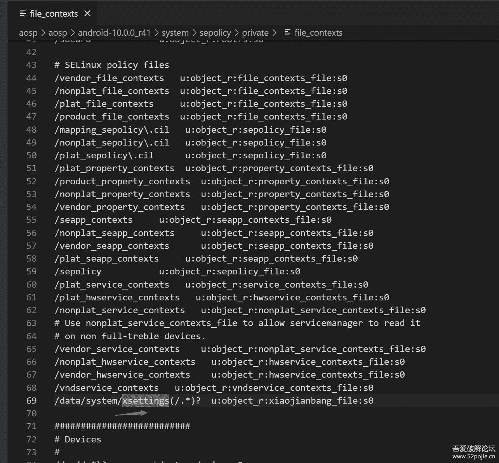

001filecontext增加目录权限.jpg (266 KB, 下载次数: 2)  
2023-2-19 21:48 上传

这 2 个路径的文件 69 行：

```
/data/system/xsettings(/.*)?  u:object_r:xiaojianbang_file:s0
```

### 0x2

- `android-10.0.0_r41/system/sepolicy/private/system_app.te`
- `android-10.0.0_r41/system/sepolicy/prebuilts/api/29/private/system_app.te`

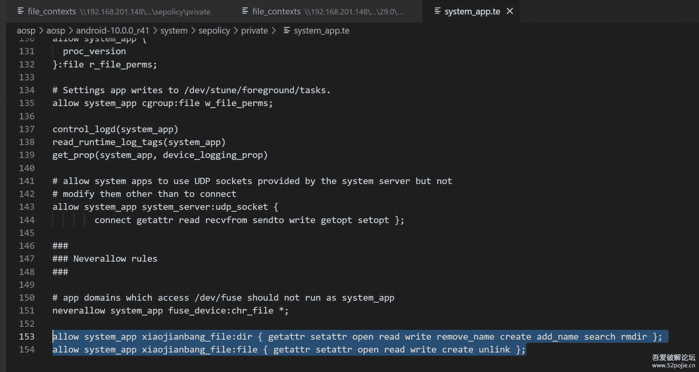

002system_appQQ截图20230205214728.jpg (166.08 KB, 下载次数: 2)  
2023-2-19 21:48 上传

末尾：

```te
allow system_app xiaojianbang_file:dir { getattr setattr open read write remove_name create add_name search rmdir };
allow system_app xiaojianbang_file:file { getattr setattr open read write create unlink };
```

### 0x3

末尾增加：

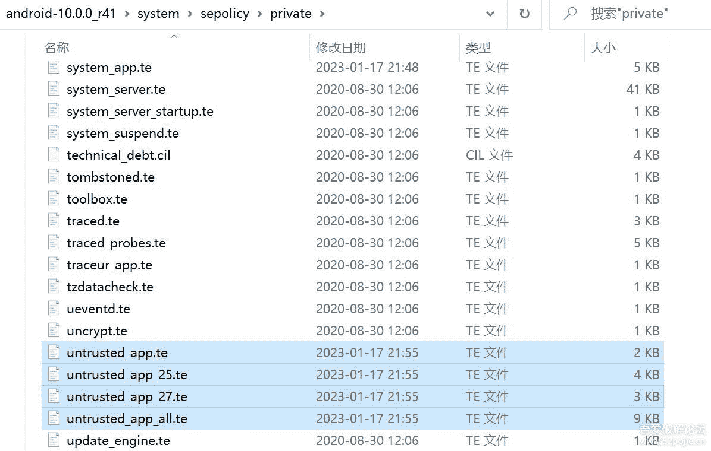

003untrustQQ截图20230205214921.jpg (130.6 KB, 下载次数: 2)  
2023-2-19 21:48 上传

- `android-10.0.0_r41/system/sepolicy/private/untrusted_app.te`

```te
allow untrusted_app xiaojianbang_file:dir { getattr open read write search rmdir };
allow untrusted_app xiaojianbang_file:file { getattr open read write };
```

- `android-10.0.0_r41/system/sepolicy/private/untrusted_app_25.te`

```te
allow untrusted_app_25 xiaojianbang_file:dir { getattr open read write search rmdir };
allow untrusted_app_25 xiaojianbang_file:file { getattr open read write };
```

- `android-10.0.0_r41/system/sepolicy/private/untrusted_app_27.te`

```te
allow untrusted_app_27 xiaojianbang_file:dir { getattr open read write search rmdir };
allow untrusted_app_27 xiaojianbang_file:file { getattr open read write };
```

- `android-10.0.0_r41/system/sepolicy/private/untrusted_app_all.te`

```te
allow untrusted_app_all xiaojianbang_file:dir { getattr open read write search rmdir };
allow untrusted_app_all xiaojianbang_file:file { getattr open read write };
```

目录：

- `android-10.0.0_r41/system/sepolicy/private/compat/26.0/26.0.ignore.cil`
- `android-10.0.0_r41/system/sepolicy/private/compat/27.0/27.0.ignore.cil`
- `android-10.0.0_r41/system/sepolicy/private/compat/28.0/28.0.ignore.cil`

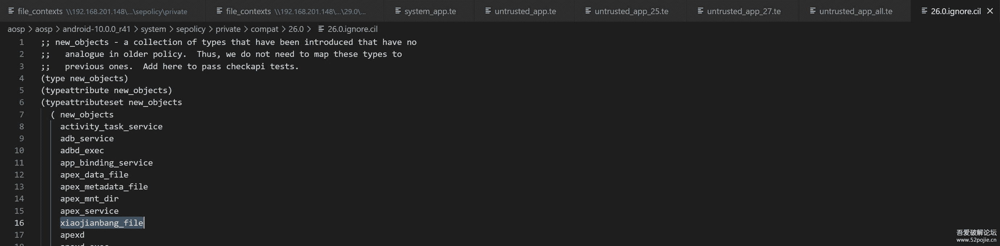

004apexdQ截图20230205215303.jpg (121.39 KB, 下载次数: 2)  
2023-2-19 21:49 上传

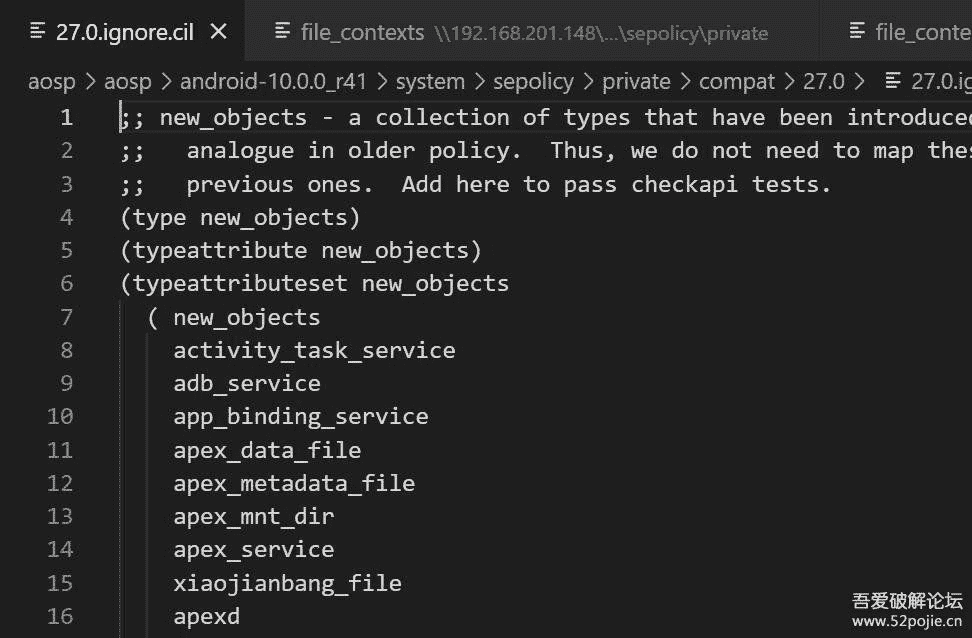

005QQapexd截图20230205215339.jpg (85.28 KB, 下载次数: 2)  
2023-2-19 21:49 上传

3 个文件在 `apexd` 前增加：

`xiaojianbang_file`

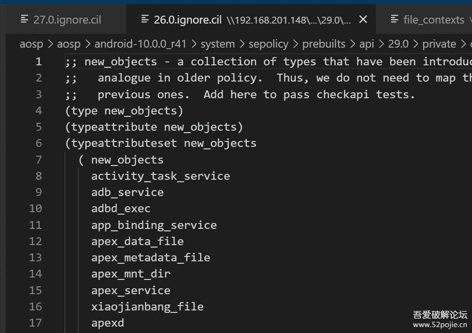

006pre_apexdQQ截图20230205215500.jpg (87.91 KB, 下载次数: 3)  
2023-2-19 21:49 上传

目录：

- `android-10.0.0_r41/system/sepolicy/prebuilts/api/29/private/compat/26.0/26.0.ignore.cil`
- `android-10.0.0_r41/system/sepolicy/prebuilts/api/29/private/compat/27.0/27.0.ignore.cil`
- `android-10.0.0_r41/system/sepolicy/prebuilts/api/29/private/compat/28.0/28.0.ignore.cil`

3 个文件在 `apexd` 前增加：

`xiaojianbang_file`

策略增加完成之后，剩下的就是管理 app 的权限处理了。

## 4. 管理脚本APP开发

管理功能描述：

1. 查看当前用户安装的 APP，当然也可以显示系统的，目前系统 APP 被我过滤。
2. 点击 APP 后进入该 APP 的脚本状态显示，是否激活，该 APP 目录下有多少个脚本文件。
3. 激活 APP 是否启用持久化 hook。
4. 选择加载的 js 脚本。

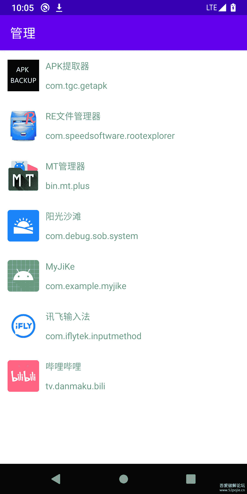

007用户APP列表2023-02-05_22_04_32.png (180.72 KB, 下载次数: 2)  
2023-2-19 21:49 上传

当点击 APP 进入详情配置的时候，会在 `sdcard/fjs` 中根据 APP 包名创建文件夹。

编写的 js 脚本需要放在该包名对应的文件下才能加载到，方便每个包管理。


008jike激活状态2023-02-05_22_04_49.png (75.95 KB, 下载次数: 1)  
2023-2-19 21:49 上传

例如 jike：

脚本内容：

修改 `com.example.myjike.CheckRoot` 类方法 `isDeviceRooted` 返回值。

```java
Java.perform(function() {
    console.log("开始hook");
    var checkClass = Java.use('com.example.myjike.CheckRoot');
    var isRoot = checkClass.isDeviceRooted.overload();
    isRoot.implementation = function() {
         console.log("返回我们hook的值true");
         return true;
    };
});
```

这就是完成后的功能。

激活操作是：

在 `xsettings` 中创建一个文件做标记，APP 启动的时候第一篇文章已经分析过，根据包名和文件是否存在，来注入 so。

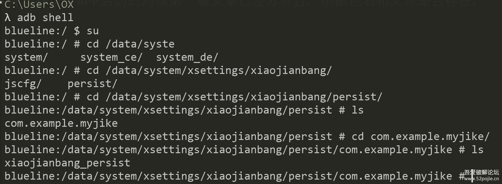

009创建标记文件QQ截图20230205221447.jpg (141.24 KB, 下载次数: 1)  
2023-2-19 21:50 上传

复制脚本操作是：

从 `sdcard` 中复制 js 文件到 `xsettings` 中对应的 APP 包名下。

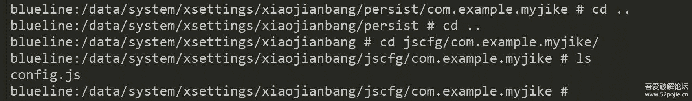

010js文件复制目录QQ截图20230205221623.jpg (94.37 KB, 下载次数: 2)  
2023-2-19 21:50 上传

注入 so 的时候把脚本复制到 APP 安装目录下的 `files` 中。

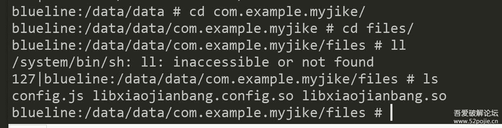

011安装目录下的js文件QQ截图20230205221711.jpg (86.4 KB, 下载次数: 2)


[href="forum.php?mod=attachment&aid=MjU5MTY5M3xmYmFkOTdjYXwxNzkzNTY5NjgzfDE2ODA4NnwxNzQ4MTAx&nothumb=yes" target="_blank"](https://www.52pojie.cn/forum.php?mod=attachment&aid=MjU5MTY5M3xmYmFkOTdjYXwxNzkzNTY5NjgzfDE2ODA4NnwxNzQ4MTAx&nothumb=yes)

2023-2-19 21:50 上传

APP的操作主要是创建目录和文件，基本上没什么难度。

重点是创建完包名后要给路径权限

```java
Os.chmod(path, 0775);
```

复制`sdcard`中的`js`文件到了`xsettings`之后需要给足够权限。

```java
try {
    //dest目标js文件的路径
    Runtime.getRuntime().exec("chmod 777 " + dest);
} catch (IOException e) {
    e.printStackTrace();
}
```

如果整个过程中遇到创建目录，复制文件实现异常，基本上权限问题。

配置文件中需要给`android:sharedUserId="android.uid.system"`，获取系统权限。

内置apk到系统，或者把源码放进去AOSP源码一起编译也可以。

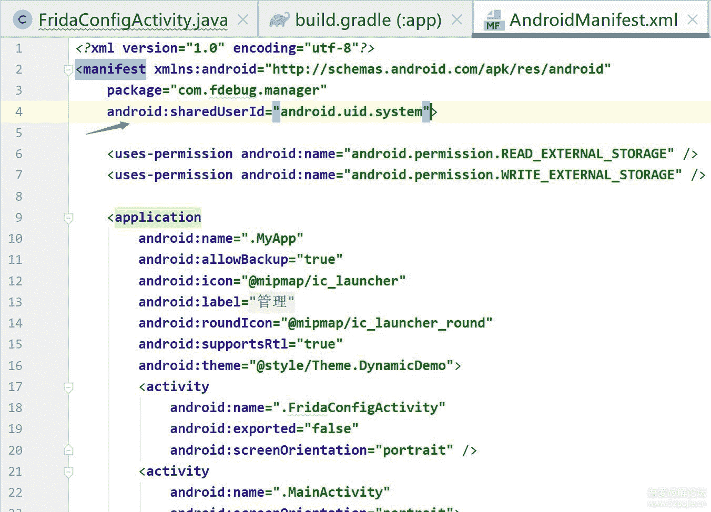

012systemuidQQ截图20230205222121.jpg (193.29 KB, 下载次数: 2)

[href="forum.php?mod=attachment&aid=MjU5MTY5NHw0N2Q3YjQ4OXwxNzkzNTY5NjgzfDE2ODA4NnwxNzQ4MTAx&nothumb=yes" target="_blank"](https://www.52pojie.cn/forum.php?mod=attachment&aid=MjU5MTY5NHw0N2Q3YjQ4OXwxNzkzNTY5NjgzfDE2ODA4NnwxNzQ4MTAx&nothumb=yes)

2023-2-19 21:50 上传

## 4. 测试APP的hook效果

默认情况下方法返回false：


013默认返回值2023-02-05_22_11_06.png (35.03 KB, 下载次数: 3)

[href="forum.php?mod=attachment&aid=MjU5MTcwMXxhYzU2NWIyY3wxNzkzNTY5NjgzfDE2ODA4NnwxNzQ4MTAx&nothumb=yes" target="_blank"](https://www.52pojie.cn/forum.php?mod=attachment&aid=MjU5MTcwMXxhYzU2NWIyY3wxNzkzNTY5NjgzfDE2ODA4NnwxNzQ4MTAx&nothumb=yes)

2023-2-19 21:51 上传

把写好的`js`脚本放到`sdcard/fjs/pkg`目录下：

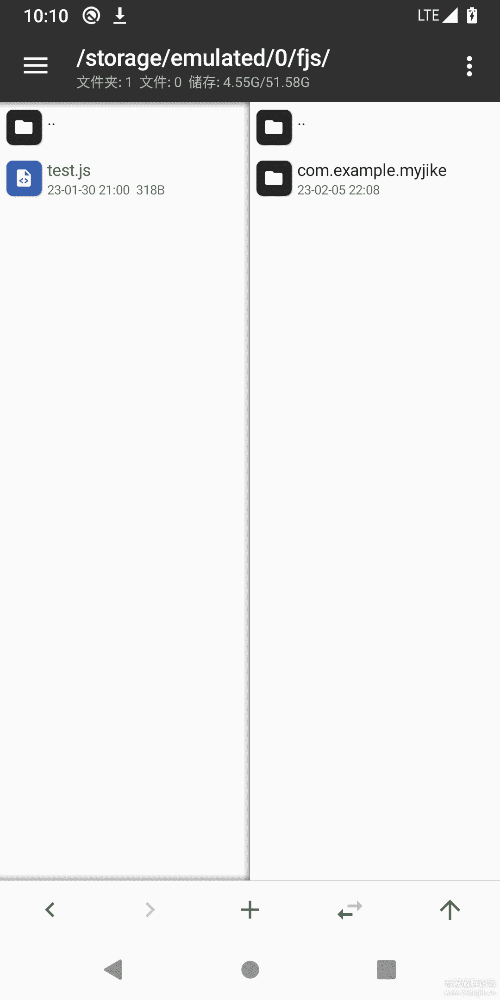

014极客的包脚本2023-02-05_22_09_35.png (67.44 KB, 下载次数: 2)

[href="forum.php?mod=attachment&aid=MjU5MTcwM3xkMzUyZjUzNnwxNzkzNTY5NjgzfDE2ODA4NnwxNzQ4MTAx&nothumb=yes" target="_blank"](https://www.52pojie.cn/forum.php?mod=attachment&aid=MjU5MTcwM3xkMzUyZjUzNnwxNzkzNTY5NjgzfDE2ODA4NnwxNzQ4MTAx&nothumb=yes)

2023-2-19 21:51 上传

进入管理app中，长按选择脚本，确认：

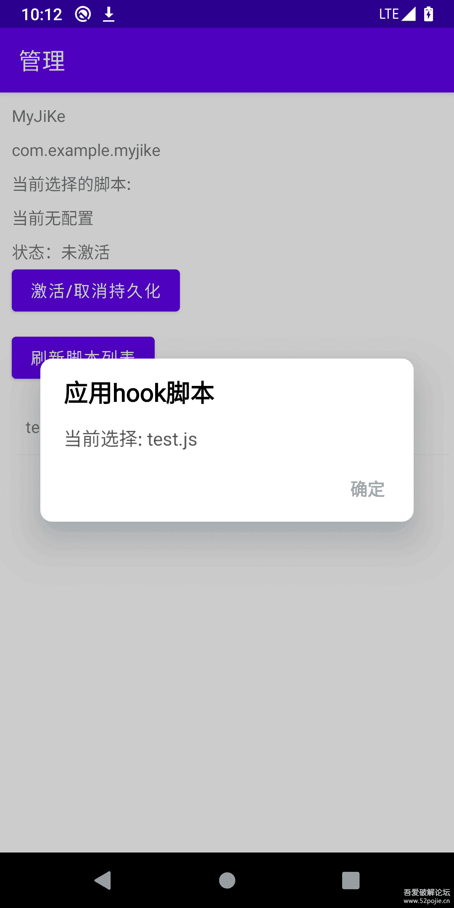

015激活脚本2023-02-05_22_11_42.png (102.2 KB, 下载次数: 2)

[href="forum.php?mod=attachment&aid=MjU5MTcwNHxhZDY5ZjZjMXwxNzkzNTY5NjgzfDE2ODA4NnwxNzQ4MTAx&nothumb=yes" target="_blank"](https://www.52pojie.cn/forum.php?mod=attachment&aid=MjU5MTcwNHxhZDY5ZjZjMXwxNzkzNTY5NjgzfDE2ODA4NnwxNzQ4MTAx&nothumb=yes)

2023-2-19 21:51 上传

打开目标APP查看hook结果：


016修改返回值true2023-02-05_22_12_16.png (34.2 KB, 下载次数: 2)

[href="forum.php?mod=attachment&aid=MjU5MTcwNXxlYzQwMWNmN3wxNzkzNTY5NjgzfDE2ODA4NnwxNzQ4MTAx&nothumb=yes" target="_blank"](https://www.52pojie.cn/forum.php?mod=attachment&aid=MjU5MTcwNXxlYzQwMWNmN3wxNzkzNTY5NjgzfDE2ODA4NnwxNzQ4MTAx&nothumb=yes)

2023-2-19 21:51 上传

对接APP的代码预览：

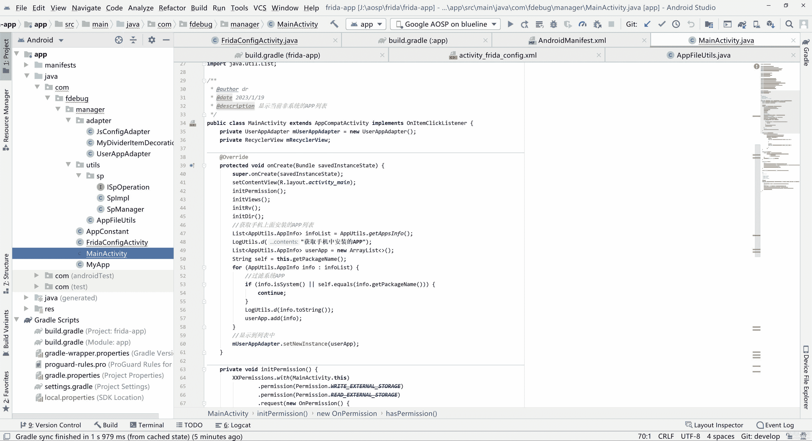

017APP代码预览QQ截图20230205222315.jpg (753.87 KB, 下载次数: 2)

[href="forum.php?mod=attachment&aid=MjU5MTcwNnxhMDZiODU0MHwxNzkzNTY5NjgzfDE2ODA4NnwxNzQ4MTAx&nothumb=yes" target="_blank"](https://www.52pojie.cn/forum.php?mod=attachment&aid=MjU5MTcwNnxhMDZiODU0MHwxNzkzNTY5NjgzfDE2ODA4NnwxNzQ4MTAx&nothumb=yes)

2023-2-19 21:52 上传

这样就可以给具体的APP配置hook脚本，脱离pc使用了。

视频版本的效果，哔站：[https://www.bilibili.com/video/BV1xG4y1X7GK](https://www.bilibili.com/video/BV1xG4y1X7GK)
