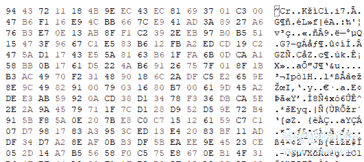
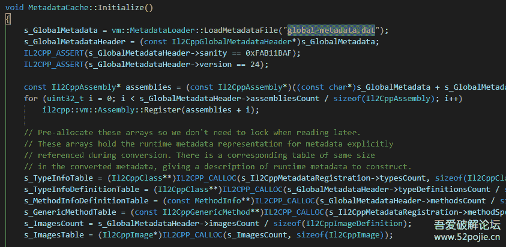
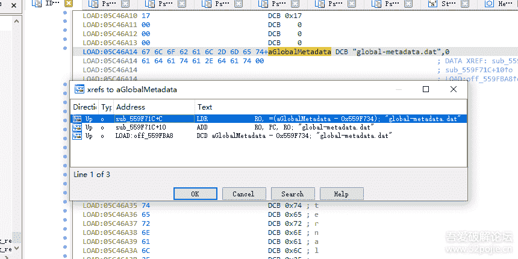
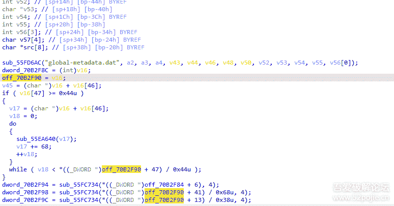
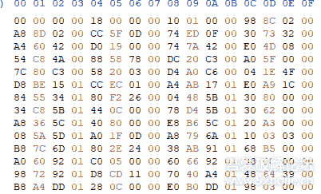
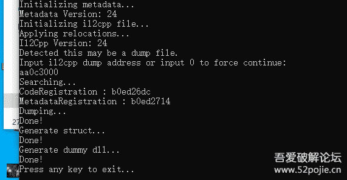

# [Android 原创] 另类的`global-metadata.dat`解密思路，以[XX方舟]为例子

- 原帖: <https://www.52pojie.cn/forum.php?mod=viewthread&tid=1748681>
- 抓取时间: 2026-11-01T21:48:04

游戏版本是taptap上下的最新版

查看安装包内的`global-metadata.dat`文件，很明显是加密了的

屏幕截图 2023-02-21 091521.png (45.26 KB, 下载次数: 2)

[href="forum.php?mod=attachment&aid=MjU5MTkwNHwxMmU0NjM1NXwxNzkzNTY5NjgyfDE2ODA4NnwxNzQ4Njgx&nothumb=yes" target="_blank"](https://www.52pojie.cn/forum.php?mod=attachment&aid=MjU5MTkwNHwxMmU0NjM1NXwxNzkzNTY5NjgyfDE2ODA4NnwxNzQ4Njgx&nothumb=yes)

2023-2-21 09:19 上传

尝试使用各位大佬的一键dump工具 失败

猜测可能是对`dat`文件的特征进行了隐藏

这里我们换一种思路进行手动dump

首先确定XX方舟的unity版本 `2017.4.39f1`

找到对应版本的`il2cpp`的源码

通过阅读源码得知 metadata文件会通过下面这条函数加载到内存中

屏幕截图 2023-02-21 092447.png (88.55 KB, 下载次数: 3)

[href="forum.php?mod=attachment&aid=MjU5MTkwNXwyNTk3ZGZiNXwxNzkzNTY5NjgyfDE2ODA4NnwxNzQ4Njgx&nothumb=yes" target="_blank"](https://www.52pojie.cn/forum.php?mod=attachment&aid=MjU5MTkwNXwyNTk3ZGZiNXwxNzkzNTY5NjgyfDE2ODA4NnwxNzQ4Njgx&nothumb=yes)

2023-2-21 09:25 上传

那么思路就很清晰了 只要在内存中找到`s_GlobalMetadataHeader`即可

首先把游戏的`so`拖到`ida`中

等`so`加载好后使用`shift+f12`打开字符串界面 搜索`global-metadata.dat`

找到后双击跳转，按`X`查看引用

屏幕截图 2023-02-21 093118.png (53.17 KB, 下载次数: 1)

[href="forum.php?mod=attachment&aid=MjU5MTkwNnxkNjQ4N2E1Y3wxNzkzNTY5NjgyfDE2ODA4NnwxNzQ4Njgx&nothumb=yes" target="_blank"](https://www.52pojie.cn/forum.php?mod=attachment&aid=MjU5MTkwNnxkNjQ4N2E1Y3wxNzkzNTY5NjgyfDE2ODA4NnwxNzQ4Njgx&nothumb=yes)

2023-2-21 09:31 上传

可以看到只有一条函数 我们跳转过去查看伪代码

屏幕截图 2023-02-21 093310.png (42.91 KB, 下载次数: 1)

[href="forum.php?mod=attachment&aid=MjU5MTkwN3w5ZTdkZjBjOHwxNzkzNTY5NjgyfDE2ODA4NnwxNzQ4Njgx&nothumb=yes" target="_blank"](https://www.52pojie.cn/forum.php?mod=attachment&aid=MjU5MTkwN3w5ZTdkZjBjOHwxNzkzNTY5NjgyfDE2ODA4NnwxNzQ4Njgx&nothumb=yes)

2023-2-21 09:33 上传

通过对比源码，很轻松的就能看出来 `off_70B2F90`就是`s_GlobalMetadataHeader`

在内存中跳转到`off_70B2F90`再进行一次指针跳转就拿到了`global-metadata.dat`文件

我们把它dump下来看看

屏幕截图 2023-02-21 094031.png (25.96 KB, 下载次数: 3)

[href="forum.php?mod=attachment&aid=MjU5MTkwOHxmYmJmNmYyN3wxNzkzNTY5NjgyfDE2ODA4NnwxNzQ4Njgx&nothumb=yes" target="_blank"](https://www.52pojie.cn/forum.php?mod=attachment&aid=MjU5MTkwOHxmYmJmNmYyN3wxNzkzNTY5NjgyfDE2ODA4NnwxNzQ4Njgx&nothumb=yes)

2023-2-21 09:40 上传

果然 `AF 1B B1 FA`的特征被改成了`00 00 00 00`

我们将文件头手动修改然后尝试使用`il2cppdumper`

屏幕截图 2023-02-21 094528.png (17.27 KB, 下载次数: 2)

[href="forum.php?mod=attachment&aid=MjU5MTkxMHw1MGRiZTY3N3wxNzkzNTY5NjgyfDE2ODA4NnwxNzQ4Njgx&nothumb=yes" target="_blank"](https://www.52pojie.cn/forum.php?mod=attachment&aid=MjU5MTkxMHw1MGRiZTY3N3wxNzkzNTY5NjgyfDE2ODA4NnwxNzQ4Njgx&nothumb=yes)

2023-2-21 09:45 上传

成功

注:这个游戏的`so`也是加密的 从内存里dump出来就行
