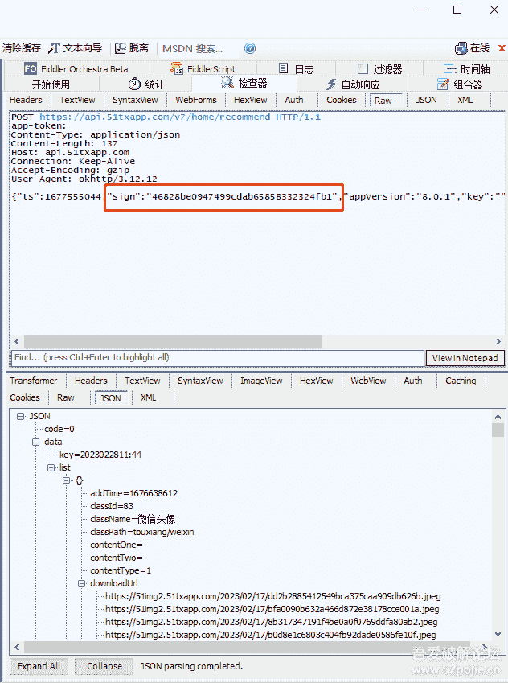
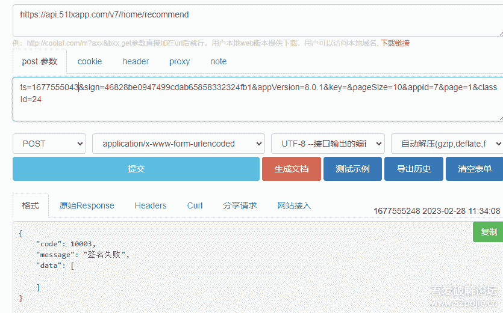
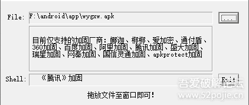
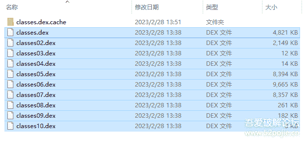
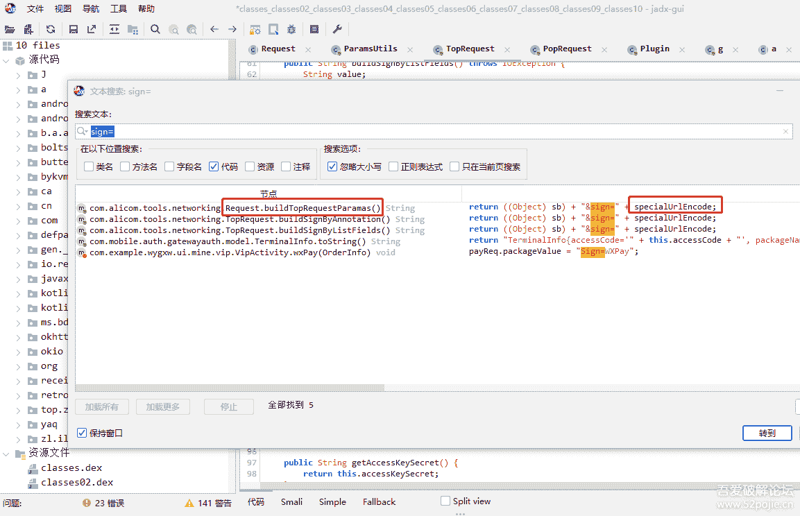
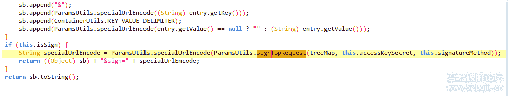
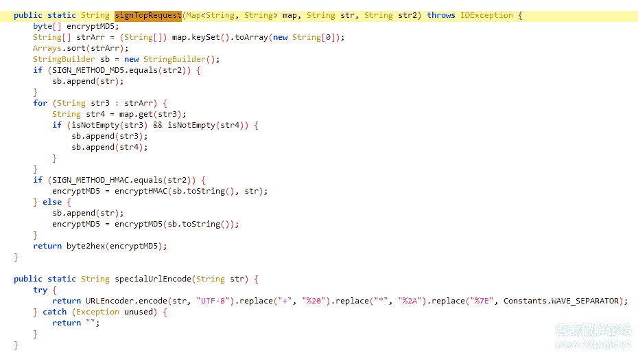
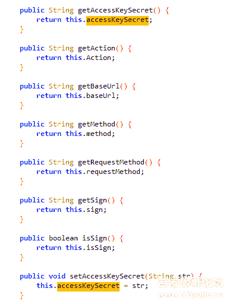
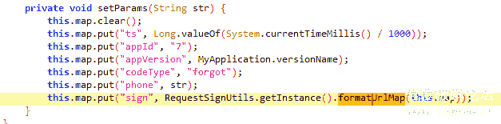
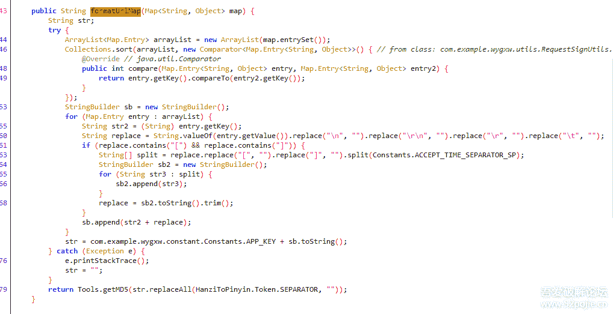

# [Android 原创] 新人第一次某头像app接口请求`sign`分析

## 基本信息

- 原帖：[https://www.52pojie.cn/forum.php?mod=viewthread&tid=1752032](https://www.52pojie.cn/forum.php?mod=viewthread&tid=1752032)
- 抓取时间：2026-11-01T21:47:59

## 分析过程

新人学习app逆向第一次尝试分析过程记录。

分析对象：某头像app，界面如下。

微信截图_20230228145941.png（348.76 KB，下载次数：1） · 上传时间：2023-2-28 15:04 · [附件下载](https://www.52pojie.cn/forum.php?mod=attachment&aid=MjU5MzI2N3wzYmU5MzI5MXwxNzkzNTY5Njc3fDE2ODA4NnwxNzUyMDMy&nothumb=yes)

### 抓包与 `sign` 初探

首先通过模拟器抓包，成功抓取到其中的数据接口，发现其中带有`sign`参数。

微信图片_20230228150608.png（64.35 KB，下载次数：0） · 上传时间：2023-2-28 15:06 · [附件下载](https://www.52pojie.cn/forum.php?mod=attachment&aid=MjU5MzI3Mnw2NzE1YmFkMHwxNzkzNTY5Njc3fDE2ODA4NnwxNzUyMDMy&nothumb=yes)

将其余参数修改后重新请求，返回签名失败，得出结论所有请求参数均参与了`sign`签名计算。

微信截图_20230228151019.png（47.92 KB，下载次数：1） · 上传时间：2023-2-28 15:10 · [附件下载](https://www.52pojie.cn/forum.php?mod=attachment&aid=MjU5MzI3NXxiOGZhYjU1OHwxNzkzNTY5Njc3fDE2ODA4NnwxNzUyMDMy&nothumb=yes)

根据特征盲猜`sign`的计算方法为请求参数排序后进行`md5`计算得出，于是乎尝试进行`sign`值计算还原，尝试了几种方案，均未成功还原出正确的`sign`值。

### APK 逆向与脱壳

开始尝试`apk`文件逆向，直接丢入工具中发现有加壳。

微信截图_20230228151325.png（11.3 KB，下载次数：1） · 上传时间：2023-2-28 15:13 · [附件下载](https://www.52pojie.cn/forum.php?mod=attachment&aid=MjU5MzI3NnwzZjYxN2ZjOHwxNzkzNTY5Njc3fDE2ODA4NnwxNzUyMDMy&nothumb=yes)

那么尝试使用`frida-dexdump`进行[脱壳](https://www.52pojie.cn/forum-5-1.html)（具体过程就不放上来了）。

完成脱壳后得到`dex`文件，并全部拖入`jadx`中进行分析。

微信截图_20230228151520.png（41.04 KB，下载次数：2） · 上传时间：2023-2-28 15:15 · [附件下载](https://www.52pojie.cn/forum.php?mod=attachment&aid=MjU5MzI3OXw1NTI5ZTAyYXwxNzkzNTY5Njc3fDE2ODA4NnwxNzUyMDMy&nothumb=yes)

### 搜索 `sign` 相关代码

直接文本搜索可能的值`sign=`，得到结果如下。

微信截图_20230228151704.png（97.67 KB，下载次数：3） · 上传时间：2023-2-28 15:17 · [附件下载](https://www.52pojie.cn/forum.php?mod=attachment&aid=MjU5MzI4MHwxYjRiYjJmNXwxNzkzNTY5Njc3fDE2ODA4NnwxNzUyMDMy&nothumb=yes)

微信截图_20230228153133.png（23.08 KB，下载次数：1） · 上传时间：2023-2-28 15:31 · [附件下载](https://www.52pojie.cn/forum.php?mod=attachment&aid=MjU5MzI4NnwxZTg1YzZiOXwxNzkzNTY5Njc3fDE2ODA4NnwxNzUyMDMy&nothumb=yes)

### 定位 `signTopRequest()`

找到对应代码处，发现该`sign`值通过一个`signTopRequest()`方法计算得出。

其中传入了三个参数：

- `treeMap`应该为参数体；
- `accessKeySecret`为加密相关secret；
- `signatureMethod`为请求方法。

参数对应下图具体方法实现。

微信截图_20230228152029.png（41.14 KB，下载次数：0） · 上传时间：2023-2-28 15:20 · [附件下载](https://www.52pojie.cn/forum.php?mod=attachment&aid=MjU5MzI4Mnw1MTljOWFmZHwxNzkzNTY5Njc3fDE2ODA4NnwxNzUyMDMy&nothumb=yes)

### 卡点：`accessKeySecret`

返回上一层尝试查找具体`accessKeySecret`值，发现只定义了相关变量，以及`get`、`set`方法。

微信截图_20230228152533.png（25.15 KB，下载次数：0） · 上传时间：2023-2-28 15:25 · [附件下载](https://www.52pojie.cn/forum.php?mod=attachment&aid=MjU5MzI4NXxlMGE2MjllMXwxNzkzNTY5Njc3fDE2ODA4NnwxNzUyMDMy&nothumb=yes)

根据写法进行搜索`setAccessKeySecret`未找到调用位置。

目前卡在这里，望各位大佬指点后续逆向思路。

### 附：相关 `apk` 文件下载地址

[http://www.51txapp.com/app/wygxw.apk](http://www.51txapp.com/app/wygxw.apk)

## 3月2号更新：问题解决

已成功解决。

通过搜索其他接口中固定关键字，找到了一个`setParams()`设置参数的方法。

微信截图_20230301174915.png（22.13 KB，下载次数：0） · 上传时间：2023-3-2 16:38 · [附件下载](https://www.52pojie.cn/forum.php?mod=attachment&aid=MjU5Mzk2Mnw5ZDNlZDEwMHwxNzkzNTY5Njc3fDE2ODA4NnwxNzUyMDMy&nothumb=yes)

可以看到`sign`的值由后面的`formatUrlMap()`计算得出，继续跟进。

微信截图_20230301175140.png（54.93 KB，下载次数：0） · 上传时间：2023-3-2 16:38 · [附件下载](https://www.52pojie.cn/forum.php?mod=attachment&aid=MjU5Mzk2M3wxZDI4MDkyZXwxNzkzNTY5Njc3fDE2ODA4NnwxNzUyMDMy&nothumb=yes)

这里就很明显了，看到其中给返回值`str`赋值的部分：

`str = ******.APP_KEY + sb.toString()`

于是乎顺利找到最后一块拼图！

最终成功实现正确`sign`值计算。

## 感悟

思路灵活是最重要的，往往一条路容易走进死胡同，及时转变思路，寻找其他突破口，不经意间就会有收获！
