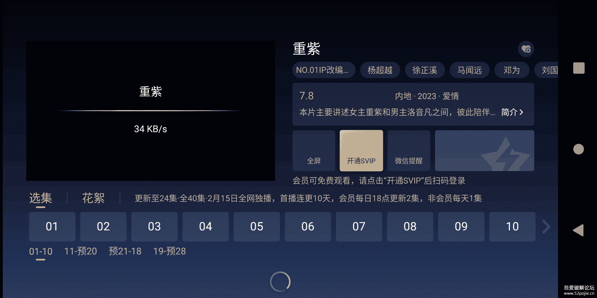
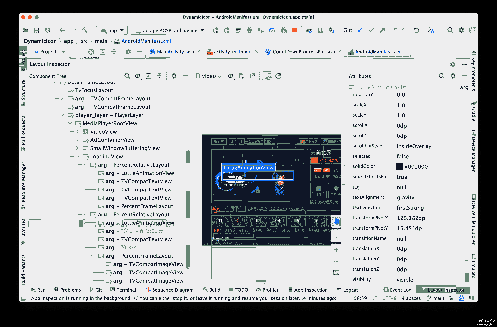
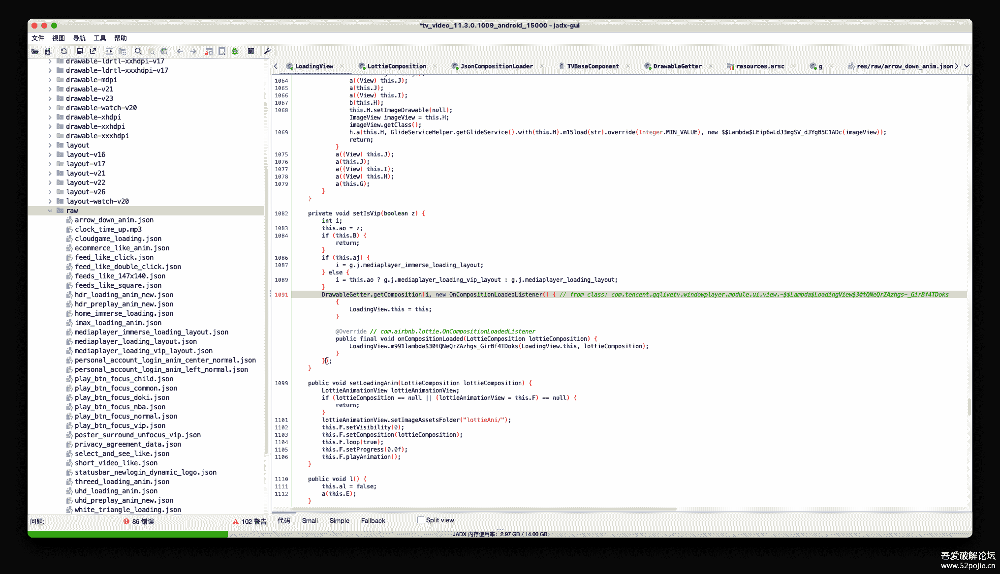
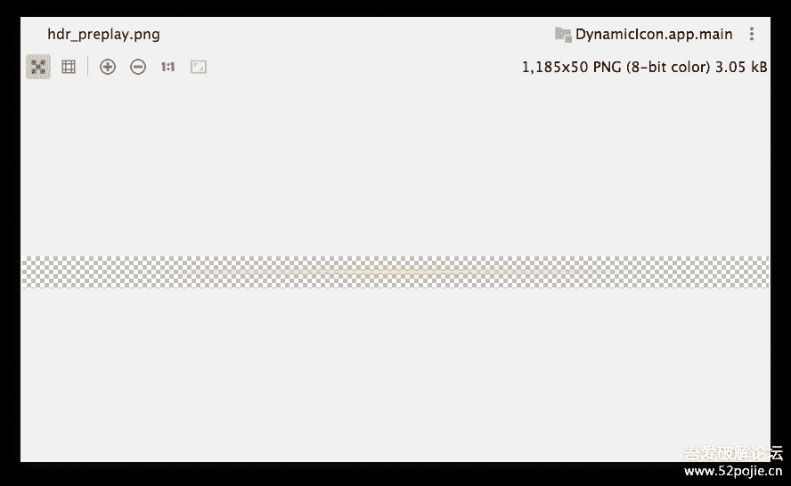
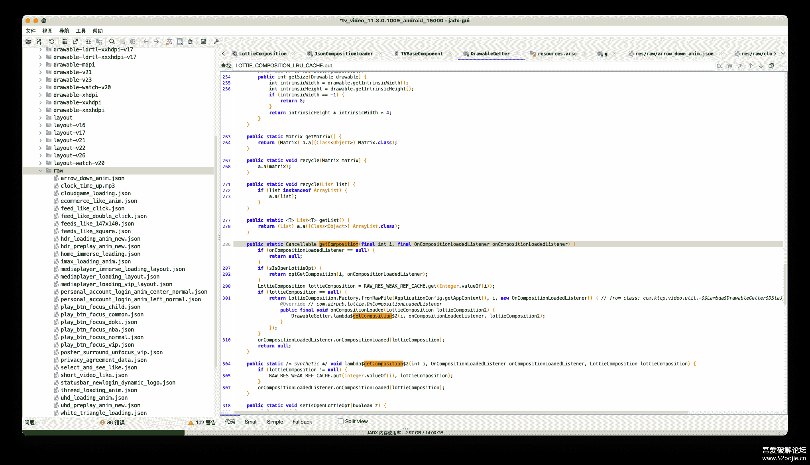
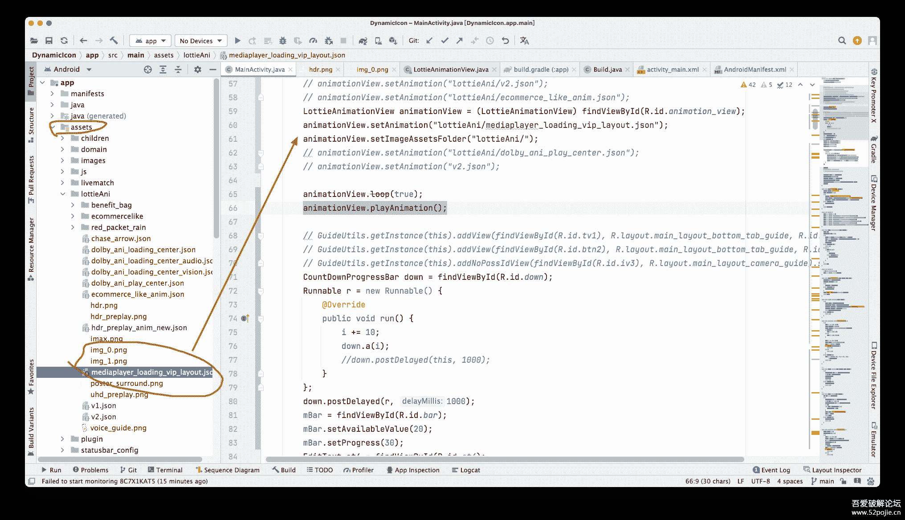

# [Android 原创] Android逆向-分析只因光视频加载动画

- 原帖：https://www.52pojie.cn/forum.php?mod=viewthread&tid=1752062
- 抓取时间：2026-11-01T21:47:50

```
typora-copy-images-to: ./images
```

## 背景

同事需要这个动画，我就静悄悄的帮他写一个，打开极光，打卡一个视频，获取极光的视频加载动画，查看如何实现。就是这个金黄色的动画。



`screen_cap_20230228_144408.png` (180.29 KB, 下载次数: 1)

[附件下载](https://www.52pojie.cn/forum.php?mod=attachment&aid=MjU5MzI5M3wxNjExMjkzMHwxNzkzNTY5NjY4fDE2ODA4NnwxNzUyMDYy&nothumb=yes)

2023-2-28 16:10 上传

### 定位控件

通过AS的Layout Inspector选择极光的进程(需要root的设备)，等待一段时间就可以把页面的布局dump出来。



`Xnip2023-02-03_14-11-52.png` (1.1 MB, 下载次数: 1)

[附件下载](https://www.52pojie.cn/forum.php?mod=attachment&aid=MjU5MzI5NHxhMTVhNjQ4MnwxNzkzNTY5NjY4fDE2ODA4NnwxNzUyMDYy&nothumb=yes)

2023-2-28 16:10 上传

这个抓取的过程有点麻烦，需要刚好加载中的时候抓比较好定位，可以通过自己开一个360WiFi限制网速来模拟，网络太好可能就看不到了。但是看是看不到了，布局中肯定还是存在这个view的组件，就是不方便定位，同样ddms的页面dump也可以。

通过分析可以得到，这个动画组件的对象是Lottie，着就好办了。

如果你不是做开发的，甚至做开发的可能都没听过这个东西。

> [Lottie](https://github.com/airbnb/lottie-android) is a mobile library for Android and iOS that parses [After Effects](http://www.adobe.com/products/aftereffects.html) animations exported as json with [lottie-web](https://github.com/airbnb/lottie-web) and renders them natively on mobile!

从ae，pr这种软件做出啦的特效这个库可以加载，导出来的产物就是图片，json字符串（特效）。

### 学习Lottie的使用

想拿到这个动画，或者我们想把它扣出来，先学习Lottie是怎么在Android上使用的。

这是使用文档：[Lottie Android 文档](http://airbnb.io/lottie/#/android)

文档中重要的部分是：

特效文件的存在位置可以是。

Lottie can load animations from:

- A json animation in `src/main/res/raw`.
- A json file in `src/main/assets`.
- A zip file in `src/main/assets`. See [images](http://airbnb.io/lottie/#/android?id=images) for more info.
- A [dotLottie](https://dotlottie.io/) file in `src/main/assets`.
- A url to a json or zip file.
- A json string. The source can be from anything including your own network stack.
- An `InputStream` to either a json file or a zip file.

项目导入Lottie之后，在页面中增加组件即可：

这里可以配置特效对应的文件，就是这么简单？

也可以通过`animationView.setAnimation`方法动态设置特效json文件，`animationView.playAnimation`主动开启动画。

### 分析动画的加载和定位资源

知道这些之后，这个组件的用法也有了，反过来猜测，组件源头应该是一个

```java
  public void setAnimation(final String assetName) {

    this.animationName = assetName;

    animationResId = 0;

    setCompositionTask(fromAssets(assetName));

  }
```

字符串！直接hook它拿到字符串，再写个demo要验证。

```javascript
var com_airbnb_lottie_LottieAnimationView_clz = 
    Java.use('com.airbnb.lottie.LottieAnimationView');
// hook设置特效json 
var com_airbnb_lottie_LottieAnimationView_clz_method_setAnimation_0996 = com_airbnb_lottie_LottieAnimationView_clz.setAnimation.overload('java.lang.String');
    com_airbnb_lottie_LottieAnimationView_clz_method_setAnimation_0996.implementation = function(v0) {
        var executor = this.hashCode();
        var beatText = 'public void com.airbnb.lottie.LottieAnimationView.setAnimation(java.lang.String)';
        var beat = newMethodBeat(beatText, executor);
        console.log("设置动画json：" + v0);
        com_airbnb_lottie_LottieAnimationView_clz_method_setAnimation_0996.call(this, v0);
        printBeat(beat);
};
// hook启动动画
var com_airbnb_lottie_LottieAnimationView_clz_method_playAnimation_1116 = com_airbnb_lottie_LottieAnimationView_clz.playAnimation.overload();
com_airbnb_lottie_LottieAnimationView_clz_method_playAnimation_1116.implementation = function() {
        var executor = this.hashCode();
        var beatText = 'public void com.airbnb.lottie.LottieAnimationView.playAnimation()';
        var beat = newMethodBeat(beatText, executor);
        com_airbnb_lottie_LottieAnimationView_clz_method_playAnimation_1116.call(this);
        printBeat(beat);
};
```

通过hook发现有多个调用，但是没有关系，丢进demo里面去跑一跑看看效果。

其中有一个是这样的。


`Xnip2023-02-28_15-14-41.png` (9.91 KB, 下载次数: 2)

[附件下载](https://www.52pojie.cn/forum.php?mod=attachment&aid=MjU5MzI5N3wyZjQ0NjU2N3wxNzkzNTY5NjY4fDE2ODA4NnwxNzUyMDYy&nothumb=yes)

2023-2-28 16:10 上传

是一个彩色的，但是不是金色的，还送了个彩蛋~~~~(经过分析猜测是vip才显示这个动画)

通过上面hook时候打印的堆栈信息，很快就定位到启动位置：



`Xnip2023-02-03_16-06-54.png` (406.24 KB, 下载次数: 1)

[附件下载](https://www.52pojie.cn/forum.php?mod=attachment&aid=MjU5MzI5Nnw2YjViOWVmMXwxNzkzNTY5NjY4fDE2ODA4NnwxNzUyMDYy&nothumb=yes)

2023-2-28 16:10 上传

启动动画前设置了一个资源文件夹`setImageAssetsFolder("lottieAni/")`，这个文件可以在`assets`目录中找到。

查看图片居然发现了这个：



`Xnip2023-02-28_15-23-23.png` (49.22 KB, 下载次数: 1)

[附件下载](https://www.52pojie.cn/forum.php?mod=attachment&aid=MjU5MzI5OHw2ZWMxNDNiY3wxNzkzNTY5NjY4fDE2ODA4NnwxNzUyMDYy&nothumb=yes)

2023-2-28 16:10 上传

离开答案又近了一点。

继续回到代码，设置的不是string类型的特效，是一个`setComposition(lottieCompsition)`，上面刚好也有一个`getComposition`的方法，进去看看具体实现：



`Xnip2023-02-03_16-06-49.png` (422.13 KB, 下载次数: 2)

[附件下载](https://www.52pojie.cn/forum.php?mod=attachment&aid=MjU5MzI5NXwzNzA1Yzc1MnwxNzkzNTY5NjY4fDE2ODA4NnwxNzUyMDYy&nothumb=yes)

2023-2-28 16:10 上传

从方法实现来看，如果没有缓存，就从`fromRawFile`中加载出来。开发的小伙伴知道答案在哪里了。

开发知识：我们放资源文件到App中，如果你丢进去的目录是`assets`或者`raw`目录，会原封不动的复制进去，不会修改，通常都是放`assets`目录，但是在使用的时候不能通过语法糖`R.xx`获取，如果你存放在`raw`目录可以通过`R.raw.xx`获取到资源引用。这里的操作就是从`raw`下取资源。把`raw`目录下的资源一个个加载，最后发现`mediaplayer_loading_vip_layout.json`是我们需要的特效。文件的命名也可以猜出是播放器的资源。


`Xnip2023-02-28_15-33-47.png` (9.55 KB, 下载次数: 1)

[附件下载](https://www.52pojie.cn/forum.php?mod=attachment&aid=MjU5MzI5OXwyN2RjYjQzYXwxNzkzNTY5NjY4fDE2ODA4NnwxNzUyMDYy&nothumb=yes)

2023-2-28 16:10 上传

demo加载的代码也比较简单。

```java
LottieAnimationView animationView = (LottieAnimationView) findViewById(R.id.animation_view);

animationView.setAnimation("lottieAni/mediaplayer_loading_vip_layout.json");

animationView.setImageAssetsFolder("lottieAni/");

animationView.loop(true);

animationView.playAnimation();
```

代码也不多，给出结构和代码预览：



`Xnip2023-02-28_16-15-25.png` (542.81 KB, 下载次数: 0)

[附件下载](https://www.52pojie.cn/forum.php?mod=attachment&aid=MjU5MzMwM3xmNzg5NjNkNHwxNzkzNTY5NjY4fDE2ODA4NnwxNzUyMDYy&nothumb=yes)

2023-2-28 16:19 上传


样本地址：[`//wwsk.lanzouy.com/iZVI60otn6pi`](https://wwsk.lanzouy.com/iZVI60otn6pi)

### 总结

我们需要的设备和熟悉的技能：

- 准备好设备`root`的手机，`debuggable = 1`。
- 布局`dump`进行分析。
- 熟悉Android的各种主流开发组件。
- 反编译定位和`hook`调试，代码分析。
