# [Android 原创] QQ音乐源高解析度无损音质下载App接口分析

- 原帖：[52pojie 原帖](https://www.52pojie.cn/forum.php?mod=viewthread&tid=1753585)
- 抓取时间：2026-11-01T21:47:47

## 当前支持

- 网易云音乐无损下载：支持登录下载歌单中的音乐和搜索下载 `HiRes/SQ/320Kbps`
- 酷我音乐无损下载：支持无损解析/`320Kbps` 的音乐
- QQ音乐无损下载：已经挂了，解析服务器返回 `403` 疑似接口异常
- 咪咕音乐无损下载：支持 `Flac/MP3`
- FreeMyMP3下载：支持无损 `FLAC/MP3` 下载，接口来自：[tools.liumingye.cn](https://tools.liumingye.cn/)

该网站有比较强的反爬虫 `token` 加密和 `js` 混淆，但是依然被我解决掉。逆向后的最新版 `js` 算法代码参考：[`MyMP3.js`](https://github.com/QiuChenly/QQFlacMusicDownloader/blob/main/WebSourceCode/src/utils/MyMP3.js)。网上都是老版本 `encode` 算法。

## 正文：先睹为快

赛博丁真i Got Smoke镇楼。

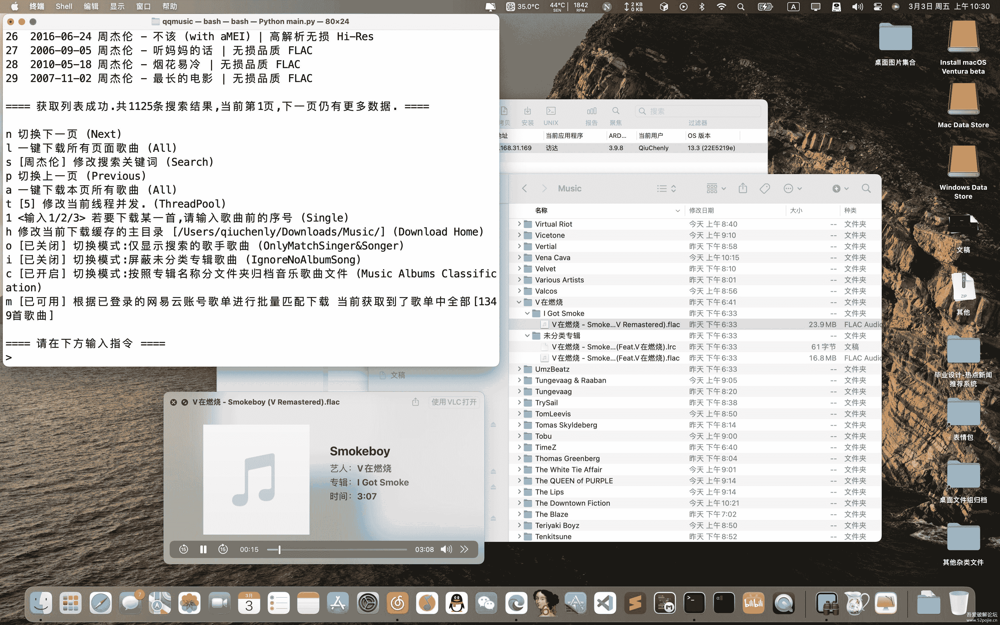  
`16778106625189.jpg`（1.26 MB，下载次数：1）  
[附件下载](https://www.52pojie.cn/forum.php?mod=attachment&aid=MjU5NDEyOXxlZTQ3NGY2MXwxNzkzNTY5NjY0fDE2ODA4NnwxNzUzNTg1&nothumb=yes)  
2023-3-3 14:22 上传

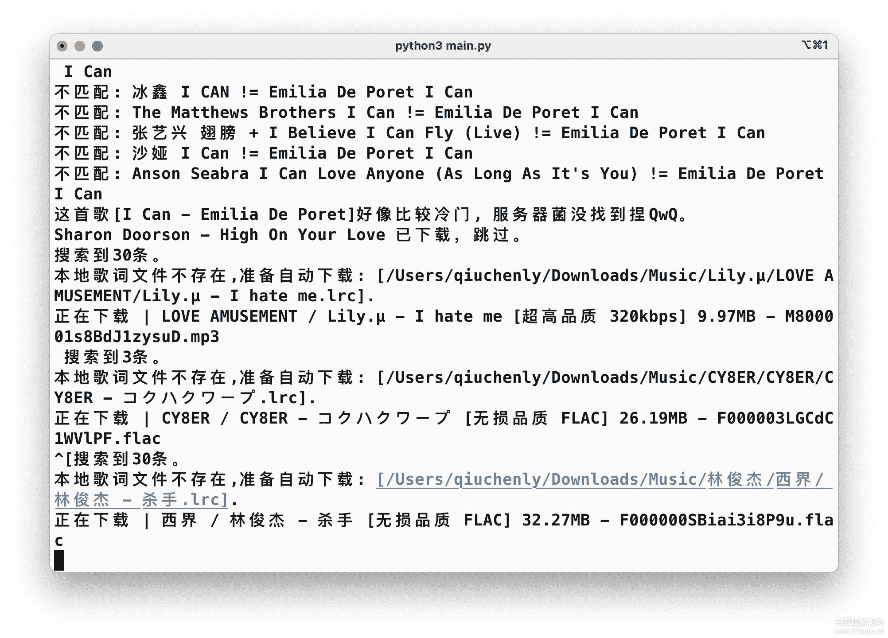  
`16778064007709.jpg`（353.66 KB，下载次数：1）  
[附件下载](https://www.52pojie.cn/forum.php?mod=attachment&aid=MjU5NDEyN3xlNjBmNjVlMXwxNzkzNTY5NjY0fDE2ODA4NnwxNzUzNTg1&nothumb=yes)  
2023-3-3 14:22 上传

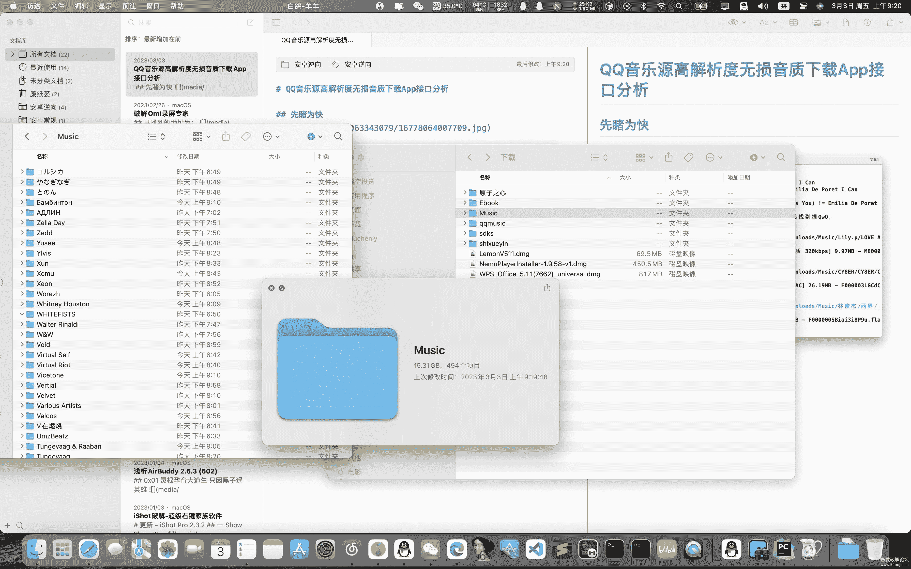  
`16778064303799.jpg`（702.13 KB，下载次数：2）  
[附件下载](https://www.52pojie.cn/forum.php?mod=attachment&aid=MjU5NDEyOHw0YzI3ODY3M3wxNzkzNTY5NjY0fDE2ODA4NnwxNzUzNTg1&nothumb=yes)  
2023-3-3 14:22 上传

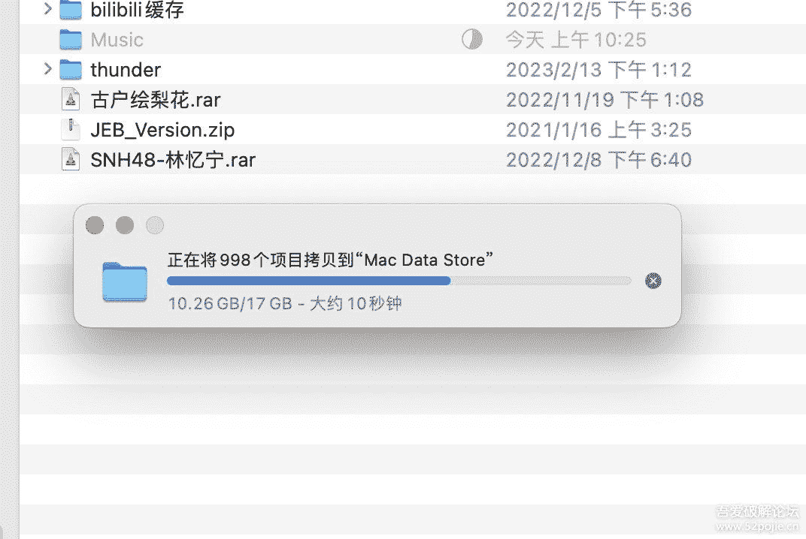  
`16778107579565.jpg`（60.77 KB，下载次数：2）  
[附件下载](https://www.52pojie.cn/forum.php?mod=attachment&aid=MjU5NDEzMHxlOTZhOTNiZXwxNzkzNTY5NjY0fDE2ODA4NnwxNzUzNTg1&nothumb=yes)  
2023-3-3 14:22 上传

## 迫害对象

我想把自己的网易云喜欢的歌曲同步下来，但我不是会员，并且1000多首一个个下载我估计这周都得耗在这上面，这显然不赛博，也不酷，也不符合我对科技的想象。

所以我找了一个App来实施我的赛博丁真想法，我称之为“网易云曲库流浪计划”。

今天的主角是听·下。

主要技术点是 `gzip` 流量打包和 `zlib` 数据压缩加密后的 `AES` 二进制流数据传输。

其他接口没有值得可说的地方。

对了，这个App居然是 `E4A` 做的，看到反汇编出来的字节码全是中文函数绷不住了。

给我一个Android开发一点小小的中文震撼。

本项目什么时候收到DMCA和谐就看各位做什么事了，希望不要收到。

本项目仅用于研究学习技术和试听，所有版权归原始版权作者和版权主体腾讯计算机信息技术有限公司所有，侵权法律责任归App开发者所有，本项目仅用于研究学习，任何人不得将获取到的资源以任！何！形！式！保留和传播！因传播和保留任何未经授权版权内容的个人受到的法律责任本人概不负责。

你啊晓得伐？

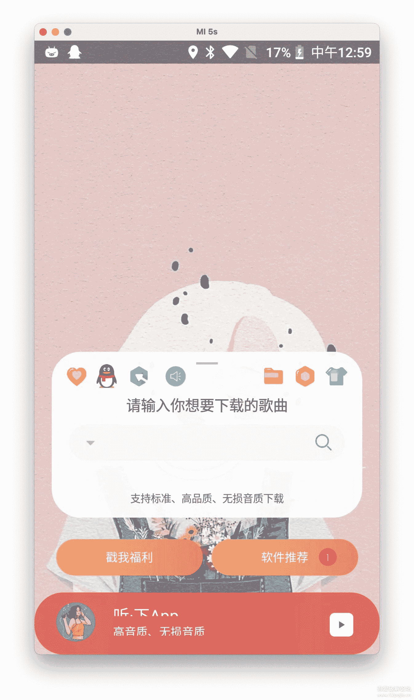  
`16778195738927.jpg`（269.81 KB，下载次数：2）  
[附件下载](https://www.52pojie.cn/forum.php?mod=attachment&aid=MjU5NDEzMXxmMTcyZjgzZXwxNzkzNTY5NjY0fDE2ODA4NnwxNzUzNTg1&nothumb=yes)  
2023-3-3 14:22 上传

搜个周董看看

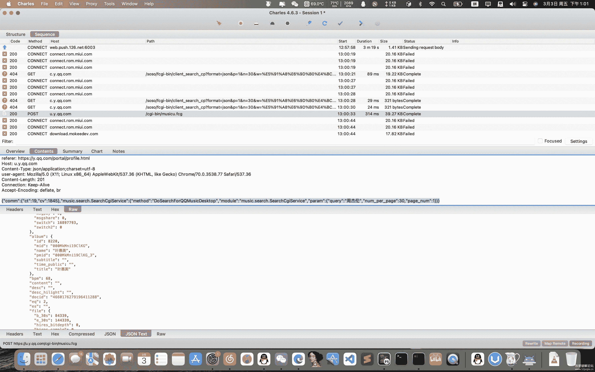  
`16778196842983.jpg`（703 KB，下载次数：1）  
[附件下载](https://www.52pojie.cn/forum.php?mod=attachment&aid=MjU5NDEzMnwwNWVlYWFmY3wxNzkzNTY5NjY0fDE2ODA4NnwxNzUzNTg1&nothumb=yes)  
2023-3-3 14:22 上传

没什么可说的，就是一个简单的接口。

```
POST Https://u.y.qq.com/cgi-bin/musicu.fcg
referer: https://y.qq.com/portal/profile.html
Content-Type: json/application;charset=utf-8
user-agent: Mozilla/5.0 (X11; Linux x86_64) AppleWebKit/537.36 (KHTML, like Gecko) Chrome/70.0.3538.77 Safari/537.36

{"comm":{"ct":19,"cv":1845},"music.search.SearchCgiService":{"method":"DoSearchForQQMusicDesktop","module":"music.search.SearchCgiService","param":{"query":"周杰伦","num_per_page":30,"page_num":1}}}
```

这个app是怎么下载的呢？

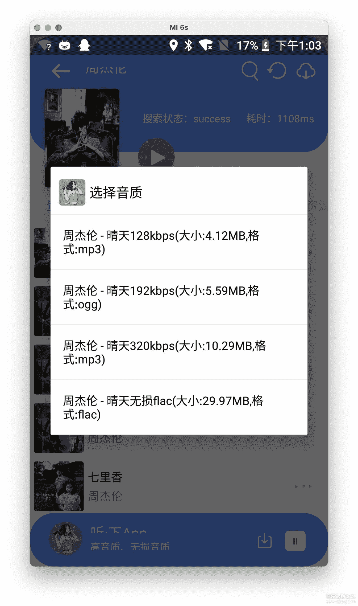  
`16778198171926.jpg`（226.31 KB，下载次数：0）  
[附件下载](https://www.52pojie.cn/forum.php?mod=attachment&aid=MjU5NDEzM3w1NjBkMWMxMHwxNzkzNTY5NjY0fDE2ODA4NnwxNzUzNTg1&nothumb=yes)  
2023-3-3 14:22 上传

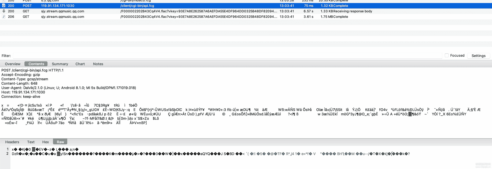  
`16778198436430.jpg`（420.89 KB，下载次数：3）  
[附件下载](https://www.52pojie.cn/forum.php?mod=attachment&aid=MjU5NDEzNHw4ZDUxNDg5OXwxNzkzNTY5NjY0fDE2ODA4NnwxNzUzNTg1&nothumb=yes)  
2023-3-3 14:22 上传

请求接口，返回乱码。

然后就直接下载 `flac` 歌曲了。

此时我们可以看到乱码的请求可知这必然加了蜜。

别的不说，打开Apk cancan他的。`JEB` 启动！

## APK 分析

### 1. 去除抓包检测

实际上这个app是有抓包检测的。

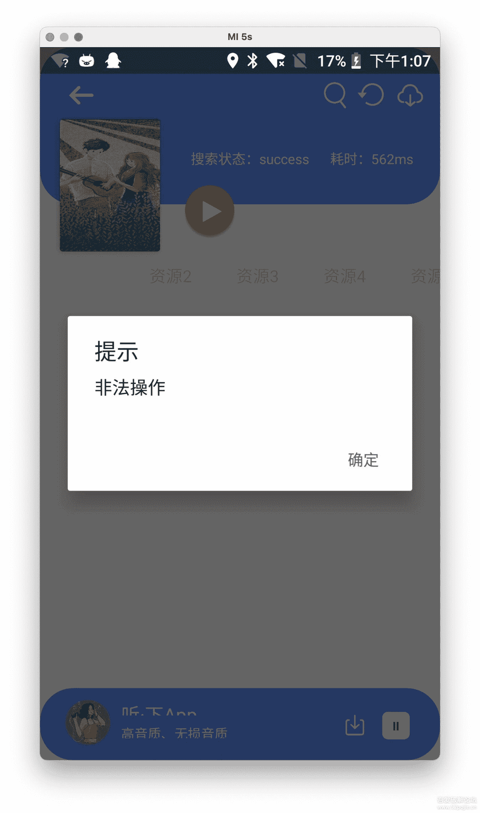  
`16778200722687.jpg`（150.62 KB，下载次数：1）  
[附件下载](https://www.52pojie.cn/forum.php?mod=attachment&aid=MjU5NDEzNnw2YTRiY2I3ZnwxNzkzNTY5NjY0fDE2ODA4NnwxNzUzNTg1&nothumb=yes)  
2023-3-3 14:22 上传

那我们先解决一下这个小问题。

这里不是什么 `SSL Pin` 也不是什么其他的高端技术，就是一个小检查。所以我们可选 `FridaHook` 掉或者重打包修改就行。

我这里选择重新打包，先搜索非法操作关键词：

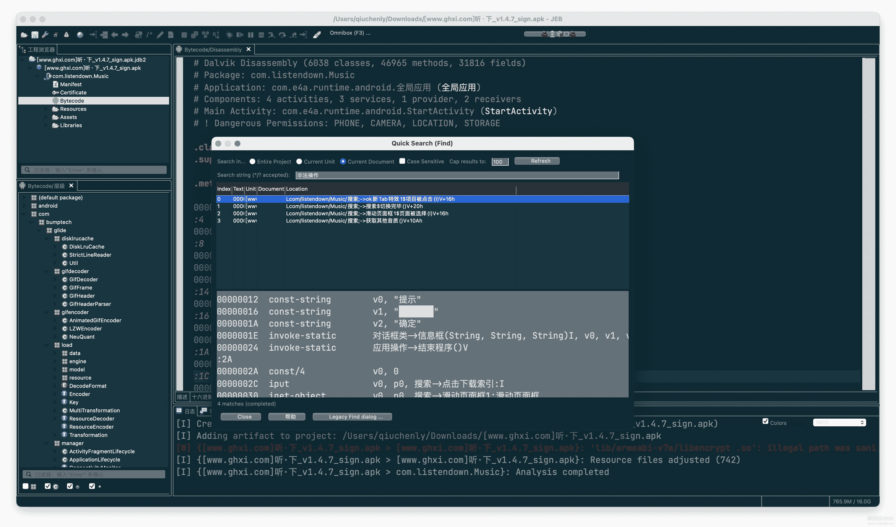  
`16778202120900.jpg`（708.5 KB，下载次数：1）  
[附件下载](https://www.52pojie.cn/forum.php?mod=attachment&aid=MjU5NDEzN3w2MzM3ZjdmN3wxNzkzNTY5NjY0fDE2ODA4NnwxNzUzNTg1&nothumb=yes)  
2023-3-3 14:23 上传

全是汉字很难绷得住。我当时就忍不住哈哈大笑了起来.jpg

`E4A` 特点，没啥可说的，我浅浅的表示Respect。

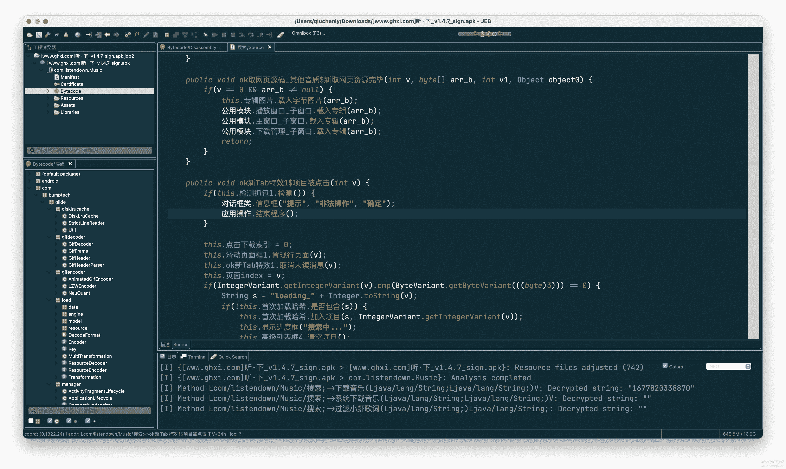  
`16778203746878.jpg`（743.45 KB，下载次数：2）  
[附件下载](https://www.52pojie.cn/forum.php?mod=attachment&aid=MjU5NDEzOHw4YjFlZDFmNHwxNzkzNTY5NjY0fDE2ODA4NnwxNzUzNTg1&nothumb=yes)  
2023-3-3 14:23 上传

看下伪代码，我感觉不需要我说明，大家都看得懂是吧。我后面就直接上图了：

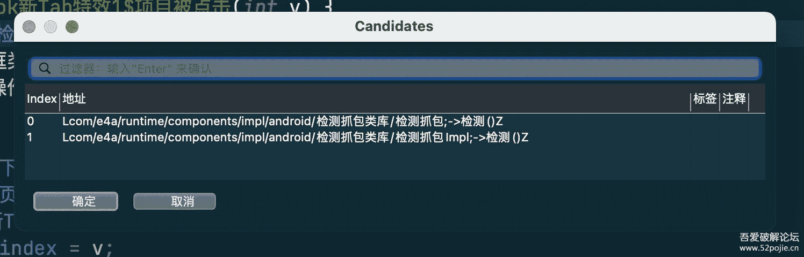  
`16778204257648.jpg`（79.12 KB，下载次数：2）  
[附件下载](https://www.52pojie.cn/forum.php?mod=attachment&aid=MjU5NDEzOXw4ODY1ZGQ5N3wxNzkzNTY5NjY0fDE2ODA4NnwxNzUzNTg1&nothumb=yes)  
2023-3-3 14:23 上传

第一个不是，直接到第二个接口实现类找实现函数

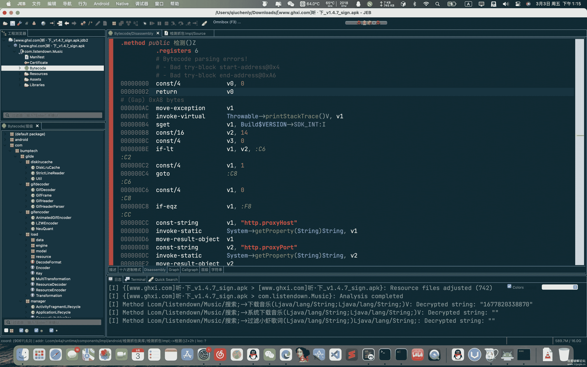  
`16778205346273.jpg`（784.97 KB，下载次数：2）  
[附件下载](https://www.52pojie.cn/forum.php?mod=attachment&aid=MjU5NDE0MXw1NzdmNGJlM3wxNzkzNTY5NjY0fDE2ODA4NnwxNzUzNTg1&nothumb=yes)  
2023-3-3 14:23 上传

在这里直接 `return v0` 就可以过掉检测。

重打包启动，就可以正常抓包。

### 2. 分析接口加密

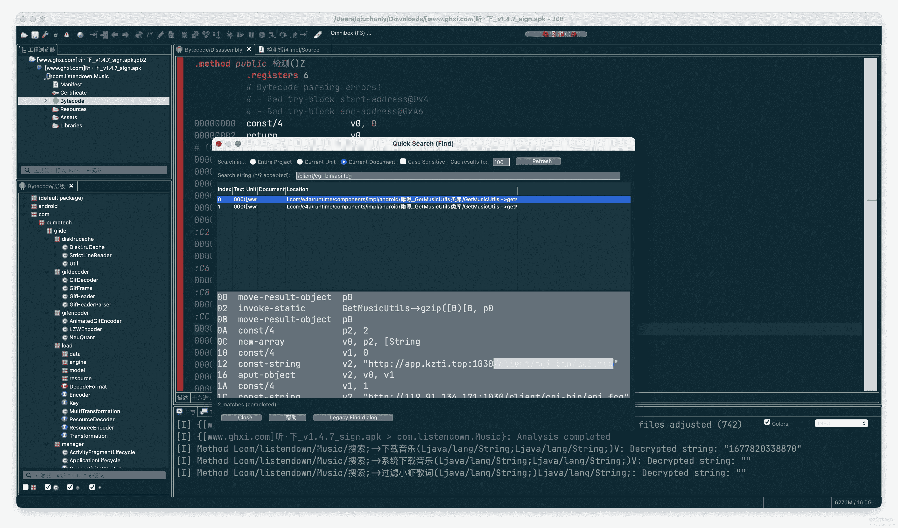  
`16778208969041.jpg`（673.49 KB，下载次数：0）  
[附件下载](https://www.52pojie.cn/forum.php?mod=attachment&aid=MjU5NDE0MnwwM2Q2YjhkYXwxNzkzNTY5NjY0fDE2ODA4NnwxNzUzNTg1&nothumb=yes)  
2023-3-3 14:23 上传

搜索关键网址，发现要素齐全：

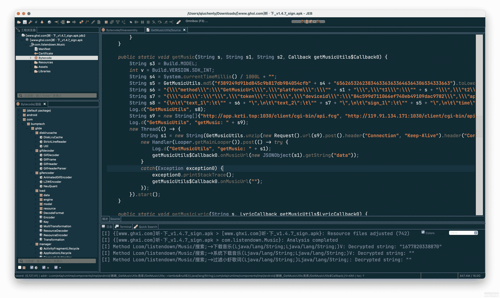  
`16778209651997.jpg`（906.35 KB，下载次数：2）  
[附件下载](https://www.52pojie.cn/forum.php?mod=attachment&aid=MjU5NDE0M3w4NzIzYjY2OHwxNzkzNTY5NjY0fDE2ODA4NnwxNzUzNTg1&nothumb=yes)  
2023-3-3 14:23 上传


public static void getMusic(String s, String s1, String s2, Callback getMusicUtils$Callback0) {

        String s3 = Build.MODEL;

        int v = Build.VERSION.SDK_INT;

        String s4 = System.currentTimeMillis() / 1000L + "";

        String s5 = GetMusicUtils.md5("f389249d91bd845c9b817db984054cfb" + s4 + "6562653262383463363633646364306534333663").toLowerCase();

        String s6 = "{\\\"method\\\":\\\"GetMusicUrl\\\",\\\"platform\\\":\\\"" + s1 + "\\\",\\\"t1\\\":\\\"" + s + "\\\",\\\"t2\\\":\\\"" + s2 + "\\\"}";

        String s7 = "{\\\"uid\\\":\\\"\\\",\\\"token\\\":\\\"\\\",\\\"deviceid\\\":\\\"84c599d711066ef740eb49109dac9782\\\",\\\"appVersion\\\":\\\"4.1.0.V4\\\",\\\"vercode\\\":\\\"4100\\\",\\\"device\\\":\\\"" + s3 + "\\\",\\\"osVersion\\\":\\\"" + v + "\\\"}";

        String s8 = "{\n\t\"text_1\":\t\"" + s6 + "\",\n\t\"text_2\":\t\"" + s7 + "\",\n\t\"sign_1\":\t\"" + s5 + "\",\n\t\"time\":\t\"" + s4 + "\",\n\t\"sign_2\":\t\"" + GetMusicUtils.md5(s6.replace("\\", "") + s7.replace("\\", "") + s5 + s4 + "NDRjZGIzNzliNzEx").toLowerCase() + "\"\n}";

        Log.d("GetMusicUtils", s8);

        String s9 = new String[]{"http://app.kzti.top:1030/client/cgi-bin/api.fcg", "http://119.91.134.171:1030/client/cgi-bin/api.fcg"}[new Random().nextInt(2)];

        Log.d("GetMusicUtils", "getMusic: " + s9);

        new Thread(() -> {

            String s1 = new String(GetMusicUtils.unzip(new Request().url(s9).post().header("Connection", "Keep-Alive").header("Content-Type", "gcsp/stream").header("Accept-Encoding", "gzip").contentByte(GetMusicUtils.gzip()).exec().body().bytes()));

            new Handler(Looper.getMainLooper()).post(() -> try {

                Log.d("GetMusicUtils", "getMusic: " + s1);

                getMusicUtils$Callback0.onMusicUrl(new JSONObject(s1).getString("data"));

            }

            catch(Exception exception0) {

                exception0.printStackTrace();

                getMusicUtils$Callback0.onMusicUrl("");

            });

        }).start();

    }
```

分析得知进行了一次AES后开始做`GetMusicUtils.gzip`压缩，期间还有两次转码操作。

`GetMusicUtils.byteToHexString` x2

`GetMusicUtils.AesEncrypt` x1 `6480fedae539deb2` 喜提16位密钥一只

`GetMusicUtils.gzip` x1

翻译后伪代码:

```
String s="sq",s1="qq",s2="F00MSAksasd";
String s3 = Build.MODEL;
int v = Build.VERSION.SDK_INT;
String s4 = System.currentTimeMillis() / 1000L + "";
String s5 = GetMusicUtils.md5("f389249d91bd845c9b817db984054cfb" + s4 + "6562653262383463363633646364306534333663").toLowerCase();
String s6 = "{\\\"method\\\":\\\"GetMusicUrl\\\",\\\"platform\\\":\\\"" + s1 + "\\\",\\\"t1\\\":\\\"" + s + "\\\",\\\"t2\\\":\\\"" + s2 + "\\\"}";
String s7 = "{\\\"uid\\\":\\\"\\\",\\\"token\\\":\\\"\\\",\\\"deviceid\\\":\\\"84c599d711066ef740eb49109dac9782\\\",\\\"appVersion\\\":\\\"4.1.0.V4\\\",\\\"vercode\\\":\\\"4100\\\",\\\"device\\\":\\\"" + s3 + "\\\",\\\"osVersion\\\":\\\"" + v + "\\\"}";
String s8 = "{\n\t\"text_1\":\t\"" + s6 + "\",\n\t\"text_2\":\t\"" + s7 + "\",\n\t\"sign_1\":\t\"" + s5 + "\",\n\t\"time\":\t\"" + s4 + "\",\n\t\"sign_2\":\t\"" + GetMusicUtils.md5(s6.replace("\\", "") + s7.replace("\\", "") + s5 + s4 + "NDRjZGIzNzliNzEx").toLowerCase() + "\"\n}";

url = "http://119.91.134.171:1030/client/cgi-bin/api.fcg"
payload = GetMusicUtils.AesEncrypt(s8.getBytes(), "6480fedae539deb2".getBytes())
payload = GetMusicUtils.byteToHexString(a).getBytes()
payload = GetMusicUtils.byteToHexString(a).getBytes()
payload = GetMusicUtils.gzip(a)
```

`byteToHexString`就是把字节编码成十六进制，没什么值得说的。

```
public static String byteToHexString(byte[] arr_b) {

        StringBuffer stringBuffer0 = new StringBuffer();

        int v;

        for(v = 0; v  3) {

                stringBuffer0.append(s.substring(6));

            }

            else if(s.length() 

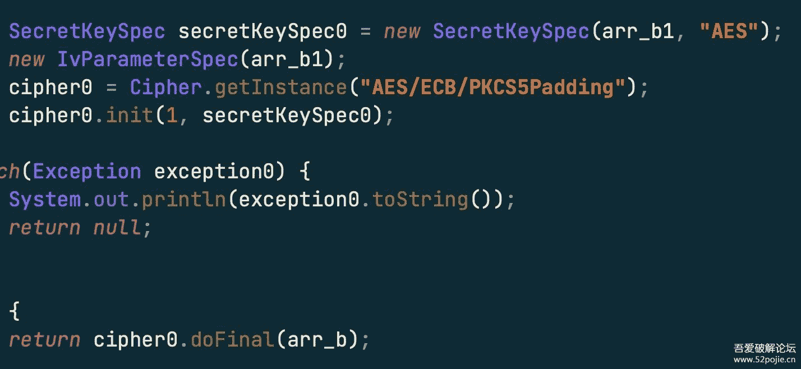

```

`GetMusicUtils.AesEncrypt`
16778224212184.jpg (92.02 KB, 下载次数: 0)

<https://www.52pojie.cn/forum.php?mod=attachment&aid=MjU5NDE0NHw5ZmVjMzYxMXwxNzkzNTY5NjY0fDE2ODA4NnwxNzUzNTg1&nothumb=yes>

2023-3-3 14:23 上传

很常规，除了python上PKCS5对齐有坑之外没什么值得说的。

其中用时间戳检查是否请求被修改过，其实这种高强度加密已经不需要用时间戳检查了，正常人连数据包都拼不出来的。

时间戳`s5`用来加密保存，然后以此为盐将`s8`请求体加密，最后压缩发给服务器。压缩率还可以，能节省20-50bytes。

`s`为音质常量有：

分别是渣音质`mp3` 好一点的320k渣音质`mp3` 高清晰度`hq` 无损`sq` 高解析无损`hr`

也就是会员听的那种。

```
public static final String _320kmp3 = "320kmp3";
/* renamed from: hq */
public static final String f127hq = "hq";
/* renamed from: hr */
public static final String f128hr = "hr";
public static final String mp3 = "mp3";
/* renamed from: sq */
public static final String f129sq = "sq";

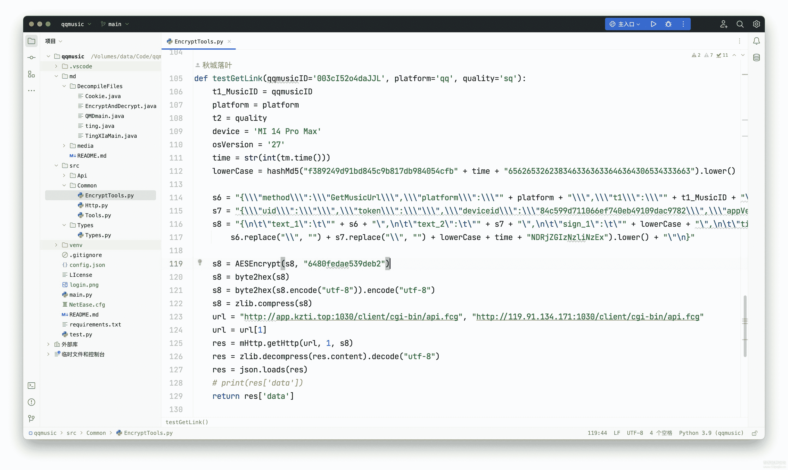


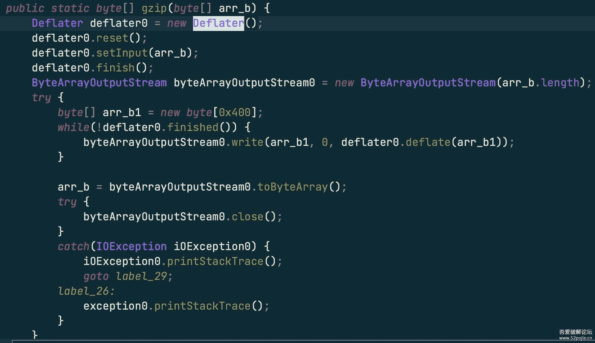


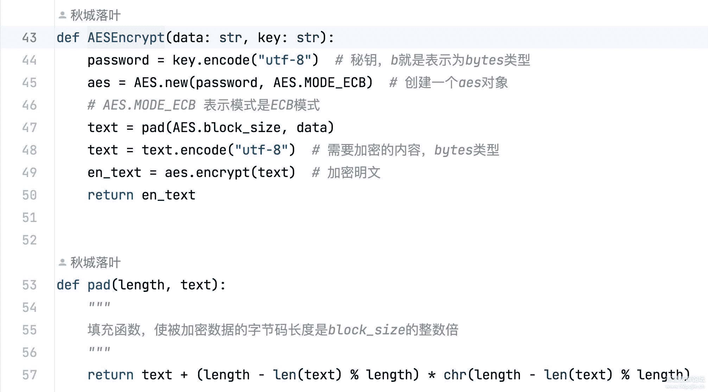

```

`s1`为平台类型常量 这里是qq 它内置了多个平台 如kuwo等。

`s2`为音乐资源名称，这是根据平台服务器返回的音乐id来给出的。

基本逆向分析到这里就结束了，所以我们浅浅的写一段python算一下加密：
16778224967050.jpg (663.63 KB, 下载次数: 1)

<https://www.52pojie.cn/forum.php?mod=attachment&aid=MjU5NDE0NXxiN2MyZWQ1YnwxNzkzNTY5NjY0fDE2ODA4NnwxNzUzNTg1&nothumb=yes>

2023-3-3 14:23 上传

## 3. python的加解密坑

- 值得注意的是我用的压缩库是zlib，一开始看到gzip我以为用gzip解压就OK了，但我没想到它里面是这么写的：
16778227540110.jpg (189.39 KB, 下载次数: 0)

<https://www.52pojie.cn/forum.php?mod=attachment&aid=MjU5NDE0NnxjOWZjZTMzYXwxNzkzNTY5NjY0fDE2ODA4NnwxNzUzNTg1&nothumb=yes>

2023-3-3 14:23 上传

gzip确实底层用了`Deflater`算法，但是GZIP有完整的包头包尾还有可选的附带信息，所以我用python上的gzip库解压不出来数据，因为根本就不是gzip数据流。所以直接用基于Deflate算法的zlib解压就出货了。

- AES的对齐加密问题

我们知道AES是对称加密，而他是按block算加密的。那么就存在一个问题：我们需要选择对齐方式，java里我们可以设置`PKCS5Padding`方式，python里没有啊！大无语事件发生，集美们。

所以按照block算，那么我们的待加密数据要有一个特点，即二进制流长度要满足16的倍数才行，不足16倍数的位数要补足。

也就是如果长度整除16余数有3，那你就要补上13个字符。

所以手搓了一个
16778235000526.jpg (171.35 KB, 下载次数: 0)

<https://www.52pojie.cn/forum.php?mod=attachment&aid=MjU5NDE0N3xmMzQxZDM4M3wxNzkzNTY5NjY0fDE2ODA4NnwxNzUzNTg1&nothumb=yes>

2023-3-3 14:23 上传

- `byte2hex`函数的实现

```
// 还是手搓 下次不敢用python写了 我错了我错了

// hex2Str写错了 其实是to Bytes，我无所谓啦

def hex2Str(hx: str):

a = hx.lower()

length = int(len(a) / 2)

bt = bytearray()

for i in range(0, length - 1):

    i2 = i * 2

    b = int(a[i2:i2 + 2], 16) & 255

    bt.append(b)

return bytes(bt)

def byte2hex(bt: bytes):

strs = ""

for i in bt:

    s = hex(i)[2:].upper()

    if len(s) > 3:

        strs += s[6:]

    elif len(s)     return md5(s.encode("utf-8")).hexdigest()
```

## 4. 看看你的works

网易云这里的api没什么可说的，网上一大把开源的Nodejs版本接口，随便找了个公开服务器对接了。


```python
#  Copyright (c) 2023. 秋城落叶, Inc. All Rights Reserved
#  @作者         : 秋城落叶(QiuChenly)
#  @邮件         : 
#  @文件         : 项目 [qqmusic] - Netease.py
#  @修改时间    : 2023-03-02 07:38:37
#  @上次修改    : 2023/3/2 下午7:38
import base64
import json
import os
import cv2
from src.Api.BaseApi import BaseApi
from src.Common import Http
from src.Types.Types import Songs

class Netease(BaseApi):
    __baseUrl = 'http://cloud-music.pl-fe.cn'

    def __init__(self):
        self.__userInfo = None
        self.__httpServer = Http.HttpRequest()

    def http(self, url, method=0, data={}):
        return self.__httpServer.getHttp2Json(self.__baseUrl + url, method, data)

    def search(self, searchKey: str) -> list[Songs]:
        pass

    def cookie(self):
        dt = self.__httpServer.getSession().cookies.get_dict()
        return dt

    def set_cookie(self, ck: dict):
        self.__httpServer.setCookie(ck)

    def checkQrState(self, key: str):
        u = '/login/qr/check?key=' + key
        return self.http(u)

    def getUserDetail(self):
        u = '/user/account'
        if self.__userInfo is not None and self.__userInfo['code'] == 200:
            return self.__userInfo
        self.__userInfo = self.http(u).json()
        return self.__userInfo

    __likeList = []

    def getUserLikeList(self):
        u = f'/likelist?uid={self.__userInfo["account"]["id"]}'
        res = self.http(u).json()
        self.__likeList = res['ids']
        return self.__likeList

    userPlaylist = []

    def getUserPlaylist(self):
        global userPlaylist
        u = f'/user/playlist?uid={self.__userInfo["account"]["id"]}'
        res = self.http(u).json()
        userPlaylist = [
            {
                'userId': l['userId'],
                'trackCount': l['trackCount'],
                'name': l['name'],
                'id': l['id'],
                'coverImgUrl': l['coverImgUrl']
            } for l in res['playlist']
        ]
        # print("用户所有歌单")
        return userPlaylist

    def getPlayListAllMusic(self, playId, size=1000, offset=0):
        u = f'/playlist/track/all?id={playId}&limit={size}&offset={offset}'
        res = self.http(u)
        if res.status_code != 200:
            return None
        if res.text.find(":400}") != -1:
            return None
        js = res.json()
        return [
            {
                "name": li['name'],
                "id": li['id'],
                'author_simple': li['ar'][0]['name'],  # li['ar'][0]['name'] if len(li['ar']) == 1 else
                "author": li['ar'],  # 数组[{'id': 472822, 'name': 'JJD', 'tns': [], 'alias': []}]
                'publishTime': li['publishTime'],
                'album': li['al']
            } for li in js['songs']
        ]

    def qrLogin(self):
        u = '/login/qr/key'
        res = self.http(u)
        unikey = res.json()['data']['unikey']

        u = '/login/qr/create?key=' + unikey + "&qrimg=1"
        res = self.http(u).json()['data']
        b64 = res['qrimg']
        url = res['qrurl']

        img = base64.b64decode(b64.split(",")[1])
        with open("./login.png", "wb+") as p:
            p.write(img)
            p.flush()

        img = cv2.imread("./login.png")
        cv2.imshow("", img)
        cv2.waitKey(0)

        res = self.checkQrState(unikey)
        res = res.json()['code']
        if res == 803:
            # Login Success
            return True
        print("登录失败。")
        return False
```

### Other

Java 图示可以通过 AES 密钥解密出服务器的返回值。

```java
import javax.crypto.Cipher;
import javax.crypto.spec.IvParameterSpec;
import javax.crypto.spec.SecretKeySpec;
import java.io.ByteArrayOutputStream;
import java.io.FileInputStream;
import java.io.IOException;
import java.util.Arrays;
import java.util.zip.Inflater;
import static javax.crypto.Cipher.DECRYPT_MODE;

public class Main {
    public static void main(String[] args) {
        System.out.println("Hello world!");
        String d = new String(unzip(readFileByBytes("/Users/qiuchenly/Downloads/response")));
        System.out.println(d);
        d = new String(unzip(readFileByBytes("/Users/qiuchenly/Downloads/request")));
        d = new String(hex2byte(d));
        byte[] bytes = hex2byte(d);
        d = new String(AesDecrypt(bytes, "6480fedae539deb2".getBytes()));
        System.out.println(d);
    }

    public static byte[] readFileByBytes(String fileName) {
        try {
            //传入文件路径fileName，底层实现 new FileInputStream(new File(fileName));相同
            FileInputStream in = new FileInputStream(fileName);
            //每次读10个字节，放到数组里
            byte[] bytes = new byte[1024];
            ByteArrayOutputStream byteArrayOutputStream = new ByteArrayOutputStream();
            int c;
            while ((c = in.read(bytes)) != -1) {
                byteArrayOutputStream.write(bytes, 0, c);
            }
            return byteArrayOutputStream.toByteArray();
        } catch (Exception e) {
            // TODO: handle exception
        }
        return new byte[0];
    }

    private static byte[] hex2byte(String str) {
        if (str == null || str.length()
```

### Credits & Refs

- 我  谢  我  自  己
- 为了实现我的赛博丁真“网易云曲库流浪计划”，我做了一个小东西：[QQFlacMusicDownloader](https://github.com/QiuChenly/QQFlacMusicDownloader)

### 项目更新记录

#### 20230414 更新

- 增加歌曲关键词过滤，现在可以自定义歌曲名称中包含的特殊关键词进行过滤，如：不需要带DJ只需要自己增加一个DJ关键词即可自动过滤掉歌曲。
- UI改善，体验优化。

#### 20230313 更新

- 修复QQ音乐无损flac解析接口，现在已经可以继续正常使用。
- 酷我接口已经被官方堵了解析漏洞

疑似咱这个项目被官方注意到了大量的解析请求，所以封了漏洞----当然我丝毫没有给自己脸上贴金的意思----但确实就是如此

等后期有机会再修复吧

#### 20230309 更新

- 修复酷我音乐解析Hires直链返回183KB酷我版权mp3文件的问题
2. 其他小问题改正，参见Github的提交记录。

#### 20230305 更新

用vue配合flask撸了一个简易前端管理界面 已开源

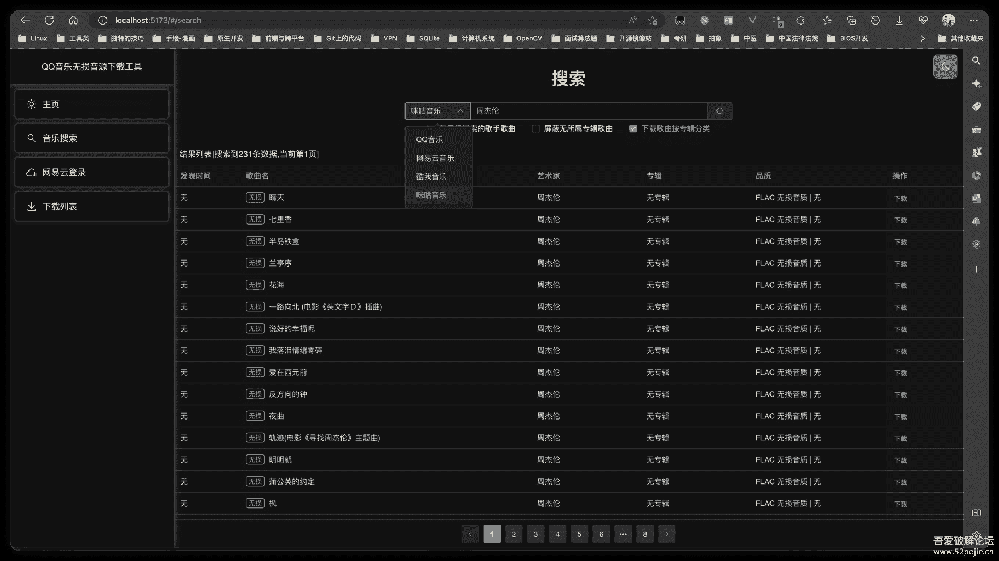

`img_2.png` (376.3 KB，下载次数: 1)

[附件原图](https://www.52pojie.cn/forum.php?mod=attachment&aid=MjU5NDM3OXw0NzcwNjQ5MnwxNzkzNTY5NjY0fDE2ODA4NnwxNzUzNTg1&nothumb=yes)

2023-3-8 01:50 上传

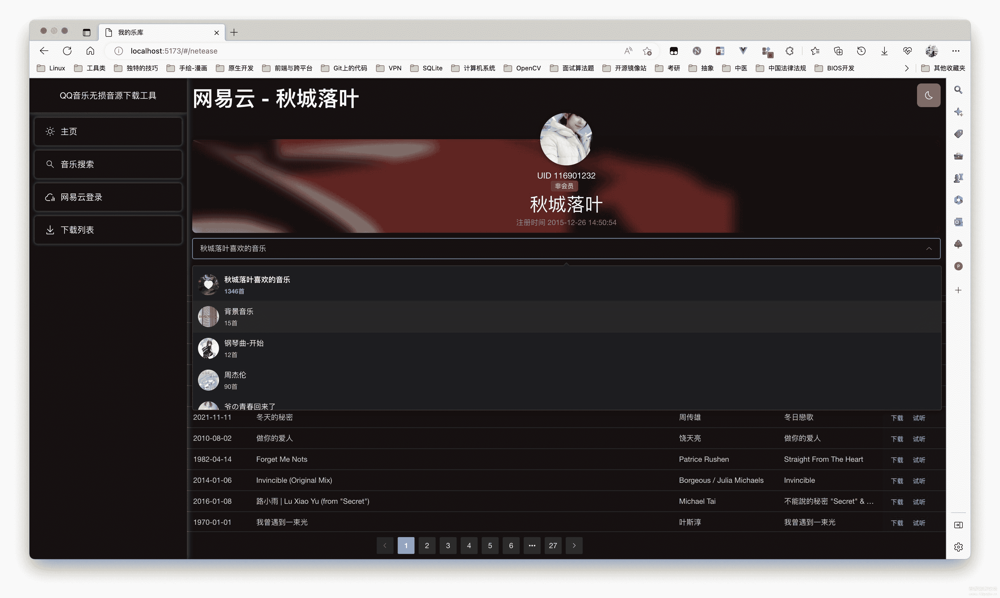

`16780178047552.jpg` (494.39 KB，下载次数: 1)

[附件原图](https://www.52pojie.cn/forum.php?mod=attachment&aid=MjU5NDYyOXxlYzE2YjVlN3wxNzkzNTY5NjY0fDE2ODA4NnwxNzUzNTg1&nothumb=yes)

2023-3-5 20:04 上传
