# [Android 原创] 某视频app分析破解-转了一圈又回到原点

- 原帖：https://www.52pojie.cn/forum.php?mod=viewthread&tid=1755792
- 抓取时间：2026-11-01T21:47:37

朋友分享一个视频 app，非会员每天可以看一次免费视频。拿来 [//www.52pojie.cn](https://www.52pojie.cn) 下。

想直接看结果的直接看最后部分。

## 推广破解与抓包

推广可以换 3 天会员，我们还是先从推广这里破解，毕竟不需要修改程序，兑换的会员永久可用，后期升级也不用再次破解。第一步 抓包：

```
{"sign=75708acd1f8b068edb4ffe4c523e9ed8","data=6d62546b省略76ee5","_ver=v1","timestamp=1677588163"}
```

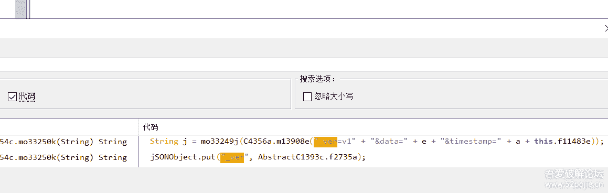

`1.png` (20.95 KB，下载次数: 1)，2023-3-8 16:27 上传，[附件下载](https://www.52pojie.cn/forum.php?mod=attachment&aid=MjU5NTA3NXwwNWRjYWQwNnwxNzkzNTY5NjU1fDE2ODA4NnwxNzU1Nzky&nothumb=yes)

## Jadx 追踪加密调用

Jadx 打开，搜索 “`_ver`”，结果太多，前面加个双引号再搜索。

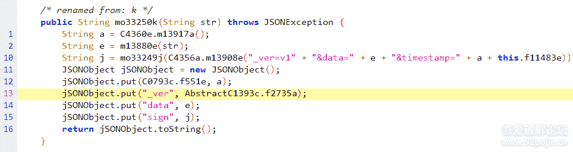

`2.png` (33.2 KB，下载次数: 0)，2023-3-8 16:27 上传，[附件下载](https://www.52pojie.cn/forum.php?mod=attachment&aid=MjU5NTA3NnwwZDYyYWIzMXwxNzkzNTY5NjU1fDE2ODA4NnwxNzU1Nzky&nothumb=yes)

只有两条，点进去发现还是在一个位置。`_ver`、`data`、`sign` 都对上了，`f551e` 其实就是 `timestamp`。可以看到 `data` 数据是执行 `m13880e`，Ctrl+单击 `m13880e`。

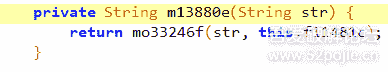

`3.png` (10.96 KB，下载次数: 0)，2023-3-8 16:27 上传，[附件下载](https://www.52pojie.cn/forum.php?mod=attachment&aid=MjU5NTA3N3wwZjIwNmNiZXwxNzkzNTY5NjU1fDE2ODA4NnwxNzU1Nzky&nothumb=yes)

继续 Ctrl+单击 `mo33246f`


`4.png` (10.89 KB，下载次数: 0)，2023-3-8 16:27 上传，[附件下载](https://www.52pojie.cn/forum.php?mod=attachment&aid=MjU5NTA3OHwxNTU1YmFiNnwxNzkzNTY5NjU1fDE2ODA4NnwxNzU1Nzky&nothumb=yes)

继续 Ctrl+单击 `EncryptUtil.encrypt`

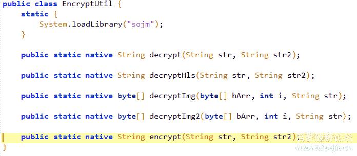

`5.png` (27.04 KB，下载次数: 0)，2023-3-8 16:27 上传，[附件下载](https://www.52pojie.cn/forum.php?mod=attachment&aid=MjU5NTA3OXw4M2ZkYTg1MXwxNzkzNTY5NjU1fDE2ODA4NnwxNzU1Nzky&nothumb=yes)

## 分析 `libsojm.so`

又是调用 `libsojm.so` 模块。解压 apk，找到 `libsojm.so`，用 IDA 载入。

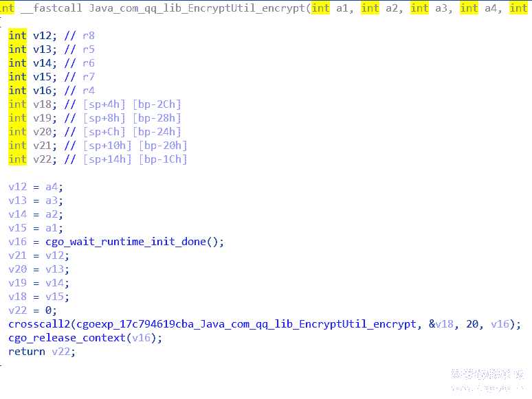

`6.png` (40.9 KB，下载次数: 0)，2023-3-8 16:27 上传，[附件下载](https://www.52pojie.cn/forum.php?mod=attachment&aid=MjU5NTA4MHwwZGM2NDNmMHwxNzkzNTY5NjU1fDE2ODA4NnwxNzU1Nzky&nothumb=yes)

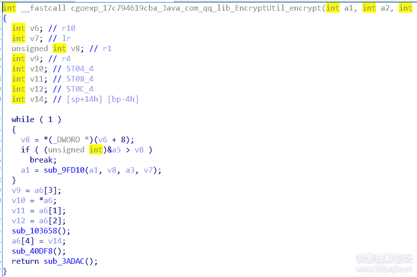

`7.png` (43.29 KB，下载次数: 0)，2023-3-8 16:27 上传，[附件下载](https://www.52pojie.cn/forum.php?mod=attachment&aid=MjU5NTA4MXwzMThhZjYzZXwxNzkzNTY5NjU1fDE2ODA4NnwxNzU1Nzky&nothumb=yes)

## 定位解密函数

然后混淆的太厉害，水平有限，搞不懂。尝试新写个 app 调用 `libsojm.so`，直接崩溃，应该是 so 内部有限制。看来想解密是不行了。回到上面 `EncryptUtil.encrypt` 的地方发现也有个几个函数，盲猜 `decrypt` 应该是解密的函数，`decryptHls` 解密视频数据，`decryptImg` 解密图片数据。`decrypt` 上右击-查找用例。

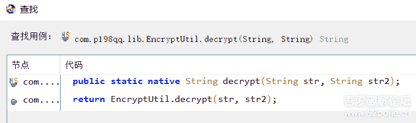

`8.png` (20.35 KB，下载次数: 0)，2023-3-8 16:27 上传，[附件下载](https://www.52pojie.cn/forum.php?mod=attachment&aid=MjU5NTA4Mnw3OTg5NTRmM3wxNzkzNTY5NjU1fDE2ODA4NnwxNzU1Nzky&nothumb=yes)

点击第二条。

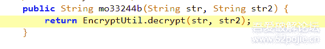

`9.png` (10.96 KB，下载次数: 0)，2023-3-8 16:27 上传，[附件下载](https://www.52pojie.cn/forum.php?mod=attachment&aid=MjU5NTA4M3xiMDc3MmE5ZXwxNzkzNTY5NjU1fDE2ODA4NnwxNzU1Nzky&nothumb=yes)

同样 `mo33244b` 右击-查找用例

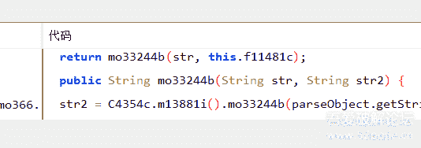

`10.png` (13.52 KB，下载次数: 0)，2023-3-8 16:27 上传，[附件下载](https://www.52pojie.cn/forum.php?mod=attachment&aid=MjU5NTA4NHwzZjg4ODgxMXwxNzkzNTY5NjU1fDE2ODA4NnwxNzU1Nzky&nothumb=yes)

进第一条

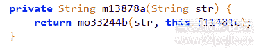

`11.png` (10.02 KB，下载次数: 0)，2023-3-8 16:27 上传，[附件下载](https://www.52pojie.cn/forum.php?mod=attachment&aid=MjU5NTA4NXxlZjUzYmEwYXwxNzkzNTY5NjU1fDE2ODA4NnwxNzU1Nzky&nothumb=yes)

继续 `m13878a` 右击-查找用例

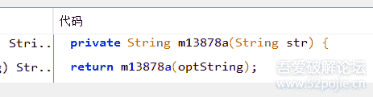

`12.png` (11.05 KB，下载次数: 1)，2023-3-8 16:27 上传，[附件下载](https://www.52pojie.cn/forum.php?mod=attachment&aid=MjU5NTA4Nnw4NGQ5MjgzNnwxNzkzNTY5NjU1fDE2ODA4NnwxNzU1Nzky&nothumb=yes)

进第二条

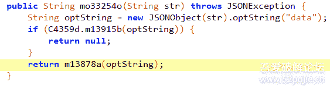

`13.png` (17.48 KB，下载次数: 1)，2023-3-8 16:27 上传，[附件下载](https://www.52pojie.cn/forum.php?mod=attachment&aid=MjU5NTA4N3xkNjBiMjliYnwxNzkzNTY5NjU1fDE2ODA4NnwxNzU1Nzky&nothumb=yes)

## 使用 MT 管理器注入日志

果然是获取返回数据中的 `data`，然后解密。我们可以用 MT 管理器的注入日志功能来打印出解密后的数据。

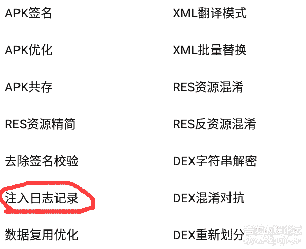

`14.png` (63.11 KB，下载次数: 0)，2023-3-8 16:27 上传，[附件下载](https://www.52pojie.cn/forum.php?mod=attachment&aid=MjU5NTA4OHwxNWY2MmIyZnwxNzkzNTY5NjU1fDE2ODA4NnwxNzU1Nzky&nothumb=yes)

模拟器中打开 MT 管理器，找到 app 点击，左下角功能，注入日志记录。

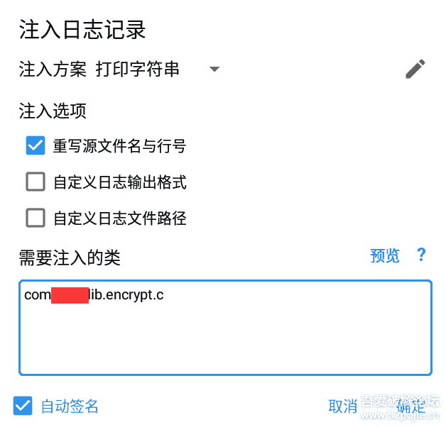

`15.png` (50.14 KB，下载次数: 0)，2023-3-8 16:27 上传，[附件下载](https://www.52pojie.cn/forum.php?mod=attachment&aid=MjU5NTA4OXw4ZmZlNTZiOHwxNzkzNTY5NjU1fDE2ODA4NnwxNzU1Nzky&nothumb=yes)

回到 jadx 中标签栏右击-复制类名 “`com.省略.lib.encrypt.C4354c`”，`C4354c` 是便于我们阅读 jadx 自己命名的名称，只保留最后一位，真实类名是 `com.省略.lib.encrypt.c`，粘贴到 MT 管理器中，然后确定。会生成一个 `_log` 结尾的 app。


`16.png` (25.04 KB，下载次数: 1)，2023-3-8 16:27 上传，[附件下载](https://www.52pojie.cn/forum.php?mod=attachment&aid=MjU5NTA5MHw0MmQxM2U4ZXwxNzkzNTY5NjU1fDE2ODA4NnwxNzU1Nzky&nothumb=yes)

点击新的 app-查看-点击 `classes.dex`-DEX编辑器++-全选-确定。

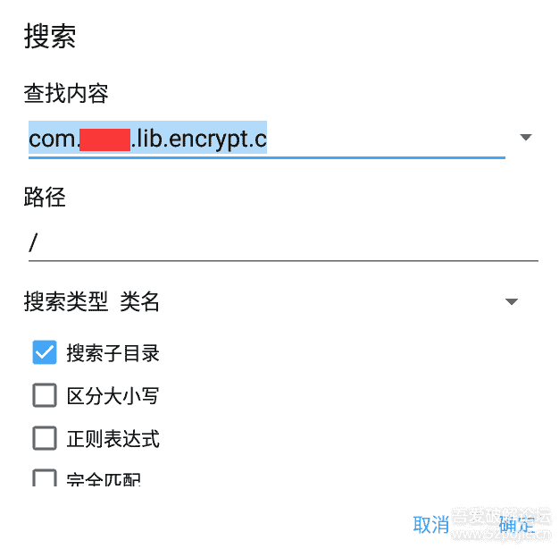

`17.png` (39.35 KB，下载次数: 0)，2023-3-8 16:27 上传，[附件下载](https://www.52pojie.cn/forum.php?mod=attachment&aid=MjU5NTA5MXw3YzQ0YmMxY3wxNzkzNTY5NjU1fDE2ODA4NnwxNzU1Nzky&nothumb=yes)

搜索-新的搜索-搜索类名 `com.省略.lib.encrypt.c` 结果就一个，点击进去。

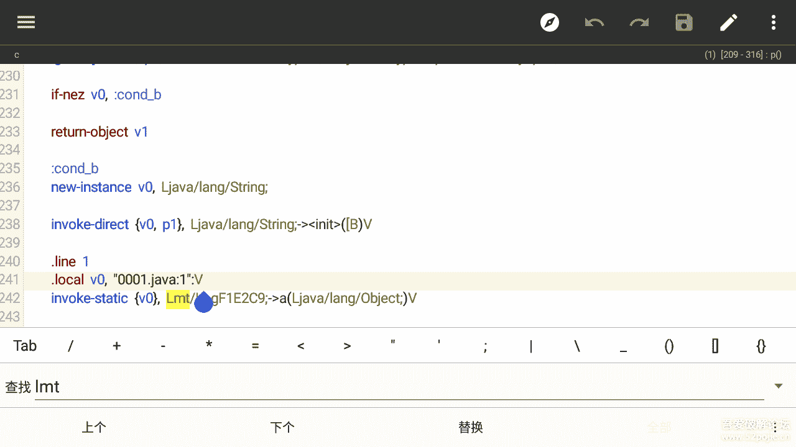

`18.png` (86.42 KB，下载次数: 0)，2023-3-8 16:27 上传，[附件下载](https://www.52pojie.cn/forum.php?mod=attachment&aid=MjU5NTA5Mnw3NWE3ZTFkYnwxNzkzNTY5NjU1fDE2ODA4NnwxNzU1Nzky&nothumb=yes)

点击右上角三个点-搜索-`Lmt`-下一个 把这两行剪切，这就是 MT 管理器注入的日志记录功能。


```smali
  .local v0, "0001.java:1":V

    invoke-static {v0}, Lmt/LogF1E2C9;->a(Ljava/lang/Object;)V
```

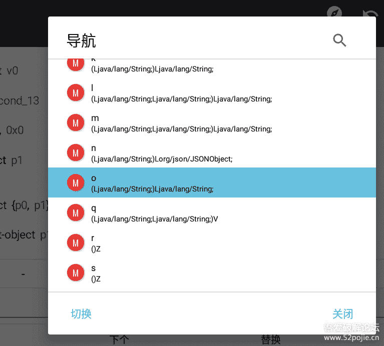

`19.png` (60.51 KB, 下载次数: 1)

[href="forum.php?mod=attachment&aid=MjU5NTA5M3xhNmUwZDk0YXwxNzkzNTY5NjU1fDE2ODA4NnwxNzU1Nzky&nothumb=yes" target="_blank"](https://www.52pojie.cn/forum.php?mod=attachment&aid=MjU5NTA5M3xhNmUwZDk0YXwxNzkzNTY5NjU1fDE2ODA4NnwxNzU1Nzky&nothumb=yes)

2023-3-8 16:27 上传

点击右上角左边的指南针按钮，选择M图标`o`的方法点切换。因为上面分析了我们要记录`mo33254o`中的解密数据，所以选择`o`，M表示method方法。

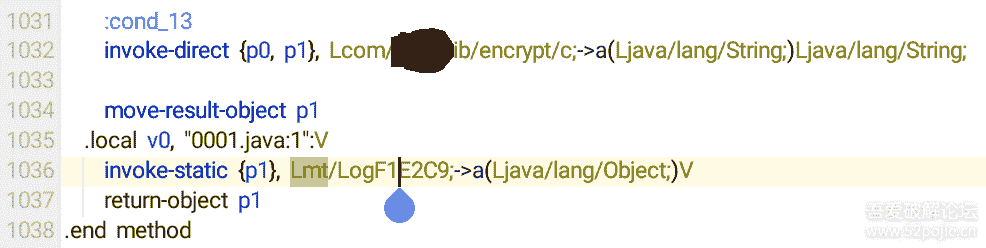

`20.png` (58.49 KB, 下载次数: 0)

[href="forum.php?mod=attachment&aid=MjU5NTQ2N3wwN2E3ZmMwZnwxNzkzNTY5NjU1fDE2ODA4NnwxNzU1Nzky&nothumb=yes" target="_blank"](https://www.52pojie.cn/forum.php?mod=attachment&aid=MjU5NTQ2N3wwN2E3ZmMwZnwxNzkzNTY5NjU1fDE2ODA4NnwxNzU1Nzky&nothumb=yes)

2023-3-10 10:31 上传

向下找到`method`结尾的地方。1032行可以看出调用`com.省略.lib.encrypt.c`中的`a`方法，就是上面Jadx的`m13878a`。1034是把结果给`p1`,1036行返回结果。所以我们在1035行添加日志记录，再结果出来还未返回的时候记录。粘贴上面剪切的代码，`v0`改为`p1`,然后一路返回，保存，签名。安装新的app，打开app，然后在`MT2/logs`目录下会有`.log`文件。打开发现如下的数据:`{"daily_view":1,"data":{省略省略"type":"android","version":"5.7.1","web_url":""}},"isVip":false,"msg":null,"status":200}`直接看到“`isVip`”。。。简单问题想复杂了。。。从这里开始看

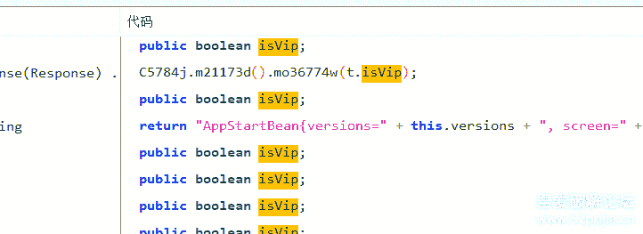

`21.png` (20.85 KB, 下载次数: 0)

[href="forum.php?mod=attachment&aid=MjU5NTA5NXxkZjVlNWFiNnwxNzkzNTY5NjU1fDE2ODA4NnwxNzU1Nzky&nothumb=yes" target="_blank"](https://www.52pojie.cn/forum.php?mod=attachment&aid=MjU5NTA5NXxkZjVlNWFiNnwxNzkzNTY5NjU1fDE2ODA4NnwxNzU1Nzky&nothumb=yes)

2023-3-8 16:27 上传

回到Jadx，搜索`isVip`，点第二条。

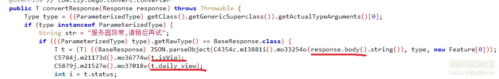

`22.png` (30.19 KB, 下载次数: 0)

[href="forum.php?mod=attachment&aid=MjU5NTA5NnwxMDA1ZjRmNHwxNzkzNTY5NjU1fDE2ODA4NnwxNzU1Nzky&nothumb=yes" target="_blank"](https://www.52pojie.cn/forum.php?mod=attachment&aid=MjU5NTA5NnwxMDA1ZjRmNHwxNzkzNTY5NjU1fDE2ODA4NnwxNzU1Nzky&nothumb=yes)

2023-3-8 16:28 上传

`response.body`、`isVip`、`daily_view`，猜测是获取返回信息，然后提取`isVip`和`daily_view`。上面的“`服务器异常,请稍后再试`”可以用来定位。

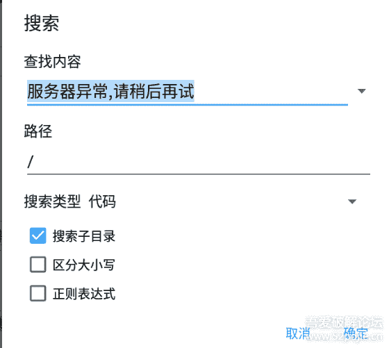

`23.png` (44.77 KB, 下载次数: 0)

[href="forum.php?mod=attachment&aid=MjU5NTA5N3w2N2EwMzQ1ZHwxNzkzNTY5NjU1fDE2ODA4NnwxNzU1Nzky&nothumb=yes" target="_blank"](https://www.52pojie.cn/forum.php?mod=attachment&aid=MjU5NTA5N3w2N2EwMzQ1ZHwxNzkzNTY5NjU1fDE2ODA4NnwxNzU1Nzky&nothumb=yes)

2023-3-8 16:28 上传

MT搜索“`服务器异常,请稍后再试`”，搜索类型为代码。也可以用上面的类定位方法。Jadx中类名为`AbstractC5124g`，所以选择`g`的那条。

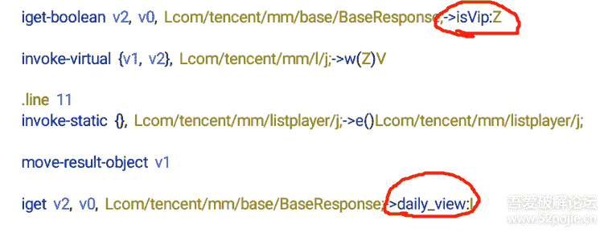

`24.png` (79.79 KB, 下载次数: 0)

[href="forum.php?mod=attachment&aid=MjU5NTA5OHw5ZjkwOTZiNnwxNzkzNTY5NjU1fDE2ODA4NnwxNzU1Nzky&nothumb=yes" target="_blank"](https://www.52pojie.cn/forum.php?mod=attachment&aid=MjU5NTA5OHw5ZjkwOTZiNnwxNzkzNTY5NjU1fDE2ODA4NnwxNzU1Nzky&nothumb=yes)

2023-3-8 16:28 上传

向下找到`isVip`和`daily_view`。

修改如上图。然后本地会员破解完成。兜兜转转又回到原点，一开始就搜索`isVip`的话就一步到位了。只是简单破解，能看免费视频了，其他功能再慢慢研究吧。
