# [Android 原创] 记一次带壳子的hook体验

- 原帖：[https://www.52pojie.cn/forum.php?mod=viewthread&tid=1756155](https://www.52pojie.cn/forum.php?mod=viewthread&tid=1756155)
- 抓取时间：2026-11-01T21:47:27

如果图裂了请下载 pdf 查看，下次我会换图床的。`记一次带壳子的hook体验.pdf` [下载链接](https://wwpv.lanzoue.com/iuuI90po44qj)

## 记一次带壳子的hook体验

### 前言

学完正己老师的 [https://www.52pojie.cn/thread-1740944-1-1.html](https://www.52pojie.cn/thread-1740944-1-1.html) 后，我们知道 xposed 的 hook 可以对加壳应用生效。正好 NeatReader 的安卓端加了 360 壳，我们就以它为例应用一下对加壳应用的 hook。

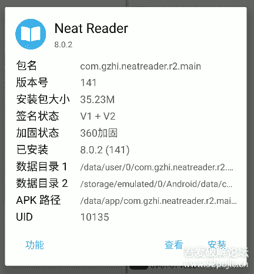

`14f76384075c4effbcd978e88e7ff547.png` (80.28 KB, 下载次数: 2)

[附件](https://www.52pojie.cn/forum.php?mod=attachment&aid=MjU5NTMzM3xiOTA3M2I0MHwxNzkzNTY5NjQ1fDE2ODA4NnwxNzU2MTU1&nothumb=yes)

2023-3-9 17:07 上传

NeatReader 在安卓端是免费软件，除云存储外没有使用限制。因此本次 hook 仅实现开启本地会员，使底部的“会员”一栏消失。

### 准备工作

首先下载 [https://wwpv.lanzoue.com/i4uHQ0ndk2wb](https://wwpv.lanzoue.com/i4uHQ0ndk2wb)，将它安装到 [https://www.52pojie.cn/thread-1135060-1-1.html](https://www.52pojie.cn/thread-1135060-1-1.html) 手机上脱壳，将 [https://wwpv.lanzoue.com/iNO9h0ndjzwd](https://wwpv.lanzoue.com/iNO9h0ndjzwd) 删掉类重复的（一般也就是大小相同的），并用 `mt/np` 做 `dex` 修复，然后 [https://wwpv.lanzoue.com/i0c4U0ndk0tg](https://wwpv.lanzoue.com/i0c4U0ndk0tg)，这个 `zip` 文件可以直接拖入 `jadx` 分析，如下图所示：

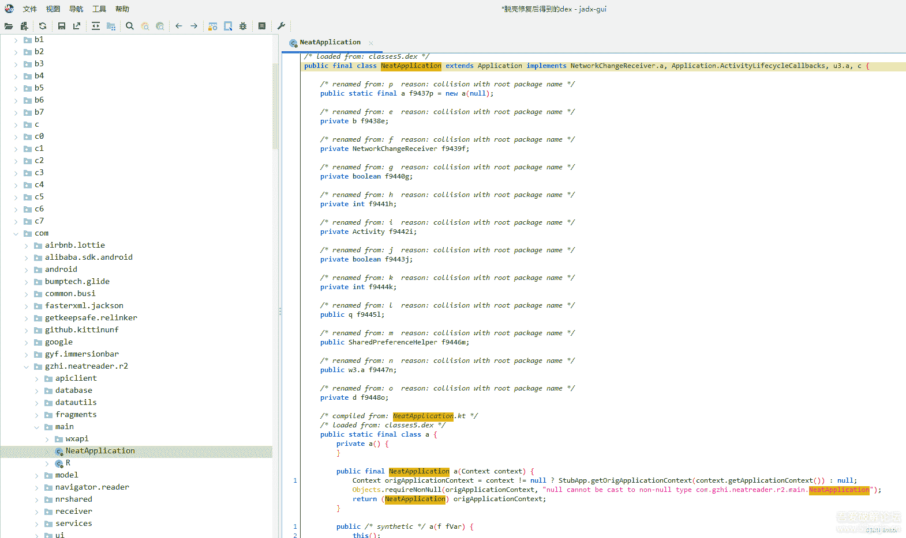

`b66c0ac139d143db9836c3e80dc58591.png` (120.42 KB, 下载次数: 1)

[附件](https://www.52pojie.cn/forum.php?mod=attachment&aid=MjU5NTMzNHwwYWU1ZjQ1ZHwxNzkzNTY5NjQ1fDE2ODA4NnwxNzU2MTU1&nothumb=yes)

2023-3-9 17:08 上传

现在将 app 安装到 pixel2xl 上，这个手机已经 `root` 并解锁 bl，刷入了 Magisk 和 lsposed：

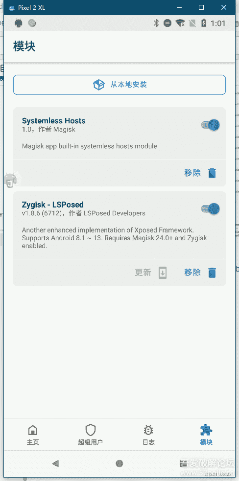

`d1d2a84d2aa745f6869df127a1afe33f.png` (87.88 KB, 下载次数: 2)

[附件](https://www.52pojie.cn/forum.php?mod=attachment&aid=MjU5NTMzNXwxMmUwMDYyYnwxNzkzNTY5NjQ1fDE2ODA4NnwxNzU2MTU1&nothumb=yes)

2023-3-9 17:08 上传

安装好原版 app 后，可以正常启动，接下来就可以着手分析代码开启本地会员了：

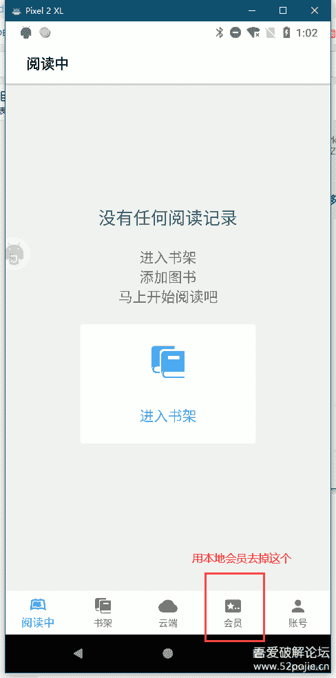

`145fc3a610ca4fb9aef2af7077118a9f.png` (60.5 KB, 下载次数: 3)

[附件](https://www.52pojie.cn/forum.php?mod=attachment&aid=MjU5NTMzNnxmNjE2ZTRlZHwxNzkzNTY5NjQ1fDE2ODA4NnwxNzU2MTU1&nothumb=yes)

2023-3-9 17:08 上传

### 分析

分析流程与破解无加固的 app 大同小异，首先搜索会员，看到明显的提示：

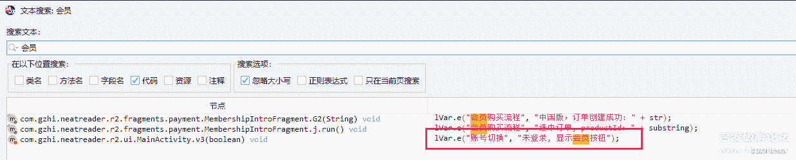

`a700751368b8443dbf708233326c8fec.png` (32.99 KB, 下载次数: 2)

[附件](https://www.52pojie.cn/forum.php?mod=attachment&aid=MjU5NTMzN3xlMmRkMzVjMnwxNzkzNTY5NjQ1fDE2ODA4NnwxNzU2MTU1&nothumb=yes)

2023-3-9 17:08 上传

这一行所在的方法如下：

```java
    private void v3(boolean z7) {
        com.gzhi.neatreader.r2.utils.l lVar = com.gzhi.neatreader.r2.utils.l.f9986a;
        lVar.e("账号切换", "updateBottomNavigationTab");
        if (p2()) {
            lVar.e("账号切换", "已登录");
            if (this.H.i() == 1) {
                lVar.e("账号切换", "VIP_USER 隐藏促销按钮");
                k3();
                return;
            } else if (q2()) {
                lVar.e("账号切换", "FREE_USER 显示促销按钮");
                if (z7) {
                    return;
                }
                if (this.f9896x.getMenu().size() == 5) {
                    if (r2()) {
                        return;
                    }
                    p3(com.gzhi.neatreader.r2.utils.g.f9982a.d(this.H.s().b()));
                    return;
                } else if (this.f9896x.getMenu().size() == 4) {
                    if (this.H.s() == null) {
                        this.f9896x.getMenu().add(0, R.id.im_premium, 4, getString(2131755099));
                    } else {
                        this.f9896x.getMenu().add(0, R.id.im_premium, 4, getString(2131755100));
                        p3(true);
                    }
                    e(4);
                    return;
                } else {
                    return;
                }
            } else {
                return;
            }
        }
        lVar.e("账号切换", "未登录, 显示会员按钮");
        if (z7) {
            return;
        }
        k3();
        this.f9896x.getMenu().add(0, R.id.im_premium, 4, getString(2131755099)).setIcon(R.drawable.ic_main_premium);
        e(4);
    }
```

分析可以得知 `p2()` 用于判断账号是否登录；`this.H.i()` 表示当前账号身份，会员为 `1`。

因此我们需要令 `p2()` 返回 `true`，令 `H.i()` 返回 `1`。

### 3. Hook 的代码实现

我们先创建一个 `NoActivity` 的项目：

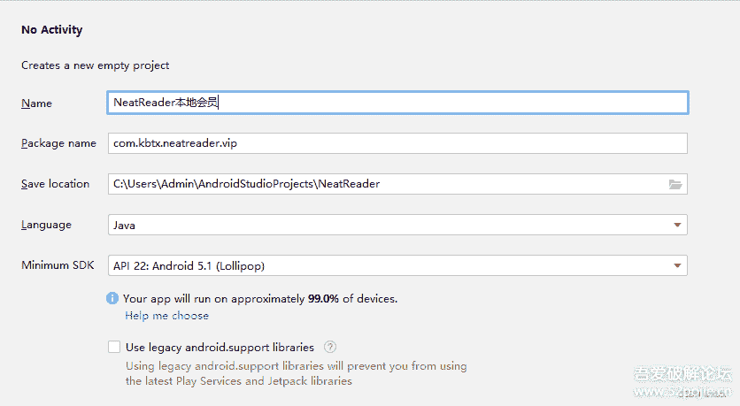

`c0e1fef0c15a4f46bfd9ddd326d27752.png` (29.17 KB, 下载次数: 1)

[附件](https://www.52pojie.cn/forum.php?mod=attachment&aid=MjU5NTMzOHw3ZTk1OTZjMXwxNzkzNTY5NjQ1fDE2ODA4NnwxNzU2MTU1&nothumb=yes)

2023-3-9 17:09 上传

在项目的 `gradle` 脚本中增加一行，使后续所有放入 `libs` 的名字带 `-api` 的 `jar` 包都能参与编译，且不会被打包：

```groovy
compileOnly fileTree(include: '*-api.jar', dir: 'libs')
```

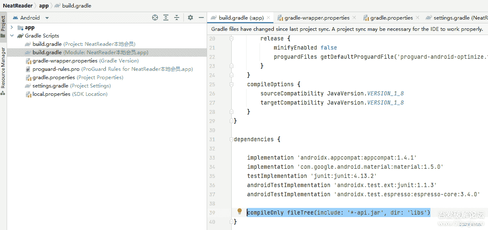

`0738ea10216f41bf9149915e318536bc.png` (100.67 KB, 下载次数: 2)

[附件](https://www.52pojie.cn/forum.php?mod=attachment&aid=MjU5NTMzOXxmOWI4ZTI3OXwxNzkzNTY5NjQ1fDE2ODA4NnwxNzU2MTU1&nothumb=yes)

2023-3-9 17:09 上传

将教程中的 `XposedBridge-89.jar` 改名为 `XposedBridge-89-api.jar` 放入 `app\libs` 目录下，重新用 `gradle sync` 同步项目即可完成导包。

然后我们在 `AndroidManifest` 中添加元数据：

接下来我们新建一个 `MyHook` 类，这里相比教程略微做一点变化，我们改为通过反射调用方法来注入 hook，因为把所有的 hook 方法都挂在回调函数里不利于阅读。

```java
public class MyHook implements IXposedHookLoadPackage {

    @Override
    public void handleLoadPackage(XC_LoadPackage.LoadPackageParam loadPackageParam) throws Throwable {
        if ("com.gzhi.neatreader.r2.main".equals(loadPackageParam.packageName)) {
            // 在attach方法中，可以取得真正的类加载器，而attach本身的加载器是壳代{过}{滤}理的加载器
            XposedHelpers.findAndHookMethod(Application.class, "attach", Context.class, new XC_MethodHook() {
                protected void afterHookedMethod(MethodHookParam param) throws Throwable {
                    Context context = (Context) param.args[0];
                    // 这是真正的类加载器
                    ClassLoader classLoader = context.getClassLoader();
                    // 取得当前类下的所有方法
                    Method[] methods = MyHook.class.getDeclaredMethods();
                    // 用反射调用所有以 mod_ 开头，且只有一个 ClassLoader 作为参数的方法
                    for (Method method : methods) {
                        if (method.getName().startsWith("mod_") && method.getParameterTypes().length == 1 && method.getParameterTypes()[0] == ClassLoader.class) {
                            method.setAccessible(true);
                            method.invoke(MyHook.this, classLoader);
                        }
                    }
                }
            });
        }
    }
}
```

然后在 `asset` 目录下新建 `xposed_init` 文件，将类的全限定名粘贴进去：

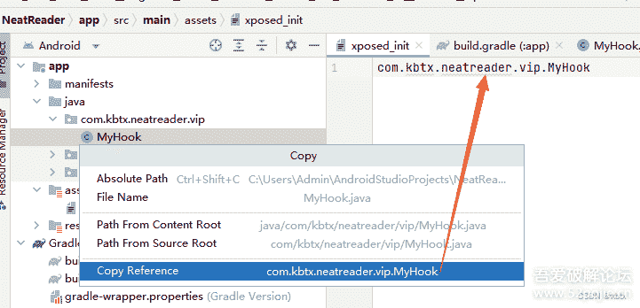

`4d8246094a174130843fd165a9e72074.png` (45 KB, 下载次数: 2)


[href="forum.php?mod=attachment&aid=MjU5NTM0MHw2YmFjNTgwNnwxNzkzNTY5NjQ1fDE2ODA4NnwxNzU2MTU1&nothumb=yes" target="_blank"](https://www.52pojie.cn/forum.php?mod=attachment&aid=MjU5NTM0MHw2YmFjNTgwNnwxNzkzNTY5NjQ1fDE2ODA4NnwxNzU2MTU1&nothumb=yes)

2023-3-9 17:09 上传

接下来只要在`MyHook`类中新增符合要求的方法，并将`jadx`复制的`xposed`片段粘贴进去就行了：

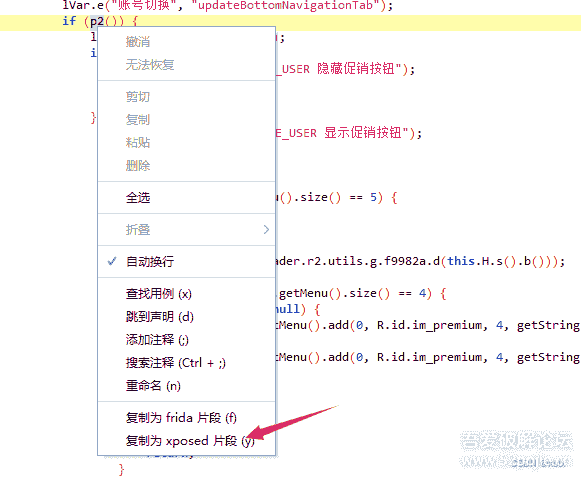

`0e974d2dd29a43c58a6b3e2333965f60.png` (34.75 KB, 下载次数: 2)

[href="forum.php?mod=attachment&aid=MjU5NTM0MXw0ZGIyYzU4OXwxNzkzNTY5NjQ1fDE2ODA4NnwxNzU2MTU1&nothumb=yes" target="_blank"](https://www.52pojie.cn/forum.php?mod=attachment&aid=MjU5NTM0MXw0ZGIyYzU4OXwxNzkzNTY5NjQ1fDE2ODA4NnwxNzU2MTU1&nothumb=yes)

2023-3-9 17:09 上传

如图，这个方法将自己设为已登录状态：

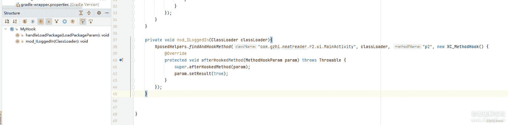

`2c2e19cb91e14681a1142043038c295b.png` (65.59 KB, 下载次数: 2)

[href="forum.php?mod=attachment&aid=MjU5NTM0MnxlNjMwNDM3M3wxNzkzNTY5NjQ1fDE2ODA4NnwxNzU2MTU1&nothumb=yes" target="_blank"](https://www.52pojie.cn/forum.php?mod=attachment&aid=MjU5NTM0MnxlNjMwNDM3M3wxNzkzNTY5NjQ1fDE2ODA4NnwxNzU2MTU1&nothumb=yes)

2023-3-9 17:10 上传

```
    private void mod_ILoggedIn(ClassLoader classLoader){
        XposedHelpers.findAndHookMethod("com.gzhi.neatreader.r2.ui.MainActivity", classLoader, "p2", new XC_MethodHook() {
            @Override
            protected void afterHookedMethod(MethodHookParam param) throws Throwable {
                super.afterHookedMethod(param);
                param.setResult(true);
            }
        });
    }
```

同理，这个方法将自己设为会员状态：

```
    private void mod_IamVIP(ClassLoader classLoader){
        XposedHelpers.findAndHookMethod("com.gzhi.neatreader.r2.utils.SharedPreferenceHelper", classLoader, "i", new XC_MethodHook() {
            @Override
            protected void afterHookedMethod(MethodHookParam param) throws Throwable {
                super.afterHookedMethod(param);
                param.setResult(1);
            }
        });
    }
```

编译安装，然后到管理界面激活模块：

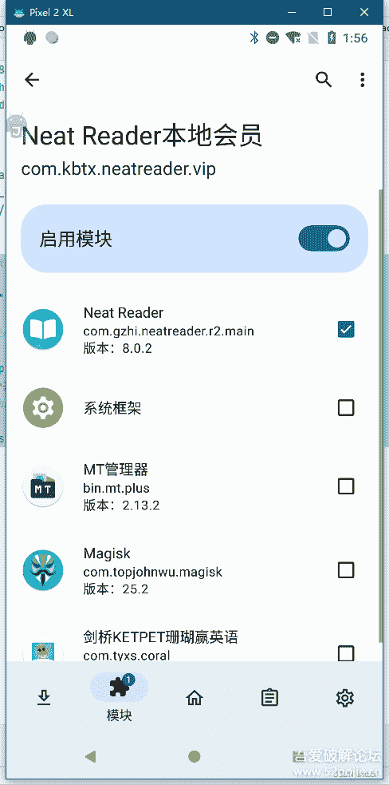

`a64a91f7c02f4bcf8805c5b8734f9102.png` (124.72 KB, 下载次数: 3)

[href="forum.php?mod=attachment&aid=MjU5NTM0M3wxODAzZGY5NHwxNzkzNTY5NjQ1fDE2ODA4NnwxNzU2MTU1&nothumb=yes" target="_blank"](https://www.52pojie.cn/forum.php?mod=attachment&aid=MjU5NTM0M3wxODAzZGY5NHwxNzkzNTY5NjQ1fDE2ODA4NnwxNzU2MTU1&nothumb=yes)

2023-3-9 17:10 上传

激活后再强行停止并重启NeatReader，发现会员一栏已经消失了：

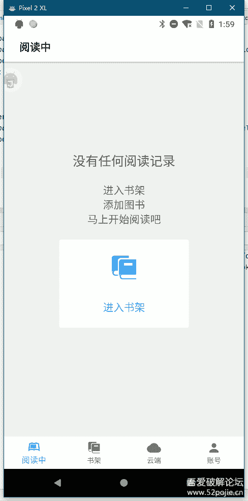

`aa74fbe8115e4f60a559ac3df1ea8b91.png` (54.33 KB, 下载次数: 1)

[href="forum.php?mod=attachment&aid=MjU5NTM0NHwwY2UyNTgyNHwxNzkzNTY5NjQ1fDE2ODA4NnwxNzU2MTU1&nothumb=yes" target="_blank"](https://www.52pojie.cn/forum.php?mod=attachment&aid=MjU5NTM0NHwwY2UyNTgyNHwxNzkzNTY5NjQ1fDE2ODA4NnwxNzU2MTU1&nothumb=yes)

2023-3-9 17:10 上传
