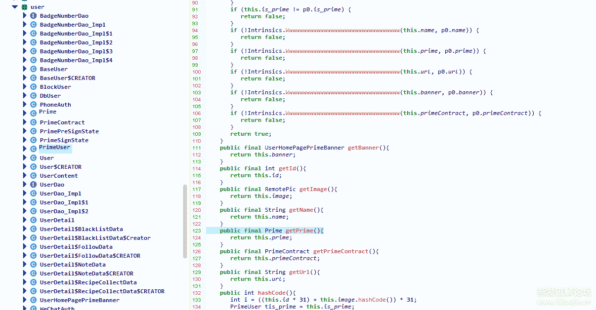
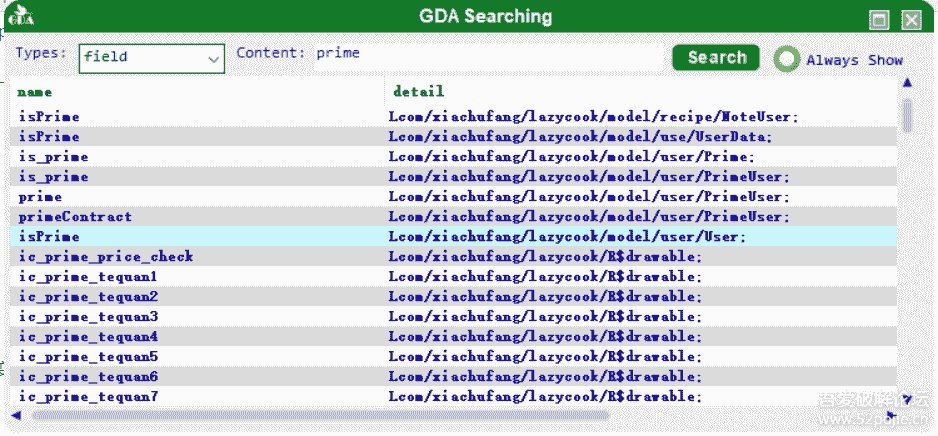
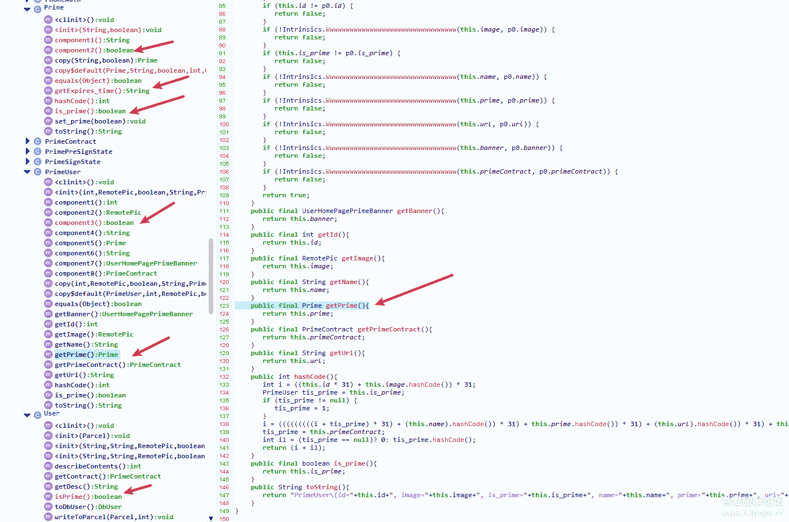
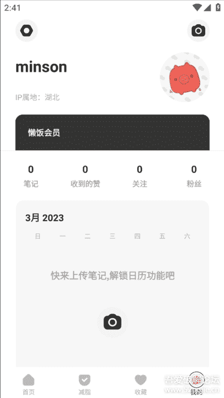

# [Android 原创] 懒饭app会员解锁

- 原帖：<https://www.52pojie.cn/forum.php?mod=viewthread&tid=1760575>
- 抓取时间：2026-11-01T21:47:11

最近老婆上班了，轮到我天天做饭了。于是下载了一个懒饭app天天搜食谱，很多菜要会员，这是我们不能忍的，只能自己动手了。

## 定位会员判断

拿着apk先直接就往GDA里面一丢，看看有没有有用的信息。一顿扫描直接就看到了下面的`user`包。

`Snipaste_2023-03-17_14-29-58.png`（103.54 KB，下载次数：2）；[下载附件](https://www.52pojie.cn/forum.php?mod=attachment&aid=MjU5ODc4OHwyMTE4YWQzY3wxNzkzNTY5NjI5fDE2ODA4NnwxNzYwNTc1&nothumb=yes)；上传时间：2023-3-17 14:30

通过类名，还有方法名，大致可以推断出判断是否是会员的变量为 `prime`。直接搜变量 `prime`。

`1111.png`（153.5 KB，下载次数：2）；[下载附件](https://www.52pojie.cn/forum.php?mod=attachment&aid=MjU5ODc4OXw0M2YxMWNjMHwxNzkzNTY5NjI5fDE2ODA4NnwxNzYwNTc1&nothumb=yes)；上传时间：2023-3-17 14:33

## 修改会员状态与有效期

然后进入到相关的类，把所有返回 `prime` 这个变量的值的方法返回值全改为 `true` 即可。

主要有三个类：`Prime`、`User`、`PrimeUser`。也可以改一下有效期，直接改 `getExpires_time()` 方法的返回值就行了。

`image.png`（175.18 KB，下载次数：1）；[下载附件](https://www.52pojie.cn/forum.php?mod=attachment&aid=MjU5ODc5NnxkNTlkYTBhNXwxNzkzNTY5NjI5fDE2ODA4NnwxNzYwNTc1&nothumb=yes)；上传时间：2023-3-17 14:39

## 打包验证

改完打包签名，安装效果如下，妈妈再也不担心我不会做菜了。

`2222241-27.png`（63.85 KB，下载次数：1）；[下载附件](https://www.52pojie.cn/forum.php?mod=attachment&aid=MjU5ODc5OHw4NWZhMTdmOXwxNzkzNTY5NjI5fDE2ODA4NnwxNzYwNTc1&nothumb=yes)；上传时间：2023-3-17 14:43
