# [Android 原创] 安卓8.1源码编译 以及 魔改指纹小试

- 原帖: https://www.52pojie.cn/forum.php?mod=viewthread&tid=1762675
- 抓取时间: 2026-11-01T21:47:07

## 一、前置工作

### 安装VMware 以及 Ubuntu18.4镜像

[//blog.csdn.net/weixin_43290551/article/details/125954709" target="_blank" rel="noopener noreferrer nofollow"](https://blog.csdn.net/weixin_43290551/article/details/125954709:rel="nofollow noopener" href="https)

### 解决无法复制粘贴

[//blog.csdn.net/qq_41940277/article/details/122610916" target="_blank" rel="noopener noreferrer nofollow"](https://blog.csdn.net/qq_41940277/article/details/122610916:rel="nofollow noopener" href="https)

### vscode安装

[//vscode.cdn.azure.cn/stable/5e805b79fcb6ba4c2d23712967df89a089da575b/code_1.76.1-1678294265_amd64.deb" target="_blank" rel="noopener noreferrer nofollow"](https://vscode.cdn.azure.cn/stable/5e805b79fcb6ba4c2d23712967df89a089da575b/code_1.76.1-1678294265_amd64.deb:rel="nofollow noopener" href="https)

`sudo dpkg -i 文件`

这一条命令就够了 `sudo snap install code`

### dpkg: 错误: 另外一个进程已经为 dpkg frontend 加锁

`sudo rm /var/lib/dpkg/lock-frontend`

`sudo rm /var/lib/dpkg/lock`

## 二、安装好编译环境

### 1、安装依赖包（可以在官网找到）

```
sudo apt update
sudo apt-get install git-core gnupg flex bison build-essential zip curl zlib1g-dev gcc-multilib g++-multilib libc6-dev-i386 lib32ncurses5-dev x11proto-core-dev libx11-dev lib32z1-dev libgl1-mesa-dev libxml2-utils xsltproc unzip fontconfig

sudo apt htop jnettop    使用時要加sudo

sudo apt install proxychains

sudo nano /etc/proxychains.conf  配置科學 

proxychains curl http://httpbin.org/ip
```

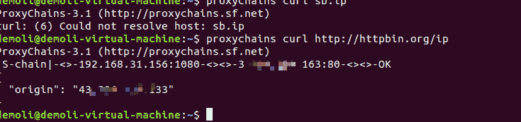

### 2、解压包和驱动

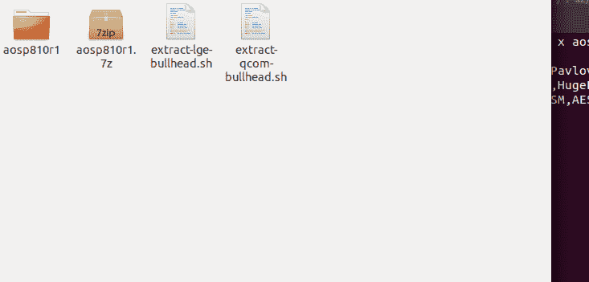

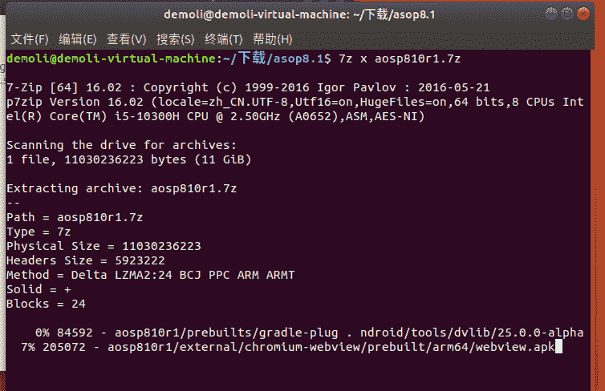

到20%的时候会暂停一下

### 3、安装python2.7

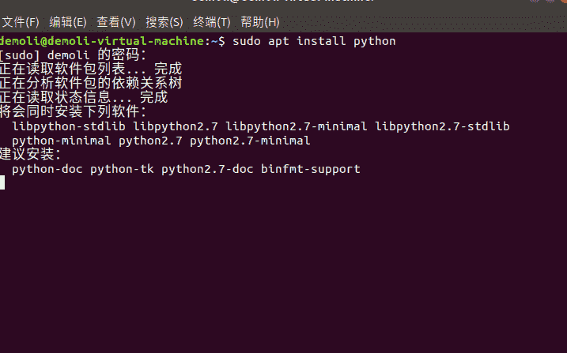

### 4、安裝驅動

按enter然後空格

給vendor權限 记得这个文件夹下面所有文件都要给权限

`sudo chmod 777 -R vendor/`

## 三、修改源码

### 去除所有本地化的设置，让命令能正确执行

在安卓源码根目录下找到 `/build/envsetup.sh` 文件，在文件的最后加入下面的代码

`export LC_ALL=C`

### 将java环境添加到环境变量

安卓8.1.0源码默认带了jdk

路径在 `/prebuilts/jdk/jdk8`，我选择将 `/prebuilts/jdk/jdk8/linux-x86/bin` 添加到了环境变量.

先打开 `.bashrc` 文件，在文件的最后加上 `export PATH=$PATH:/home/lingzhiyi/Documents/aosp-all/aosp-pixel810/aosp810r1/prebuilts/jdk/jdk8/linux-x86/bin`

## 四、编译

回到安卓根目录

```
source build/envsetup.sh
lunch 24 // lunch aosp_saifish-user
make -j6 // 6表示6个线程
```

到源码目录 `source build/envsetup.sh`

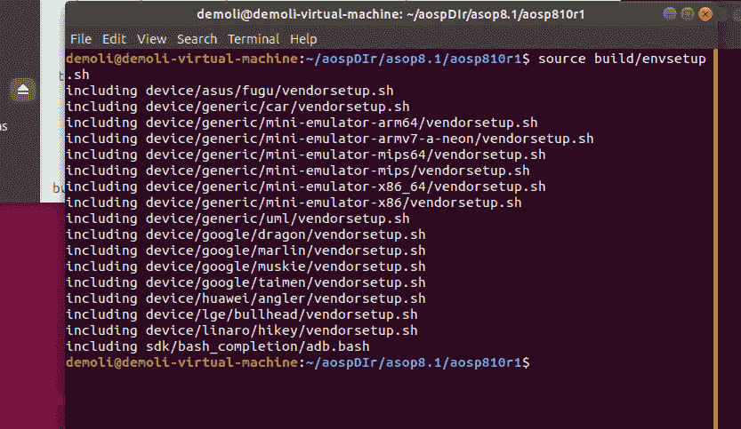

`lunch`

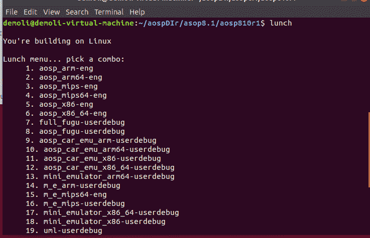

aosp_sailfish-user

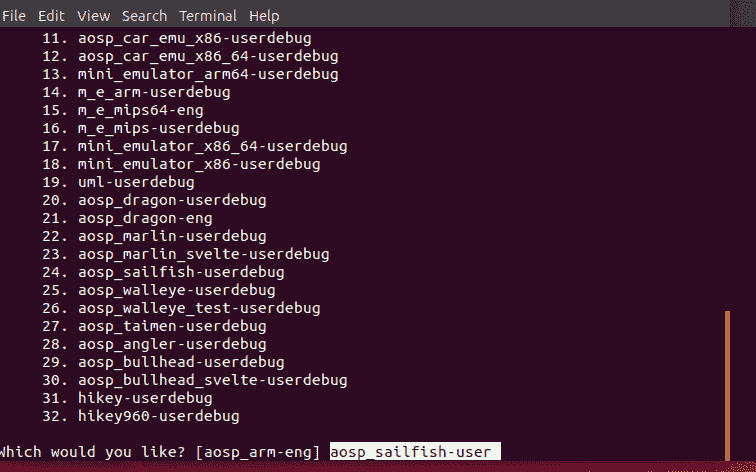

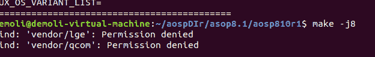

## 五、内置功能

### 1、内置frida的动态库

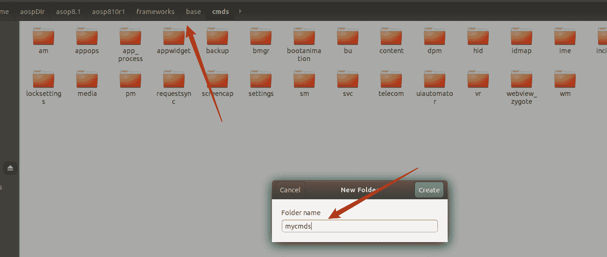

- 放置编译后的gadget库（32位以及64位）
- 配置到源码中
- 修改 `/build/make/target/product/core.mk` 文件，注意增加的地方

### 加载内置库


```
            app = data.info.makeApplication(data.restrictedBackupMode, null);

             // demoli-add start   
            String curPkgName = data.appInfo.packageName;
            String path_for_gadget = "/sdcard/" + curPkgName+"demoligadgethook";
            File path_curPkgName = new File(path_for_gadget);
            if(path_curPkgName.exists()){
                String arch = System.getProperty("os.arch");
                try{
                    if (arch != null && arch.contains("64")){
                        System.load("/system/lib64/demoli.so");
                    }else{
                        System.load("/system/lib/demoli.so");
                    }
                    Slog.e("demoli", "load gadget successful");
                }
                catch (Exception e) {
                    Slog.e("demoli", "demoli_failed=" + e.toString());
                }
            }
            // demoli-add end

            // demoli-add start
            //String curPkgName = app.getPackageName();
            String path_for_dex = "/sdcard/"+curPkgName+"demolidexhook.dex";
            File file = new File(path_for_dex);
            if(file.exists()){
                try {
                    //获取到 BaseDexClassLoader 的  pathList字段
                    // private final DexPathList pathList;
                    // find("BaseDexClassLoader","")
                    Field pathListField = BaseDexClassLoader.class.getDeclaredField("pathList");
                    //破坏封装，设置为可以调用
                    pathListField.setAccessible(true);
                    //拿到当前ClassLoader的pathList对象
                    Object pathListObj = pathListField.get(app.getClassLoader());
                    //获取当前ClassLoader的pathList对象的字节码文件（DexPathList ）
                    Class dexPathListClass = pathListObj.getClass();
                    //拿到DexPathList 的 dexElements字段
                    // private final Element[] dexElements；
                    Field dexElementsField = dexPathListClass.getDeclaredField("dexElements");
                    //破坏封装，设置为可以调用
                    dexElementsField.setAccessible(true);
                    //使用插件创建 ClassLoader
                    DexClassLoader pathClassLoader = new DexClassLoader(file.getPath(), file.getAbsolutePath(), null, app.getClassLoader());
                    //拿到插件的DexClassLoader 的 pathList对象
                    Object newPathListObj = pathListField.get(pathClassLoader);
                    //拿到插件的pathList对象的 dexElements变量
                    Object newDexElementsObj = dexElementsField.get(newPathListObj);
                    //拿到当前的pathList对象的 dexElements变量
                    Object dexElementsObj=dexElementsField.get(pathListObj);
                    int oldLength = Array.getLength(dexElementsObj);
                    int newLength = Array.getLength(newDexElementsObj);
                    //创建一个dexElements对象
                    Object concatDexElementsObject = Array.newInstance(dexElementsObj.getClass().getComponentType(), oldLength + newLength);
                    //先添加新的dex添加到dexElement
                    for (int i = 0; i  dexPathListClass2 = pathListObj2.getClass();
                    //拿到DexPathList 的 dexElements字段
                    // private final Element[] dexElements；
                    Field dexElementsField2 = dexPathListClass2.getDeclaredField("dexElements");
                    //破坏封装，设置为可以调用
                    dexElementsField2.setAccessible(true);
                    //使用插件创建 ClassLoader
                    DexClassLoader pathClassLoader2 = new DexClassLoader(file_apk.getPath(), file_apk.getAbsolutePath(), null, app.getClassLoader());
                    //拿到插件的DexClassLoader 的 pathList对象
                    Object newpathListObj2 = pathListField2.get(pathClassLoader2);
                    //拿到插件的pathList对象的 dexElements变量
                    Object newDexElementsObj2 = dexElementsField2.get(newpathListObj2);
                    //将插件的 dexElements对象设置给 当前ClassLoader的pathList对象
                    dexElementsField2.set(pathListObj2, newDexElementsObj2);
                    Slog.e("dexhook","demoli add apk successful!");
                } catch (Exception e) {
                    e.printStackTrace();
                }
            }else{
                Slog.e("apkhook",path_for_apk+" not exists");
            }
            // demoli add end
```
## 六、通用改机方案
- 加载这个文件
- 在 `/system/core/init/property_service.cpp` 中
然后需要把修改后的 `mybuild.prop` 加入到编译链中。安卓8是如下的方案，但是安卓10的修改路径不一样。需要放置在最后
- 自己创建这个文件
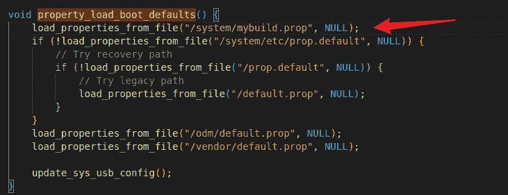
## 1、自定义 su
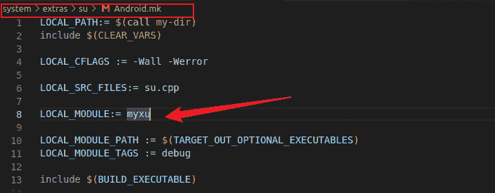
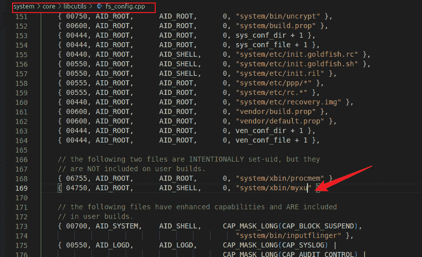
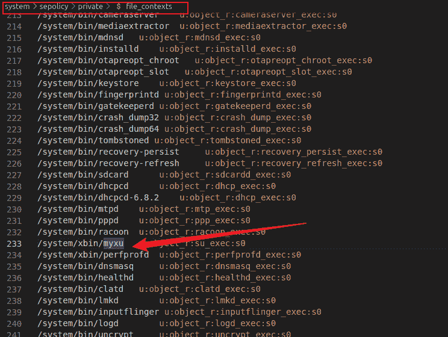
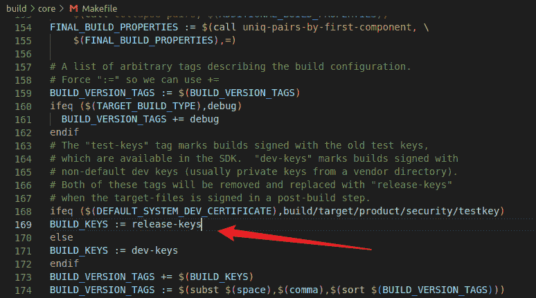
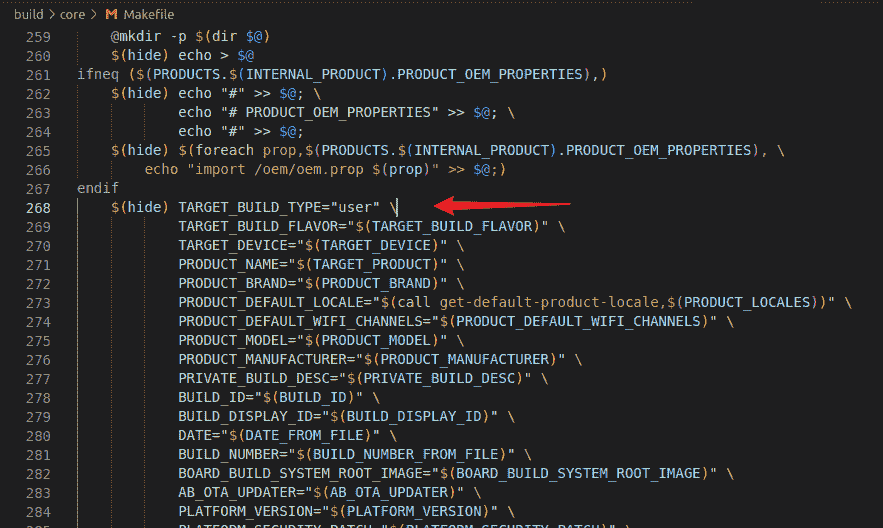
电脑太垃圾了 等我编译出来在发个效果
