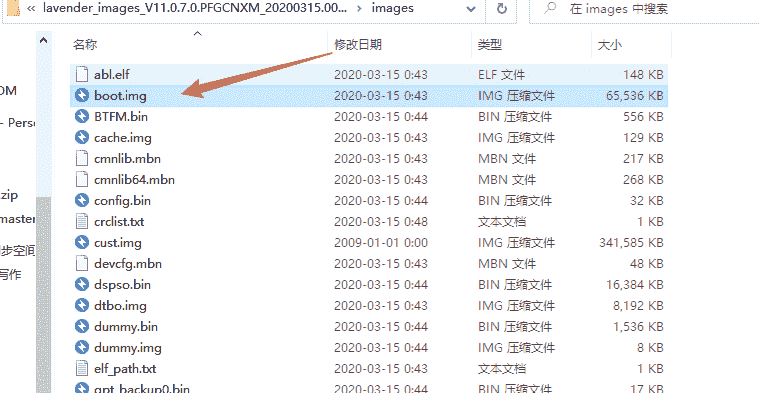
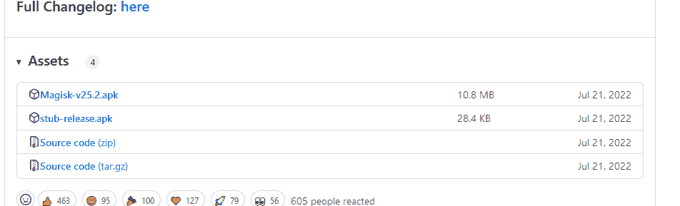

# [Android 原创] 刷Magisk + Shamiko 可以过一部分root检测
- 原帖: https://www.52pojie.cn/forum.php?mod=viewthread&tid=1763181
- 抓取时间: 2026-11-01T21:47:02

## 刷Magisk + Shamiko

### 一、打开usb调试

### 二、获取ROM版本的`boot.img`
- 在`rom`包中找这个`boot.img`

- `adb push`到手机`download`目录

### 三、下载Magisk

- https://github.com/topjohnwu/Magisk/releases
- 安装修补`boot.img`文件

### 四、刷入修补的文件
`fastboot flash boot magisk_patched-24300（版本号）_4BvPE（随机码）.img`

### 五、没解锁操
冤大头花30解锁原因是之前刷机的时候用官方的软件刷的时候给上锁了！

### 六、失败从来 第二种方案
- 刷`twrp`
- https://eu.dl.twrp.me/lavender/twrp-3.7.0_9-0-lavender.img
- `fastboot flash recovery twrp-3.3.1-0-bullhead.img`
- 传`magisk.zip`
- https://github.com/topjohnwu/Magisk/archive/refs/tags/v25.2.zip
- `adb reboot recovery`
- 为防止重启手机`MIUI`自动替换回官方`Recovery`，按住手机音量上键，同时电脑运行下面命令重启手机，直至进入`TWRP`界面。

```
fastboot reboot
```
