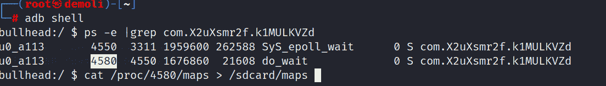
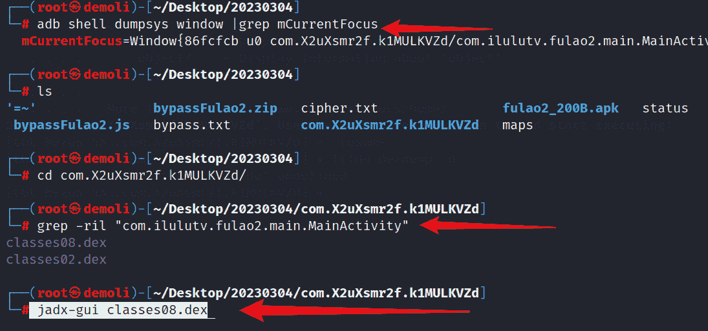
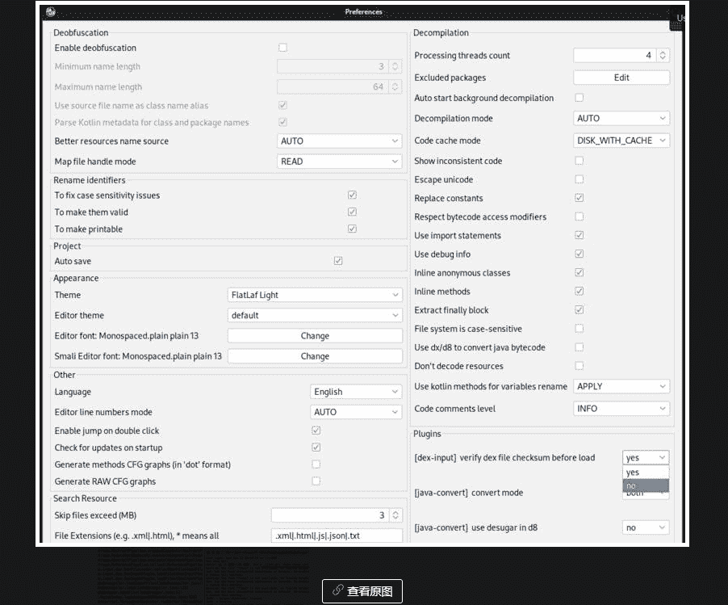

# [Android 原创] 初探frida反调试

- 原帖：https://www.52pojie.cn/forum.php?mod=viewthread&tid=1763350
- 抓取时间：2026-11-01T21:47:00

## 常见frida检测

### 1. 检测文件名（改名）、端口名 `27042`（改端口）、双进程保护（`spawn` 启动）

### 2. 检测 D-Bus

D-Bus 是一种进程间通信（IPC）和远程过程调用（RPC）机制，最初是为 Linux 开发的，目的是用一个统一的协议替代现有的和竞争的 IPC 解决方案。

```
遍历连接手机所有端口发送D-bus消息，如果返回"REJECT"这个特征则认为存在frida-server。
内存中存在frida rpc字符串，认为有frida-server

/*
- Mini-portscan to detect frida-server on any local port.
/
for(i = 0 ; i )&sa , sizeof sa) != -1) {
__android_log_print(ANDROID_LOG_VERBOSE, APPNAME,  "FRIDA DETECTION [1]: Open Port: %d", i);
memset(res, 0 , 7);
// send a D-Bus AUTH message. Expected answer is “REJECT"
send(sock, "\x00", 1, NULL);
send(sock, "AUTH\r\n", 6, NULL);
usleep(100);
if (ret = recv(sock, res, 6, MSG_DONTWAIT) != -1) {
if (strcmp(res, "REJECT") == 0) {
/ Frida server detected. Do something… /
}
}
close(sock);
}
```

检测 D-Bus 可以通过 hook 系统库函数，比如 `strstr`、`strcmp` 等等。

### 3. 检测 `/proc/pid/maps` 映射文件

### 4. 检测 `/proc/pid/tast/tid/stat/` 或者 `/proc/pid/task/tip/status`

因为 `so` 载入的时候，底层最后 `open` 去打开的。所以再用 frida 去 hook 应用中的 `open` 函数，看看读取了哪些 `so` 或者文件，可以看到最后断在了 `/proc/self/maps`。对于 3、4 有效。

### 5. 直接调用 `openat` 的 `syscall` 的检测

在 `text` 节表中搜索 `frida-gadget.so` / `frida-agent.so` 字符串，避免了 hook `libc` 来 anti-anti 的方法。

注入方式改为：

1. `frida-inject`
2. `ptrace` 注入 配置文件的形式注入
3. 编译 rom 注入

### 6. 从 inlinehook 角度检测 frida

- [bbs.kanxue.com/thread-269862.htm](https://bbs.kanxue.com/thread-269862.htm)（未学习）
- [zhuanlan.zhihu.com/p/557713016](https://zhuanlan.zhihu.com/p/557713016)

`hook_open` 函数可以查看是哪里检测了 `so` 文件。

```
function hook_open(){
    var pth = Module.findExportByName(null,"open");
    Interceptor.attach(ptr(pth),{
        onEnter:function(args){
            this.filename = args[0];
            console.log("",this.filename.readCString())
            if (this.filename.readCString().indexOf(".so") != -1){
                args[0] = ptr(0)
            }
        },onLeave:function(retval){
            return retval;
        }
    })
}
setImmediate(hook_open)
```

替换一个正常的：

```
function main() {
  const openPtr = Module.getExportByName('libc.so', 'open');
  const open = new NativeFunction(openPtr, 'int', ['pointer', 'int']);
  var readPtr = Module.findExportByName("libc.so", "read");
  var read = new NativeFunction(readPtr, 'int', ['int', 'pointer', "int"]);
  var fakePath = "/data/data/com.app/maps";
  var file = new File(fakePath, "w");
  var buffer = Memory.alloc(512);
  Interceptor.replace(openPtr, new NativeCallback(function (pathnameptr, flag) {
      var pathname = Memory.readUtf8String(pathnameptr);
      var realFd = open(pathnameptr, flag);
      if (pathname.indexOf("maps") >= 0) {
          while (parseInt(read(realFd, buffer, 512)) !== 0) {
              var oneLine = Memory.readCString(buffer);
              if (oneLine.indexOf("tmp") === -1) {
                  file.write(oneLine);
              }
          }
          var filename = Memory.allocUtf8String(fakePath);
          return open(filename, flag);
      }
      var fd = open(pathnameptr, flag);
      return fd;
  }, 'int', ['pointer', 'int']));
}
setImmediate(main)
```

### 检测点是 `maps`、`status`

1. 替换
2. 映射



使用方法：把解压后的 `maps` 和 `status` 文件拷贝到 `sdcard` 目录下，并 `chmod` 给 `777` 权限，然后 `frida` 使用 `bypassFulao2.js` 脚本。

查看当前运行软件的包名和类名：

`adb shell dumpsys window |grep mCurrentFocus`

去脱壳的 `dex` 文件夹中搜索：

`grep -ril "com.ilulutv.fulao2.main.MainActivity"`

`jadx` 查看：

`jadx-gui classes08.dex`



### 新版 `jadx` 修改 `checknum`


