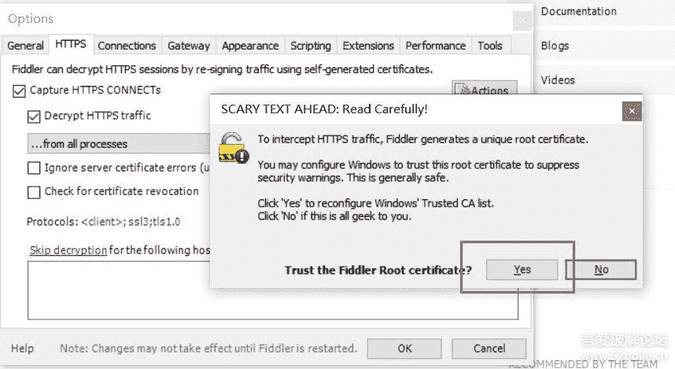
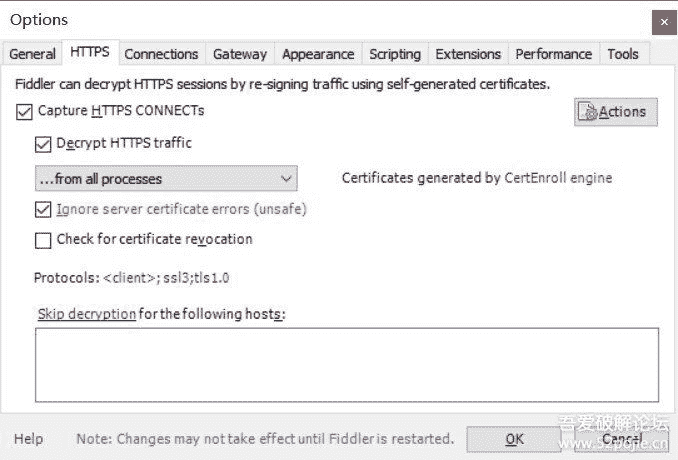
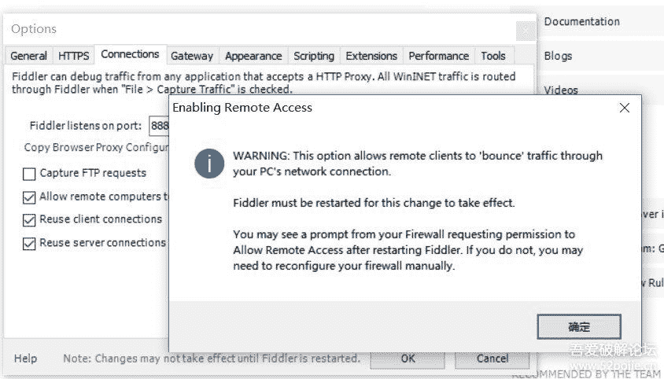
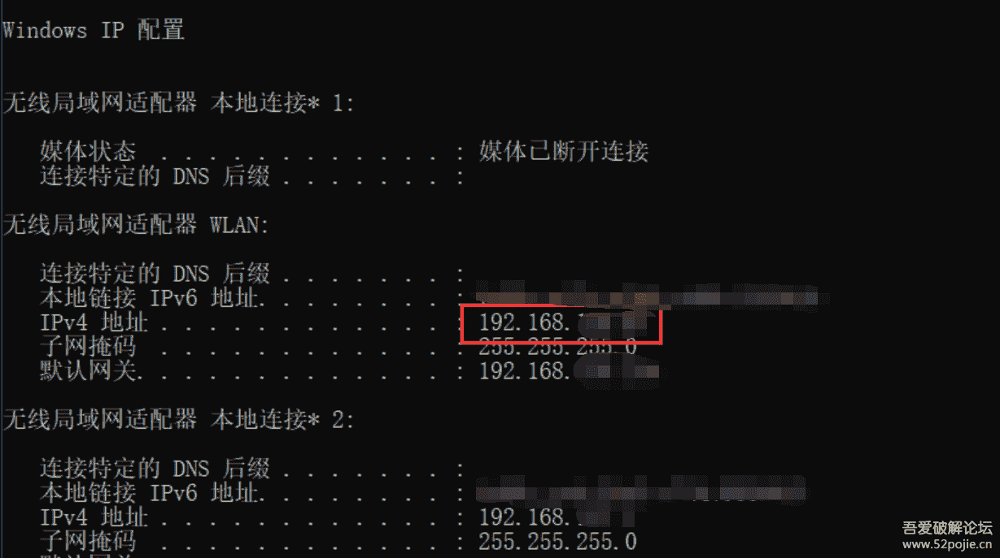
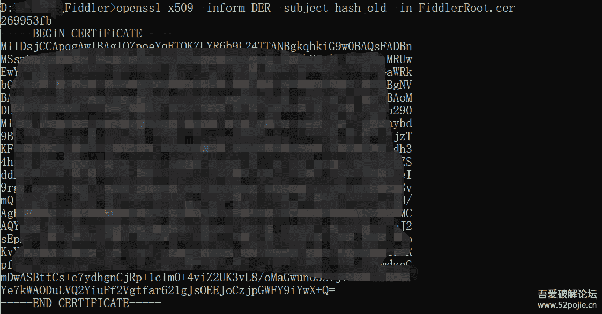

# [Android 原创] Fiddler 在安卓 7.0 以上系统抓包环境的搭建及常见大坑

- 原帖：[https://www.52pojie.cn/forum.php?mod=viewthread&tid=1767392](https://www.52pojie.cn/forum.php?mod=viewthread&tid=1767392)
- 抓取时间：2026-11-01T21:45:31

`Fiddler`版本：`FiddlerSetup_5.0.20204.45441.exe`

手机系统版本：安卓9，已经`root`（测试机）

## 官网下载安装包

[官网下载](https://www.telerik.com/download/fiddler)

安装包打开，一路下一步就行。

## 安装与配置 Fiddler

安装好后打开`Tools->options`。



`1.jpg`（71.6 KB，下载次数：0；2023-3-30 22:24 上传）

[附件下载](https://www.52pojie.cn/forum.php?mod=attachment&aid=MjYwMzM0M3xmZjYyNmQxOHwxNzkzNTY5NTI5fDE2ODA4NnwxNzY3Mzky&nothumb=yes)

`Yes->是->是->确定`，HTTPS 选完如下图所示。



`2.jpg`（47.97 KB，下载次数：0；2023-3-30 22:24 上传）

[附件下载](https://www.52pojie.cn/forum.php?mod=attachment&aid=MjYwMzM0NHw2N2UwZDA3NXwxNzkzNTY5NTI5fDE2ODA4NnwxNzY3Mzky&nothumb=yes)

设置端口，按下图中勾选，端口填默认。



`3.jpg`（73.31 KB，下载次数：0；2023-3-30 22:24 上传）

[附件下载](https://www.52pojie.cn/forum.php?mod=attachment&aid=MjYwMzM0NXw0OTM3NTU1ZXwxNzkzNTY5NTI5fDE2ODA4NnwxNzY3Mzky&nothumb=yes)

确定 -> ok

## 配置手机与电脑网络

配置完毕后，需要手机和电脑处于同一网络，目前有两种方式：

1. 自己常用的非`root`手机开热点，笔记本和测试机连接同一个网络
2. 笔记本电脑开热点，测试机连接
3. 不能笔记本和测试机都连接路由器的 Wi-Fi，这里我尝试过，完全不行，千万不要这么做

查看 IP 地址，可以在控制台输入`ipconfig`，也可以使用 Fiddler 右上角`Online`查看。这里是命令`ipconfig`的截图。



`4.png`（176.51 KB，下载次数：0；2023-3-30 22:36 上传）

[附件下载](https://www.52pojie.cn/forum.php?mod=attachment&aid=MjYwMzM0OXw3MjJmOWY5ZXwxNzkzNTY5NTI5fDE2ODA4NnwxNzY3Mzky&nothumb=yes)

查看图中 IPv4 地址。

## 下载并安装证书

手机浏览器访问`http://192.168.xxx.xx:8888/`下载证书。

将下载好的证书`FiddlerRoot.cer`拷贝到电脑上，需要安装一个 OpenSSL。

[OpenSSL 下载](https://slproweb.com/products/Win32OpenSSL.html)

下载`Win64 OpenSSL v1.1.1t Light`就可以，安装好需要加到环境变量中，然后在控制台执行以下命令：

```
openssl x509 -inform DER -subject_hash_old -in FiddlerRoot.cer
```



`5.png`（67.64 KB，下载次数：0；2023-3-30 22:47 上传）

[附件下载](https://www.52pojie.cn/forum.php?mod=attachment&aid=MjYwMzM1MXxmNmFhNmZkZHwxNzkzNTY5NTI5fDE2ODA4NnwxNzY3Mzky&nothumb=yes)
