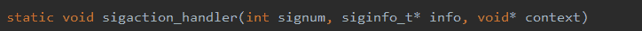
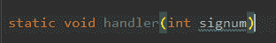

# [Android 原创] SECCOMP_RET_TRAP 信号量检测主动执行的对抗

- 原帖: https://www.52pojie.cn/forum.php?mod=viewthread&tid=1768421
- 抓取时间: 2026-11-01T21:45:29

关于`SECCOMP_RET_TRAP`，使用信号量去检测的方法，在之前的帖子里面已经讲过了。

其实这种方法可以通过拦截`sigaction`系统调用，拿到`handler`地址，主动去调用执行`handler`即可。

`handler`函数一般有如下两种：

868227_3X4EY8839THP7SC.jpg (1.82 KB, 下载次数: 0)

[href="forum.php?mod=attachment&aid=MjYwNDA1OXwwZmZhMTQwY3wxNzkzNTY5NTI3fDE2ODA4NnwxNzY4NDIx&nothumb=yes" target="_blank"](https://www.52pojie.cn/forum.php?mod=attachment&aid=MjYwNDA1OXwwZmZhMTQwY3wxNzkzNTY5NTI3fDE2ODA4NnwxNzY4NDIx&nothumb=yes)

2023-4-2 11:05 上传

868227_3UR3ZE7VDBWSVCE.jpg (1.43 KB, 下载次数: 1)

[href="forum.php?mod=attachment&aid=MjYwNDA1OHxlNDczMmE0YnwxNzkzNTY5NTI3fDE2ODA4NnwxNzY4NDIx&nothumb=yes" target="_blank"](https://www.52pojie.cn/forum.php?mod=attachment&aid=MjYwNDA1OHxlNDczMmE0YnwxNzkzNTY5NTI3fDE2ODA4NnwxNzY4NDIx&nothumb=yes)

2023-4-2 11:05 上传

第一种一般是与`sigqueue`函数配套使用，第二种则是与`raise`或者`kill`函数配套使用。

那是不是意味着信号量这种检测手段就彻底被废弃了呢？当然不是，既然是第三方的主动去执行，那我们也可以检测这种主动执行的情况。比如注册`SIGSYS`的信号注册3个`handler`任意挑选里面的1个去真正产生`SIGSYS`信号的执行检测`seccomp`，另外两个不产生`SIGSYS`信号（这里产生信号的方式有很多种，使用函数去主动发送信号是其中的一种）。然后去检测这三个`handler`的结果，做分析判断即可。

也可以使用`sigqueue`发送信号时携带一些数据信息，然后`handler`里面验证这些数据，当然也可以拦截`sigqueue`系统调用，也一样可以绕过了。

另外我们也可以解析`handler`的调用堆栈，符号，一般主动执行的都会与系统执行的堆栈有较大的不同。

其实检测的维度也是多种多样的，仔细静下心来想想，也很容易就得出方案。
