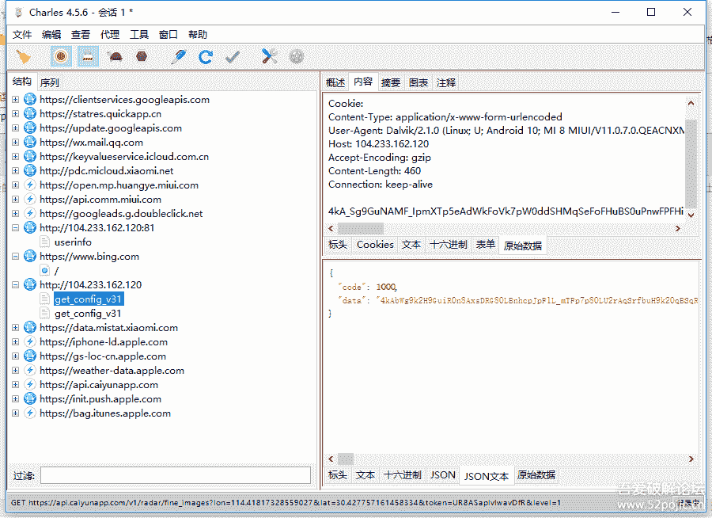
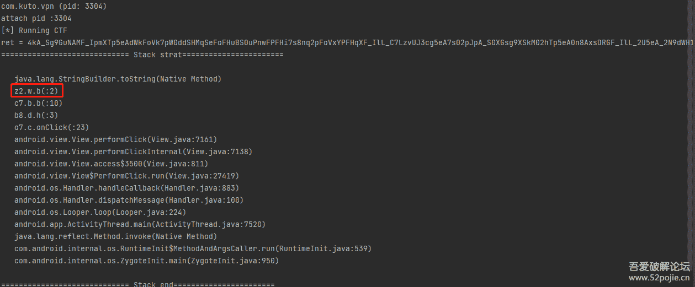
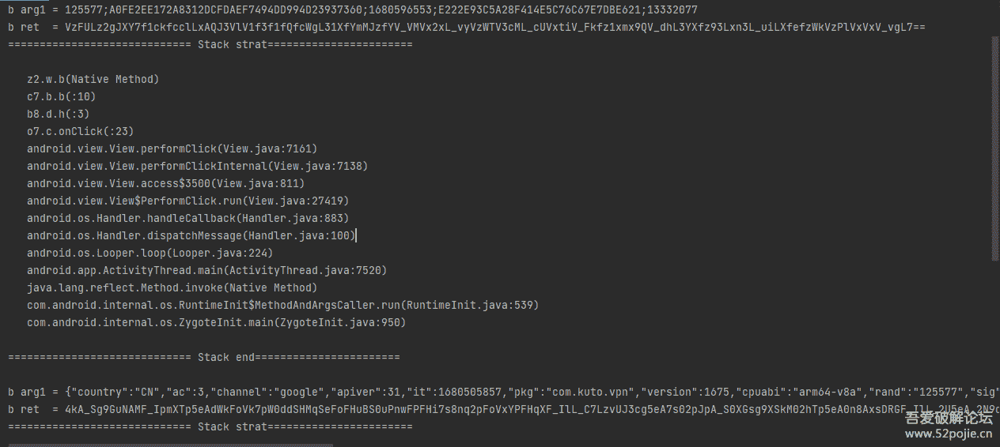
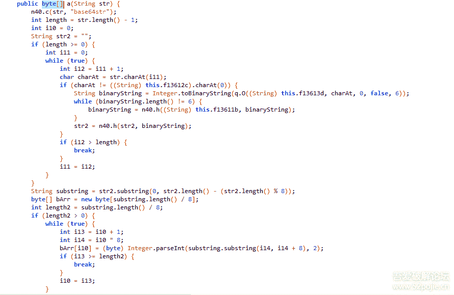
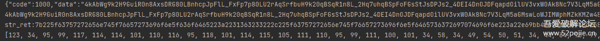
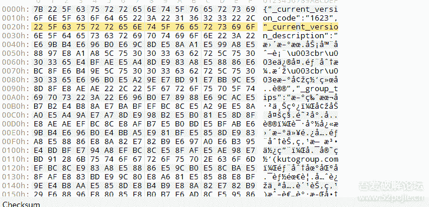

# [Android 原创] 某通的rpc调用

- 原帖: https://www.52pojie.cn/forum.php?mod=viewthread&tid=1769553
- 抓取时间: 2026-11-01T21:45:27

起因是因为之前用的蜜蜂的线路白嫖不了了，那只能重新找一个在逆向拿出来线路，就找到了这个，但是这个东西吧解出来发现没什么用，正好`rpc`的调用资料也蛮少，写出来大家一块看看吧。

打开软件以后看到vip节点全部都是上锁的不能直接使用，但是我的目的也不是直接使用呀，界面右下角有个刷新线路的按钮，按一下发现发出去了一条请求，盲猜返回的就是线路



抓包图.png (95.11 KB, 下载次数: 0)

[href="forum.php?mod=attachment&aid=MjYwNTE0Nnw0MmYyMzc0ZHwxNzkzNTY5NTI1fDE2ODA4NnwxNzY5NTUz&nothumb=yes" target="_blank"](https://www.52pojie.cn/forum.php?mod=attachment&aid=MjYwNTE0Nnw0MmYyMzc0ZHwxNzkzNTY5NTI1fDE2ODA4NnwxNzY5NTUz&nothumb=yes)

2023-4-6 08:14 上传

那果断`frida`吧。看着是`Base64`,但是仔细看看里面存在"_" "-" 这两种符号。那估计是魔改的吧

这里找到加密点呢，是百度出来一篇帖子，看雪大神发的，据说是个小姐姐发的（链接我就不发了吧，不知道论坛里面让不让发）。我直接发代码吧

[JavaScript] 纯文本查看 复制代码
```
function showStacks() {
    var Exception = Java.use("java.lang.Exception");
    var ins = Exception.$new("Exception");
    var straces = ins.getStackTrace();

    if (undefined == straces || null == straces) {
        return;
    }

    console.log("============================= Stack strat=======================");
    console.log("");

    for (var i = 0; i = 0 ){
                console.log('ret = ' + ret)
                showStacks()
            }
            return ret
        }
    });

}
```



加密点.png (85.88 KB, 下载次数: 0)

[href="forum.php?mod=attachment&aid=MjYwNTE0N3xiMmI3OWFmOHwxNzkzNTY5NTI1fDE2ODA4NnwxNzY5NTUz&nothumb=yes" target="_blank"](https://www.52pojie.cn/forum.php?mod=attachment&aid=MjYwNTE0N3xiMmI3OWFmOHwxNzkzNTY5NTI1fDE2ODA4NnwxNzY5NTUz&nothumb=yes)

2023-4-6 08:14 上传

可以看到`z2.w.b`就是加密点了，就去代码里面看看

看着代码十分的简单，但是没有看到加密的函数什么的，就在这个函数一直调，到最后`append`实在是没找到值是多少，就放弃了函数，突然想到`frida`可以`rpc`啊

换个思路，既然加密点找到了，那需要知道参数才可以主动调用这个函数，那还是需要hook知道参数。继续hook



参数.png (100.76 KB, 下载次数: 0)

[href="forum.php?mod=attachment&aid=MjYwNTE0OHw0ZDkzMjI1M3wxNzkzNTY5NTI1fDE2ODA4NnwxNzY5NTUz&nothumb=yes" target="_blank"](https://www.52pojie.cn/forum.php?mod=attachment&aid=MjYwNTE0OHw0ZDkzMjI1M3wxNzkzNTY5NTI1fDE2ODA4NnwxNzY5NTUz&nothumb=yes)

2023-4-6 08:15 上传

这时候发现走了两次这个函数，第二次这个函数走的时候里面有个`sig`字段，这个内容就是第一次进入函数加密的结果。

仔细看看第一次进函数的参数

经过多次发包发现，第一个分号之前的会变，而且是在软件重新打开以后会变，那么这个就是`pid`？后一项不变，然后加个时间戳，最后一个不知道是什么意思，反正也不变，那就自己构造呗。直接写代码吧。

[JavaScript] 纯文本查看 复制代码
```
function sign(str_data, str_ret) {

  var str_ret = null;

  Java.perform(function () {

            //获取内存中已有对象 主动调用

            Java.choose("z2.w", {

          //匹配到对象执行的回调函数

          onMatch: function (instance) {

            str_ret = instance.b(str_data);

          },

          //搜索完成后执行的回调函数

          onComplete: function () {

          }

        });

  });

  return str_ret;

}
```

因为这个函数不是一个静态函数，如果是静态函数可以直接调用的。

一共调用两次函数，得到结果以后发包出去，如果构造正确，那么就会返回一个`json`的字符串，这时候就要找解密的代码了

因为加密的时候参数是一个字符串，那么大胆想象解密的时候也是一个字符串



解密函数.png (44.42 KB, 下载次数: 0)

[href="forum.php?mod=attachment&aid=MjYwNTE0OXxlMGY2NDgyN3wxNzkzNTY5NTI1fDE2ODA4NnwxNzY5NTUz&nothumb=yes" target="_blank"](https://www.52pojie.cn/forum.php?mod=attachment&aid=MjYwNTE0OXxlMGY2NDgyN3wxNzkzNTY5NTI1fDE2ODA4NnwxNzY5NTUz&nothumb=yes)

2023-4-6 08:15 上传

就打赌这个就是解密函数，直接写代码调用它

python代码

[Python] 纯文本查看 复制代码
```
import json
import os

import frida
import time
import datetime

import requests

def on_message(message, payload):
    message_type = message['type']
    if message_type == 'send':
        print('[* message]', message['payload'])

    elif message_type == 'error':
        stack = message['stack']
        print('[* error]', stack)

    else:
        print(message)

js_code = open("酷通rpc.js", "r", encoding="utf-8").read()
session = frida.get_usb_device().attach("com.kuto.vpn")
script = session.create_script(js_code)
script.on("message", on_message)
script.load()

def get_sign(tstr):
    res = script.exports.sign(tstr,"")
    return res

def get_decode(decode_str):
    res = script.exports.decode(decode_str, "")
    return res

def main():
    t = time.time()

    sstr = "85343;A0FE2EE172A8312DCFDAEF7494DD994D23937360;" + str(int(t)) + ";E222E93C5A28F414E5C76C67E7DBE621;13332077"
    res = get_sign(sstr)
    # print("第一层:" + get_sign(sstr))
    tstr = "{\"country\":\"CN\",\"ac\":3,\"channel\":\"google\",\"apiver\":31,\"it\":" + str(int(t)) + ",\"pkg\":\"com.kuto.vpn\",\"version\":1675,\"cpuabi\":\"arm64-v8a\",\"rand\":\"129715\",\"sig\":\"" + res + "\",\"uid\":955978,\"lang\":\"ZH\",\"vip\":true,\"device\":2118329573}"
    res2 = get_sign(tstr)
    # print("第二层:" + get_sign(tstr))
    url = "http://104.233.162.120/get_config_v31"
    header = {
        "Cookie":"",
        "Content-Type": "application/x-www-form-urlencoded",
        "User-Agent": "Dalvik/2.1.0 (Linux; U; Android 10; MI 8 MIUI/V11.0.7.0.QEACNXM)",
        "Host": "104.233.162.120",
        "Connection": "Keep-Alive",
        "Accept-Encoding": "gzip",
    }
    reqs = requests.post(url=url, data=res2, headers=header)
    print(reqs.text)
    data = json.loads(reqs.text)
    data = data['data']
    print(data)
#     调用解密
    decode_str = get_decode(data)

    print(str(decode_str))

if __name__ == '__main__':
    main()
```

js代码

[JavaScript] 纯文本查看 复制代码
```
var result;

var ByteString = Java.use("com.android.okhttp.okio.ByteString");

function sign(str_data, str_ret) {

  var str_ret = null;

  Java.perform(function () {

            //获取内存中已有对象 主动调用

            Java.choose("z2.w", {

          //匹配到对象执行的回调函数

          onMatch: function (instance) {

            str_ret = instance.b(str_data);

          },

          //搜索完成后执行的回调函数

          onComplete: function () {

          }

        });

  });

  return str_ret;

}

function decode_str(str_data, str_ret) {

  var str_ret = null;

  Java.perform(function () {

            //获取内存中已有对象 主动调用

            Java.choose("z2.w", {

          //匹配到对象执行的回调函数

          onMatch: function (instance) {

            str_ret = instance.a(str_data);

          },

          //搜索完成后执行的回调函数

          onComplete: function () {

          }

        });

  });

  console.log("str_ret:" + ByteString.of(str_ret).hex())

  return str_ret;

}

rpc.exports  = {

    sign: sign,

    decode: decode_str

};
```

直接运行看结果吧



结果.png (37.85 KB, 下载次数: 0)

[href="forum.php?mod=attachment&aid=MjYwNTE1MXw4MmE5ZmUzZnwxNzkzNTY5NTI1fDE2ODA4NnwxNzY5NTUz&nothumb=yes" target="_blank"](https://www.52pojie.cn/forum.php?mod=attachment&aid=MjYwNTE1MXw4MmE5ZmUzZnwxNzkzNTY5NTI1fDE2ODA4NnwxNzY5NTUz&nothumb=yes)

2023-4-6 08:16 上传

`str_ret`已经是解密完成的了，放到`010`里面看看是不是熟悉的`vmess://xxxxxxxxxxxxxxx`



010.png (67.74 KB, 下载次数: 0)

[href="forum.php?mod=attachment&aid=MjYwNTE1MHxkYmQwMGI5ZnwxNzkzNTY5NTI1fDE2ODA4NnwxNzY5NTUz&nothumb=yes" target="_blank"](https://www.52pojie.cn/forum.php?mod=attachment&aid=MjYwNTE1MHxkYmQwMGI5ZnwxNzkzNTY5NTI1fDE2ODA4NnwxNzY5NTUz&nothumb=yes)

2023-4-6 08:16 上传

很难受，不是熟悉的样子，因为不是熟悉的样子往后也不想继续了，就这样吧，就当是一个`rpc`调用的例子吧....
