# [Android 原创] Pixel1代平替：一加3手机刷入KaliNethunter解封完整Linux命令环境

- 原帖: https://www.52pojie.cn/forum.php?mod=viewthread&tid=1769927
- 抓取时间: 2026-11-01T21:45:24

## 意义

大家知道在Linux上，我们想要对数据封包进行统计、定位、可视化、分析和转储等，有一系列的工具和软件。这些工具为我们进行网络数据封包的分析和处理提供了无与伦比的支持，可以说有这些工具的存在，没有抓不到的包，如果再结合`hook`技术，可以说没有解不开的协议。

工具虽好，但是它们的运行都需要一个完整的Linux环境，比如像`jnettop`/`htop`/`nethogs`等需要`root`权限，像`iwlist`/`aircrack`/`HID`等需要内核驱动支持、监听模式的打开等，`Wireshark`/`Charles`/`BP`会需要桌面环境的支持，在GUI中进行可视化分析。

具体的内容在这篇文章中进行了详细的解释：[//mp.weixin.qq.com/s/PIiGZKW6oQnOAwlCqvcU0g" target="_blank" rel="noopener noreferrer nofollow"](https://mp.weixin.qq.com/s/PIiGZKW6oQnOAwlCqvcU0g:rel="nofollow noopener" href="https)

随着时间的推移，Nexus设备逐渐退出历史舞台，而Kali Nethunter却迟迟不能支持到Pixel设备；此时我们只能退而求其次，选择一加手机，来延续手机上刷入Kali Nethunter解封完整Linux环境的传统。

本篇基于一加3(t)手机，在性能上相当于Pixel一代手机。运行环境是安卓10。本文中用到的附件等位于百度盘中：链接：[//pan.baidu.com/s/1c01pB6JIY6a-25P-855dAA" target="_blank" rel="noopener noreferrer nofollow"](https://pan.baidu.com/s/1c01pB6JIY6a-25P-855dAA:rel="nofollow noopener" href="https) 提取码：`e2gn`

## Intro

- 为什么要搭建`nethunter`的环境
- 工欲善其事,必先利其器.`nethunter`强大的工具支持,使得工作变得轻松
- 为什么使用`oneplus3T`
- `oneplus3T`这部机型,`lineage`,`nethunter`,`twrp`都有很好的支持
- `oneplus3T`现在的价格很低
- `oneplus3T`性能还不错,比`nexus 5x`的性能强悍很多
- 为什么写这个刷机文章
不仅仅是因为这个`nethunter`的强大和`oneplus3t`的性价比,更因为是刷机总是出现这样那样的问题,导致失败.经过反复几天测试,得出了一种比较轻松的方式.后面提供了这个刷机过程中用到的所有的工具包

## 刷机前设置

需要开启开发者模式,`bootloader`解锁,`usb`调试

如果手机满足这些条件,可以直接进入刷入`lineage`

### 开启开发者模式

系统版本号(点击多次),一般进入方式都是手机里面,设置->关于手机->版本号

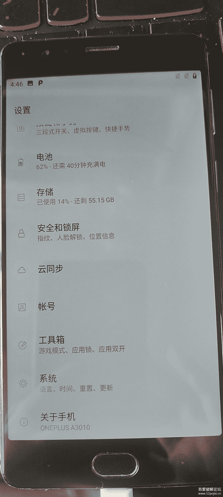
202304061.jpg (302.89 KB, 下载次数: 2)
[href="forum.php?mod=attachment&aid=MjYwNTAzMHxhNTYwNjNiYnwxNzkzNTY5NTIyfDE2ODA4NnwxNzY5OTI3&nothumb=yes" target="_blank"](https://www.52pojie.cn/forum.php?mod=attachment&aid=MjYwNTAzMHxhNTYwNjNiYnwxNzkzNTY5NTIyfDE2ODA4NnwxNzY5OTI3&nothumb=yes)
2023-4-5 20:08 上传
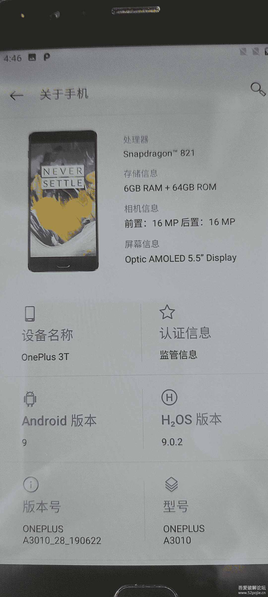
202304062.jpg (283.47 KB, 下载次数: 0)
[href="forum.php?mod=attachment&aid=MjYwNTAzMXxkNjcxMDNiZXwxNzkzNTY5NTIyfDE2ODA4NnwxNzY5OTI3&nothumb=yes" target="_blank"](https://www.52pojie.cn/forum.php?mod=attachment&aid=MjYwNTAzMXxkNjcxMDNiZXwxNzkzNTY5NTIyfDE2ODA4NnwxNzY5OTI3&nothumb=yes)
2023-4-5 20:08 上传

### 开启usb调试和oem解锁许可

- 设置->系统->开发者选项
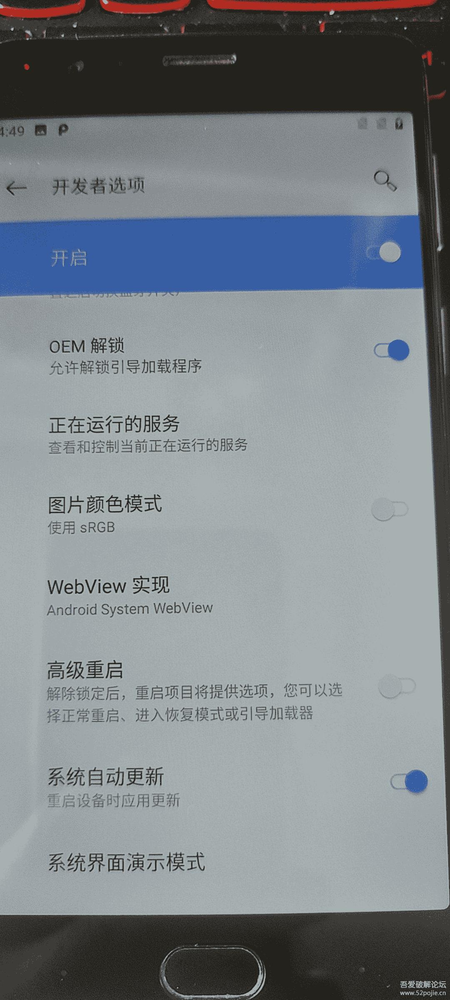
202304063.jpg (303.08 KB, 下载次数: 1)
[href="forum.php?mod=attachment&aid=MjYwNTAzMnwxY2U0NGMwZnwxNzkzNTY5NTIyfDE2ODA4NnwxNzY5OTI3&nothumb=yes" target="_blank"](https://www.52pojie.cn/forum.php?mod=attachment&aid=MjYwNTAzMnwxY2U0NGMwZnwxNzkzNTY5NTIyfDE2ODA4NnwxNzY5OTI3&nothumb=yes)
2023-4-5 20:08 上传
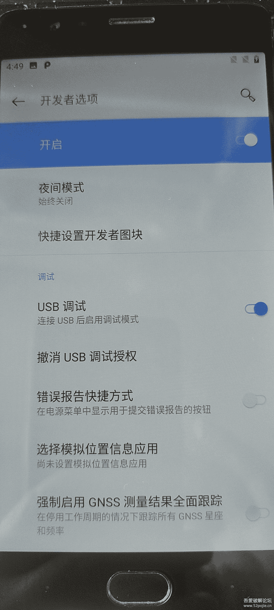
202304064.jpg (294.24 KB, 下载次数: 2)
[href="forum.php?mod=attachment&aid=MjYwNTAzM3xkNzZjYTFiY3wxNzkzNTY5NTIyfDE2ODA4NnwxNzY5OTI3&nothumb=yes" target="_blank"](https://www.52pojie.cn/forum.php?mod=attachment&aid=MjYwNTAzM3xkNzZjYTFiY3wxNzkzNTY5NTIyfDE2ODA4NnwxNzY5OTI3&nothumb=yes)
2023-4-5 20:08 上传

### 解锁OEM

- 重启到`bootloader`
- 使用`adb`命令
```
adb reboot bootloader
```
- 手机关机,然后开机键+手机音量下键

202304065.png (18.43 KB, 下载次数: 1)
[href="forum.php?mod=attachment&aid=MjYwNTAzNHxkMjFiNTg2MXwxNzkzNTY5NTIyfDE2ODA4NnwxNzY5OTI3&nothumb=yes" target="_blank"](https://www.52pojie.cn/forum.php?mod=attachment&aid=MjYwNTAzNHxkMjFiNTg2MXwxNzkzNTY5NTIyfDE2ODA4NnwxNzY5OTI3&nothumb=yes)
2023-4-5 20:08 上传
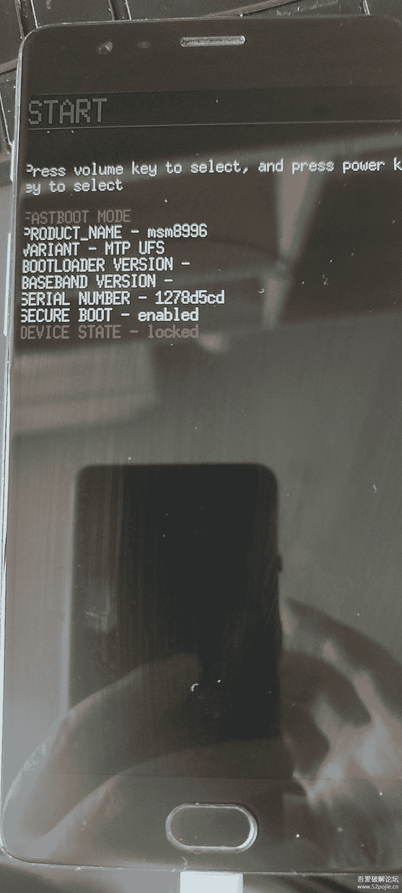
202304066.jpg (319.67 KB, 下载次数: 1)
[href="forum.php?mod=attachment&aid=MjYwNTAzNXwyYzI1MGM5Y3wxNzkzNTY5NTIyfDE2ODA4NnwxNzY5OTI3&nothumb=yes" target="_blank"](https://www.52pojie.cn/forum.php?mod=attachment&aid=MjYwNTAzNXwyYzI1MGM5Y3wxNzkzNTY5NTIyfDE2ODA4NnwxNzY5OTI3&nothumb=yes)
2023-4-5 20:08 上传
- 解锁
```
fastboot oem unlock
```
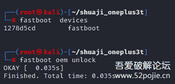
202304067.png (26.71 KB, 下载次数: 2)
[href="forum.php?mod=attachment&aid=MjYwNTAzNnwxZTUyNWEwM3wxNzkzNTY5NTIyfDE2ODA4NnwxNzY5OTI3&nothumb=yes" target="_blank"](https://www.52pojie.cn/forum.php?mod=attachment&aid=MjYwNTAzNnwxZTUyNWEwM3wxNzkzNTY5NTIyfDE2ODA4NnwxNzY5OTI3&nothumb=yes)
2023-4-5 20:08 上传
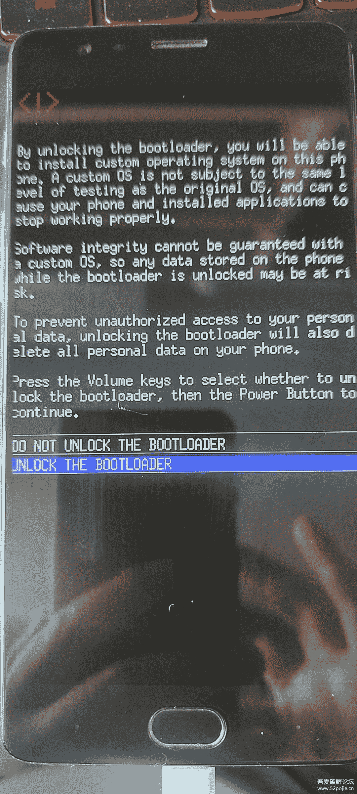
202304068.jpg (425.97 KB, 下载次数: 1)
[href="forum.php?mod=attachment&aid=MjYwNTAzN3xjM2Q3ZWIxZHwxNzkzNTY5NTIyfDE2ODA4NnwxNzY5OTI3&nothumb=yes" target="_blank"](https://www.52pojie.cn/forum.php?mod=attachment&aid=MjYwNTAzN3xjM2Q3ZWIxZHwxNzkzNTY5NTIyfDE2ODA4NnwxNzY5OTI3&nothumb=yes)
2023-4-5 20:09 上传
手机出现这个界面以后,选择`UNLOCK THE BOOTLOADER`(音量上下键可以切换选项,电源键做选择)
等待解锁后自动重启
注意: 解锁重启之后,完成基本设置之后,再次启动开发者模式和`usb`调试

### 刷入 lineage

`nethunter`官方提供的系统是`android10`的镜像包,需要输入一个`android10`的底包,这里选择`lineage`的系统

### 刷入 twrp

- 重启手机,刷入`twrp.img`
```
adb reboot bootloader
fastboot flash recovery recovery.img
```
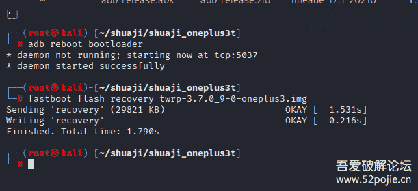
202304069.png (50.68 KB, 下载次数: 1)
[href="forum.php?mod=attachment&aid=MjYwNTAzOHw0YzRlZmEzZnwxNzkzNTY5NTIyfDE2ODA4NnwxNzY5OTI3&nothumb=yes" target="_blank"](https://www.52pojie.cn/forum.php?mod=attachment&aid=MjYwNTAzOHw0YzRlZmEzZnwxNzkzNTY5NTIyfDE2ODA4NnwxNzY5OTI3&nothumb=yes)
2023-4-5 20:09 上传
- 手机音量上下键,选择`recovrey mode`进入`twrp`的系统
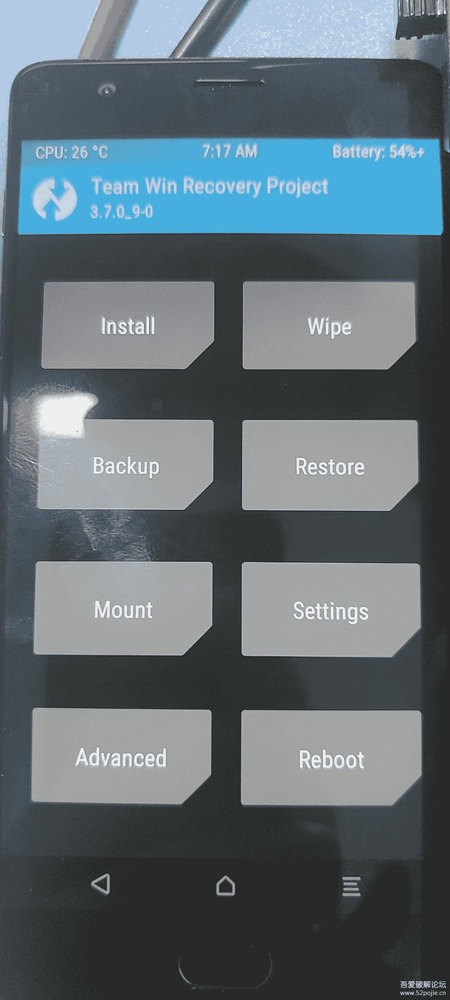
2023040611.jpg (274.03 KB, 下载次数: 2)
[href="forum.php?mod=attachment&aid=MjYwNTA0MHwyYzlmM2Y2ZHwxNzkzNTY5NTIyfDE2ODA4NnwxNzY5OTI3&nothumb=yes" target="_blank"](https://www.52pojie.cn/forum.php?mod=attachment&aid=MjYwNTA0MHwyYzlmM2Y2ZHwxNzkzNTY5NTIyfDE2ODA4NnwxNzY5OTI3&nothumb=yes)
2023-4-5 20:09 上传

### 清理数据

- 在`twrp`中,`Wipe`->`Format Data`->输入`'yes'`->成功之后,`back`到可以选择`Advanced Wipe`地方
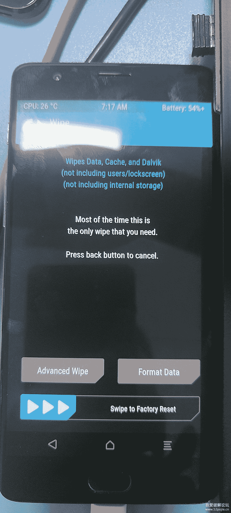
2023040612.jpg (326.39 KB, 下载次数: 2)
[href="forum.php?mod=attachment&aid=MjYwNTA0MXxlZWM3NGY4NnwxNzkzNTY5NTIyfDE2ODA4NnwxNzY5OTI3&nothumb=yes" target="_blank"](https://www.52pojie.cn/forum.php?mod=attachment&aid=MjYwNTA0MXxlZWM3NGY4NnwxNzkzNTY5NTIyfDE2ODA4NnwxNzY5OTI3&nothumb=yes)
2023-4-5 20:10 上传
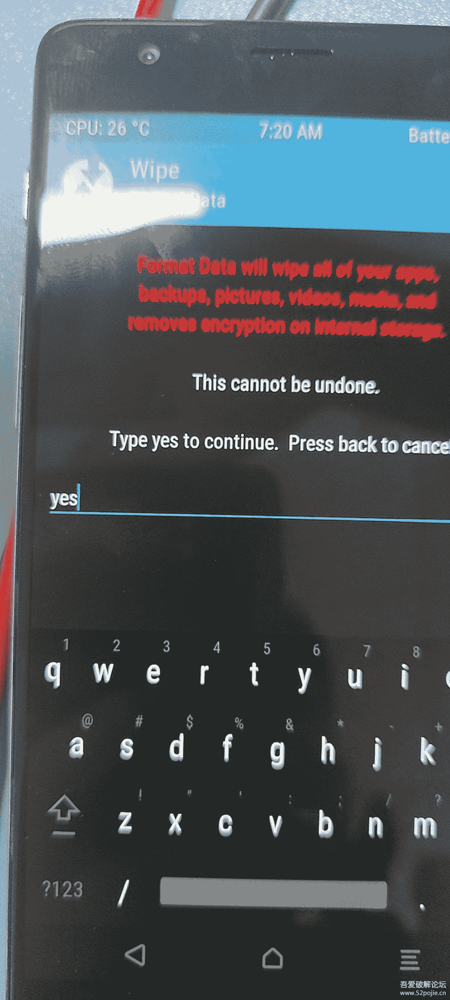
2023040610.jpg (313.33 KB, 下载次数: 1)
[href="forum.php?mod=attachment&aid=MjYwNTAzOXxlMmU5ZDMzMHwxNzkzNTY5NTIyfDE2ODA4NnwxNzY5OTI3&nothumb=yes" target="_blank"](https://www.52pojie.cn/forum.php?mod=attachment&aid=MjYwNTAzOXxlMmU5ZDMzMHwxNzkzNTY5NTIyfDE2ODA4NnwxNzY5OTI3&nothumb=yes)
2023-4-5 20:09 上传
- `Advanced Wipe`->勾选全部
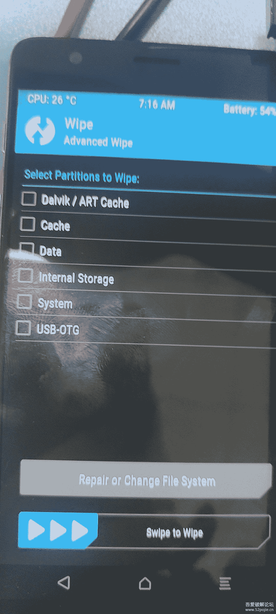
2023040615.jpg (311.96 KB, 下载次数: 2)
[href="forum.php?mod=attachment&aid=MjYwNTA0Mnw4MjRjMThhM3wxNzkzNTY5NTIyfDE2ODA4NnwxNzY5OTI3&nothumb=yes" target="_blank"](https://www.52pojie.cn/forum.php?mod=attachment&aid=MjYwNTA0Mnw4MjRjMThhM3wxNzkzNTY5NTIyfDE2ODA4NnwxNzY5OTI3&nothumb=yes)
2023-4-5 20:10 上传

### 输入固件包

- `Advanced`->`ADB Sideload`
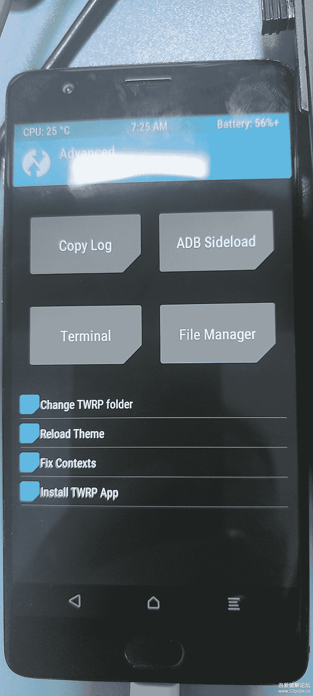
2023040617.jpg (314.58 KB, 下载次数: 1)
[href="forum.php?mod=attachment&aid=MjYwNTA0M3wxMmU5ZTg0NnwxNzkzNTY5NTIyfDE2ODA4NnwxNzY5OTI3&nothumb=yes" target="_blank"](https://www.52pojie.cn/forum.php?mod=attachment&aid=MjYwNTA0M3wxMmU5ZTg0NnwxNzkzNTY5NTIyfDE2ODA4NnwxNzY5OTI3&nothumb=yes)
2023-4-5 20:10 上传
- 输入命令
```
adb sideload oxygenos-9.0.6-bl-km-5.0.8-firmware-3.zip
```
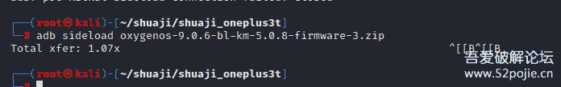
2023040640.png (25.38 KB, 下载次数: 0)
[href="forum.php?mod=attachment&aid=MjYwNTA1MHxlYTA5Y2Y1NXwxNzkzNTY5NTIyfDE2ODA4NnwxNzY5OTI3&nothumb=yes" target="_blank"](https://www.52pojie.cn/forum.php?mod=attachment&aid=MjYwNTA1MHxlYTA5Y2Y1NXwxNzkzNTY5NTIyfDE2ODA4NnwxNzY5OTI3&nothumb=yes)
2023-4-5 20:11 上传
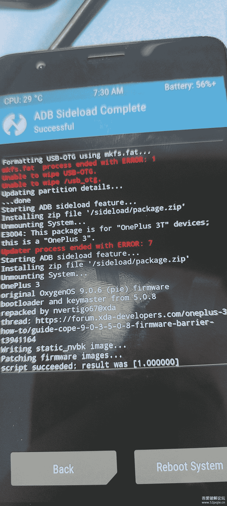
2023040641.jpg (399.92 KB, 下载次数: 2)


## 3> 刷入 lineage 的包

- `Advanced`->`ADB Sideload`
- 输入如下命令

```bash
adb sideload lineage-17.1-20210215-nightly-oneplus3-signed.zip
```

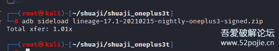
2023040642.png (25.43 KB, 下载次数: 2)
2023-4-5 20:12 上传

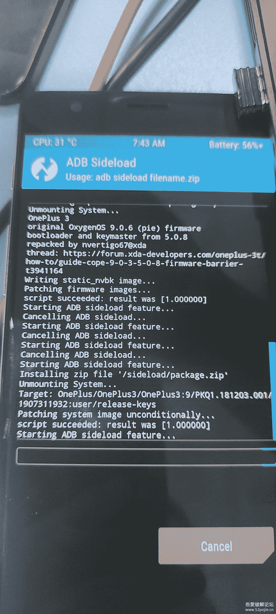
2023040643.jpg (413.17 KB, 下载次数: 1)
2023-4-5 20:12 上传

## 3> 刷入 magisk

- `Advanced`->`ADB Sideload`
- 输入下面命令

```bash
adb sideload app-release.zip
```

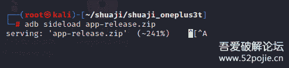
2023040644.png (22.55 KB, 下载次数: 1)
2023-4-5 20:12 上传

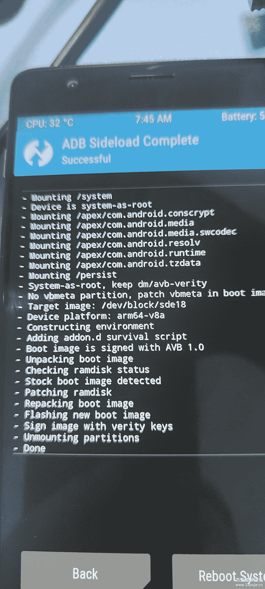
2023040645.jpg (399.16 KB, 下载次数: 1)
2023-4-5 20:12 上传

- 重启
- 开启开发者模式,usb调试
- 使用下面命令安装 magisk 的 app

```bash
adb install app-release.apk
```

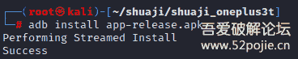
2023040646.png (17.38 KB, 下载次数: 2)
2023-4-5 20:12 上传

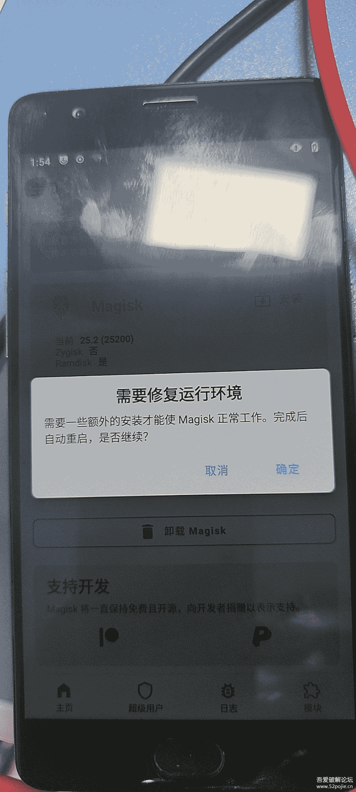
2023040647.jpg (325.36 KB, 下载次数: 2)
2023-4-5 20:12 上传

- 重启,安装 magisk 之后,第一次需要重启,让配置生效


2023040648.jpg (317.98 KB, 下载次数: 1)
2023-4-5 20:12 上传

- magisk 如上已经安装成功

## 2> 使用 Magisk 刷入 nethunter

- 传入 nethunter 的包

```bash
adb push kalihunter.zip /sdcard/Download
```

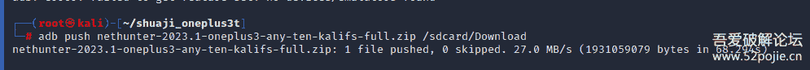
2023040628.png (28.37 KB, 下载次数: 1)
2023-4-5 20:10 上传

- 选择 模块->本地,选择,nethunter 的包,等待结束,重启

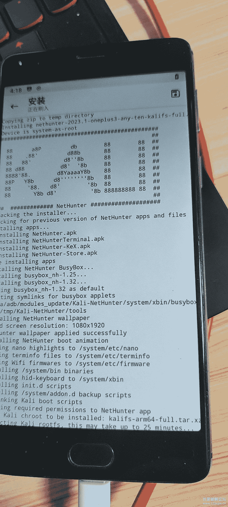
2023040629.jpg (398.81 KB, 下载次数: 1)
2023-4-5 20:10 上传

## 2> nethunter 初始化设置

重启后,连 wifi,输入命令,设置时间

```bash
settings put global captive_portal_http_url https://www.google.cn/generate_204
settings put global captive_portal_https_url https://www.google.cn/generate_204
settings put global ntp_server 1.hk.pool.ntp.org
reboot
```

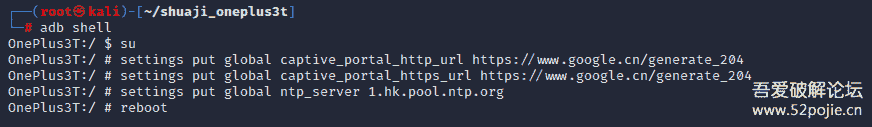
2023040630.png (38.17 KB, 下载次数: 1)
2023-4-5 20:10 上传

初始化,点击 `Kali Chroot Manager` 开始初始化

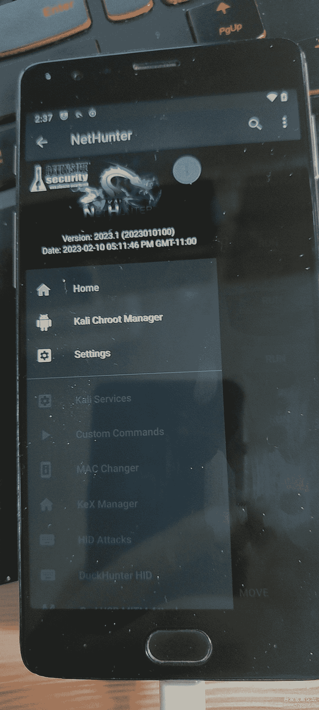
2023040631.jpg (291.65 KB, 下载次数: 2)
2023-4-5 20:10 上传


2023040632.jpg (291.65 KB, 下载次数: 2)
2023-4-5 20:10 上传

命令窗口可以使用,成功

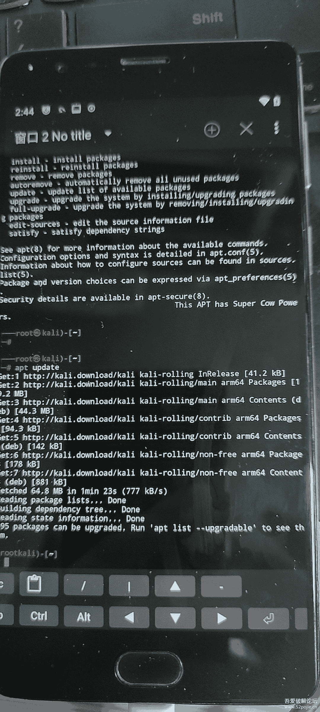
2023040633.jpg (452.96 KB, 下载次数: 1)
2023-4-5 20:11 上传

## 2> 刷入成功！

可以开启的逆向之旅了！后续还会更新 OnePlus 系列的 Kali Nethunter 刷入教程，敬请期待！
