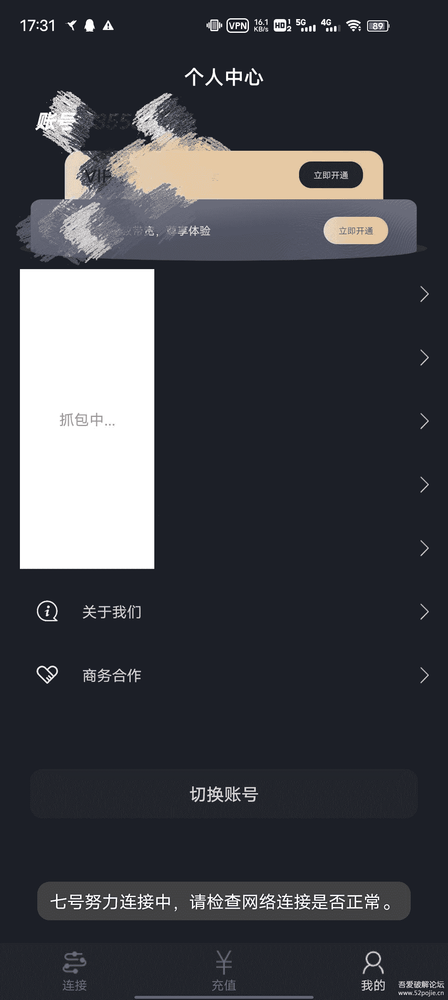
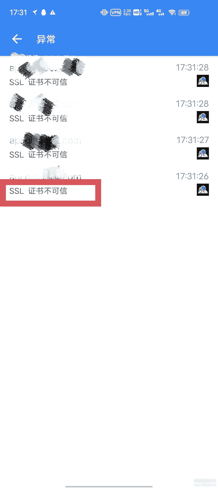
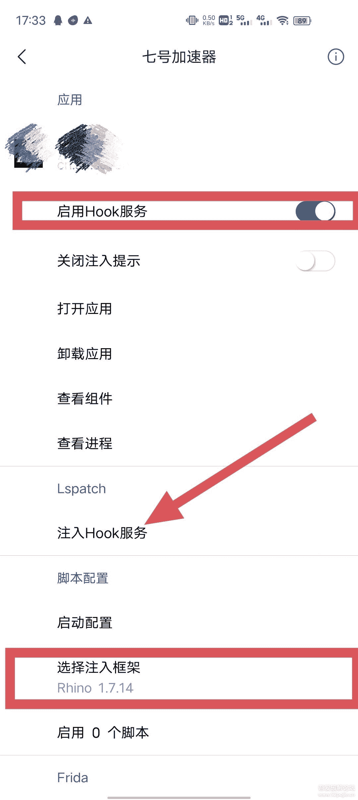
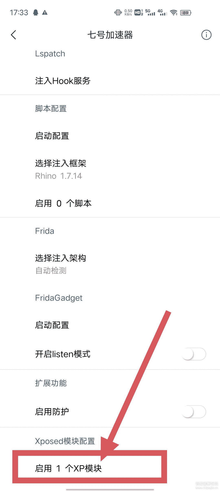
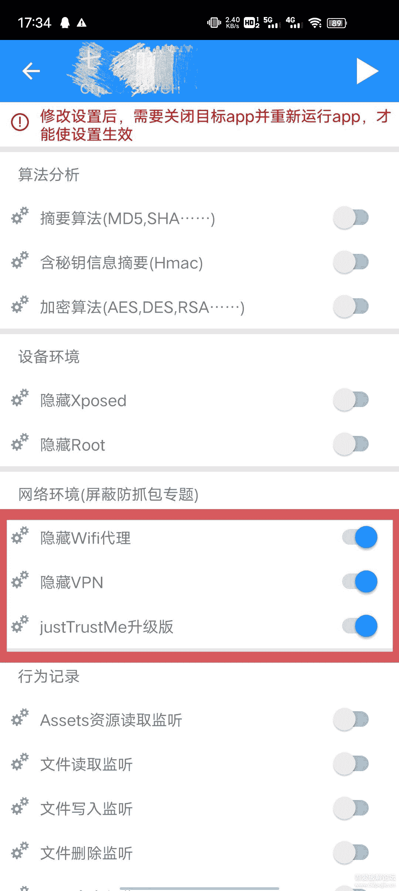
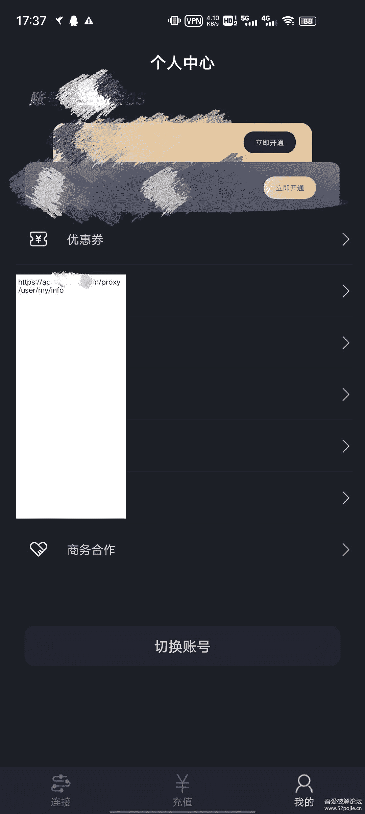
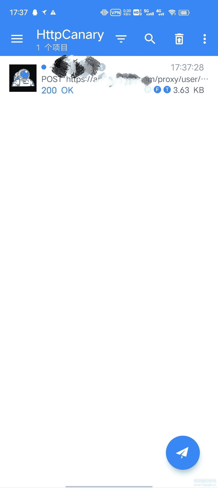

# [Android 原创] 一种无root抓包方法

- 原帖: https://www.52pojie.cn/forum.php?mod=viewthread&tid=1773022
- 抓取时间: 2026-11-01T21:45:16

## 前言

新人贴，请大家多多关照

楼主是MT论坛帖子同一作者（别开腔，自己人

）

观前提醒，适合没有root的朋友，只支持部分应用（反正我觉得比[该帖](https://www.52pojie.cn/thread-661779-1-1.html)给力

）。

方法其实都是公开的，只是没有人这么玩，或者说没有人分享。

## 工具准备与安装

使用工具：`算法助手`、`LSPatch`、`JsHook`

如果你还没有root，又想分析软件，那么这三个应用就是装机必备，这里只做一个功能的演示，其他功能自行体会，举一反三。

`jshook`无法激活免root模式的直接用`lspatch`修补激活吧，帖子用`jshook`只是我觉得更稳定

当你尝试抓包某个软件时是否遇到过

`IMG_20230412_174501.jpg` (153.45 KB, 下载次数: 5)

[附件下载](https://www.52pojie.cn/forum.php?mod=attachment&aid=MjYwNzEyN3xlNjI4ZDU5ZHwxNzkzNTY5NTEzfDE2ODA4NnwxNzczMDIy&nothumb=yes)

2023-4-12 19:59 上传

`IMG_20230412_174543.jpg` (124.56 KB, 下载次数: 3)

[附件下载](https://www.52pojie.cn/forum.php?mod=attachment&aid=MjYwNzEyOHwwOWFiN2IwOXwxNzkzNTY5NTEzfDE2ODA4NnwxNzczMDIy&nothumb=yes)

2023-4-12 20:00 上传

但你又没有root，那么这时候你就需要三大法宝：`抓包组合拳.zip`

`Screenshot_20230412_173243.jpg` (34.03 KB, 下载次数: 5)

[附件下载](https://www.52pojie.cn/forum.php?mod=attachment&aid=MjYwNzEyOXwwMWM1NDkwOXwxNzkzNTY5NTEzfDE2ODA4NnwxNzczMDIy&nothumb=yes)

2023-4-12 20:01 上传

首先打开`jshook`（开启无root模式），找到你要抓包的应用，启用`hook`服务，选择相应框架，再点击`LSPatch`注入`hook`服务，安装应用。

`IMG_20230412_174656.jpg` (158.59 KB, 下载次数: 3)

[附件下载](https://www.52pojie.cn/forum.php?mod=attachment&aid=MjYwNzEzMHw2ZTQxNjRhYXwxNzkzNTY5NTEzfDE2ODA4NnwxNzczMDIy&nothumb=yes)

2023-4-12 20:03 上传

### 限制说明

这就是这个方法的限制，如果软件签名校验较强，加固较强比如4x90加固`undefined`，就别想了，还是乖乖root或者放弃吧。

## 后续配置

安装完成后在`jshook`找到软件，在最下方启用`xp`模块，选择`算法助手`

`IMG_20230412_174751.jpg` (139.1 KB, 下载次数: 3)

[附件下载](https://www.52pojie.cn/forum.php?mod=attachment&aid=MjYwNzEzMnxkMGM0ZmI2ZHwxNzkzNTY5NTEzfDE2ODA4NnwxNzczMDIy&nothumb=yes)

2023-4-12 20:05 上传

`IMG_20230412_174827.jpg` (105 KB, 下载次数: 4)

[附件下载](https://www.52pojie.cn/forum.php?mod=attachment&aid=MjYwNzEzMXxmNThmZjlkYXwxNzkzNTY5NTEzfDE2ODA4NnwxNzczMDIy&nothumb=yes)

2023-4-12 20:03 上传

然后打开`算法助手`，开启相应功能，例如你要抓包，就开启这三个功能，然后把后台全部划掉。

`IMG_20230412_174946.jpg` (201.79 KB, 下载次数: 2)

[附件下载](https://www.52pojie.cn/forum.php?mod=attachment&aid=MjYwNzEzM3xlZjc3MDYwNHwxNzkzNTY5NTEzfDE2ODA4NnwxNzczMDIy&nothumb=yes)

2023-4-12 20:06 上传

重新打开`jshook`、`算法助手`（施法过程

），注意，使用过程保持这两个应用程序后台。

## 抓包结果

尝试抓包，成功解决抓包断网问题

`IMG_20230412_175042.jpg` (148.6 KB, 下载次数: 4)

[附件下载](https://www.52pojie.cn/forum.php?mod=attachment&aid=MjYwNzEzNHwzZTA1NjQxYnwxNzkzNTY5NTEzfDE2ODA4NnwxNzczMDIy&nothumb=yes)

2023-4-12 20:07 上传

`IMG_20230412_175128.jpg` (108.13 KB, 下载次数: 4)

[附件下载](https://www.52pojie.cn/forum.php?mod=attachment&aid=MjYwNzEzNXw1OTNhNjY5NnwxNzkzNTY5NTEzfDE2ODA4NnwxNzczMDIy&nothumb=yes)

2023-4-12 20:07 上传

结束！！！
