# [Android 原创] Pixel4平替：一加7刷NetHunter(android10) 指南

- 原帖: https://www.52pojie.cn/forum.php?mod=viewthread&tid=1775805
- 抓取时间: 2026-11-01T21:45:10

## Intro

### 为什么要用OnePlus7这个设备

- Kali Nethunter官方支持一加7
- OnePlus7是属于一加前几代机型,价格不高,性能上相当于Pixel4代
- OnePlus7拥有高通9008的救砖模式,这个机器不管怎么折腾都可以恢复.

> 救砖模式是高通CPU提供的特性

- OnePlus7在xda上面拥有众多的三方rom包，随便玩

本篇基于一加7手机，在性能上相当于Pixel四代手机。运行环境是安卓10。本文中用到的附件等位于百度盘中：链接：https://pan.baidu.com/s/1gtmCfqfQmEX5JvMZtvUH7w 提取码：euuo

### 刷机是玄学,怎么做才科学

- 刷机需要测试各个版本的工具,很多时候不是你步骤错了,可能仅仅是使用的工具包版本不对
  - 方案:提供下面步骤用到的所有工具包,在附件里面
- 系统版本,OnePlus的系统版本众多,会影响结果,可能bootloader都解锁不了(这里有个伤心的故事)
  - 方案:提供刷机固件包,从头开始,这样肯定行

### 开始刷机

#### 下载安装高通驱动

- 安装高通9008驱动,驱动名称:"`QDLoader_HS-USB_Driver_64bit_Setup.exe`"
- 安装

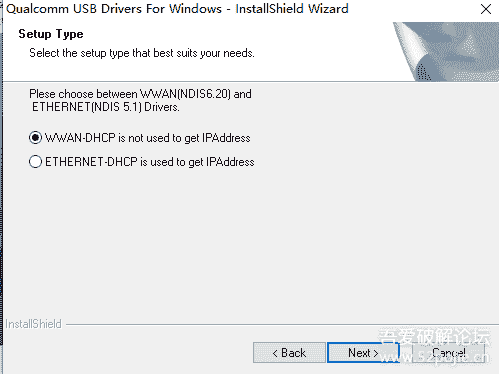

2023041811.png (22.24 KB, 下载次数: 1)，2023-4-19 11:30 上传

附件：[2023041811.png](https://www.52pojie.cn/forum.php?mod=attachment&aid=MjYwODcxM3w1NjVjMGI4YnwxNzkzNTY5NTA3fDE2ODA4NnwxNzc1ODA1&nothumb=yes)

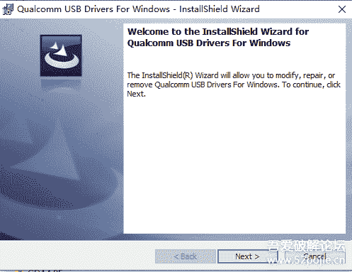

2023041812.png (67.41 KB, 下载次数: 0)，2023-4-19 11:30 上传

附件：[2023041812.png](https://www.52pojie.cn/forum.php?mod=attachment&aid=MjYwODcxNHxlNGFkYjg2ZnwxNzkzNTY5NTA3fDE2ODA4NnwxNzc1ODA1&nothumb=yes)

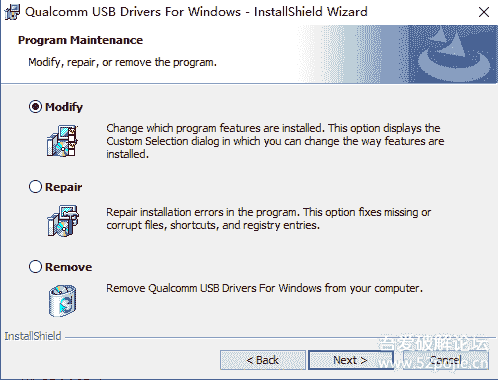

2023041813.png (35.95 KB, 下载次数: 0)，2023-4-19 11:30 上传

附件：[2023041813.png](https://www.52pojie.cn/forum.php?mod=attachment&aid=MjYwODcxNXw2ZGUwZjcwZHwxNzkzNTY5NTA3fDE2ODA4NnwxNzc1ODA1&nothumb=yes)

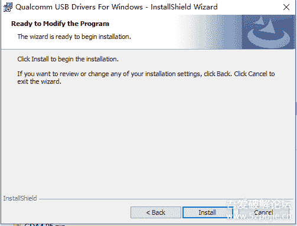

2023041815.png (29.01 KB, 下载次数: 0)，2023-4-19 11:30 上传

附件：[2023041815.png](https://www.52pojie.cn/forum.php?mod=attachment&aid=MjYwODcxN3wyMzc5YjRiYnwxNzkzNTY5NTA3fDE2ODA4NnwxNzc1ODA1&nothumb=yes)

- 用管理员权限打开`cmd`,输入命令开启测试模式,然后重启电脑

```
bcdedit /set testsigning on
```

- 检查测试模式是否打开,重启后电脑桌面右下角出现下图所示就是成功,可继续下一步


2023041819.png (18.7 KB, 下载次数: 1)，2023-4-19 11:30 上传

附件：[2023041819.png](https://www.52pojie.cn/forum.php?mod=attachment&aid=MjYwODcyMnwyOWM5NGIzZHwxNzkzNTY5NTA3fDE2ODA4NnwxNzc1ODA1&nothumb=yes)

#### 刷入固件包

- 电脑解压固件包`guacamoleb_14_P.32_210127.zip`,

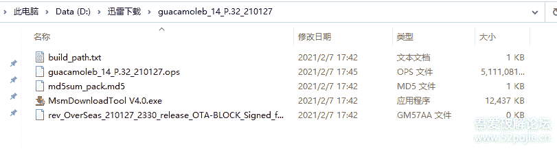

2023041820.png (29.3 KB, 下载次数: 2)，2023-4-19 11:30 上传

附件：[2023041820.png](https://www.52pojie.cn/forum.php?mod=attachment&aid=MjYwODcyM3xmNjY1NmJkMHwxNzkzNTY5NTA3fDE2ODA4NnwxNzc1ODA1&nothumb=yes)

- 启动软件`MsmDownloadTool V4.0.exe`

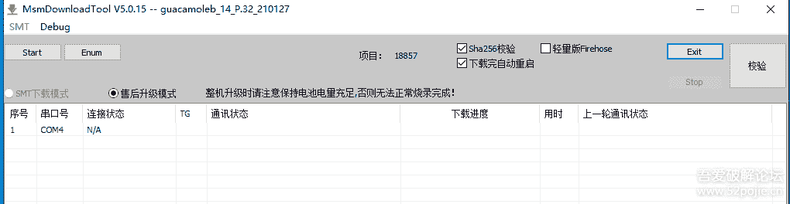

2023041821.png (21.94 KB, 下载次数: 1)，2023-4-19 11:31 上传

附件：[2023041821.png](https://www.52pojie.cn/forum.php?mod=attachment&aid=MjYwODcyNHw1NWUxNDNmNHwxNzkzNTY5NTA3fDE2ODA4NnwxNzc1ODA1&nothumb=yes)

- 点击`start`,等待手机进入`edl`模式

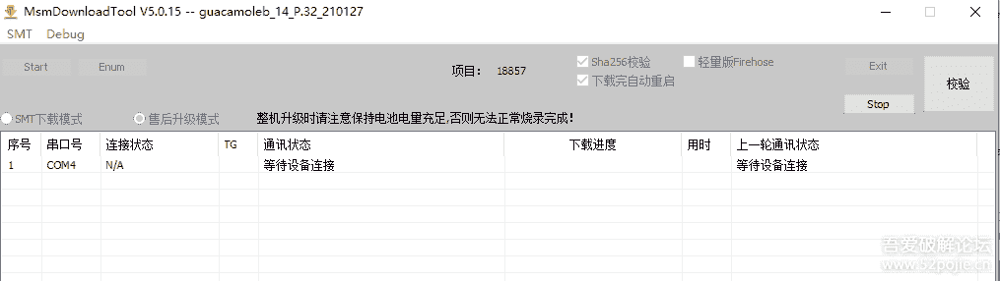

2023041822.png (21.38 KB, 下载次数: 1)，2023-4-19 11:31 上传

附件：[2023041822.png](https://www.52pojie.cn/forum.php?mod=attachment&aid=MjYwODcyNXwwZDdmMDFiNnwxNzkzNTY5NTA3fDE2ODA4NnwxNzc1ODA1&nothumb=yes)

- 手机进入`edl`模式,`MsmDownloadTool`会自动输入android 10系统
- 方式1:手机关机,数据线连接电脑,然后同时按住音量上键和下键
- 方式2: 如果手机还可以开机,还可以连接`adb`

```
adb reboot edl
```

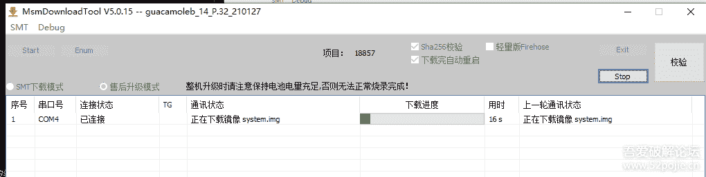

2023041823.png (22.61 KB, 下载次数: 1)，2023-4-19 11:31 上传

附件：[2023041823.png](https://www.52pojie.cn/forum.php?mod=attachment&aid=MjYwODcyNnw4NzU0NDdkOXwxNzkzNTY5NTA3fDE2ODA4NnwxNzc1ODA1&nothumb=yes)

- 等待系统刷入,进入简单设置下

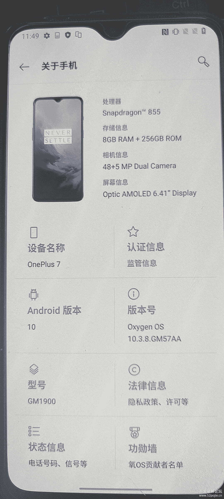

2023041824.jpg (324.31 KB, 下载次数: 1)，2023-4-19 11:31 上传

附件：[2023041824.jpg](https://www.52pojie.cn/forum.php?mod=attachment&aid=MjYwODcyN3w0Yzk2YWNlZXwxNzkzNTY5NTA3fDE2ODA4NnwxNzc1ODA1&nothumb=yes)

#### 解锁手机bootloader

- 打开手机开发者模式, 开启`adb`调试

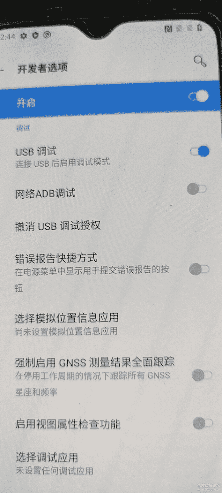

202304182.jpg (284.8 KB, 下载次数: 2)，2023-4-19 11:32 上传

附件：[202304182.jpg](https://www.52pojie.cn/forum.php?mod=attachment&aid=MjYwODczN3w5NDM4NDdkY3wxNzkzNTY5NTA3fDE2ODA4NnwxNzc1ODA1&nothumb=yes)

- 开启oem解锁

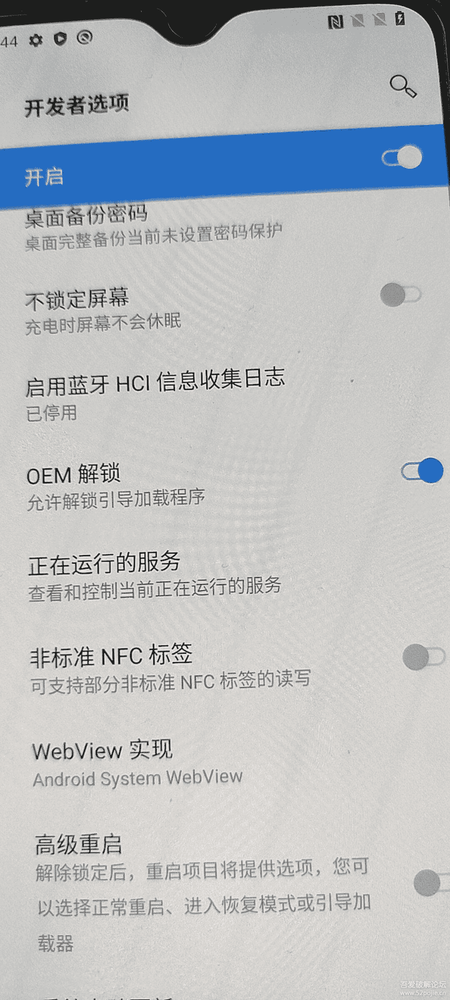

202304181.jpg (401.31 KB, 下载次数: 1)，2023-4-19 11:32 上传

附件：[202304181.jpg](https://www.52pojie.cn/forum.php?mod=attachment&aid=MjYwODczNnxlZmE2ZTcwZnwxNzkzNTY5NTA3fDE2ODA4NnwxNzc1ODA1&nothumb=yes)

- 使用命令,进入`fastboot`模式

```
adb reboot bootloader
```

- 使用命令解锁

```
fastboot oem unlock
```

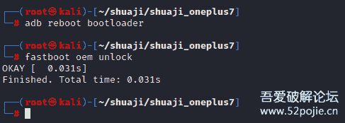

2023041824.png (28.68 KB, 下载次数: 1)，2023-4-19 11:31 上传

附件：[2023041824.png](https://www.52pojie.cn/forum.php?mod=attachment&aid=MjYwODcyOHwxOTA0M2QzOXwxNzkzNTY5NTA3fDE2ODA4NnwxNzc1ODA1&nothumb=yes)

- 选择"UNLOCK THE BOOTLOADER",等待重启,进入,重新设置usb调试和开发者模式

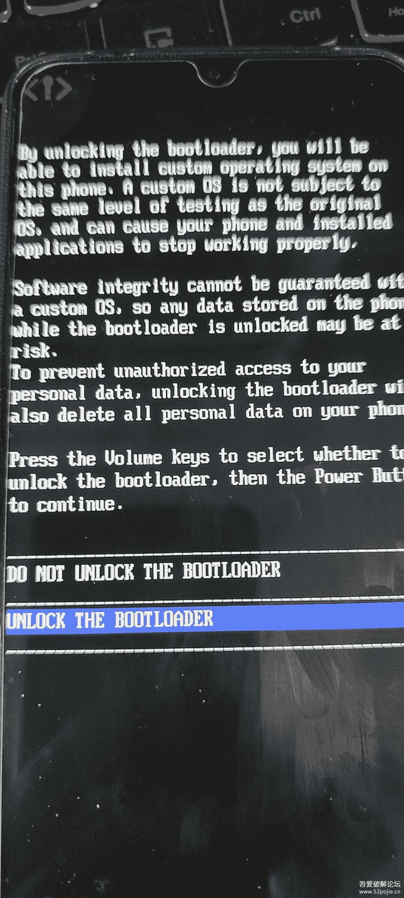

2023041818.jpg (442.33 KB, 下载次数: 1)，2023-4-19 11:30 上传

附件：[2023041818.jpg](https://www.52pojie.cn/forum.php?mod=attachment&aid=MjYwODcyMHxmNjgzOWE3YXwxNzkzNTY5NTA3fDE2ODA4NnwxNzc1ODA1&nothumb=yes)

#### 刷入twrp

- 重启手机到`fastboot`模式

```
adb reboot bootloader
```

- 刷入twrp

```
fastboot boot twrp.img
```

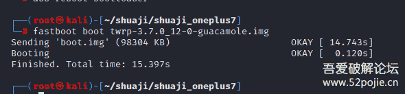

2023041825.png (30.88 KB, 下载次数: 2)，2023-4-19 11:31 上传

附件：[2023041825.png](https://www.52pojie.cn/forum.php?mod=attachment&aid=MjYwODcyOXwyNzE2NzE5MnwxNzkzNTY5NTA3fDE2ODA4NnwxNzc1ODA1&nothumb=yes)

- 这里安装完就直接进入revovery模式,twrp系统中,
- 操作界面选择 `Advanced->Flash Current TWRP`

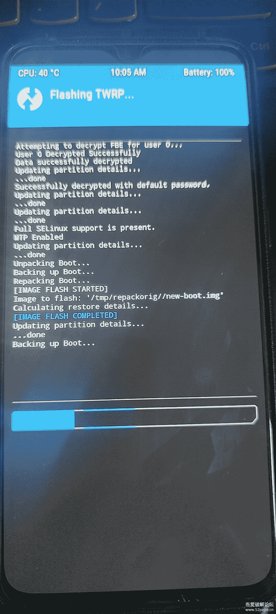

2023041826.jpg (388.02 KB, 下载次数: 1)，2023-4-19 11:31 上传

附件：[2023041826.jpg](https://www.52pojie.cn/forum.php?mod=attachment&aid=MjYwODczMHw1OWNiZTA2NXwxNzkzNTY5NTA3fDE2ODA4NnwxNzc1ODA1&nothumb=yes)

- 操作界面选择 `Wipe->Format Data->输入yes`

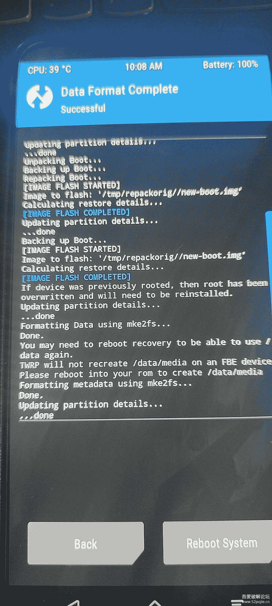

2023041827.jpg (400.48 KB, 下载次数: 1)


[href="forum.php?mod=attachment&aid=MjYwODczMXwxYzMyM2JlMHwxNzkzNTY5NTA3fDE2ODA4NnwxNzc1ODA1&nothumb=yes" target="_blank"](https://www.52pojie.cn/forum.php?mod=attachment&aid=MjYwODczMXwxYzMyM2JlMHwxNzkzNTY5NTA3fDE2ODA4NnwxNzc1ODA1&nothumb=yes)

2023-4-19 11:31 上传

- 这时候不要重启

## 刷入 Magisk

- `Advanced->ADB Sideload->Swipe to Start Sideload`

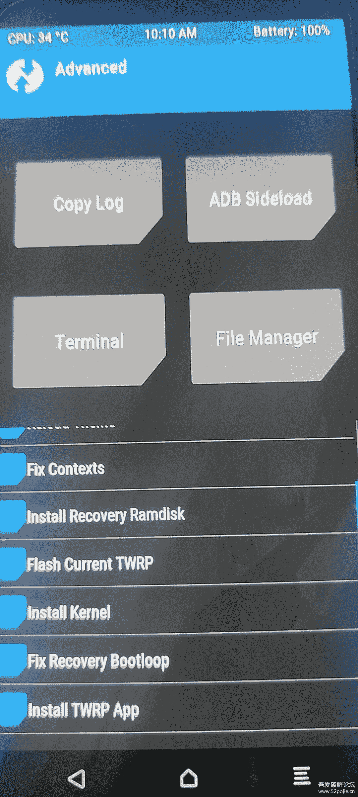

2023041828.jpg (323.53 KB, 下载次数: 1)

[href="forum.php?mod=attachment&aid=MjYwODczMnw2Y2VkNTFmYnwxNzkzNTY5NTA3fDE2ODA4NnwxNzc1ODA1&nothumb=yes" target="_blank"](https://www.52pojie.cn/forum.php?mod=attachment&aid=MjYwODczMnw2Y2VkNTFmYnwxNzkzNTY5NTA3fDE2ODA4NnwxNzc1ODA1&nothumb=yes)

2023-4-19 11:31 上传

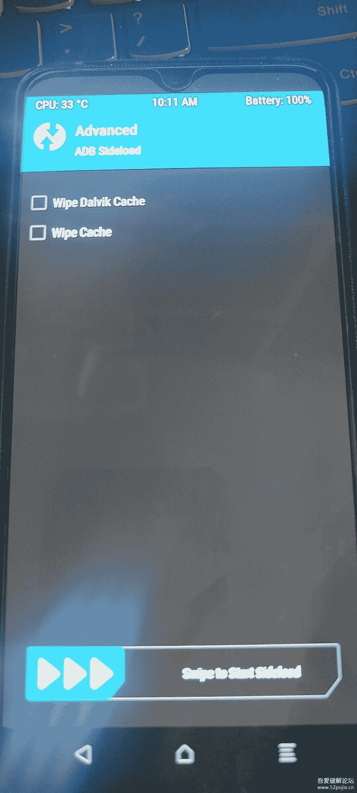

2023041829.jpg (296.27 KB, 下载次数: 1)

[href="forum.php?mod=attachment&aid=MjYwODczM3wwMmRiZmI3Y3wxNzkzNTY5NTA3fDE2ODA4NnwxNzc1ODA1&nothumb=yes" target="_blank"](https://www.52pojie.cn/forum.php?mod=attachment&aid=MjYwODczM3wwMmRiZmI3Y3wxNzkzNTY5NTA3fDE2ODA4NnwxNzc1ODA1&nothumb=yes)

2023-4-19 11:31 上传

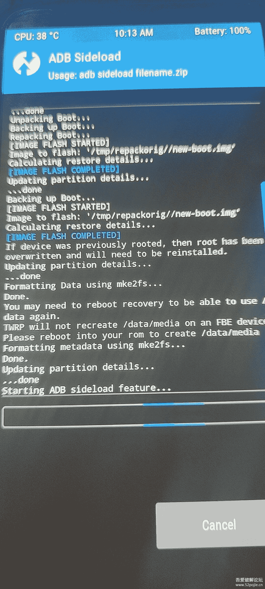

2023041830.jpg (409.12 KB, 下载次数: 0)

[href="forum.php?mod=attachment&aid=MjYwODczNHw3NzZmZDhiYXwxNzkzNTY5NTA3fDE2ODA4NnwxNzc1ODA1&nothumb=yes" target="_blank"](https://www.52pojie.cn/forum.php?mod=attachment&aid=MjYwODczNHw3NzZmZDhiYXwxNzkzNTY5NTA3fDE2ODA4NnwxNzc1ODA1&nothumb=yes)

2023-4-19 11:31 上传

- 输入命令，刷入`Magisk.zip`

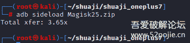

2023041832.png (20.79 KB, 下载次数: 0)

[href="forum.php?mod=attachment&aid=MjYwODc2MHxhMjlkZGQzM3wxNzkzNTY5NTA3fDE2ODA4NnwxNzc1ODA1&nothumb=yes" target="_blank"](https://www.52pojie.cn/forum.php?mod=attachment&aid=MjYwODc2MHxhMjlkZGQzM3wxNzkzNTY5NTA3fDE2ODA4NnwxNzc1ODA1&nothumb=yes)

2023-4-19 13:35 上传

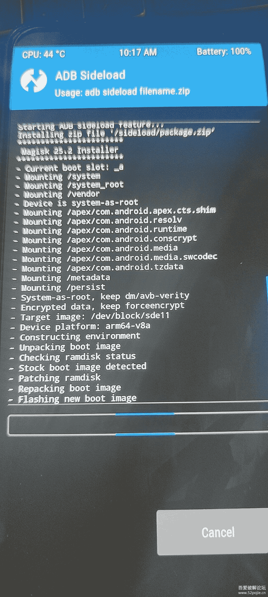

2023041831.jpg (413.52 KB, 下载次数: 1)

[href="forum.php?mod=attachment&aid=MjYwODc1OXw5NjRmYjVhN3wxNzkzNTY5NTA3fDE2ODA4NnwxNzc1ODA1&nothumb=yes" target="_blank"](https://www.52pojie.cn/forum.php?mod=attachment&aid=MjYwODc1OXw5NjRmYjVhN3wxNzkzNTY5NTA3fDE2ODA4NnwxNzc1ODA1&nothumb=yes)

2023-4-19 13:35 上传

## 刷入 `Disable_Dm-Verity_ForceEncrypt_11.02.2020.zip`

- `Advanced->ADB Sideload->Swipe to Start Sideload`

- 刷入`Disable_Dm-Verity_ForceEncrypt_11.02.2020.zip`，出现 Select Option 的时候，按音量+键

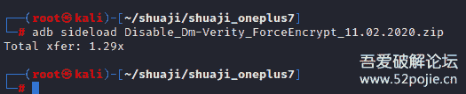

2023041833.png (22.72 KB, 下载次数: 1)

[href="forum.php?mod=attachment&aid=MjYwODc2MXw2NWU5ZTRkN3wxNzkzNTY5NTA3fDE2ODA4NnwxNzc1ODA1&nothumb=yes" target="_blank"](https://www.52pojie.cn/forum.php?mod=attachment&aid=MjYwODc2MXw2NWU5ZTRkN3wxNzkzNTY5NTA3fDE2ODA4NnwxNzc1ODA1&nothumb=yes)

2023-4-19 13:35 上传

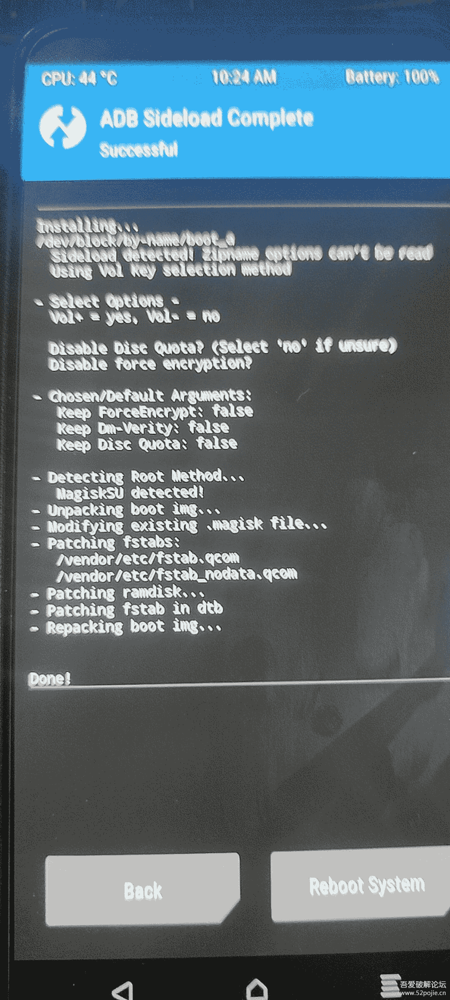

2023041834.jpg (365.71 KB, 下载次数: 1)

[href="forum.php?mod=attachment&aid=MjYwODc2Mnw1YWVmZDJlNHwxNzkzNTY5NTA3fDE2ODA4NnwxNzc1ODA1&nothumb=yes" target="_blank"](https://www.52pojie.cn/forum.php?mod=attachment&aid=MjYwODc2Mnw1YWVmZDJlNHwxNzkzNTY5NTA3fDE2ODA4NnwxNzc1ODA1&nothumb=yes)

2023-4-19 13:36 上传

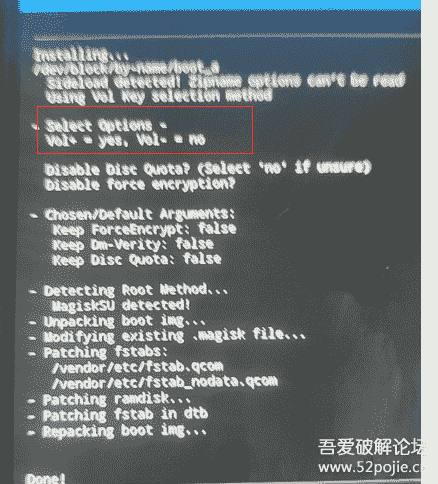

2023041834.png (362.02 KB, 下载次数: 2)

[href="forum.php?mod=attachment&aid=MjYwODc2M3w5ZjQ1NzBkMHwxNzkzNTY5NTA3fDE2ODA4NnwxNzc1ODA1&nothumb=yes" target="_blank"](https://www.52pojie.cn/forum.php?mod=attachment&aid=MjYwODc2M3w5ZjQ1NzBkMHwxNzkzNTY5NTA3fDE2ODA4NnwxNzc1ODA1&nothumb=yes)

2023-4-19 13:36 上传

- 重启，进入设置，其中有个设置选“无”


2023041835.jpg (299.21 KB, 下载次数: 0)

[href="forum.php?mod=attachment&aid=MjYwODc2NHxhZWRmOGIxMHwxNzkzNTY5NTA3fDE2ODA4NnwxNzc1ODA1&nothumb=yes" target="_blank"](https://www.52pojie.cn/forum.php?mod=attachment&aid=MjYwODc2NHxhZWRmOGIxMHwxNzkzNTY5NTA3fDE2ODA4NnwxNzc1ODA1&nothumb=yes)

2023-4-19 13:36 上传

## 刷入 nethunter

- 重启到 fastboot 模式，然后音量键-进入 recovery 模式，重新进入 twrp

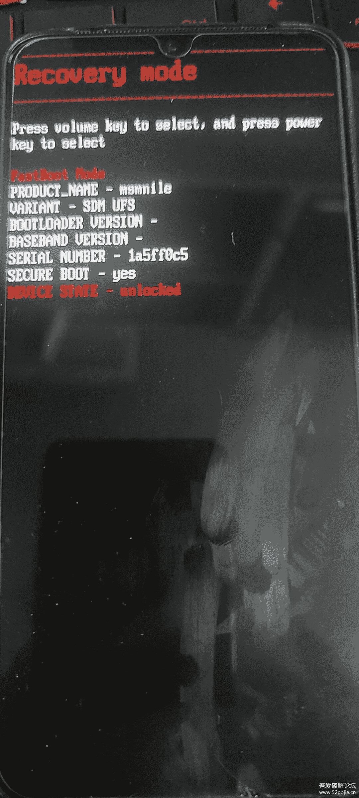

2023041836.jpg (269.07 KB, 下载次数: 1)

[href="forum.php?mod=attachment&aid=MjYwODc2NXxmZjZhMzZjMnwxNzkzNTY5NTA3fDE2ODA4NnwxNzc1ODA1&nothumb=yes" target="_blank"](https://www.52pojie.cn/forum.php?mod=attachment&aid=MjYwODc2NXxmZjZhMzZjMnwxNzkzNTY5NTA3fDE2ODA4NnwxNzc1ODA1&nothumb=yes)

2023-4-19 13:36 上传

- `Advanced->ADB Sideload->Swipe to Start Sideload`

- 输入命令，刷入“`kernel-nethunter-2021.3-oneplus7-oos-ten.zip`”

```
adb sideload kernel-nethunter-2021.3-oneplus7-oos-ten.zip
```

- `Advanced->ADB Sideload->Swipe to Start Sideload`

- 输入命令，输入“`nethunter-2022.1-oneplus7-oos-ten-kalifs-full.zip`”

```
adb sideload nethunter-2022.1-oneplus7-oos-ten-kalifs-full.zip
```

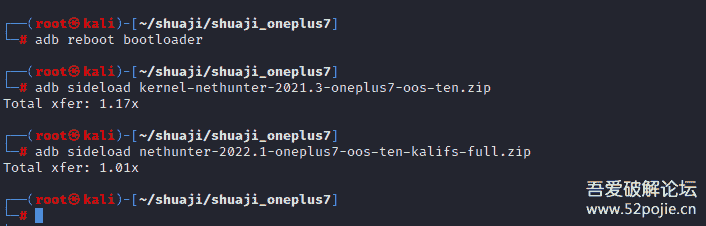

2023041838.png (39.84 KB, 下载次数: 1)

[href="forum.php?mod=attachment&aid=MjYwODc2NnxhNDgwNWQ0YXwxNzkzNTY5NTA3fDE2ODA4NnwxNzc1ODA1&nothumb=yes" target="_blank"](https://www.52pojie.cn/forum.php?mod=attachment&aid=MjYwODc2NnxhNDgwNWQ0YXwxNzkzNTY5NTA3fDE2ODA4NnwxNzc1ODA1&nothumb=yes)

2023-4-19 13:36 上传

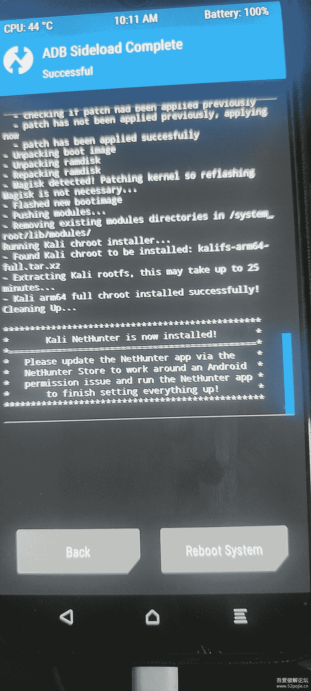

2023041839.jpg (380.46 KB, 下载次数: 1)

[href="forum.php?mod=attachment&aid=MjYwODc2N3w2OWY4Yzg2OHwxNzkzNTY5NTA3fDE2ODA4NnwxNzc1ODA1&nothumb=yes" target="_blank"](https://www.52pojie.cn/forum.php?mod=attachment&aid=MjYwODc2N3w2OWY4Yzg2OHwxNzkzNTY5NTA3fDE2ODA4NnwxNzc1ODA1&nothumb=yes)

2023-4-19 13:36 上传


2023041840.jpg (308.23 KB, 下载次数: 1)

[href="forum.php?mod=attachment&aid=MjYwODc2OHw3OWIxNDVhNHwxNzkzNTY5NTA3fDE2ODA4NnwxNzc1ODA1&nothumb=yes" target="_blank"](https://www.52pojie.cn/forum.php?mod=attachment&aid=MjYwODc2OHw3OWIxNDVhNHwxNzkzNTY5NTA3fDE2ODA4NnwxNzc1ODA1&nothumb=yes)

2023-4-19 13:36 上传


2023041841.jpg (262.98 KB, 下载次数: 1)

[href="forum.php?mod=attachment&aid=MjYwODc3Mnw1YzEwNzRkOXwxNzkzNTY5NTA3fDE2ODA4NnwxNzc1ODA1&nothumb=yes" target="_blank"](https://www.52pojie.cn/forum.php?mod=attachment&aid=MjYwODc3Mnw1YzEwNzRkOXwxNzkzNTY5NTA3fDE2ODA4NnwxNzc1ODA1&nothumb=yes)

2023-4-19 13:38 上传

## 安装一个 magisk

- 输入命令安装`magisk.app`


```
adb install magisk.app
```


`2023041844.png` (17.08 KB, 下载次数: 1)

[href="forum.php?mod=attachment&aid=MjYwODc3M3xlN2ZlZTczOHwxNzkzNTY5NTA3fDE2ODA4NnwxNzc1ODA1&nothumb=yes" target="_blank"](https://www.52pojie.cn/forum.php?mod=attachment&aid=MjYwODc3M3xlN2ZlZTczOHwxNzkzNTY5NTA3fDE2ODA4NnwxNzc1ODA1&nothumb=yes)

2023-4-19 13:38 上传


`2023041845.jpg` (346.43 KB, 下载次数: 0)

[href="forum.php?mod=attachment&aid=MjYwODc3NXw3ZGQ3MDhlOHwxNzkzNTY5NTA3fDE2ODA4NnwxNzc1ODA1&nothumb=yes" target="_blank"](https://www.52pojie.cn/forum.php?mod=attachment&aid=MjYwODc3NXw3ZGQ3MDhlOHwxNzkzNTY5NTA3fDE2ODA4NnwxNzc1ODA1&nothumb=yes)

2023-4-19 13:38 上传

## 4. 初始化Nethunter

- 联wifi,修改时间
- 打开图中红圈得nethunter

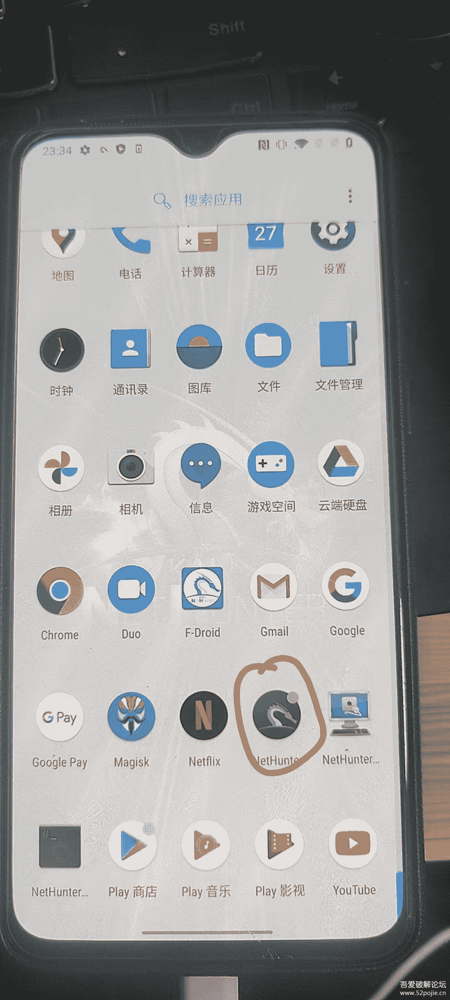

`2023041846.jpg` (284.87 KB, 下载次数: 1)

[href="forum.php?mod=attachment&aid=MjYwODc3NnxmNDg4YmQ3MXwxNzkzNTY5NTA3fDE2ODA4NnwxNzc1ODA1&nothumb=yes" target="_blank"](https://www.52pojie.cn/forum.php?mod=attachment&aid=MjYwODc3NnxmNDg4YmQ3MXwxNzkzNTY5NTA3fDE2ODA4NnwxNzc1ODA1&nothumb=yes)

2023-4-19 13:38 上传

- 点击kali Chroot Manager

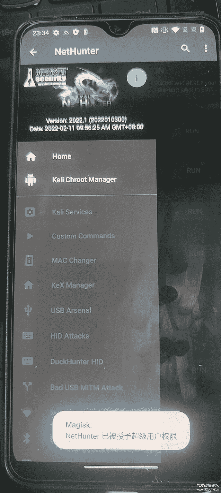

`2023041847.jpg` (277.95 KB, 下载次数: 2)

[href="forum.php?mod=attachment&aid=MjYwODc3N3w3NTVmNTQxNXwxNzkzNTY5NTA3fDE2ODA4NnwxNzc1ODA1&nothumb=yes" target="_blank"](https://www.52pojie.cn/forum.php?mod=attachment&aid=MjYwODc3N3w3NTVmNTQxNXwxNzkzNTY5NTA3fDE2ODA4NnwxNzc1ODA1&nothumb=yes)

2023-4-19 13:38 上传

- 点击START KALI CHROOT


`2023041848.jpg` (344.76 KB, 下载次数: 0)

[href="forum.php?mod=attachment&aid=MjYwODc3OHw5YjQ4YzhhNXwxNzkzNTY5NTA3fDE2ODA4NnwxNzc1ODA1&nothumb=yes" target="_blank"](https://www.52pojie.cn/forum.php?mod=attachment&aid=MjYwODc3OHw5YjQ4YzhhNXwxNzkzNTY5NTA3fDE2ODA4NnwxNzc1ODA1&nothumb=yes)

2023-4-19 13:38 上传

- 成功


`2023041849.jpg` (532.9 KB, 下载次数: 1)

[href="forum.php?mod=attachment&aid=MjYwODc3OXw4OWU1ZDc5MXwxNzkzNTY5NTA3fDE2ODA4NnwxNzc1ODA1&nothumb=yes" target="_blank"](https://www.52pojie.cn/forum.php?mod=attachment&aid=MjYwODc3OXw4OWU1ZDc5MXwxNzkzNTY5NTA3fDE2ODA4NnwxNzc1ODA1&nothumb=yes)

2023-4-19 13:38 上传

- 验证,打开命令行窗口,输入命令

```
apt update
```

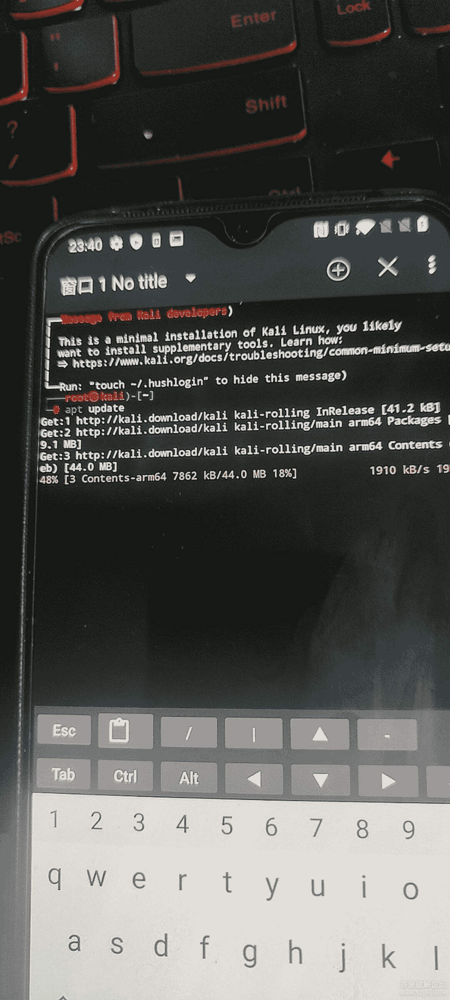

`2023041850.jpg` (310.13 KB, 下载次数: 3)

[href="forum.php?mod=attachment&aid=MjYwODc4MHwzYjgwNjhlOHwxNzkzNTY5NTA3fDE2ODA4NnwxNzc1ODA1&nothumb=yes" target="_blank"](https://www.52pojie.cn/forum.php?mod=attachment&aid=MjYwODc4MHwzYjgwNjhlOHwxNzkzNTY5NTA3fDE2ODA4NnwxNzc1ODA1&nothumb=yes)

2023-4-19 13:39 上传
