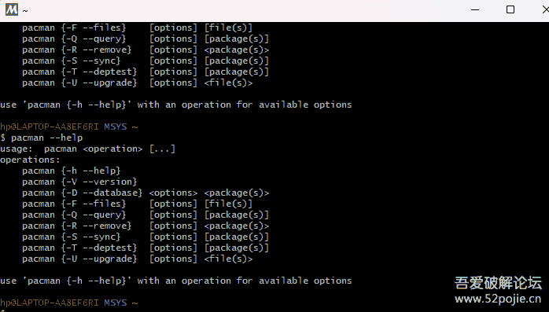
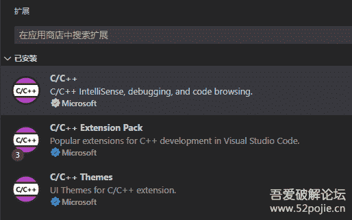
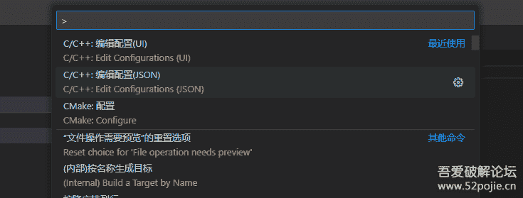

# [Android 原创] luckfollowme arm 学习篇(1) --环境搭建1

- 原帖：`https://www.52pojie.cn/forum.php?mod=viewthread&tid=1778681`
- 抓取时间：2026-11-01T21:45:04

## luckfollowme arm 学习篇(1) --环境搭建1

自从上次用 mt 开源的签名校验简单说了一下过程，然后很多人问我具体原理是啥。但是我不敢答。

因为我也想知道呀，我连 c++ 都看不懂。更别说那个 xhook hook `open` 一系列函数能解决签名校验问题。

在我研究 xhook 过程中，我一顿乱搜。跳到了一个坑

- elf PLT 重定向hook
- arm inline hook

elf 看了看。没看懂。故先从 arm 开始。

为了学 arm，我用了 1 个月快速入门 c++ ndk 等等基础的东西，当然我个人是急性子，教程太多都不知道怎么看，是否正规也不清楚，摸石头过桥，后面有不合理的地方也欢迎指出。

后面教程希望您跟我一样，起码学 1 个星期 c++ 在过来，这样您应该跟我一个水准了。我相信看这章都跟我一样是新手，right？

### 安装 `gcc` `g++` `gdb`

`gcc` `g++` 您可以理解为编译 c 和 c++ 的编译器

`gdb` 是用来 debug 用的

当然安装我们可以使用 msys 进行安装

下载地址：`https://www.msys2.org/`

下载完打开你会发现类似 `git` 的窗口



`03.png`（39.4 KB，下载次数: 1）

[附件下载](https://www.52pojie.cn/forum.php?mod=attachment&aid=MjYxMDQ0OHwwM2RlNTBlZHwxNzkzNTY5NTAxfDE2ODA4NnwxNzc4Njgx&nothumb=yes)

2023-4-26 00:59 上传

其中有个很重要的命令 `pacman`。我把它理解为包管理器。

输入下面命令安装 `mingw-w64` 工具链：

```
pacman -S --needed base-devel mingw-w64-x86_64-toolchain
```

这个工具链有着 `gcc`、`g++`、`gdb` 等工具，来帮助我们把 c++ 编译成 windows 可执行程序。

为什么不是 android（linux） 可执行文件？后面会说。

安装好后，在您 `msys2` 的 `mingw64` 的 `bin` 目录下会有我们想要的文件。

`F:\c++\msys2\mingw64\bin`

您可以考虑放在 `path` 路径下，这样命令窗口可以直接用 `g++`、`gcc` 等命令了。

### 配置 vscode 编写 c++ 代码

为什么选 vscode 呢？明明 visual studio 自动集成环境更方便。

我觉得像我这种新手，用 vscode 自己搭建环境更能多了解下编译过程。

再者 vscode 插件丰富，什么语言都支持，看些开源代码更容易。

1. 创建我们编写代码的目录，名字随意，我就叫 `practice` 了。
2. 安装 c++ 插件，按 `Ctrl+shift+X` 跳到插件安装界面。



`01.png`（29.48 KB，下载次数: 1）

[附件下载](https://www.52pojie.cn/forum.php?mod=attachment&aid=MjYxMDQ0NnwwM2VlMWFmNnwxNzkzNTY5NTAxfDE2ODA4NnwxNzc4Njgx&nothumb=yes)

2023-4-26 00:59 上传

这个插件能很好的帮我们 intellijSense，也就是智能提示。

3. 配置 c++ 的 intellijSense

在最上边有个“帮助 -> 显示所有命令”，然后搜索 `c++编辑配置`。



`02.png`（29.6 KB，下载次数: 1）

[附件下载](https://www.52pojie.cn/forum.php?mod=attachment&aid=MjYxMDQ0N3wwODc2NDBhOHwxNzkzNTY5NTAxfDE2ODA4NnwxNzc4Njgx&nothumb=yes)

2023-4-26 00:59 上传

然后您的 `c_cpp_properties.json` 文件配置应该如下：

```
{
    "configurations": [
        {
            "name": "Win32 g++",
            "includePath": [
                "${workspaceFolder}/**"
            ],
            "defines": [
                "_DEBUG",
                "UNICODE",
                "_UNICODE"
            ],
            "cStandard": "c17",
            "cppStandard": "c++17",
            "configurationProvider": "ms-vscode.cmake-tools",
            "compilerPath": "F:\\c++\\msys2\\mingw64\\bin\\g++.exe"
        }
    ],
    "version": 4
}
```

注意 `compilerPath` 写您 `mingw64` 下的的路径。

这样您应该就拥有了代码提示功能。

### hello word

一切基础从 hello word 开始，我也是这样过来的。

创建 `hello.cpp` 文件，这是 c++ 的源文件。

```
#include 
#include 
#include 

int main()
{
    std::vector msg {"Hello","World"};
    for(const std::string &word : msg){
        std::cout 
```

然后再当前目录下执行：

```
g++ -g .\hello.cpp -o hello.exe
```

您应该就可以得到一个 `hello.exe` 文件。

接下来执行下面命令，您就可以得到 `hello world` 字样。

```
./hello.exe
```

下一章我将介绍如何使用 android studio 中 ndk 的 `cmake` 工具链完成交叉编译成 linux 的可执行文件。
