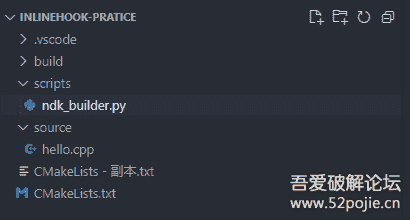
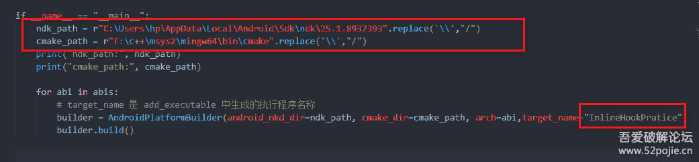
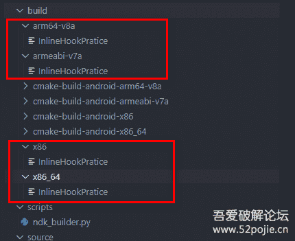
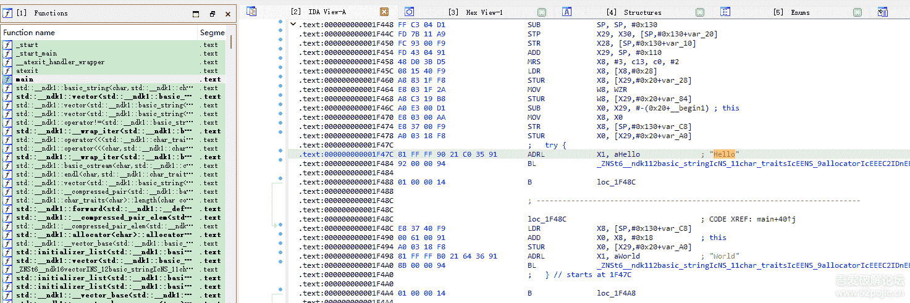

# [Android 原创] luckfollowme arm 学习篇(3) - NDK 交叉编译

- 原帖：<https://www.52pojie.cn/forum.php?mod=viewthread&tid=1778684>
- 抓取时间：2026-11-01T21:45:00

## luckfollowme arm 学习篇(3) - NDK 交叉编译

之前带大伙用 `cmake` 配置 `CMakeLists.txt`。

然后依然可以正常编译 Windows 的可执行文件。

可我们的主要目标是学习 arm hook，那么只构建 Windows 的可执行文件肯定是不行的。

这时候就需要我们的 `ndk` 的交叉编译工具了。

交叉编译，您可以理解成可以在 Windows 环境下构建基于 Linux 等其他平台的二进制文件。

### ABI 介绍

在构建之前，我说一下 `abi`。

`abi` 个人理解就是 CPU 架构生成的指令集。

我们需要在编译的时候指定下 `abi`（`arch`）。

`abi` 可以指定大概 4 种：

- `x86`
- `x86_64`
- `armeabi-v7a`
- `arm64-v8a`

后续我们会编译可能会指定 `abi` 生成，稍微注意一下即可。

### NDK 交叉编译工具

上一章也提到了 `ndk` `cmake` toolchain。

具体参考：[CMake 与 NDK 指南](https://developer.android.google.cn/ndk/guides/cmake?hl=zh-cn)。

要通过 `ndk` `cmake` 使用交叉工具链，参考：[CMake 工具链交叉编译 Android 文档](https://cmake.org/cmake/help/latest/manual/cmake-toolchains.7.html#cross-compiling-for-android)。

在 `CMake 3.21` 之后，貌似内置了 NDK 交叉编译工具链的支持，所以您只需要简单的参数即可：

```bash
-DCMAKE_SYSTEM_NAME=Android # 启动 android 的交叉编译环境
-DCMAKE_ANDROID_NDK=${HOME}/Android/Sdk/ndk/22.1.7171670 #设置使用的ndk路径
-DCMAKE_ANDROID_ARCH_ABI= x86|x86_64|armeabi-v7a|arm64-v8a # 设置abi arch 
-DCMAKE_SYSTEM_VERSION=21 # 设置android api 级别 有些 api不支持 arm64 21 算是最小支持arm64版本了
-DCMAKE_BUILD_TYPE=DEBUG|RELEASE # 编译是否优化
```

当然，我写了个 Python 脚本，能够快速编译 `x86`、`x86_64`、`armeabi-v7a`、`arm64-v8a` 等不同 `arch` 的二进制文件：

```python
import os
import shutil
import subprocess

abis = ["x86", "x86_64", "armeabi-v7a", "arm64-v8a"]

class AndroidPlatformBuilder(object):
    cmake_args = list()
    cmake_build_type = "Debug"  # "Debug|Release"
    project_dir = ""
    platform = "android"
    arch = ""
    android_api_level = 21

    def __init__(self, android_nkd_dir, cmake_dir, arch, target_name, project_dir="") -> None:
        # 如何没有写项目路径 默认上一层路径
        self.project_dir = project_dir if project_dir else os.path.dirname(os.path.dirname(os.path.realpath(__file__)))
        self.arch = arch
        self.target_name = target_name
        self.cmake_build_dir = os.path.normpath(f"{self.project_dir}/build/cmake-build-android-{arch}")
        self.build_output_dir = os.path.normpath(f"{self.project_dir}/build/{arch}")
        self.cmake = cmake_dir

        if arch == "armeabi-v7a" or arch == "x86":
            self.android_api_level = 19

        # cmake android 构建参数
        self.cmake_args += [
            "-DCMAKE_SYSTEM_NAME=Android",      # 启用android 交叉编译
            f"-DCMAKE_C_COMPILER=clang",        # ndk 是使用 clang 进行编译的
            f"-DCMAKE_CXX_COMPILER=clang++",
            f"-DCMAKE_BUILD_TYPE={self.cmake_build_type}",  # debug 调试信息多点 不会被优化 release 是最终优化版本
            f"-DCMAKE_ANDROID_NDK={android_nkd_dir}",       # ndk 路径
            f"-DCMAKE_SYSTEM_VERSION={self.android_api_level}", # arm64 架构是在 Android 5.0 (API level 21) 开始支持的
            f"-DCMAKE_ANDROID_ARCH_ABI={self.arch}"             # android arch abi
        ]

    def build(self):
        # 0.清空缓存
        if os.path.exists(self.cmake_build_dir):
            shutil.rmtree(self.cmake_build_dir)

        # 1.构建 adnroid  cmake 项目
        cmake_cmd_options = ["-S {}".format(self.project_dir), "-B {}".format(self.cmake_build_dir)]
        cmd = [f"{self.cmake}"] + cmake_cmd_options + self.cmake_args

        # 集合转换 string 命令
        cmd = " ".join(cmd)
        print(cmd)
        os.system(cmd)

        # 2. 根据cmake 项目 构建二进制文件
        if not os.path.exists(self.build_output_dir):
            os.makedirs(self.build_output_dir)

        subprocess.run(["cmake", "--build", "."], cwd=self.cmake_build_dir, check=True)
        print("cmake --build .")
        shutil.copyfile(f"{self.cmake_build_dir}/{self.target_name}", f"{self.build_output_dir}/{self.target_name}")

if __name__ == "__main__":
    ndk_path = r"C:\Users\hp\AppData\Local\Android\Sdk\ndk\25.1.8937393".replace('\\', "/")
    cmake_path = r"F:\c++\msys2\mingw64\bin\cmake".replace('\\', "/")
    print("ndk_path:", ndk_path)
    print("cmake_path:", cmake_path)

    for abi in abis:
        # target_name 是 add_executable 中生成的执行程序名称 
        builder = AndroidPlatformBuilder(android_nkd_dir=ndk_path, cmake_dir=cmake_path, arch=abi, target_name="InlineHookPratice")
        builder.build()
```

您把他复制到我图中所示的地方：



01.png（17.46 KB，下载次数：1）

[附件下载](https://www.52pojie.cn/forum.php?mod=attachment&aid=MjYxMDQ1MXxkNDlmNTUxZHwxNzkzNTY5NDk3fDE2ODA4NnwxNzc4Njg0&nothumb=yes)

2023-4-26 01:08 上传

修改您的 `NDK_PATH`、`CMAKE_PATH` 以及 `CMakeLists` 中您最终构建的可执行程序的 `target_name`。



02.png（38.63 KB，下载次数：1）

[附件下载](https://www.52pojie.cn/forum.php?mod=attachment&aid=MjYxMDQ1MnxjYTcyYjk5ZHwxNzkzNTY5NDk3fDE2ODA4NnwxNzc4Njg0&nothumb=yes)

2023-4-26 01:08 上传

执行后，您的 `build` 目录下应该会有以下文件：



03.png（29.06 KB，下载次数：1）

[附件下载](https://www.52pojie.cn/forum.php?mod=attachment&aid=MjYxMDQ1M3xlODYzY2JhZXwxNzkzNTY5NDk3fDE2ODA4NnwxNzc4Njg0&nothumb=yes)

2023-4-26 01:08 上传

### 浏览 arm64

我们将生成的 `arm64-v8a` 中的文件拖入到 `ida pro` 中，然后搜索 `main` 方法。您应该就可以看到对应的 `hello world` 字样。



04.png（110.86 KB，下载次数：1）

[附件下载](https://www.52pojie.cn/forum.php?mod=attachment&aid=MjYxMDQ1NHw2ZWRmZTZmYXwxNzkzNTY5NDk3fDE2ODA4NnwxNzc4Njg0&nothumb=yes)

2023-4-26 01:08 上传

由于用到 `std::` 里面的东西，生成的内容很多，导致我看点迷糊。

下章教程我们还是弄个简单的分析吧。
