# [Android 原创] 【简单教程】单机象棋解锁会员+免登录+精简布局

- 原帖：<https://www.52pojie.cn/forum.php?mod=viewthread&tid=1779407>
- 抓取时间：2026-11-01T21:44:54

## 前言

第一次发帖有点不懂，大家多多关照。这记做一次安卓逆向吧，好的开始。

要用到的工具有 mt管理器（浏览器有）。

前几天无聊[doge]想找个游戏玩玩，就去软件商店看看，发现一个单机象棋。看名字应该是单机，应该不要网络，但是这个游戏“驴唇不对马嘴”：不但不是单机，开局还要登录，索性就登录看看，没想到开局还要开会员！（纯纯圈钱软件）

这能忍

作为学习了一点小逆向，我直接打开 mt管理器。很简单的教程：`isvip` 改一即可。下面是我对软件修改的详细教程。

## 修改会员

### 软件与瘦身

软件

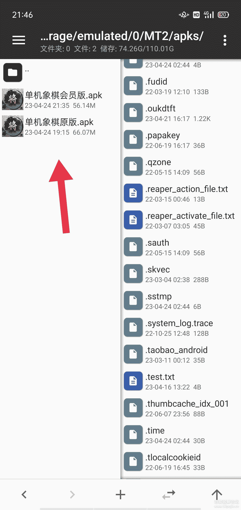

给它瘦身（把这几个删掉）

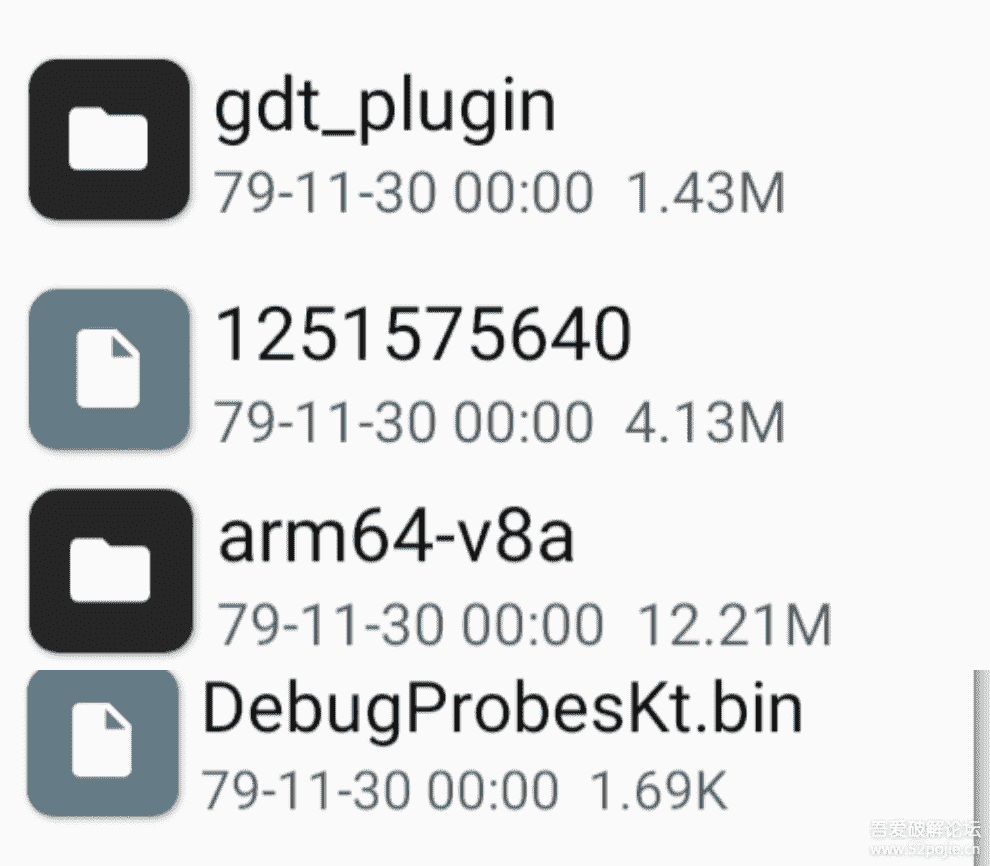

然后 `dex++` 打开。

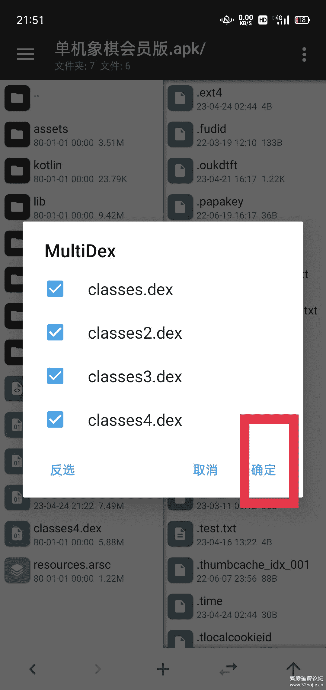

搜索关键词 `isvip` 方法名。

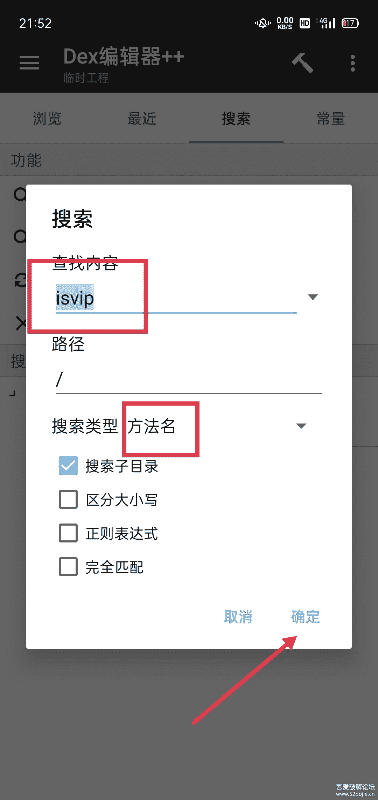

找到了一个进去看看。

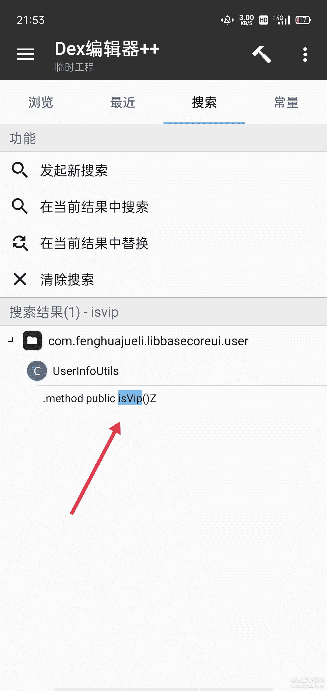

### 修改赋值

记住 848 行。进去之后发现它帮我们赋值 `const v0,0x0`，返回值是 `v1`，还有个跳转。这个就可以把 `0x0` 改为 `0x1`，然后把跳转注释掉，会员不就搞定了。

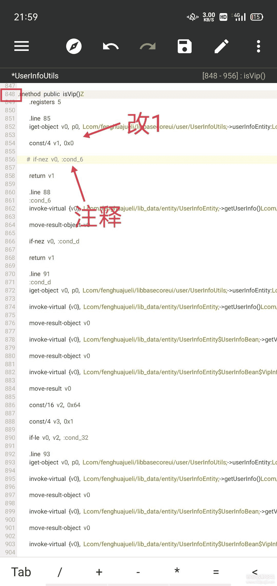

## 免登录

然后免登录，滑到 689 行。发现 697 它帮我们赋值了 `0x1`。我们可以猜一下 695 行会不会跳转到这呢（当然会啦）。看到 702 行没有，赋值的是 `0x0`。软件本身让你登录，怎么可能会不跳转到这呢？我们给它写个 `0x1`，这样它不管跳到哪都是不用登录的。

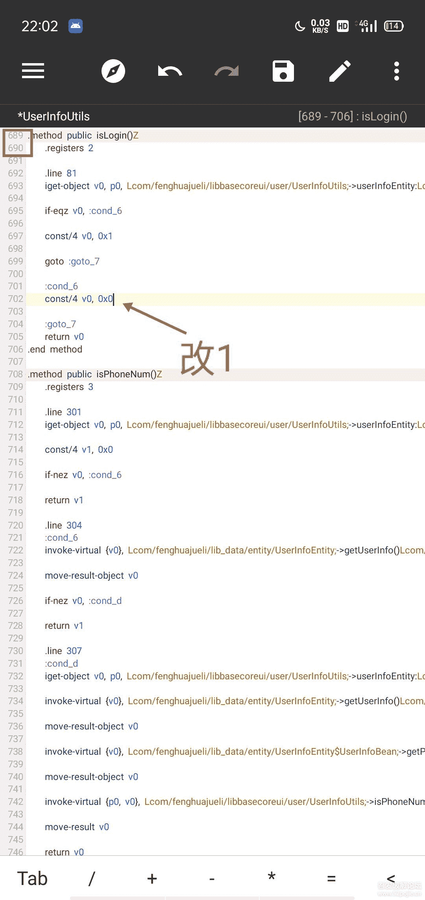

我进去发现会员功能已经解锁，但是点击开通会员和个人主页会闪退。我看了看都是些没啥用的功能，所以给它去掉。

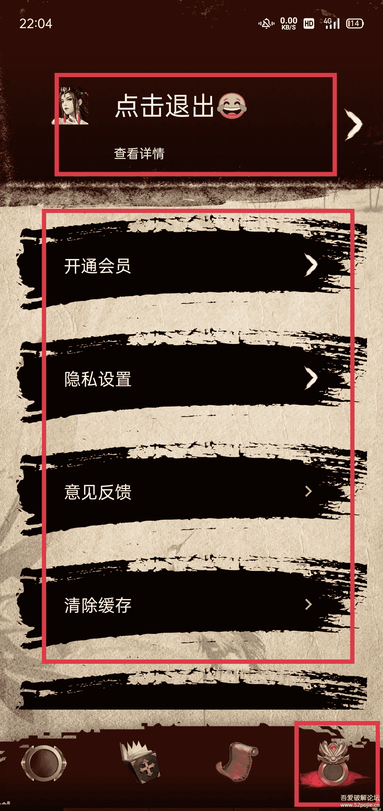

## 精简布局

打开开发者助手。软件要无障碍（给它就完了，不是啥锁机）。

然后打开软件点击界面资源分析。

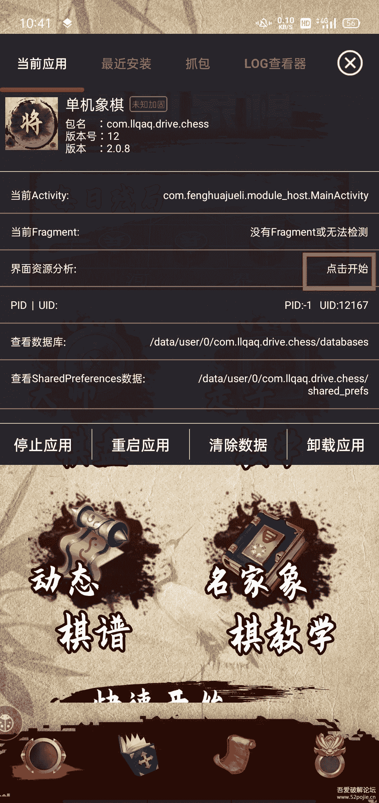

点击你要去掉的图标。

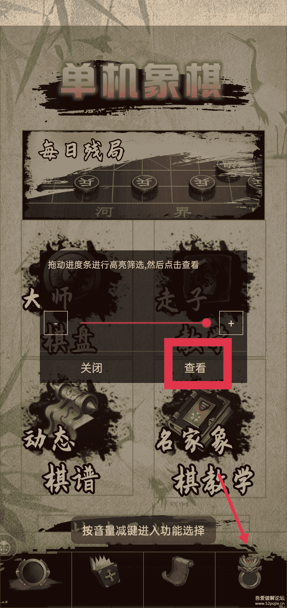

点击查看就可以看到图标的 `ID` 了，点击复制。

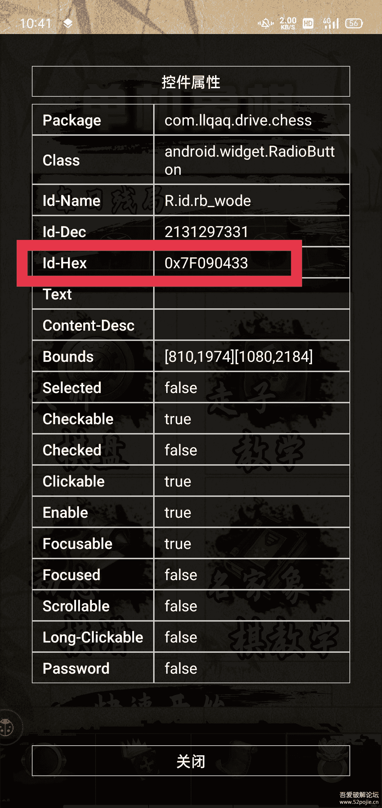

到 mt管理器点击软件查看。再点击右上角有 3 个点，就会弹出功能栏，选择 `xml搜索`。

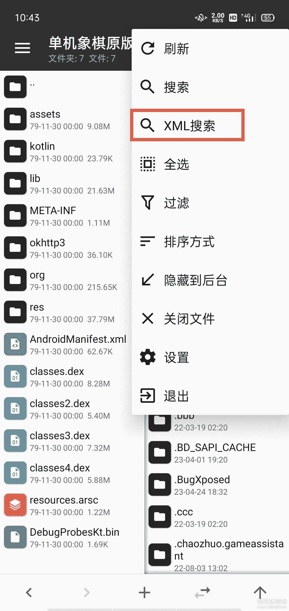

把刚刚复制的 `ID` 粘贴上去（记得把 `0x` 去掉）。

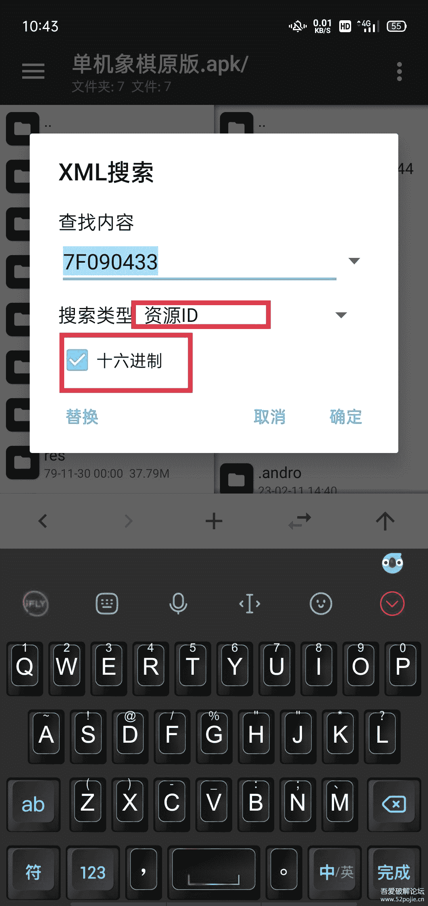

找到了进去看看。

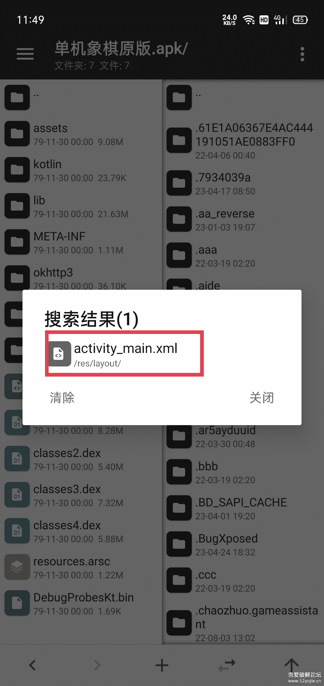

发现改 `0dp` 就可以把图标去掉。

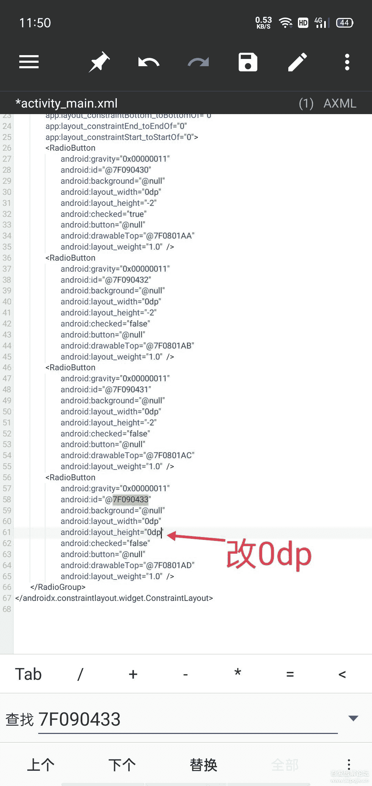

到这里也就改完了。

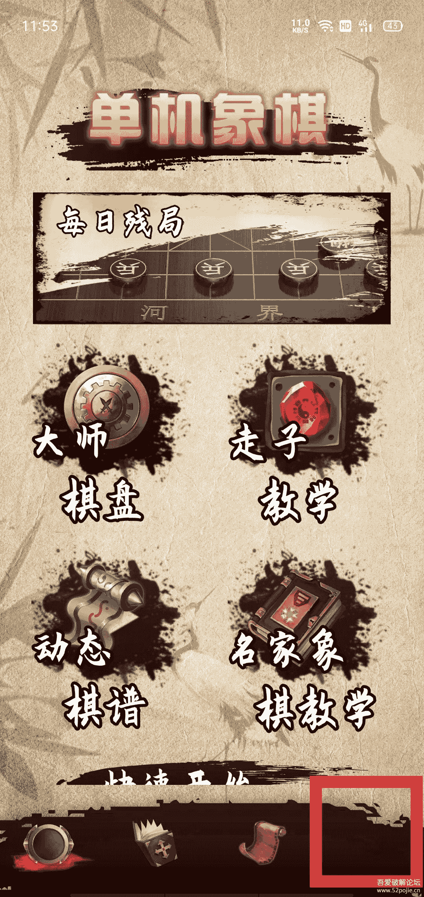

如果嫌麻烦的话，可以改完会员和登录就不用改了；如果有什么违规的话我再改。

## 成品与工具

- 成品：<https://wwpj.lanzoul.com/iOd3P0tw0tzg>，密码：0000
- 练手包（原版）：<https://wwpj.lanzoul.com/iCBTn0tw0wfe>，密码：630m
- 开发者助手工具：<https://wwpj.lanzoul.com/ihDRK0twcn9g>，密码：1s8c
