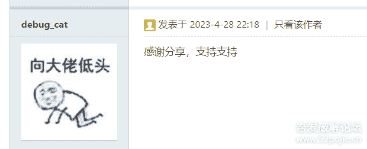

# [Android 原创] luckfollowme arm 学习篇 07 - dobby

- 原帖: https://www.52pojie.cn/forum.php?mod=viewthread&tid=1779984
- 抓取时间: 2026-11-01T21:44:50

## luckfollowme arm 学习篇 07 - dobby

首先感谢大佬的默默支持,让我有信心做下去。



01.png (35.78 KB, 下载次数: 2)

[附件](https://www.52pojie.cn/forum.php?mod=attachment&aid=MjYxMTI2OHw3YjRjZjJmNXwxNzkzNTY5NDg4fDE2ODA4NnwxNzc5OTg0&nothumb=yes)

2023-4-29 14:43 上传

后面空就会更新很慢了,因为越到后面就越在挑战我的知识储备了。

google一整天是什么感受？各位也有体会吧。

接下来才是正式讲解 inline hook 部分

我们的目标是能够手写 asm 并且能够尝试 inline hook 为主

目前常见的 inline hook 框架就是 dobby了。

应该说我只知道dobby

本次的目标就是通过 dobby hook 砸门的 sum 方法 。 并获取参数

### vscode 准备

在 `.vscode/c_cpp_properties.json`

为了方便提示,您应该修改如下:

```json
{
    "configurations": [
        {
            "name": "Win32 g++",
            "includePath": [
                "${workspaceFolder}/**",
                "C:\\Users\\hp\\AppData\\Local\\Android\\Sdk\\ndk\\25.1.8937393\\toolchains\\llvm\\prebuilt\\windows-x86_64\\sysroot\\usr\\include\\**",
                "C:/Users/hp/AppData/Local/Android/Sdk/ndk/25.1.8937393/toolchains/llvm/prebuilt/windows-x86_64/lib64/clang/14.0.6/include/**"
            ],
            "defines": [
                "_DEBUG",
                "UNICODE",
                "_UNICODE"
            ],
            "intelliSenseMode": "msvc-x64"
        }
    ],
    "version": 4
}
```

这在后面 引入 dobby 应该不至于会出现 红色警告

### 准备 dobby

首先在 github 上, 下载release 的 [dobby-android-all.tar.gz](https://github.com/jmpews/Dobby/releases/download/latest/dobby-android-all.tar.gz)

然后解压他们。

解压出来您会看到

- `arm64-v8a`
- `armeabi-v7a`
- `x86`
- `x86_64`
- `dobby.h`

点进去 `arm64-v8a`

您会发现有两个文件

- `dobby.a`
- `dobby.so`

通过我不懈努力的搜索,大概意思如下

`.a` 文件是 静态库,静态库一般用于与我们程序一起编译,打包出来的代码会混合在一起,类似直接把 source 源码整合在一起,这种执行效率高点,但是程序会变得很大。

`.so` 文件是动态库,动态库一般通过 `dlopen` 加载在内存中,随后我们通过 symbol 解析导出表符号的方法内存地址进行使用,向常见的系统库, `libart.so` `libc.so` 我们程序没有这种 so 但是在 android 执行却可以使用,因为我们在运行程序的时候 它就给我们预先 linker 进来了

所以为了方便,我们直接使用 `.a` 文件,整合在我们应用中使用

### 引入 dobby

创建 `libs` 目录 ,放入下面这些目录

- `arm64-v8a`
- `armeabi-v7a`
- `x86`
- `x86_64`

在 `source` 目录内 放入 `dobby.h`

### 链接 dobby.a

如何把 `dobby.a` 链接到我们的项目呢

答案肯定是 `cmake`

我们可以通过预构建库的 `IMPORTED` 来加入本地目录上的 静态库

然后需要设置 目标属性的 `IMPORTED_LOCATION`

```
# 添加导入库 IMPORTED 代表是从磁盘上获取的

add_library(DOBBY_LIB STATIC IMPORTED)

# 设置目标的磁盘上主文件的完整路径 CMAKE_SOURCE_DIR 是 cmake的 variables 代表当前 cmake 来源路径

set_target_properties(DOBBY_LIB PROPERTIES IMPORTED_LOCATION ${CMAKE_CURRENT_SOURCE_DIR}/libs/${CMAKE_ANDROID_ARCH_ABI}/libdobby.a)
```

具体文档可以查看 `add_library` 的 `imported` 部分：[add_library](https://cmake.org/cmake/help/latest/command/add_library.html#imported-libraries)

接下来您还需要将它添加到您的 可执行程序中。

```
# 将 dobby.a 库链接到 hello2 中
target_link_libraries(hello2 DOBBY_LIB ${liblog})
```

我们首先创建 `DobbyHookTest.cpp` 用于测试我们的 dobby

代码就暂时使用 `hello2.cpp` 的

```cpp
#include "stdio.h"

#include "stdint.h"

uint64_t _global_sum;

int sum(int a1, int a2,int a3,int a4,int a5,int a6,int a7,int a8,uint64_t a9,uint64_t a10)

{

    //4. 测试加法 和 局部变量

    int sum = a1 + a2 + a3 + a4 + a5 + a6 + a7+ a8;

    uint64_t sum2 = a9 + a10;

    //5. 测试状态寄存器 和 条件跳转

    if (sum > 10)

    {

        //6. 测试全局变量

        _global_sum = sum + sum2;

    }

    // 7. 测试返回值

    return _global_sum;

}

int main()

{

    //1. 测试b 指令 死循环

    while (true)

    {

        //2. 测试局部变量赋值指令

        uint64_t a9 = 10;

        uint64_t a10 = 20;

        //3. 测试传参 和 调用方法

        int ret = sum(1,2,3,4,5,6,7,8,a9,a10);

        printf("sum:%d\n", ret);

        getchar();

    }

    return 0;

}
```

随后将 `dobby.a` 集成到我们的项目中

完整的 `CMakeLists.txt` 代码如下

```cmake
# 使用最小版本号
cmake_minimum_required(VERSION 3.5)
# 我们的项目名称
project(InlineHookPratice)
# 启动支持 asm 汇编
enable_language(ASM)

# 设置 c++ 和 c 的标准
set(CMAKE_CXX_STANDARD 11)
set(CMAKE_CXX_STANDARD_REQUIRED ON)
set(CMAKE_C_STANDARD 11)

# 查找的include 的位置
include_directories(
    ./source/    

)

# 设置我们要编译的资源 放入 SOURCE_CPP 变量里面
set(hello_source 
    ./source/hello.cpp
)

# hello2 的代码来源
set(hello2_source 
    ./source/hello2.cpp
)

# dobby 测试 的代码来源
set(dobby_test_source 
    ./source/DobbyHookTest.cpp
)
# 由于 dobby 调试信息需要 log 环境 ，我们查找你ndk 中 log 库的就可以了
find_library(
    liblog

    log
    )
# 添加导入库 IMPORTED 代表是从磁盘上获取的
add_library(DOBBY_LIB STATIC IMPORTED)
# 设置目标的磁盘上主文件的完整路径 CMAKE_SOURCE_DIR 是 cmake的 variables 代表当前 cmake 来源路径
set_target_properties(DOBBY_LIB PROPERTIES IMPORTED_LOCATION ${CMAKE_CURRENT_SOURCE_DIR}/libs/${CMAKE_ANDROID_ARCH_ABI}/libdobby.a)

# 输出 cmake  build  状态信息
message(STATUS "[msg] DOBBY_LIB path: ${CMAKE_CURRENT_SOURCE_DIR}/libs/${CMAKE_ANDROID_ARCH_ABI}/libdobby.a")
message(STATUS "[msg] DOBBY_LIB: ${DOBBY_LIB}")
message(STATUS "[msg] liblog: ${liblog}")

# 将我们要编译的资源 加入可执行文件 InlineHookPratice 里面 到时候编译出来就叫 InlineHookPratice.exe 或者 InlineHookPratice... 根据环境变化
add_executable(hello ${hello_source})
# 将hello2 生成 可执行程序 
add_executable(hello2 ${hello2_source})
# 将 dobby_test 生成可执行程序
add_executable(dobby_test ${dobby_test_source})

# 将 dobby.a 库链接到 dobby_test 中
target_link_libraries(dobby_test DOBBY_LIB ${liblog})
```

注意 `ndk_builder.py` 脚本中 修改下 复制的 `target_name`

```python
builder = AndroidPlatformBuilder(android_nkd_dir=ndk_path, cmake_dir=cmake_path, arch=abi,target_name="dobby_test")
```

### 使用 dobby

dobby 的 使用方式在 `dobby.h`

常见的 3 种 hook 形式

```c
// 1.基于 bytecode hook 这种使用指令的字节码 可以在任意地方进行hook
int DobbyCodePatch(void *address, uint8_t *buffer, uint32_t buffer_size);

// 2. 方法的 inline hook 最为常用
int DobbyHook(void *address, dobby_dummy_func_t replace_func, dobby_dummy_func_t *origin_func);

// 3. instrument 我英语不好不知道啥意思 但是从 提供的信息来看 
// 它可以在任意地方进行hook  并获取 寄存器的上下文 也就是 x0~x31
typedef void (*dobby_instrument_callback_t)(void *address, DobbyRegisterContext *ctx);
int DobbyInstrument(void *address, dobby_instrument_callback_t pre_handler);
```

当然里面还有  `importTableReplace` 导入表替换这种方式。

本文只讲 `DobbyHook` 其余的我并没有比较好的例子测试。

使用 `DobbyHook` 很简单,它提供了宏定义,来指导我们快速使用。

代码是这样的:

```c
//定义宏定义 install_hook_name 方法

//name     是您要hook 的方法

//fn_ret_t 是hoot方法的返回值

//fn_args_t hook的方法的参数    

#define install_hook_name(name, fn_ret_t, fn_args_t...)                                                                \
  // # 号表示带双引号拼接name ## 代表原样拼接name
  //提供hook 的 方法
  static fn_ret_t fake_##name(fn_args_t);                                                                              \
 // 提供原方法的指针     
  static fn_ret_t (*orig_##name)(fn_args_t);                                                                           \
 // 提供快捷安装 hook 方法  
  /* __attribute__((constructor)) */ static void install_hook_##name(void *sym_addr) {                                 \
      // 调用 DobbyHook 进行hook
    DobbyHook(sym_addr, (dobby_dummy_func_t)fake_##name, (dobby_dummy_func_t *)&orig_##name);                          \
    return;                                                                                                            \
  }                                                                                                                    \
  //后面没有加 ; 结束符号,代表这个方法的方法体我们自主实现    
  fn_ret_t fake_##name(fn_args_t)
```

我们参数 hook 上一章的 `sum` 方法

```c
int sum(int a1, int a2,int a3,int a4,int a5,int a6,int a7,int a8,uint64_t a9,uint64_t a10);
```

按照上面的宏定义我们这样使用:

```c
install_hook_name(sum,int, int a1, int a2,int a3,int a4,int a5,int a6,int a7,int a8,uint64_t a9,uint64_t a10){

    printf("进入到 hook 方法,参数:%d,%d,%d,%d,%d,%d,%d,%d,%llu,%llu \n",a1,a2,a3,a4,a5,a6,a7,a8,a9,a10);

    int ret =   orig_sum(a1,a2,a3,a4,a5,a6,a7,a8,a9,a10);

    printf("调用 原方法获取的结果:%d\n",ret);

    return ret;

}
```

最终它会变成:


```
static int fake_sum(int a1, int a2,int a3,int a4,int a5,int a6,int a7,int a8,uint64_t a9,uint64_t a10); 
static int (*orig_sum)(int a1, int a2,int a3,int a4,int a5,int a6,int a7,int a8,uint64_t a9,uint64_t a10); 
static void install_hook_sum(void *sym_addr) { 
    DobbyHook(sym_addr, (dobby_dummy_func_t)fake_sum, (dobby_dummy_func_t *)&orig_sum); return; 
} 
int fake_sum(int a1, int a2,int a3,int a4,int a5,int a6,int a7,int a8,uint64_t a9,uint64_t a10){
    printf("进入到 hook 方法,参数:%d,%d,%d,%d,%d,%d,%d,%d,%llu,%llu \n",a1,a2,a3,a4,a5,a6,a7,a8,a9,a10);
    int ret =   orig_sum(a1,a2,a3,a4,a5,a6,a7,a8,a9,a10);
    printf("调用 原方法获取的结果:%d\n",ret);
    return ret;
}
```

这样就可以少写了许多代码。

接下来我们测试一下,完整的c++代码如下:

```
#include "stdio.h"

#include "stdint.h"

#include "dobby.h"

uint64_t _global_sum;

int sum(int a1, int a2,int a3,int a4,int a5,int a6,int a7,int a8,uint64_t a9,uint64_t a10)

{

    //4. 测试加法 和 局部变量

    int sum = a1 + a2 + a3 + a4 + a5 + a6 + a7+ a8;

    uint64_t sum2 = a9 + a10;

    //5. 测试状态寄存器 和 条件跳转

    if (sum > 10)

    {

        //6. 测试全局变量

        _global_sum = sum + sum2;

    }

    // 7. 测试返回值

    return _global_sum;

}

install_hook_name(sum,int, int a1, int a2,int a3,int a4,int a5,int a6,int a7,int a8,uint64_t a9,uint64_t a10){

    printf("进入到 hook 方法,参数:%d,%d,%d,%d,%d,%d,%d,%d,%llu,%llu \n",a1,a2,a3,a4,a5,a6,a7,a8,a9,a10);

    int ret =   orig_sum(a1,a2,a3,a4,a5,a6,a7,a8,a9,a10);

    printf("调用 原方法获取的结果:%d\n",ret);

    return ret;

}

int main()

{

    printf("输入任意键开始hook...\n");

    getchar();

    dobby_dummy_func_t sum_sym_addr = (dobby_dummy_func_t)sum;

    install_hook_sum(sum_sym_addr);

    printf("hook sum:%p\n",sum_sym_addr);

    //1. 测试b 指令 死循环

    while (true)

    {

        //2. 测试局部变量赋值指令

        uint64_t a9 = 10;

        uint64_t a10 = 20;

        //3. 测试传参 和 调用方法

        int ret = sum(1,2,3,4,5,6,7,8,a9,a10);

        printf("sum:%d\n", ret);

        getchar();

    }

    return 0;

}
```

接下来我们测试下:

使用 `python3 ndb_builder.py` 进行编译,这是关键,如果您没报错 并成功生成 `dobby_test` 文件,那么你就可以安心了。

修改下 `adb_execute_arm64.bat` 并启动:

```
cd ..\build\arm64-v8a\  
adb push .\dobby_test /data/local/tmp/ 
adb shell "chmod 755 /data/local/tmp/dobby_test" 
adb shell "/data/local/tmp/dobby_test" 
```

如果您运行的结果是:

```
adb shell "/data/local/tmp/dobby_test"

输入任意键开始hook...

hook sum:0x715b1e0888

进入到 hook 方法,参数:1,2,3,4,5,6,7,8,10,20 

调用 原方法获取的结果:66

sum:66
```

那么您就成功了。

下一章,我们分析下 dobby function inline hook 的 asm 原理
