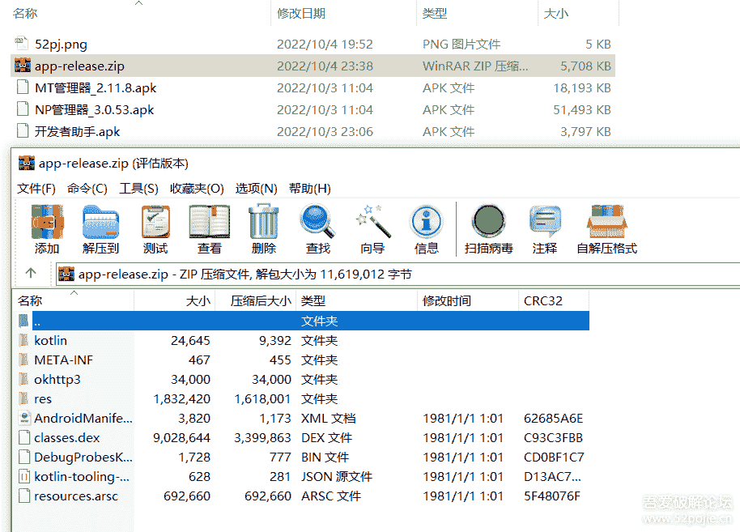

# [Android 原创] 安卓逆向入门笔记(一)——apk文件结构

- 原帖: https://www.52pojie.cn/forum.php?mod=viewthread&tid=1781093
- 抓取时间: 2026-11-01T21:44:42

最近在看正己大佬的安卓逆向教程，我顺便了解了些相关的基础知识，我就想把这些基础知识做个汇总，若有错误请大佬指正！

## 一、apk文件结构

`APK`是Android Package的缩写，即Android安装包。而`apk`文件其实就是一个压缩包，我们可以将`apk`文件的后缀改为`.zip`来观察`apk`中的文件。

`image-20230416210158031.png` (113.64 KB, 下载次数: 5)

<https://www.52pojie.cn/forum.php?mod=attachment&aid=MjYxMTk0NHxmOTQ5YjIwM3wxNzkzNTY5NDgwfDE2ODA4NnwxNzgxMDkz&nothumb=yes>

2023-5-3 22:47 上传

我们来了解当中一些常见的文件和文件夹：

### `assets`文件夹

`assets`这里存放的是静态资源文件（图片、视频等），这个文件夹下的资源文件不会被编译。不被编译的资源文件是指在编译过程中不会被转换成二进制代码的文件，而是直接被打包到最终的程序中。这些文件通常是一些静态资源，如图片、音频、文本文件等。

### `lib`文件夹

`lib`：`.so`库（C或C++编译的动态链接库）。`APK`文件中的动态链接库（Dynamic Link Library，简称DLL）是一种可重用的代码库，它包含在应用程序中，以便在运行时被调用。这些库通常包含许多常见的函数和程序，可以在多个应用程序中共享，从而提高了代码的复用性和效率。

`lib`文件夹下的每个目录都适用于不同的环境下，`armeabi-v7a`目录基本通用所有Android设备，`arm64-v8a`目录只适用于64位的Android设备，`x86`目录常见用于Android模拟器，`x86-64`目录适用于支持`x86_64`架构的Android设备（适用于支持通常称为“`x86-64`”的指令集的CPU）。

### `META-INF`文件夹

`META-INF`：在Android应用的`APK`文件中，`META-INF`文件夹是存放数字签名相关文件的文件夹，包含以下三个文件：

- `MANIFEST.MF`：`MANIFEST.MF`是一个摘要清单文件，它包含了`APK`文件中除自身外所有文件的数字摘要。这些摘要通常是通过特定的哈希算法（如`SHA-1`、`SHA-256`等）对文件内容进行计算得到的，用于确保文件内容在传输或存储过程中未被篡改。
- `CERT.SF`：`CERT.SF`文件存储了`MANIFEST.MF`文件的数字摘要以及`MANIFEST.MF`中每个文件条目的数字摘要的二次摘要。开发者使用自己的私钥对`CERT.SF`进行签名，以保证`CERT.SF`文件内容的完整性和真实性。
- `CERT.RSA`：`CERT.RSA`文件包含了使用开发者私钥对`CERT.SF`文件进行签名得到的数字签名以及签名时所使用的数字证书。当验证`APK`的签名时，系统会使用数字证书中的公钥来验证`CERT.SF`文件的数字签名是否有效，从而确保`CERT.SF`文件未被篡改，进而验证`MANIFEST.MF`文件和整个`APK`的完整性。

总之，`META-INF`文件夹中的文件是用于保护`APK`文件的完整性和真实性的重要文件，可以确保`APK`文件来自合法的开发者，并且没有被篡改过。这里多提一嘴，在安卓签名校验的代码中主要是通过后缀名去找文件的，后缀名前的名字可以随便改，但以`RSA`和`SF`结尾的文件后缀名前的名字必须一致。现在有些大型的`APP`中`META-INF`文件夹下不止这三个文件，还会有其他的文件来加强`APP`的签名校验，所以这是比较麻烦的东西。

现在看这些东西是不是有些不明白？什么是数字摘要、什么是数字签名、什么是数字证书什么的，没事，我们接下来讲解这些东西，让你搞明白。

#### APK签名机制原理

问：什么是数字摘要？

答：数字摘要是一种数学算法，将任何长度的数据转换为固定长度的唯一字符串，而且不同的明文通过`Hash`算法转换成固定长度的密文，其结果总是不同的，而同样的明文其摘要必定一致。数字摘要通常用于数据完整性验证和加密技术中，以确保数据在传输或存储过程中没有被篡改或损坏。数字摘要算法是单向的，即无法通过数字摘要反推出原始数据。常见的数字摘要使用的`Hash`算法有`MD5`、`SHA-1`、`SHA-256`等。这里插一嘴，现在`MD5`在有的情况下已经不安全了，可能会出现不同的数据加密成相同的密文，因为明文的排列是有无数种可能的，而`MD5`所转换的密文长度是固定的128位，无限的数据对应有限的长度是不可能永远让不同的数据转换为不同的内容的。

问：为什么会出现数字签名？

答：要回答这个问题说来话长，我们要先从信息的传输开始讲起。

**对称加密：**

这天小红和小明在教室里通过纸条来传递信息，但小红和小明间隔甚远，需要经过其他同学帮助才能成功传输信息，在这个过程中是无法保证信息不被泄露的，那为了这个传输的信息不被泄露就需要对信息进行加密，而加密和解密是需要一个双方都知道的密钥来进行的，加密者用密钥对明文进行加密得到密文，解密者用密钥对密文进行解密得到明文，加解密都用同样的密钥，即为对称加密。所以双方该如何确定出一个同样的密钥呢？如果由一方生成密钥，再将密钥发送给对方，那么攻击者也可以获取到密钥，就会导致加解密没有了作用。

那么什么办法可以解决这个问题呢？可以用非对称加密。

**非对称加密：**

在非对称加密中，密钥总是成对出现的，分别称之为公钥和私钥，私钥由自己安全保管不外泄，而公钥则可以发给网络中的任何人。用其中一把密钥加密的明文只能用另一把密钥进行解密，无法使用同一把密钥进行加解密，比如用公钥进行加密的明文只能用私钥进行解密，公钥自己没法解密。

你可能还是会有疑问，如果一方将公钥发送给另一方，自己再用私钥对明文进行加密，再把加密的数据给另一方，那这不还是会导致加解密没有了作用？又或者一方将私钥发送给另一方，自己再用公钥对明文进行加密，再把加密的数据给另一方，这不还是会被攻击者获取到私钥从而解密数据？如果非对称加密这么使用确实会出现这种问题，但是非对称加密一般不这么用，而是下面这种操作：

现在是服务器和浏览器之间的信息传输，它们之间是怎么做才能信息不外泄呢？

1. 服务器会将非对称加密中的公钥发送给浏览器，浏览器生成一串随机数字，而这串随机数字使用服务器发送过来的公钥进行加密。
2. 将通过公钥加密的随机数字发送给服务器，服务器接收后使用私钥进行解密，这样双方就都得到了一个同样的随机数字，而这个随机数字可以作为对称加密的密钥。
3. 使用随机数字作为密钥对真正需要传递的数据进行加密传输。

这样就算是攻击者拦截到了服务器发送给浏览器的公钥，也只能无济于事，因为通过公钥加密的数据没法通过公钥进行解密。这套流程也被称之为`SSL`（安全套接字层）。

这看似很美好，但是这真的无懈可击吗？不，因为服务器和浏览器之间无法得知接收的公钥或者数据来自于谁，这样攻击者可以先将服务器发送的公钥拦截下来替换成自己的公钥，浏览器接收到之后无法辨别这个公钥是来自于谁的，只会傻傻的使用这个公钥对生成的随机数字进行加密，然后返回给服务器，攻击者再将返回的内容拦截下来，通过自己的私钥进行解密，这样攻击者又获得了对称加密的密钥。

所以想要解决这个问题，那么就需要知道接收到的信息是由谁发送的，这就引出了下一个概念——数字证书。

**数字证书：**

在讲数字证书之前，我们需要知道一个第三方机构——`CA`机构。`CA`机构是指数字证书认证机构（Certificate Authority），也称为证书颁发机构。它是一种可信第三方机构，负责颁发数字证书，用于证明数字身份、数字签名等安全通信和交易中的身份验证和数据保护。`CA`机构通过对证书申请者的身份进行认证，为其颁发数字证书，使得用户可以在网络上进行加密通信、数字签名、身份认证等安全操作，保障网络安全和数据隐私。

我们来讲讲数字证书和`CA`机构在身份验证中是扮演一个什么样的角色：

1. 服务器会将自己的公钥、域名，还有自己所申请认证证书的`CA`机构，以及数字摘要的`Hash`算法、签名算法（用于生成数字签名的加密算法）、数字摘要、原始数据等信息打包在一起发送给自己申请的`CA`机构，该机构也有一对公私钥对，`CA`机构会用它的私钥对打包数据中的数字摘要进行加密，得到一个密文，而这个密文就是签名，数字签名生成后会被放在证书中发送给服务器的管理员，而这个证书就叫做`TLS`证书。
2. 服务器将`CA`机构发送过来的`TLS`证书代替原本要发送给浏览器的公钥发送给浏览器，浏览器拿到这个证书之后不会选择第一时间相信，而是拿`CA`机构公开的公钥对证书中的签名进行解密得到数字摘要，浏览器也会从证书中提取出原始数据和数字摘要的`Hash`算法进行转换，这样就可以获得原始数据的数字摘要，再将这两数字摘要一对比就知道数据在服务器发送过来的途中有没有被篡改了。
3. 如果解密后的数字摘要和由原始数据转换成的数字摘要一致，那么浏览器就会从证书中提取出公钥，从而可以安全的进行`SSL`。

不过需要注意的是，上面的数字证书是`https`的验证流程，而`apk`文件和`https`在验证数字证书的过程中所用到的算法和流程也有所不同。

`HTTPS`所用的数字证书通常需要经过`CA`机构的认证和颁发。而`apk`文件的数字证书包含了签名者的公钥、签名算法、签名时间等信息，在Android系统中使用的数字证书，是可以由开发者自行生成和使用。

Android在安装`APK`时，会验证`APK`的数字签名是否合法。验证的过程包括以下几个步骤：

- 提取数字证书：提取`APK`文件`META-INF`目录下的`.RSA`（如`CERT.RSA`）或`.DSA`文件中的数字证书。
- 提取公钥：从数字证书中提取公钥，该公钥将用于后续的签名验证。
- 验证签名：使用提取的公钥对`APK`文件中`CERT.SF`文件的数字签名进行验证操作，检查该签名是否是由对应的私钥生成的，以此来确保`CERT.SF`文件的完整性和真实性。
- 重新计算文件哈希值：对`MANIFEST.MF`文件中记录的`APK`内各个文件进行哈希运算，生成每个文件新的数字摘要。
- 比较哈希值：将重新计算得到的各文件数字摘要与`MANIFEST.MF`文件中记录的对应文件的数字摘要进行比较，同时结合步骤3中签名验证的结果。如果所有文件的哈希值都一致且签名验证通过，则认为数字签名合法；否则，认为数字签名不合法。

需要注意的是，数字证书包含了签名者的身份信息、公钥、证书有效期等内容。数字签名是使用私钥对`CERT.SF`文件（该文件包含了`MANIFEST.MF`文件的数字摘要以及`MANIFEST.MF`中每个文件条目的数字摘要的二次摘要）进行签名得到的结果，而不是对数字证书或整个`APK`文件的数字摘要进行加密。在安装`APK`文件时，Android系统会按照上述流程进行验证，以确保`APK`的真实性和完整性。如果数字证书无效、签名验证不通过或文件哈希值不匹配，则会提示安装失败或警告用户存在安全风险。

MT管理器是一个可以对`APK`文件进行修改和重新签名的工具。它使用的签名工具是Android SDK中的`apksigner`工具，一个官方提供的`APK`签名工具。

当MT管理器对`APK`文件进行修改后，它会将修改后的文件打包成一个新的`APK`文件。然后，MT管理器会调用`apksigner`工具，使用开发者提供的数字证书对新的`APK`文件进行签名。签名过程中，`apksigner`会对`APK`文件进行`Hash`运算，生成数字摘要，并使用提供的数字证书对数字摘要进行加密，最后生成新的`META-INF`目录和`CERT.RSA`文件。

最后，MT管理器会将签名后的`APK`文件保存到指定位置。需要注意的是，MT管理器只能对已经进行过数字签名的`APK`文件进行修改和重新签名。因为`apksigner`要求原本的`APK`文件必须进行了数字签名才能进行重新签名的操作。所以如果`APK`文件没有进行数字签名，`apksigner`无法对其进行签名操作，从而无法通过MT管理器进行修改和签名。

总结来说，Android系统验证`APK`的数字签名是为了确保`APK`的真实性和完整性。MT管理器使用`apksigner`工具对`APK`文件进行签名，并要求原始`APK`文件已经进行了数字签名才能进行修改和重新签名操作。

### `AndroidManifest.xml`配置文件

`AndroidManifest.xml`是Android应用程序中最重要的文件之一，它包含了应用程序的基本信息，如应用程序的名称、图标、版本号、权限、组件（`Activity`、`Service`、`BroadcastReceiver`、`Content Provider`）等等。在应用程序运行时，系统会根据这个文件来管理应用程序的生命周期，启动和关闭应用程序，管理应用程序的组件等等。

我们来了解一下`AndroidManifest.xml`文件的主要组成部分：

- `manifest`标签

`manifest`标签是`AndroidManifest.xml`文件的根标签，它包含了应用程序的基本信息，如包名、版本号、`SDK`版本、应用程序的名称和图标等等。

- `application`标签

`application`标签是应用程序的主要标签，它包含了应用程序的所有组件，如`Activity`（活动）、`Service`（服务）、`Broadcast Receiver`（广播接收器）、`Content Provider`（内容提供者）等等。在`application`标签中，也可以设置应用程序的全局属性，如主题、权限等等。

- `activity`标签

`activity`标签定义了一个`Activity`组件，它包含了`Activity`的基本信息，如`Activity`的名称、图标、主题、启动模式等等。在`activity`标签中，还可以定义`Activity`的布局、`Intent`过滤器等等。

- `service`标签

`service`标签定义了一个`Service`组件，它包含了`Service`的基本信息，如`Service`的名称、图标、启动模式等等。在`service`标签中，还可以定义`Service`的`Intent`过滤器等等。

- `receiver`标签

`receiver`标签定义了一个`BroadcastReceiver`组件，它包含了`BroadcastReceiver`的基本信息，如`BroadcastReceiver`的名称、图标、权限等等。在`receiver`标签中，还可以定义`BroadcastReceiver`的`Intent`过滤器等等。

- `provider`标签

`provider`标签定义了一个`Content Provider`组件，它包含了`Content Provider`的基本信息，如`Content Provider`的名称、图标、权限等等。在`provider`标签中，还可以定义`Content Provider`的`URI`和`Mime Type`等等。

- `uses-permission`标签

`uses-permission`标签定义了应用程序需要的权限，如访问网络、读取SD卡等等。在应用程序安装时，系统会提示用户授权这些权限。

- `uses-feature`标签

`uses-feature`标签定义了应用程序需要的硬件或软件特性，如摄像头、GPS等等。在应用程序安装时，系统会检查设备是否支持这些特性。

以上是`AndroidManifest.xml`文件的主要组成部分，它们共同定义了应用程序的基本信息和组件，是应用程序的重要配置文件。现在如果看起来有点懵，没关系，后面实战会使用到它的，以后也会对它进行详解，那时你或许会有一点对它的理解了。

### `resources.arsc`文件

`resources.arsc`文件是Android应用程序的资源文件之一，它是一个二进制文件，包含了应用程序的所有资源信息，例如布局文件、字符串、图片等。这个文件在应用程序编译过程中由`aapt`工具生成，并被打包进`APK`文件中。

`resources.arsc`文件的主要作用是提供资源的索引和映射关系。它将资源文件名、类型、值等信息映射到一个唯一的整数ID上。这个ID在`R`文件中定义，并且可以通过代码中的`R`类来引用。例如，`R.layout.main`表示布局文件`main.xml`对应的ID，`R.string.app_name`表示字符串资源`app_name`对应的ID。

当应用程序运行时，系统会根据`R`类中的ID来查找对应的资源，并将其加载到内存中，供应用程序使用。这个过程是通过解析`resources.arsc`文件和`R`类实现的。通过这种方式，应用程序可以方便地访问和使用资源，而不需要手动处理资源文件的位置和命名等问题。

需要注意的是，`resources.arsc`文件只包含资源的索引和映射关系，并不包含实际的资源内容。实际的资源内容存储在`res`文件夹中，按照资源类型和名称进行组织。当应用程序需要使用资源时，系统会根据`resources.arsc`文件中的索引信息找到对应的资源文件，并将其加载到内存中。

总之，`resources.arsc`文件是Android应用程序的资源文件之一，包含了资源的索引和映射关系。它和`R`类一起构成了应用程序访问和使用资源的基础。通过解析`resources.arsc`文件和使用`R`类，应用程序可以方便地加载和使用资源。

这里只是简单介绍了`resources.arsc`文件，其实还有一个比较重要的知识点，那就是`resources.arsc`文件结构，我怕篇幅太过于长了，这里就不细讲了，有兴趣的可以自行去了解，比如可以观看以下这些文章：

[//juejin.cn/post/6986448355962404877](https://juejin.cn/post/6986448355962404877)

- [//blog.csdn.net/beyond702/article/details/51744082" target="_blank" rel="noopener noreferrer nofollow"](<https://blog.csdn.net/beyond702/article/details/51744082:rel="nofollow noopener" href="https>)
- [//juejin.cn/post/7072897327509274631#heading-7" target="_blank" rel="noopener noreferrer nofollow"](<https://juejin.cn/post/7072897327509274631#heading-7:rel="nofollow noopener" href="https>)
- [//blog.csdn.net/chzphoenix/article/details/80569567" target="_blank" rel="noopener noreferrer nofollow"](<https://blog.csdn.net/chzphoenix/article/details/80569567:rel="nofollow noopener" href="https>)

如果可以全部看完，那你对`resources`的文件结构和打包流程、资源管理及资源的编译的有了一定的了解。

## `res`文件夹

`res`：资源文件目录，二进制格式。实际上，APK文件下的`res`文件夹并不是二进制格式，而是经过编译后的二进制资源文件。在Android应用程序开发中，资源文件通常是以XML格式存储的，如布局文件、字符串资源、颜色资源等。在编译时，Android编译器会将这些XML资源文件编译成二进制格式的资源文件，以提高应用程序的运行效率和安全性。虽然`res`文件夹下的二进制资源文件不能直接编辑和修改，但是开发者仍然可以通过Android提供的资源管理工具，如`aapt`、`apktool`等，来反编译和编辑这些资源文件的。

在`res`文件夹中，主要包含以下子文件夹和文件：

| `res`子目录 | 存储的资源类型 |
| --- | --- |
| `animator/` |  |
