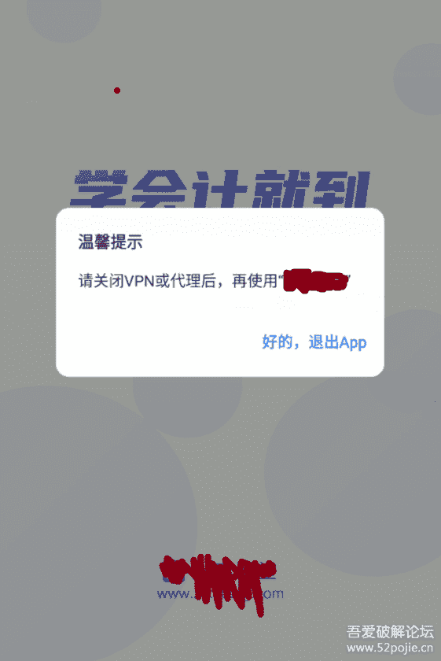
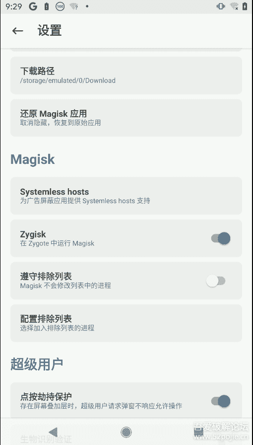
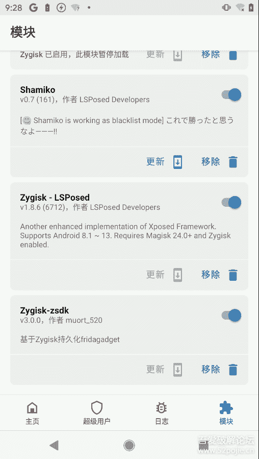
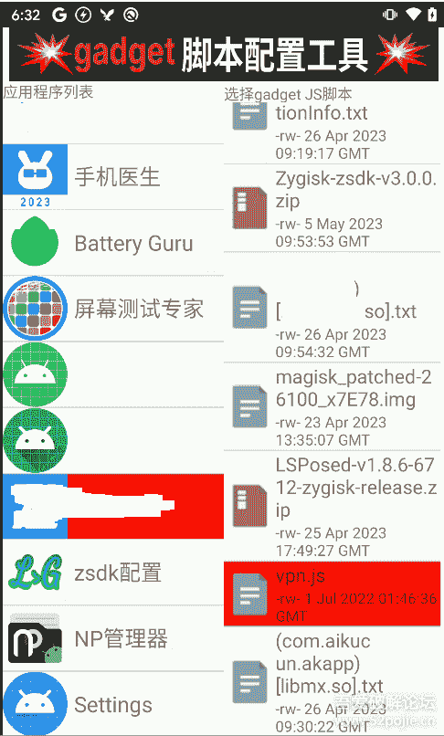
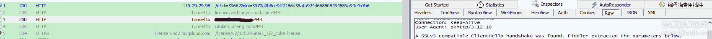
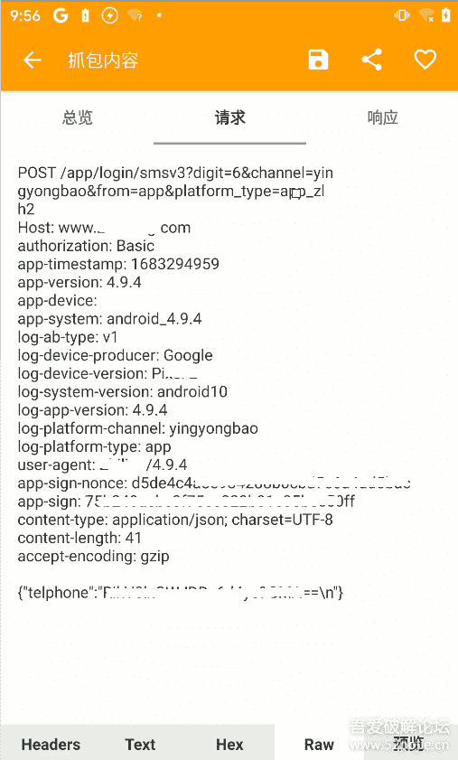

# [Android 原创] 干掉xx检测的方便抓包方案

- 原帖：[https://www.52pojie.cn/forum.php?mod=viewthread&tid=1781876](https://www.52pojie.cn/forum.php?mod=viewthread&tid=1781876)
- 抓取时间：2026-11-01T21:44:32

## 序言

抓包是老生常谈的一项重要任务，在 android 抓包过程中常会遇到各种问题。在对抗激烈的今天，要想顺利抓包并非易事。笔者尝试用一种叫新的插件方法处理遇到的 v*n 检测、daili 检测等问题，希望可以给各位师傅提供借鉴参考：

## 一、问题及初步的处理

目标 app：`Y29tLnpsa2V0YW5nLm1t` v4.9.4

遇到的问题：



`image-20230505212044493.png` (102.85 KB, 下载次数: 0)

[附件下载](https://www.52pojie.cn/forum.php?mod=attachment&aid=MjYxMjQyMXw4YTBlNWJlN3wxNzkzNTY5NDcwfDE2ODA4NnwxNzgxODc2&nothumb=yes)

2023-5-5 22:18 上传

app 进行了外皮恩和代理的检测，你要开小黄鸟或者用热点的方法抓包，程序会自动退出。

解决方法那就用优雅的 `frida`，但是这次我们不用电脑连线的方式，而用 `zigisk` 模块的方式加载 `fridagadget`，做到 `frida` 的持久化：

1：手机 `root` 并安装 `magisk`，这方面的资料很多，百度即可；

2：打钩 `zygisk`，并安装附件模块 `Zygisk-zsdk-v3.0.0`（按 `magisk` 模块的安装方法）：

[下载链接](https://wwgg.lanzouf.com/ioq9X0usdmze)



`QQ图片20230505213009.png` (112.73 KB, 下载次数: 0)

[附件下载](https://www.52pojie.cn/forum.php?mod=attachment&aid=MjYxMjQyM3xlNTg2ZjMxYnwxNzkzNTY5NDcwfDE2ODA4NnwxNzgxODc2&nothumb=yes)

2023-5-5 22:18 上传



`QQ图片20230505212856.png` (134.87 KB, 下载次数: 0)

[附件下载](https://www.52pojie.cn/forum.php?mod=attachment&aid=MjYxMjQyMnwzY2MyZDBiYnwxNzkzNTY5NDcwfDE2ODA4NnwxNzgxODc2&nothumb=yes)

2023-5-5 22:18 上传

重启下手机

3：安装 `zsdk配置_1.2.apk`，脚本管理软件，运行：

[下载链接](https://wwgg.lanzouf.com/i6pfK0usdmyd)



`QQ图片20230505213414.png` (219.48 KB, 下载次数: 0)

[附件下载](https://www.52pojie.cn/forum.php?mod=attachment&aid=MjYxMjQyNHwzYmUyNTVlM3wxNzkzNTY5NDcwfDE2ODA4NnwxNzgxODc2&nothumb=yes)

2023-5-5 22:18 上传

这玩意的界面分为左右两个部分，先将 `frida` 脚本推送到 `sdcard/download` 目录。在软件右侧点选要加载的脚本，软件左侧点选要注入的 app（或者反过来也可以）。两个都点红后，会提示注入成功，这时候可以开始 `fiddler` 抓包：



`QQ图片20230505214125.png` (32 KB, 下载次数: 0)

[附件下载](https://www.52pojie.cn/forum.php?mod=attachment&aid=MjYxMjQyNXxmNzIwOTc3M3wxNzkzNTY5NDcwfDE2ODA4NnwxNzgxODc2&nothumb=yes)

2023-5-5 22:18 上传

可以看到，向 app 服务器发送的 https 登录包被捕捉到了，app 不再报错和要求强制退出。但是在已经安装并迁移好 `fd` 证书的情况下，这个包无法被解密，`fd` 的 `raw` 详情中看到 `A SSLv3-compatible ClientHello handshake was found`

## 二、ssl pinning的最终解决

造成上面无法解密的原因是 `ssl pinning`，还需要我们进一步处理，改写原 `js` 代码：

```
Java.perform(function() {
    var NInterface = Java.use("java.net.NetworkInterface");
    try {
        NInterface.isUp.overload().implementation = function() {
            //console.log("Network Down");      
            return false;
            // 在极少数情况下可能会导致连接丢失，所以要小心
        }
    } catch (err) {
        console.error(err);
    }
    try {
        var NInterface = Java.use("java.net.NetworkInterface");
        NInterface.getName.overload().implementation = function() {
            var IName = this.getName();
            if (IName == "tun0" || IName == "ppp0" || IName == "p2p0" || IName == "ccmni0" || IName == "tun") {
                console.log("Detected Interface Name : ", JSON.stringify(this.getName()));
                return "FuckYou";
            }
            return this.getName();
        }
    } catch (err) {
        console.error(err);
    }
    try {
        var GetProperty = Java.use("java.lang.System");
        GetProperty.getProperty.overload("java.lang.String").implementation = function(getprop) {
            if (getprop.indexOf("http.proxyHost") >= 0 || getprop.indexOf("http.proxyPort") >= 0) {
                var newprop = "CKMKB"
                return this.getProperty.call(this, newprop);
            }
            return this.getProperty(getprop);
        }
    } catch (err) {
        console.error(err);
    }
    try {
        var NCap = Java.use("android.net.NetworkCapabilities");
        NCap.hasTransport.overload("int").implementation = function(values) {
            console.log("检测到 HasTransport 检查 ");
            if (values == 4)
                return false;
            else
                return this.hasTransport(values);
        }
    } catch (e) {
        console.error(e);
    }
})
```

附件上去除证书锁定的代码，最终代码如下：

```
function vpn() {
    Java.perform(function() {
        var NInterface = Java.use("java.net.NetworkInterface");
        try {
            NInterface.isUp.overload().implementation = function() {
                //console.log("Network Down");      
                return false;
                // 在极少数情况下可能会导致连接丢失，所以要小心
            }
        } catch (err) {
            console.error(err);
        }
        try {
            var NInterface = Java.use("java.net.NetworkInterface");
            NInterface.getName.overload().implementation = function() {
                var IName = this.getName();
                if (IName == "tun0" || IName == "ppp0" || IName == "p2p0" || IName == "ccmni0" || IName == "tun") {
                    console.log("Detected Interface Name : ", JSON.stringify(this.getName()));
                    return "FuckYou";
                }
                return this.getName();
            }
        } catch (err) {
            console.error(err);
        }
        try {
            var GetProperty = Java.use("java.lang.System");
            GetProperty.getProperty.overload("java.lang.String").implementation = function(getprop) {
                if (getprop.indexOf("http.proxyHost") >= 0 || getprop.indexOf("http.proxyPort") >= 0) {
                    var newprop = "CKMKB"
                    return this.getProperty.call(this, newprop);
                }
                return this.getProperty(getprop);
            }
        } catch (err) {
            console.error(err);
        }
        try {
            var NCap = Java.use("android.net.NetworkCapabilities");
            NCap.hasTransport.overload("int").implementation = function(values) {
                console.log("检测到 HasTransport 检查 ");
                if (values == 4)
                    return false;
                else
                    return this.hasTransport(values);
            }
        } catch (e) {
            console.error(e);
        }
    })
};

function ssl() {
    Java.perform(function() {
        var array_list = Java.use("java.util.ArrayList");
        var ApiClient = Java.use('com.android.org.conscrypt.TrustManagerImpl');
        ApiClient.checkTrustedRecursive.implementation = function(a1, a2, a3, a4, a5, a6) {
            var k = array_list.$new();
            return k;
        }
    }, 0);
};

vpn();
ssl()
```

重新 `adb` 推入 `sdcard/download` 目录，注入。

这下可以顺利的抓包并解密了，小黄鸟也可以：



`QQ图片20230505215821.png` (166.55 KB, 下载次数: 0)

[附件下载](https://www.52pojie.cn/forum.php?mod=attachment&aid=MjYxMjQyNnw0NzBhZGMyM3wxNzkzNTY5NDcwfDE2ODA4NnwxNzgxODc2&nothumb=yes)

2023-5-5 22:18 上传

## 三、总结

`frida` 在现今的逆向中应用很广，因为他很便捷高效。但对于抓包这经常要操作的任务，将其持久化后将很方便（不用再每次打命令注入，还有一定的隐蔽功能）。而且 `zsdk配置` 无需重启就可以直接作业，切换非常方便。另外在 `fridagadget` 的同时，依然可以用 `frida sever` 进行 hook，可以说具有很大的灵活性！
