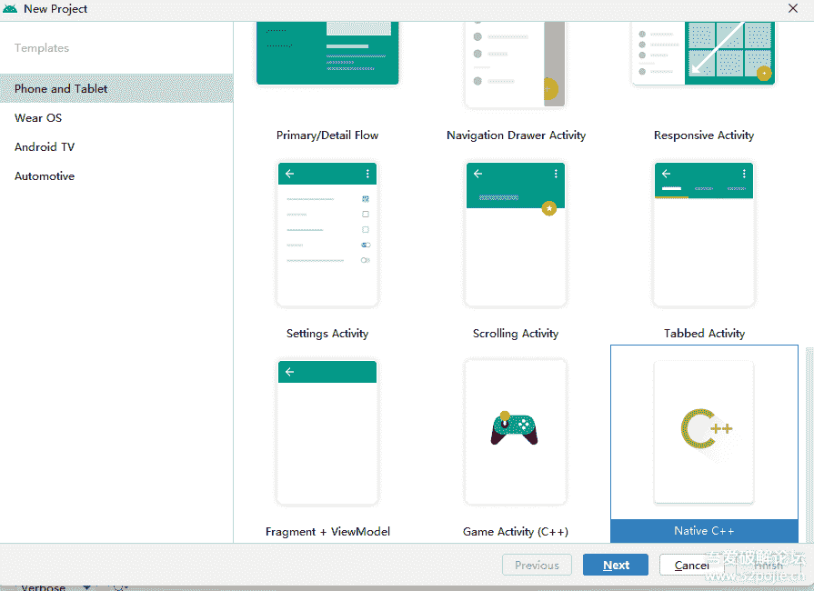
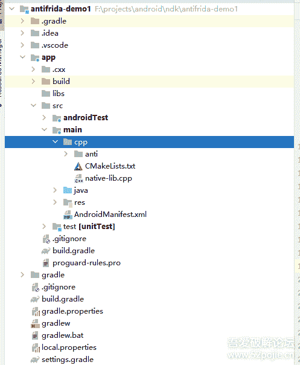
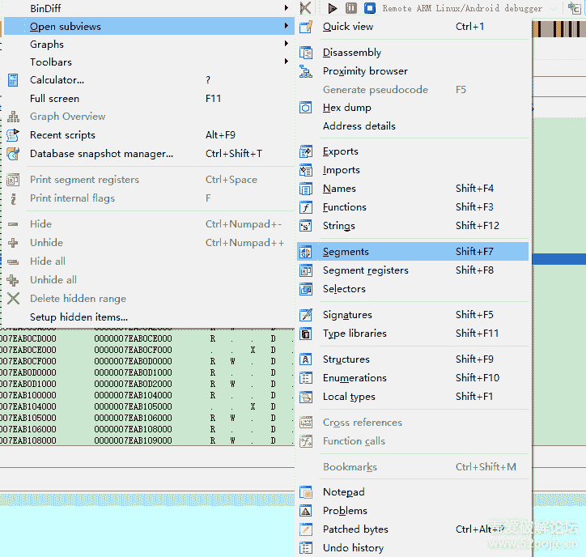
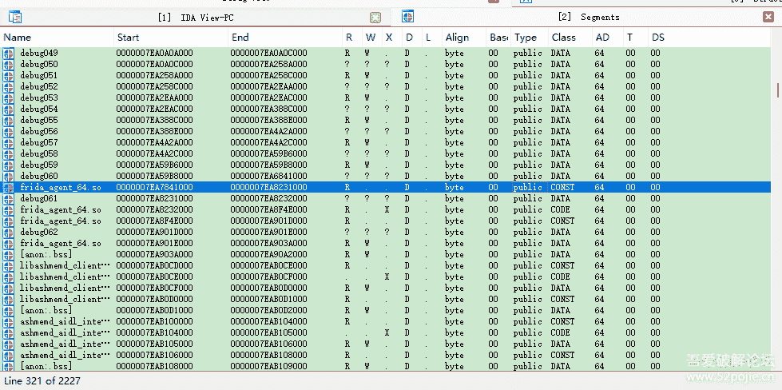
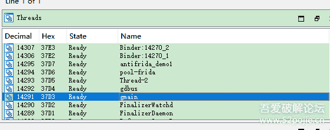
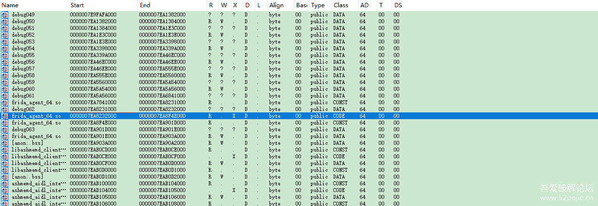
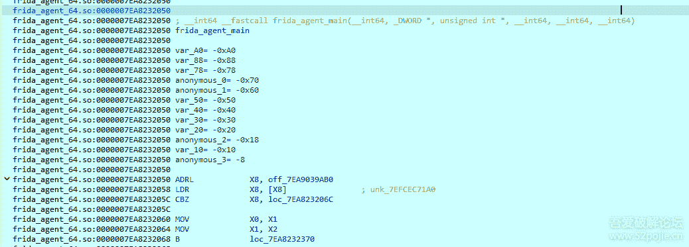
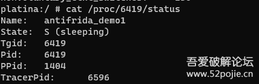

# [Android 原创] `frida` 检测

- 原帖：[https://www.52pojie.cn/forum.php?mod=viewthread&tid=1783400](https://www.52pojie.cn/forum.php?mod=viewthread&tid=1783400)
- 抓取时间：2026-11-01T21:43:13

## `frida` 检测

（本章内容需要用到真机）

`frida` 特征检测仿造自 qtfreet00 和 darvincisec：

- [qtfreet00/AntiFrida](https://github.com/qtfreet00/AntiFrida)
- [darvincisec/DetectFrida](https://github.com/darvincisec/DetectFrida)

看样子还是好几年前的，看来大佬几年前就摸透了。

### 项目创建

- 首先我们创建 cpp 的项目



01.png（49.57 KB，下载次数：1）

[附件下载](https://www.52pojie.cn/forum.php?mod=attachment&aid=MjYxMzM2MHw2MGM5M2QzMHwxNzkzNTY5MzkxfDE2ODA4NnwxNzgzNDAw&nothumb=yes)

2023-5-9 19:30 上传

- 创建完的结构如下



02.png（32.87 KB，下载次数：1）

[附件下载](https://www.52pojie.cn/forum.php?mod=attachment&aid=MjYxMzM2MXxlOWU2MWE4YXwxNzkzNTY5MzkxfDE2ODA4NnwxNzgzNDAw&nothumb=yes)

2023-5-9 19:30 上传

- 我并不擅长写 android，后续我全部都写 android 日志进行交互。

关于 android 日志，请参考文档：

- [Android NDK logging](https://developer.android.google.cn/ndk/reference/group/logging)

### proc self maps 说明

通过下面指令可以看到内存映射段：

```
cat /proc/self/maps 

platina:/ # ps -ef|grep antifrida_demo1

u0_a214       9608 31372 1 17:26:01 ?     00:00:01 com.luckfollow.antifrida_demo1

root          9871  9826 2 17:27:24 pts/5 00:00:00 grep antifrida_demo1

platina:/ # cat /proc/9608/maps

12c00000-13200000 rw-p 00000000 00:00 0                                  [anon:dalvik-main space (region space)]
13200000-140c0000 ---p 00000000 00:00 0                                  [anon:dalvik-main space (region space)]
140c0000-14100000 ---p 00000000 00:00 0                                  [anon:dalvik-main space (region space)]
14100000-14140000 rw-p 00000000 00:00 0                                  [anon:dalvik-main space (region space)]
14140000-14180000 ---p 00000000 00:00 0                                  [anon:dalvik-main space (region space)]
14180000-14240000 rw-p 00000000 00:00 0                                  [anon:dalvik-main space (region space)]
14240000-16b80000 ---p 00000000 00:00 0                                  [anon:dalvik-main space (region space)]
16b80000-32c00000 rw-p 00000000 00:00 0                                  [anon:dalvik-main space (region space)]
70ab7000-70d61000 rw-p 00000000 103:2d 1989                              /system/framework/arm64/boot.art
70d61000-70e76000 rw-p 00000000 103:2d 1953                              /system/framework/arm64/boot-core-libart.art
70e76000-70eb1000 rw-p 00000000 103:2d 1971                              /system/framework/arm64/boot-okhttp.art
70eb1000-70f0b000 rw-p 00000000 103:2d 1947                              /system/framework/arm64/boot-bouncycastle.art
70f0b000-70f54000 rw-p 00000000 103:2d 1944                              /system/framework/arm64/boot-apache-xml.art
70f54000-70f57000 rw-p 00000000 103:2d 1932                              /system/framework/arm64/boot-QPerformance.art
70f57000-70f59000 rw-p 00000000 103:2d 1935                              /system/framework/arm64/boot-UxPerformance.art
70f59000-718c6000 rw-p 00000000 103:2d 1959                              /system/framework/arm64/boot-framework.art
718c6000-7190b000 rw-p 00000000 103:2d 1956                              /system/framework/arm64/boot-ext.art
7190b000-71a29000 rw-p 00000000 103:2d 1980                              /system/framework/arm64/boot-telephony-common.art
71a29000-71a3a000 rw-p 00000000 103:2d 1986                              /system/framework/arm64/boot-voip-common.art
71a3a000-71a53000 rw-p 00000000 103:2d 1962                              /system/framework/arm64/boot-ims-common.art
71a53000-71aab000 rw-p 00000000 103:2d 1965                              /system/framework/arm64/boot-miuisdk@boot.art
71aab000-71ad1000 rw-p 00000000 103:2d 1968                              /system/framework/arm64/boot-miuisystemsdk@boot.art
```

就以某一段为例：

```
70ab7000-70d61000 rw-p 00000000 103:2d 1989                              /system/framework/arm64/boot.art
```

分别含义如下：

- `70ab7000-70d61000`：本段内存映射的虚拟地址空间范围，对应 `vm_area_struct` 中的 `vm_start` 和 `vm_end`。
- `rw-p`：此段虚拟地址空间的属性。每种属性用一个字段表示，`r` 表示可读，`w` 表示可写，`x` 表示可执行，`p` 和 `s` 共用一个字段，互斥关系，`p` 表示私有段，`s` 表示共享段，如果没有相应权限，则用 `-` 代替。
- `00000000`：针对有名映射，指本段映射地址在文件中的偏移。
- `103:2d`：所映射的文件所属设备的设备号。
- `1989`：映射文件所属节点号。
- `/system/framework/arm64/boot.art`：映射的文件。

但我们用 `frida` 使用 `spwan` 附加上去后：

```
frida -U -f com.luckfollow.antifrida_demo1
```

其 `maps` 中多处了这一段：

```
platina:/ # cat /proc/12186/maps|grep frida
7ea7841000-7ea8231000 r--p 00000000 fc:00 1114131                        /data/local/tmp/re.frida.server/frida-agent-64.so
7ea8232000-7ea8f4e000 r-xp 009f0000 fc:00 1114131                        /data/local/tmp/re.frida.server/frida-agent-64.so
7ea8f4e000-7ea901d000 r--p 0170b000 fc:00 1114131                        /data/local/tmp/re.frida.server/frida-agent-64.so
7ea901e000-7ea903a000 rw-p 017da000 fc:00 1114131                        /data/local/tmp/re.frida.server/frida-agent-64.so
```

这一段应该是 `frida` 附加上去的。

我们借助 ida pro 看一下：



03.png（69.69 KB，下载次数：1）

[附件下载](https://www.52pojie.cn/forum.php?mod=attachment&aid=MjYxMzM2Mnw4ZGU4OTBmOHwxNzkzNTY5MzkxfDE2ODA4NnwxNzgzNDAw&nothumb=yes)

2023-5-9 19:30 上传



04.png（53.8 KB，下载次数：1）

[附件下载](https://www.52pojie.cn/forum.php?mod=attachment&aid=MjYxMzM2M3w3Mzc1MWEzOXwxNzkzNTY5MzkxfDE2ODA4NnwxNzgzNDAw&nothumb=yes)

2023-5-9 19:30 上传

可以看到在内存中每个 `segments` 的具体情况。

地址跟：

```
platina:/ # cat /proc/12186/maps|grep frida
7ea7841000-7ea8231000 r--p 00000000 fc:00 1114131                        /data/local/tmp/re.frida.server/frida-agent-64.so
7ea8232000-7ea8f4e000 r-xp 009f0000 fc:00 1114131                        /data/local/tmp/re.frida.server/frida-agent-64.so
7ea8f4e000-7ea901d000 r--p 0170b000 fc:00 1114131                        /data/local/tmp/re.frida.server/frida-agent-64.so
7ea901e000-7ea903a000 rw-p 017da000 fc:00 1114131                        /data/local/tmp/re.frida.server/frida-agent-64.so
```

完美对应。

## `frida` 检测思路

以下只是个人结合开源 antifrida 的一些开源项目，并没有看 `frida` 源码，并没有深入追究，肯定会有漏的情况。

上述按道理直接看 `maps` 中映射的文件是否包含 `/tmp` 目录就可以了。但可能有些改目录的情况。所以检测会根据内存特征或者 `elf` 中描述信息对比。

`elf` 目前我还不了解。先看看基于内存和线程的。

### 1. 基于线程



05.png（16 KB，下载次数：2）

[附件下载](https://www.52pojie.cn/forum.php?mod=attachment&aid=MjYxMzM2NHxmODY1ZTIxN3wxNzkzNTY5MzkxfDE2ODA4NnwxNzgzNDAw&nothumb=yes)

2023-5-9 19:30 上传

我们可以看到线程中多了 `gmain` 和 `pool-frida`。

我们可以通过：

```
/proc/self/task/thread_id/status 
/proc/self/task/thread_id/stat
```

获取线程名。


```
platina:/proc/14270/task # cat 14294/status
Name:   pool-frida
State:  t (tracing stop)
Tgid:   14270
Pid:    14294
PPid:   31372
.....
```

```
platina:/proc/14270/task # cat 14294/stat
14294 (pool-frida) t 31372 31372 0 0 -1 1077952576 14 0 0 0 0 0 0 0 20 0 19 0 196500473 5490044928 19924 18446744073709551615 424577748992 424577773808 549642079824 545349434336 547774104380 0 4612 1 1073775864 1 0 0 -1 1 0 0 0 0 0 424577777664 424577779096 425002627072 549642081909 549642082008 549642082008 549642084318 0
```

## 2. 打开的文件

`ls /pro/self/fd -l`

```
platina:/proc/14270/task/14294/fd # ls -l /proc/14270/fd|grep /tmp
l-wx------ 1 u0_a214 u0_a214 64 2023-05-06 20:39 43 -> /data/local/tmp/re.frida.server/linjector-45
```

可以看到`fd`软链接到文件 `linjector`

## 3. 内存特征

通过 `ida pro` `segments` 中 `CODE`段是代码段。



06.png (51.26 KB, 下载次数: 1)

[href="forum.php?mod=attachment&aid=MjYxMzM2NXw1NzkwMTQwMHwxNzkzNTY5MzkxfDE2ODA4NnwxNzgzNDAw&nothumb=yes" target="_blank"](https://www.52pojie.cn/forum.php?mod=attachment&aid=MjYxMzM2NXw1NzkwMTQwMHwxNzkzNTY5MzkxfDE2ODA4NnwxNzgzNDAw&nothumb=yes)

2023-5-9 19:30 上传

我们双击点进去下面看



07.png (66.78 KB, 下载次数: 1)

[href="forum.php?mod=attachment&aid=MjYxMzM2NnxlOWNhOWU3NnwxNzkzNTY5MzkxfDE2ODA4NnwxNzgzNDAw&nothumb=yes" target="_blank"](https://www.52pojie.cn/forum.php?mod=attachment&aid=MjYxMzM2NnxlOWNhOWU3NnwxNzkzNTY5MzkxfDE2ODA4NnwxNzgzNDAw&nothumb=yes)

2023-5-9 19:30 上传

找到了 `frida_agent_main()` 方法。

我们可以通过这个方法一些代码特征码 来寻找是否被 `frida` 注入了。

当然个人觉得 直接解析 `elf` 更快点，看特征符号是否包含 `frida_agent_main()` 方法。

内存搜索需要带上算法 (`BM` 或 `Sunday`) ,那就不好说了。

## 4. trace 检测

当调试工具 进行附加程序的时候,会产生`TracerPid`。

如下图所示:



08.png (14.9 KB, 下载次数: 0)

[href="forum.php?mod=attachment&aid=MjYxMzM2N3wzOTU0MDcxOXwxNzkzNTY5MzkxfDE2ODA4NnwxNzgzNDAw&nothumb=yes" target="_blank"](https://www.52pojie.cn/forum.php?mod=attachment&aid=MjYxMzM2N3wzOTU0MDcxOXwxNzkzNTY5MzkxfDE2ODA4NnwxNzgzNDAw&nothumb=yes)

2023-5-9 19:30 上传

有些程序会 自己附加自己 达到 `frida` 无法附加的功能

不过只用 `frida` 附加 不会出现 `PtracerPid`. 原因不知,愿大佬解答

## 5. 总结检测

上述所说,除了 `/proc/self/fd` 只是用到目录函数外。

其余的都需要用到 `openat()` 函数。

总结一下

- `openat()`
- `/proc/self/maps`
- 通过判断 `elf` 是否是执行段扫描代码特征码
- 解析 `elf` 中导出符号名称
- 直接解析链接名称是否出现非系统目录
- `/proc/self/task/thread_id/stat`
- 判断线程名称是否存在 `frida` `gmain`关键字
- `/proc/self/status`
- 判断是否有调试工具附加
- `opendir()`->`open()`
- `/proc/self/fd`
- 查找被打开的文件描述符的文件

由于 `elf` 需要了解`elf`格式 扫内存需要用到算法。这对我来说还是有点挑战性的。

所以我只演示三个:

- 直接解析内存链接名称是否带`/tmp`
- 判断线程名称是否存在 `frida` `gmain`关键字
- 查找被打开的文件描述符的文件是否是`/tmp`路径

## 代码演示

### 1. 判断 maps linker的文件 是否存在 tmp 目录

```
 static const char *CHECK_FEATURE = "/tmp";

 static const char *TAG = "ANTI_FRIDA";

 static const char *PROC_MAPS = "/proc/self/maps";

 void check_path()

 {

     char buffer[BUFFER_LEN];

     int fd = 0;

     // 64 位地址

     unsigned long long base;

     unsigned long long end;

     unsigned long offset;

     char path[256];

     char perm[5];

     if ((fd = openat(AT_FDCWD, PROC_MAPS, O_RDONLY)) > 0)

     {

         while (read_line(fd, buffer, BUFFER_LEN) > 0)

         {

             // sscanf 函数用于 格式化输入 到参数

             // x 十六进制 l长整型 * 可要可不要

             if (sscanf(buffer, "%x-%lx %4s %lx %*s %*s %s", &base, &end, perm, &offset, path) 
```

### 2. 检查 task 中 stat 线程名称

```
void check_thread_name()
{
    static const char *PROC_TASK = "/proc/self/task";
    static const char *PROC_STATUS = "/proc/self/task/%s/stat";
    static const char *THREAD_NAME1 = "gmain";
    static const char *THREAD_NAME2 = "pool-frida";
    // 打开目录
    DIR *dir = opendir(PROC_TASK);
    if (dir != NULL)
    {
        struct dirent *entry = NULL;
        // 遍历子目录
        while ((entry = readdir(dir)) != NULL)
        {
            if (strcmp(entry->d_name, ".") == 0 || strcmp(entry->d_name, "..")==0)
            {
                continue;
            }
            char filePath[BUFFER_LEN] = "";
            snprintf(filePath, sizeof(filePath), PROC_STATUS, entry->d_name);
            int fd = openat(AT_FDCWD, filePath, O_RDONLY | O_CLOEXEC, 0);
            if (fd > 0)
            {
                char buf[BUFFER_LEN] = "";
                read_line(fd, buf, BUFFER_LEN);
                if (strstr(buf, THREAD_NAME1) != NULL || strstr(buf, THREAD_NAME2) != NULL)
                {
                    __android_log_print(ANDROID_LOG_DEBUG, TAG, "thread 不通过: %s",buf);
                    break;
                }
            }
        }
        closedir(dir);
    }
}
```

### 3. 检查使用的文件描述符

```
void check_fd()
{
    static const char *PROC_FD = "/proc/self/fd";
    DIR *dir = opendir(PROC_FD);
    if (dir != NULL)
    {
        struct dirent *entry = readdir(dir);
        struct stat filestat;
        while ((entry = readdir(dir)) != nullptr)
        {
            char filepath[BUFFER_LEN] = "";
            char buf[BUFFER_LEN] = "";
            snprintf(filepath, sizeof(filepath), "/proc/self/fd/%s", entry->d_name);
            // linker 文件状态
            lstat(filepath, &filestat);
            // st_mode 包含 文件权限 和 文件类型
            // (__buf.st_mode & S_IFMT) 代表只取 高位4位 文件类型
            // S_IFLNK 文件类型是 linker 链接文件
            if ((filestat.st_mode & S_IFMT) == S_IFLNK)
            {
                // 取linker的实际路径
                readlinkat(AT_FDCWD, filepath, buf, BUFFER_LEN);
                if (strstr(buf, CHECK_FEATURE) != NULL)
                {
                    __android_log_print(ANDROID_LOG_DEBUG, TAG, "FD 未通过: %s",buf);
                }
            }
        }
        closedir(dir);
    }
}
```

### frida 演示

我们使用`frida`进行附加

```
frida -U -f com.luckfollow.antifrida_demo1
```

在 `logcat` 可以看到下面的信息

```
D/ANTI_FRIDA: maps 不通过:/data/local/tmp/re.frida.server/frida-agent-64.so

D/ANTI_FRIDA: thread 不通过: 25187 (gmain) S 31372 31372 0 0 .....

D/ANTI_FRIDA: FD 未通过: /data/local/tmp/re.frida.server/linjector-4
```

## 基于 frida hook __openat 完成过检测

是不是 这样就安全了呢？答案肯定是否的

上诉所有检测中,几乎都离不开 `openat()` 函数。

哪怕是 `opendir()` 底层也是用到 `open()` 函数打开目录文件描述符

而 `open()` 和 `openat()` 最终都使用到了 `__openat()` 的 `svc`调用。

所以说我们可以 `hook` `__openat()` 有几个方案处理:

- 判断 `proc`
- 判断 `maps`
- 返回值改 `-1`
- 重定向修正文件
- 判断 `fd`
- 返回值改`-1`
- 判断 `task`
- 返回值改`-1`

`__openat()` 我们可以直接`hook` 为了以防万一也 `hook` `syscall`

### 1. 通过 __openat

```
 function anti_open() {
        //prepared fun
        let openatPtr: NativePointer | null = NativeUtil.open_io.find_real_openat();
        let openat_fun = NativeUtil.open_io.openat_fun(openatPtr!);

        Interceptor.replace(openatPtr!, new NativeCallback(function (fd, pathname, flags) {
            const pathnamestr = pathname.readCString();
            if (pathnamestr != null) {
                if (pathnamestr.indexOf("proc") != -1) {
                    if (pathnamestr.indexOf("maps") > 0) return maps_handle(pathnamestr);
                    if (pathnamestr.indexOf("task") > 0 && pathnamestr.indexOf("status") > 0) return thread_handle(pathnamestr);
                    if (pathnamestr.indexOf("fd") > 0) return fd_handle(pathnamestr);
                }
            }

            return openat_fun(fd, pathname, flags);

        }, "int", ["int", "pointer", "int"]));
    }

    function maps_handle(pathnamestr: string) {
        DebugUtil.LOGD("anti_maps:" + pathnamestr);
        return -1;
    }

    function thread_handle(pathnamestr: string) {
        DebugUtil.LOGD("anti_thread:" + pathnamestr);
        return -1;
    }

    function fd_handle(pathnamestr: string) {
        DebugUtil.LOGD("anti_fd:" + pathnamestr);
        return -1;
    }

    function status_handle(pathnamestr: string) {
        DebugUtil.LOGD("anti_status:" + pathnamestr);
        return -1;
    }
```

### 2. 通过 syscall

`syscall` 比较麻烦。 需要判断 `arm64` 和 `arm32`。

当 `openat` 使用 `syscall` 函数调用的时候,如下:

```
int pick_openat(int fd, const char *pathname, int flags,...)
{
    // 0 系统 call
    // 1 原始openat
    // 2 自定义系统 call
    static int SYSCALL_INVOKE = 0;
    switch (SYSCALL_INVOKE)
    {
    case 0:


```
        return syscall(__NR_openat,fd,pathname,flags);    

    default:

        return openat(fd,pathname,flags);

    }

}
```

我们虽然不能 hook `svc` 的内核调用，但是可以 hook 到外部使用 `svc` 的 `syscall`。

```
    function anti_syscall_openat() {
        let syscallPtr = NativeUtil.unistd.get_syscall_call_ptr();
        let syscallFun = NativeUtil.unistd.get_syscall_call_function()!;

        let openatPtr: NativePointer | null = NativeUtil.open_io.find_real_openat();
        let openat_fun = NativeUtil.open_io.openat_fun(openatPtr!);

        function handle_openat(args: NativePointer[], sysFun: NativeFunction): number {
            const pathnamestr = args[2].readCString();
            if (pathnamestr != null && pathnamestr.indexOf("proc") != -1) {
                if (pathnamestr.indexOf("maps") > 0) return maps_handle(pathnamestr);
                if (pathnamestr.indexOf("task") > 0 && pathnamestr.indexOf("status") > 0) return thread_handle(pathnamestr);
                if (pathnamestr.indexOf("fd") > 0) return fd_handle(pathnamestr);
            }
            return sysFun.apply(null, args);
        }

        if (Process.arch === "arm64") {
            DebugUtil.LOGD("anti_syscall_openat start arm64...")
            Interceptor.replace(syscallPtr, new NativeCallback(function (sysSign, arg1, arg2, arg3, arg4, arg5, arg6) {
                if (sysSign === NativeUtil.unistd.syscall_asm.__NR_openat) {
                    DebugUtil.LOGW("syscall openat arm64");
                    return handle_openat([...arguments], syscallFun);
                }
                return syscallFun(sysSign, arg1, arg2, arg3, arg4, arg5, arg6);
            }, "int", ["int", "pointer", "pointer", "pointer", "pointer", "pointer", "pointer"]))
        } else {
            DebugUtil.LOGD("anti_syscall_openat start arm32...")
            Interceptor.replace(syscallPtr, new NativeCallback(function (sysSign, arg1, arg2, arg3) {
                if (sysSign === NativeUtil.unistd.syscall_asm.__NR_openat) {
                    DebugUtil.LOGW("syscall openat arm32");
                    return handle_openat([...arguments], syscallFun);
                }
                return syscallFun(sysSign, arg1, arg2, arg3);
            }, "int", ["int", "pointer", "pointer", "pointer"]))
        }
    }
```

## 重定向 `maps`

当然，我们还可以生成一个处理过的 `maps` 文件重定向上面去。

这也可以防止误伤或者检测内容的问题。

操作可以留给大家尝试。

## 自定义 `syscall` 防止被 hook

为了防止被 hook 寻常的 `__openat` 以及 `syscall`。

我们自定义 `syscall` 完成防止 hook。

（`syscall` 使用我会在 arm 学习篇写几篇教程）

为了方便，我只实现 arm64。

```
// syscall.S

#include "bionic_asm.h"

#if defined(__aarch64__)

ENTRY(my_syscall)

    // x8 系统调用号

    mov     x8, x0

    // x0 - x5 系统函数传参

    mov     x0, x1

    mov     x1, x2

    mov     x2, x3

    mov     x3, x4

    mov     x4, x5

    mov     x5, x6

    // 系统调用

    svc     #0

    // 当 CF = 1  代表无符号 溢出 则 x0 是负数 有错误码 

    cmn     x0, #(MAX_ERRNO + 1)

    // hi 条件为 CF = 1 一般用于 无符号比较大小

    cneg    x0, x0, hi

    // 调用 __set_errno_internal  传入错误码

    b.hi    __set_errno_internal

    ret

END(my_syscall)

#endif
```

```
extern "C" int my_syscall(int sys_no, ...);
int pick_openat(int fd, const char *pathname, int flags, ...)
{
    // 0 系统 call
    // 1 原始openat
    // 2 自定义系统 call
    static int SYSCALL_INVOKE = 2;
    switch (SYSCALL_INVOKE)
    {
    case 0:
        return syscall(__NR_openat, fd, pathname, flags);
    case 2:
        return my_syscall(__NR_openat, fd, pathname, flags);    
    default:
        return openat(fd, pathname, flags);
    }
}
```

## 总结

实际上有很多问题。

比没有采用 `elf` 执行段中的内存特征去检测 `frida`。

因为 `elf` 结构我还不太了解。

总归来说，大多数都用 `openat` 来打开 `/proc/self/maps` 获取内存映射信息，方便扫描内存。

不过应该还有其他方式，目前我只能通过开源的方案去寻找答案。

`svc` 搜过一些资料还是可以被观察到的。比如一些指令跟踪。或者一些基于 linux 限制强制跳转到 `__set_errno_internal` 函数进行转发处理。目前我还看不懂。能做到这些的大佬指定是个大佬。

不过还有一种方案我也测试了的。

debug_cat 大佬发了我一个他改版的 `frida`，去掉了内存特征并将残留文件变成随机名，奈何我不会改机，原可以将 `frida` 生成的残留文件放在系统目录下，由于权限设置不了，不然就可以解决了。
