# [Android 原创] coco2djs手游封包协议分析 `jsc` 文件解密[客户虐我千百次,我待客户如初恋]

- 原帖：https://www.52pojie.cn/forum.php?mod=viewthread&tid=1784353
- 抓取时间：2026-11-01T21:43:12

## 前言

多图预警，流量提醒

某鱼上面接了个单子，关于安卓手游逆向分析的。本来不想搞的，今天客户又联系我说看下，好吧，看在 money 的份上那就分析看看。

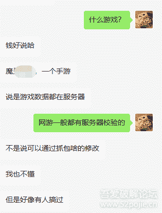

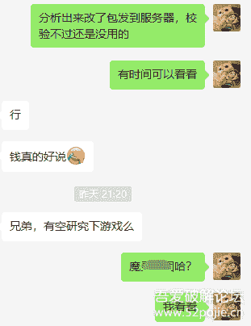

## 初步分析

下载安装 app，没啥说的。像这种手游类型的，一般都是 TCP 的封包协议，有的是 websocket，有的是纯粹的 TCP。

那么就先抓包看看，我用的是 pixel3，配置抓包环境就不详细展开了。打开 charles，发现到登录服务器的时候会提示连接不上服务器。那就换 httpcanary 试试。

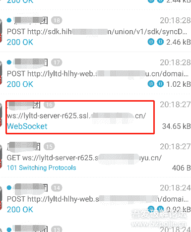

可以明显看到是 websocket 的协议，先打开看看是否是明文显示的。

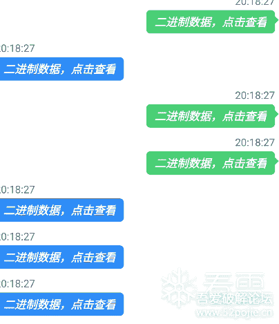

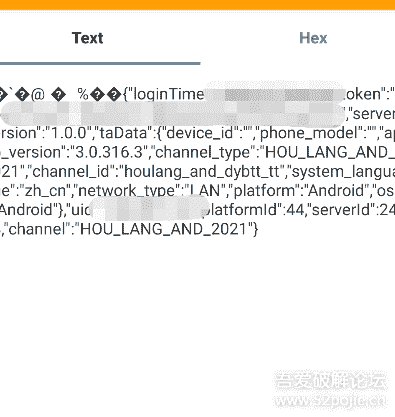

可以看到发送包部分明文，再看看接收的包。

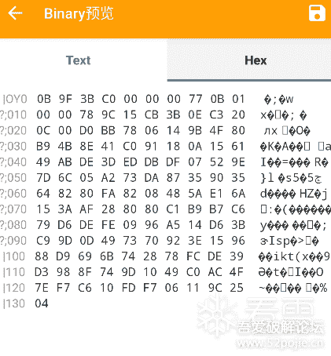

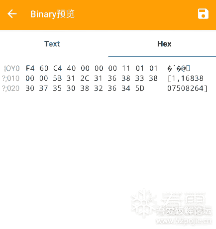

有的有明文，有的却都是乱码，且乱码部分的数据都比较大。初步判断有做压缩传输。

## APP 分析

接下来就要去看下 app 里面的构造了。首先游戏类的 app，因为要频繁更新，所以一般不存在加固加壳的情况。用压缩软件打开 app 目录，可以看到：

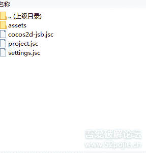

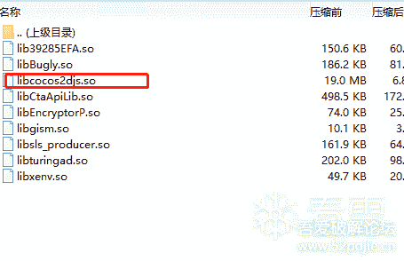

cocos2d `jsc` 文件，并且在 `lib` 目录看到了 `cocos2djs.so`，确定这个游戏主要的逻辑应该都在这个 `jsc` 文件里面。

根据经验直接用 mt 管理器以十六进制文本打开 `cocos2djs.so`，然后搜索 ASCII 字符 `main.js`：

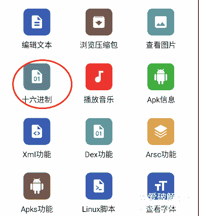

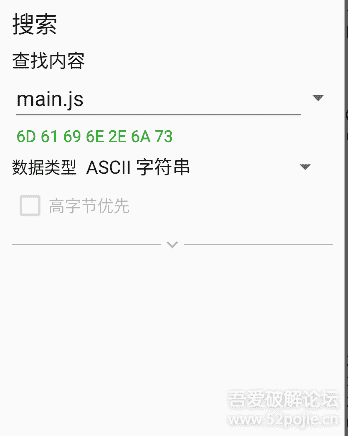

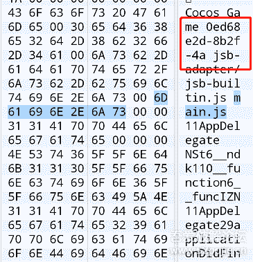

这个格式的 `0ed68e2d-8b2f-4a` 就是 `jsc` 的解密密钥 `key`。尝试解密：https://bbs.kanxue.com/thread-267920.htm#msg_header_h2_1

根据这篇大佬的分析，里面有提到的 `jsc` 解密 v1.44 工具，下载打开，输入 `key`，然后拖入 `project.jsc`，运气不错，顺利的解开了。（ps：文件有点大，可能会卡一会儿，耐心等待）

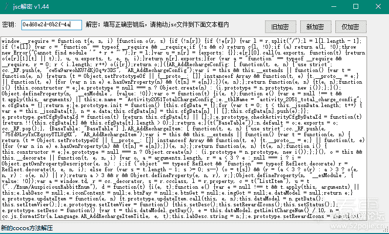

## 代码分析

接下来就找个工具把 `js` 代码格式化一下。然后关键词大法搜索一下 `ws://`、`send`、`sendmessage`、`encrypt`、`encode` 之类的。

顺利的定位到发包前的编码代码位置，先上编码的图：

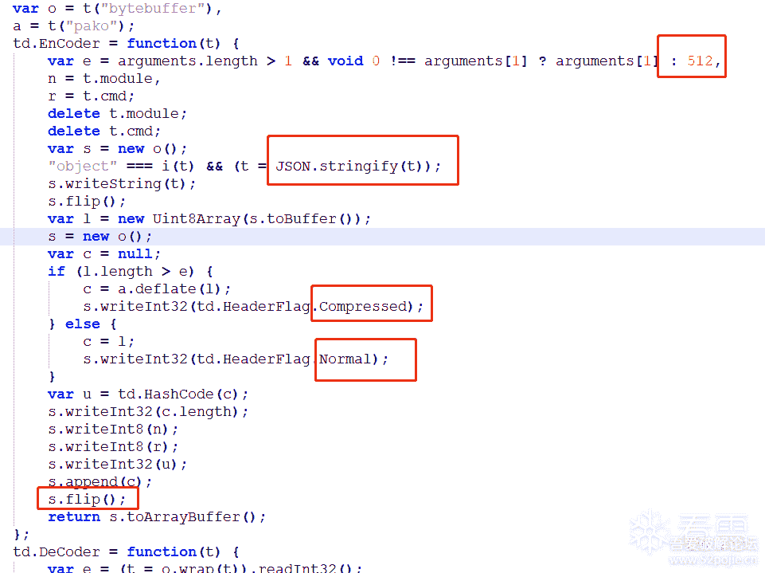

然后是解码的：

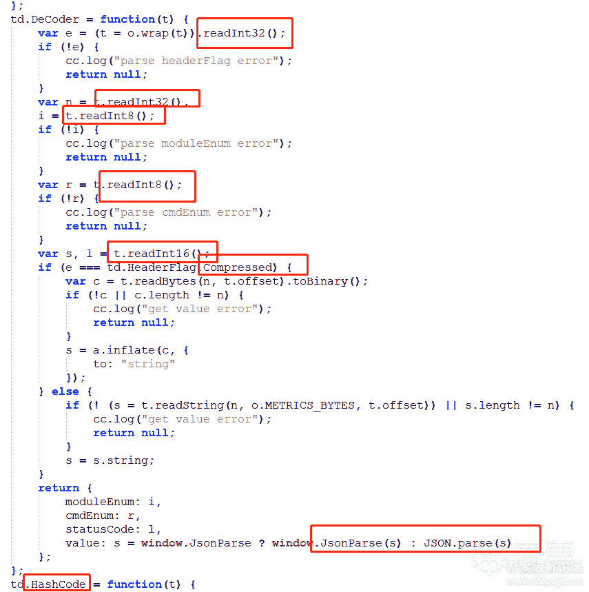

编码的和解码的差不多，只是多了个 `HashCode`，应该是服务器接收到客户端的数据后会根据这个 `hashcode` 来判断数据是否是合法提交。

### 算法分析

重点看下解码的代码：

先读取前 4 个字节作为 `headerFlag` 来判断数据是否被压缩，如果是压缩的需要执行解压缩 `inflate` 操作。

再读取 4 个字节是数据的长度（ps：注意要做字节集反转，大小端网络字节序的转换）。

然后一个字节作为 `moduleEnum`。

再一个字节作为 `cmdEnum`。

再两个字节作为 `statusCode`。

然后从下个字节开始到尾部刚好是与数据长度相等，那么这最后读取出来的 `readBytes` 就是最终的数据了。

## 算法还原解析数据

接下来根据前面的分析，来通过代码实现数据的解析，看看服务器返回的数据明文是什么东东：

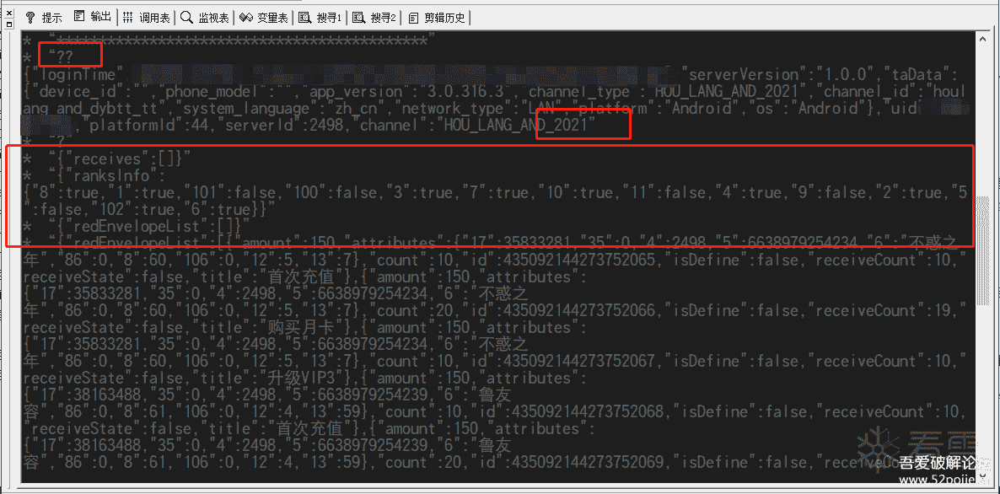

图上第一个包是发送的包，因为没有做 `hashcode` 的判断，导致前面多了两个字节，后面丢了两个字节。不过接收的包是可以看到完整信息的。

至此封包分析结束，发送的包只要按照相同的逻辑做组包即可，记得带上 `hashcode`。

## 总结

1. 逆向分析的过程，上文取巧通过搜索 `main.js` 来直接定位到了 `key` 的位置。如果做适当的加密混淆可以避免这种情况，那么就得像上贴大佬的方式去 `ida` 定位 `xxtea`，然后 `frida` 来 `hook` 关键的位置提取 `key` 值。
2. 这个游戏只是对数据做了压缩，且短数据直接没有做处理，没有做加密或者序列号的处理，不过考虑到游戏类对通讯的低延时要求，不做评价。
3. 最后在附件贴上游戏文件，如有侵权，联系删除。

好了，到这里基本的分析记录也已经结束了。谈不上教程，只是把自己的学习分析过程记录一下。大家有什么好的方法和见解也欢迎交流，谢谢大家。

最后的最后，客户放我鸽子了，这也是这篇帖子会出现的原因。大家再见！

`17.png` (147.93 KB, 下载次数: 1)

[`href="forum.php?mod=attachment&aid=MjYxNDEyN3xmMzhkMTQ2NHwxNzkzNTY5Mzg5fDE2ODA4NnwxNzg0MzUz&nothumb=yes" target="_blank"`](https://www.52pojie.cn/forum.php?mod=attachment&aid=MjYxNDEyN3xmMzhkMTQ2NHwxNzkzNTY5Mzg5fDE2ODA4NnwxNzg0MzUz&nothumb=yes)

2023-5-11 21:50 上传

[`href="forum.php?mod=attachment&aid=MjYxNDEyOHwzN2MxNDQ4OHwxNzkzNTY5Mzg5fDE2ODA4NnwxNzg0MzUz" target="_blank"`](https://www.52pojie.cn/forum.php?mod=attachment&aid=MjYxNDEyOHwzN2MxNDQ4OHwxNzkzNTY5Mzg5fDE2ODA4NnwxNzg0MzUz)

(731 Bytes, 下载次数: 139)

2023-5-11 21:50 上传

点击文件名下载附件

下载积分: 吾爱币 -1 CB
