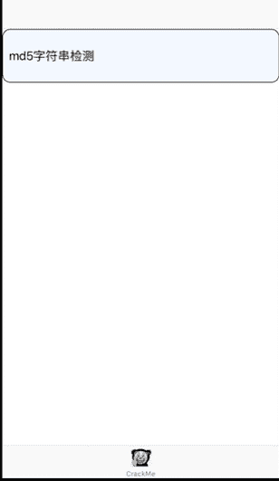
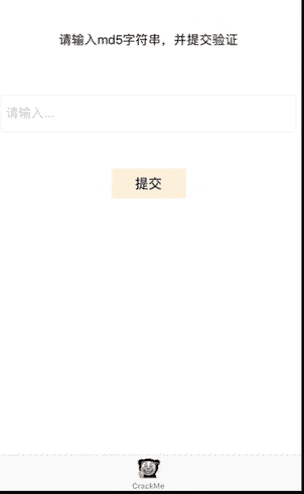
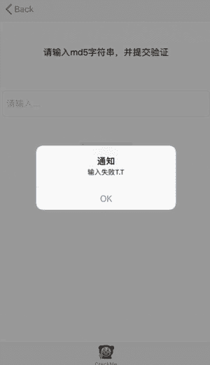
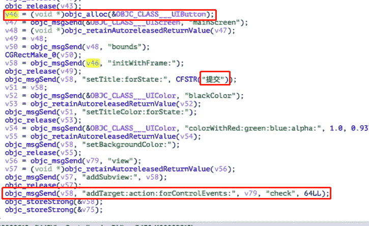
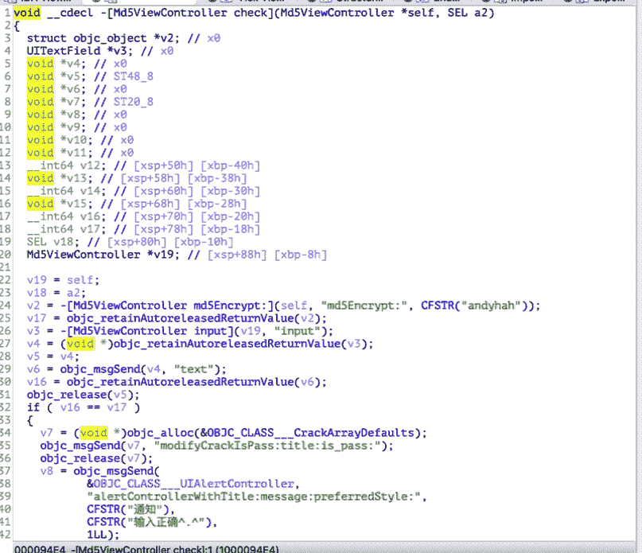
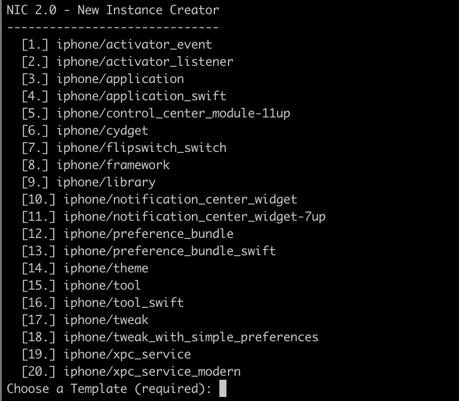
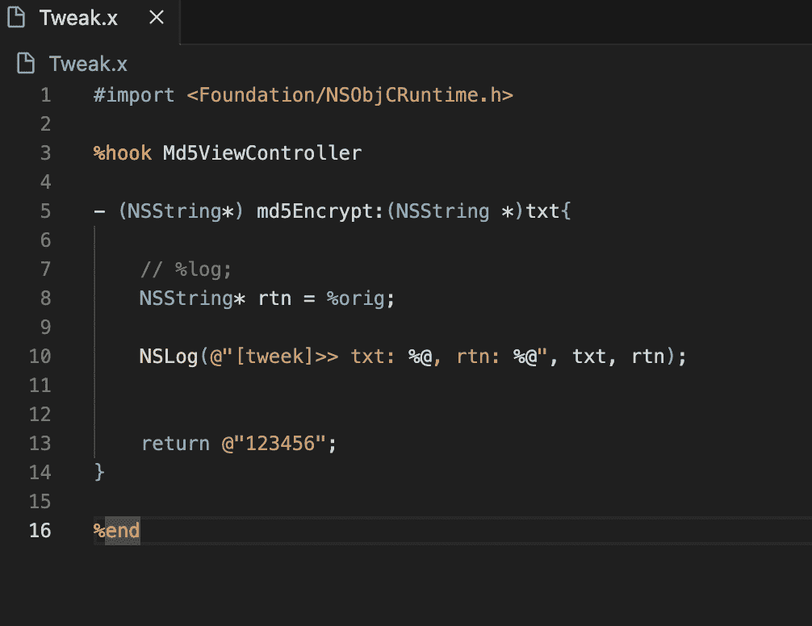
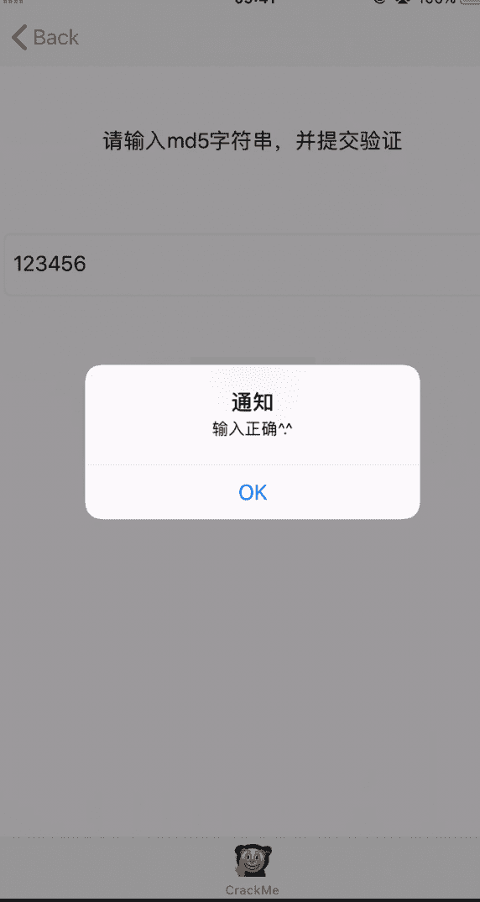
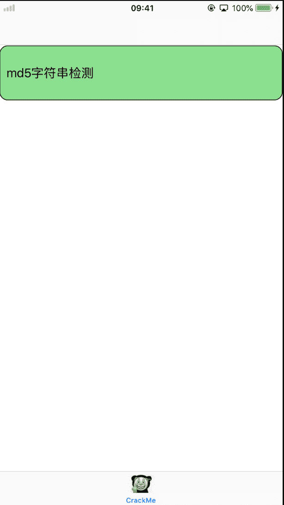
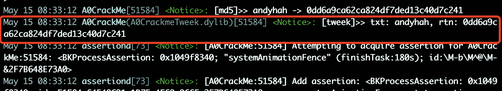

# [iOS 原创] 【ios逆向学习】简易ios crackme 学习分析记录

- 原帖: https://www.52pojie.cn/forum.php?mod=viewthread&tid=1785910
- 抓取时间: 2026-11-01T21:43:08

## 小引

最近入门了ios逆向，还买了本飘云大佬的《ios运用逆向与安全之道》，看了看属实不错。写了个简易crackme app用来熟悉熟悉，初步了解一下ios的逆向方法和流程。

### 设备

- ios版本 12.4.5
- iphone6 plus（已越狱）
- xcode 12.0

### 项目地址

[https://github.com/andy0andy/ios_crackme](https://github.com/andy0andy/ios_crackme)

## 流程

### 分析

- 目标：输入框输入字符串，点击提交，成功则弹出成功提示框，并且首页背景变为绿色

  
  
  

- 通过Reveal 查看页面找到视图为 `Md5ViewController`

- 用ida 打开Mach-O文件并搜索关键字提交，找到目标代码，是一个点击事件，事件触发的方法是 `check`

  

- 找到 `check`，查看伪代码，发现加密函数是 `md5Encrypt`, 入参是 “`andyhah`”。然后与输入框的输入比较，相同则成功。

  

### 逆向

`md5Encrypt`函数实现功能其实就是将“`andyhah`”md5加密了一下，但还是hook一下练练手^。^，使用越狱插件将加密函数改为永远返回 `123456`

- tweek 插件

  [https://juejin.cn/post/6961975578631241765](https://juejin.cn/post/6961975578631241765)

- 运行`nic.pl` 启动theos

- 选择tweek

  

- 修改`Tweek.x`, 使`md5Encrypt`返回固定字符串

  

- 打包，上传，安装

  ```
  DEBUG=0 make package
  scp packages/[deb文件] root@[设备ip]:/tmp

  # 进入iphone
  cd /tmp
  dpkg -i [deb文件]
  ```

- 运行

  输入框输入 123456，点击提交

  
  

查看日志iphone：`idevicesyslog -i "A0CrackMe"`



### 小结

一个很简单app，可以自行clone项目，并用xcode安装到测试机上。后面继续深入也会更新跟多的检测攻防上去
