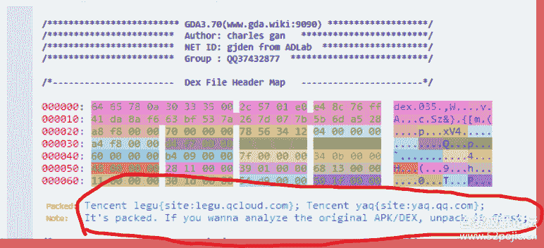
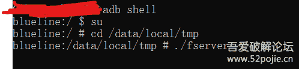
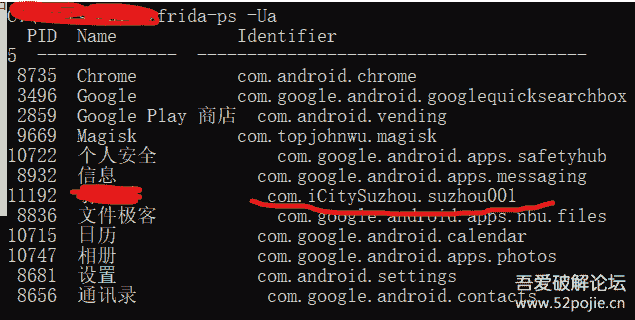
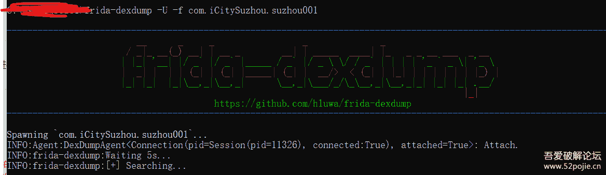
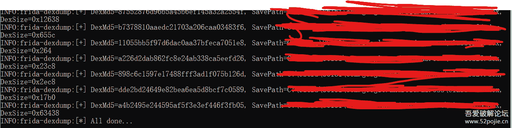

# [Android 分享]（纯新手）新手记录一次 `frida-dexdump` 脱壳过程

- 原帖：<https://www.52pojie.cn/forum.php?mod=viewthread&tid=1786001>
- 抓取时间：2026-11-01T21:43:07

纯新手，了解到了大佬的 `Firda-dexdump`，记录一下[过程](https://www.52pojie.cn/forum-5-1.html)。

## 第一步：查看 app 是否带壳

我这里是将 `apk` 拖入 `GDA` 当中。

屏幕截图 2023-05-16 093446.png (164.49 KB, 下载次数: 2)

<https://www.52pojie.cn/forum.php?mod=attachment&aid=MjYxNTA3MHxiMDFhYTM2OXwxNzkzNTY5Mzg1fDE2ODA4NnwxNzg2MDAx&nothumb=yes>

2023-5-16 09:34 上传

## 第二步：启动 `frida`，查看包名

屏幕截图 2023-05-16 093826.png (14.75 KB, 下载次数: 1)

<https://www.52pojie.cn/forum.php?mod=attachment&aid=MjYxNTA3Mnw1Nzg0MWZmZnwxNzkzNTY5Mzg1fDE2ODA4NnwxNzg2MDAx&nothumb=yes>

2023-5-16 09:38 上传

屏幕截图 2023-05-16 094053.png (52.96 KB, 下载次数: 1)

<https://www.52pojie.cn/forum.php?mod=attachment&aid=MjYxNTA3M3wzNDQyYTM4M3wxNzkzNTY5Mzg1fDE2ODA4NnwxNzg2MDAx&nothumb=yes>

2023-5-16 09:40 上传

## 第三步：使用 `frida-dexdump`

（`frida-dexdump -U -f 包名 -o 保存地址`）

屏幕截图 2023-05-16 094619.png (35.85 KB, 下载次数: 0)

<https://www.52pojie.cn/forum.php?mod=attachment&aid=MjYxNTA3NHw3NDFlNjNjOXwxNzkzNTY5Mzg1fDE2ODA4NnwxNzg2MDAx&nothumb=yes>

2023-5-16 09:46 上传

屏幕截图 2023-05-16 094542.png (93.65 KB, 下载次数: 1)

<https://www.52pojie.cn/forum.php?mod=attachment&aid=MjYxNTA3NXxiYWI5OWU4MnwxNzkzNTY5Mzg1fDE2ODA4NnwxNzg2MDAx&nothumb=yes>

2023-5-16 09:46 上传

显示 `all done` 即代表脱壳完成。

非常方便，大佬不愧是大佬。
