# [Android 分享] 关于长安车机飞鱼系统解除系统安装限制以及过程

- 原帖：[https://www.52pojie.cn/forum.php?mod=viewthread&tid=1786616](https://www.52pojie.cn/forum.php?mod=viewthread&tid=1786616)
- 抓取时间：2026-11-01T21:43:05

## 关于长安车机飞鱼系统解除系统安装限制以及过程

### 前提说明

- 文章原作者：@17710，因作者无吾爱账号，所以代为发表。已经获得作者授权！以下内容为作者原内容！
- 此教程仅针对飞鱼系统代表车型 UNI-V、锐程 puls 等；至于梧桐系统（代表车型 UNI-T），请见文章结尾思路。
- （本人是纯小白，可能走了很多弯路，大佬勿喷。）

### 思路

首先感谢 VIKING 大佬的思路（csdn 搜索“长安梧桐车机”）@VIKING-01。

至于二代 75p 的教程，可以看 @Streamform 的帖子，详细介绍了如何绕过辰为加密直接安装（帖子地址百度）。

从大佬教程中，我们可以找到梧桐车机的第一道拦截 APK 并进行删除：`system/app/VecentekAPP/` 目录下的 `VecentekAPP.apk`。

然后使用 `pm install -r` 继续安装软件会进行报错。

如图：

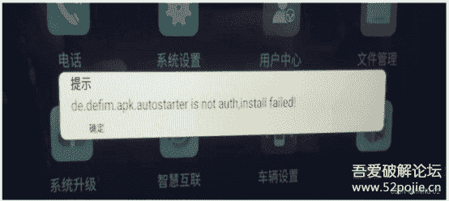

1.png (126.72 KB, 下载次数: 3)  
[附件下载](https://www.52pojie.cn/forum.php?mod=attachment&aid=MjYxNTQxNHxmZmU5M2RjM3wxNzkzNTY5MzgyfDE2ODA4NnwxNzg2NjE2&nothumb=yes)  
2023-5-17 13:39 上传

## 一、根据 Viking 的思路之后的流程

### 1、找到车机中的 `Services.jar` 并拷贝出来，并开始修改

根据报错提示以及大佬思路，可以找到 `/system/framework/services.jar`，然后使用 `adb pull` 拷贝出来。

adb 工具命令如下：

```bash
# adb 工具命令如下：
adb pull /system/framework/services.jar system  # 拷贝 jar 文件到工具箱下面的 system 目录中
```

根据报错提示以及大佬思路，将这个文件用 MT 管理器打开，然后进行关键字搜索，可以得到如下结果。

如图：

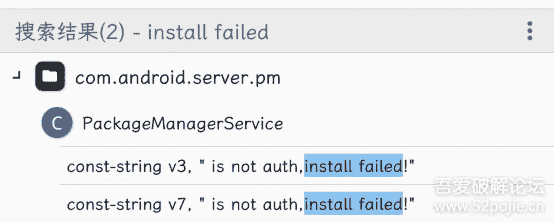

2.png (55.88 KB, 下载次数: 3)  
[附件下载](https://www.52pojie.cn/forum.php?mod=attachment&aid=MjYxNTQxNXxlNTU1M2FjMHwxNzkzNTY5MzgyfDE2ODA4NnwxNzg2NjE2&nothumb=yes)  
2023-5-17 13:39 上传

将这部分代码转换成 Java 代码，得到如下所示：

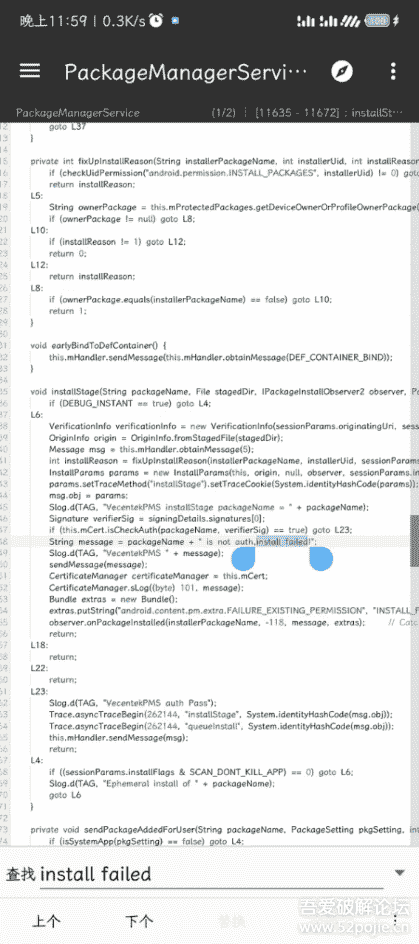

3.png (294.47 KB, 下载次数: 1)  
[附件下载](https://www.52pojie.cn/forum.php?mod=attachment&aid=MjYxNTQxNnwxMTc4OTExNHwxNzkzNTY5MzgyfDE2ODA4NnwxNzg2NjE2&nothumb=yes)  
2023-5-17 13:39 上传

然后将整段代码喂个 GTP（不要问，问就是看不懂，纯小白），得到以下结果：

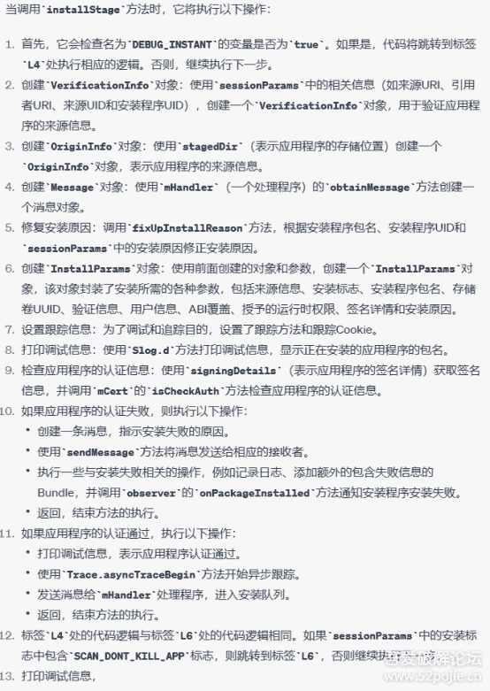

4.png (315.77 KB, 下载次数: 3)  
[附件下载](https://www.52pojie.cn/forum.php?mod=attachment&aid=MjYxNTQxN3xiYTU4ZDE5YXwxNzkzNTY5MzgyfDE2ODA4NnwxNzg2NjE2&nothumb=yes)  
2023-5-17 13:40 上传

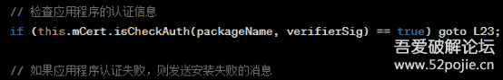

5.png (25.83 KB, 下载次数: 3)  
[附件下载](https://www.52pojie.cn/forum.php?mod=attachment&aid=MjYxNTQxOXwyMTBlNTkyNHwxNzkzNTY5MzgyfDE2ODA4NnwxNzg2NjE2&nothumb=yes)  
2023-5-17 13:40 上传

发现是通过这行代码来判断应用是否通过认证，继续找 GTP：

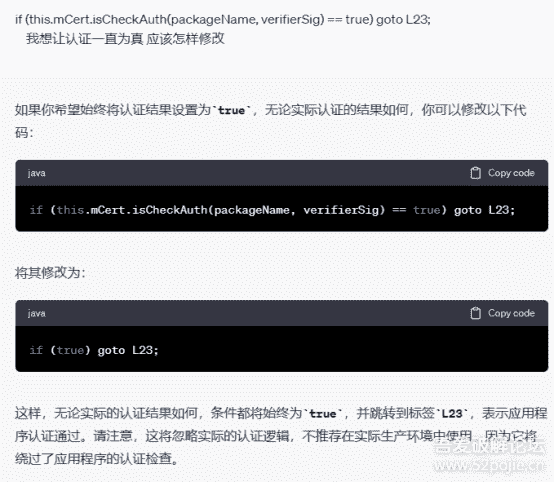

6.png (89.98 KB, 下载次数: 2)  
[附件下载](https://www.52pojie.cn/forum.php?mod=attachment&aid=MjYxNTQyMXwwOWJkMzI3NnwxNzkzNTY5MzgyfDE2ODA4NnwxNzg2NjE2&nothumb=yes)  
2023-5-17 13:40 上传

按照 GTP 给的修改教程，改完之后发现我转不回 dex 里的 smali 代码了（问就是菜）……只得作罢，从一开始的 smali 代码动手。

找到刚刚用 MT 搜索到的对应文件里面的对应内容：

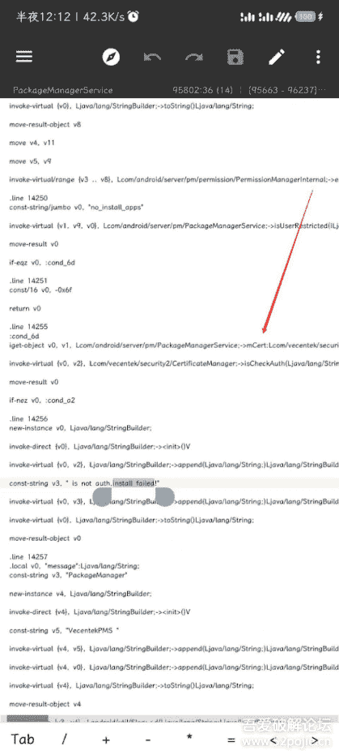

7.png (192.95 KB, 下载次数: 2)  
[附件下载](https://www.52pojie.cn/forum.php?mod=attachment&aid=MjYxNTQyMnxhZWYwY2NhMXwxNzkzNTY5MzgyfDE2ODA4NnwxNzg2NjE2&nothumb=yes)  
2023-5-17 13:40 上传

可以发现 Java 代码里的判断，对应的就是图上这几行；老规矩，找 GTP，得到如下结果：

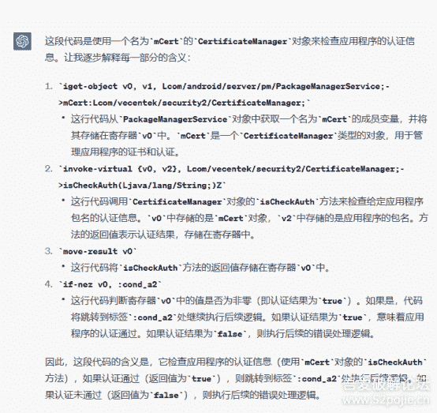

8.png (184.74 KB, 下载次数: 2)  
[附件下载](https://www.52pojie.cn/forum.php?mod=attachment&aid=MjYxNTQyNHxlNTViYzE0NnwxNzkzNTY5MzgyfDE2ODA4NnwxNzg2NjE2&nothumb=yes)  
2023-5-17 13:40 上传

然后让 GPT 动手修改：

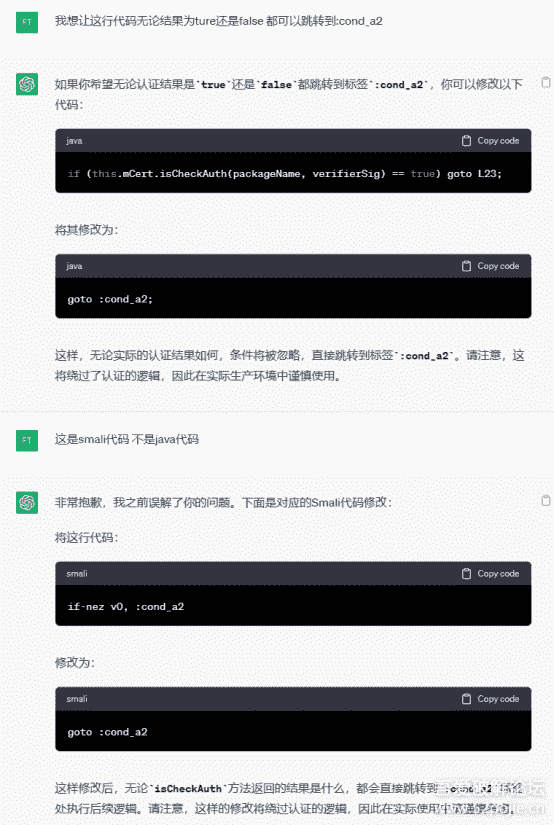

12.png (116.76 KB, 下载次数: 2)  
[附件下载](https://www.52pojie.cn/forum.php?mod=attachment&aid=MjYxNTQ0MHw5YmJhOWZhMXwxNzkzNTY5MzgyfDE2ODA4NnwxNzg2NjE2&nothumb=yes)  
2023-5-17 13:44 上传

按照教程修改（一共有两个），有两处 `install failed`，我们需要修改两处，修改完后用 MT 反编译回去即可。

如图所示：

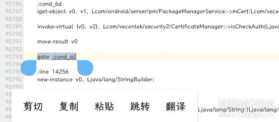

9.png (68.62 KB, 下载次数: 2)  
[附件下载](https://www.52pojie.cn/forum.php?mod=attachment&aid=MjYxNTQyNXwxZTYwOWJkNnwxNzkzNTY5MzgyfDE2ODA4NnwxNzg2NjE2&nothumb=yes)  
2023-5-17 13:40 上传

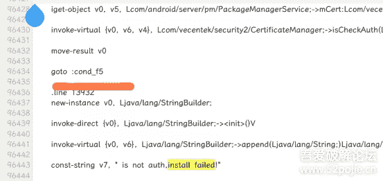

10.png (85.4 KB, 下载次数: 3)  
[附件下载](https://www.52pojie.cn/forum.php?mod=attachment&aid=MjYxNTQyNnw2MjMwZGIzMXwxNzkzNTY5MzgyfDE2ODA4NnwxNzg2NjE2&nothumb=yes)  
2023-5-17 13:40 上传

### 2、开始测试流程

温馨提示：

```bash
# 进入 adb 替换掉车机原文件（提前做好备份）
# 执行 stop、sync、start 三个命令进行重启
# 不用 reboot 重启是因为 reboot 重启需要重连 adb，而这三个命令重启不会
# 万一文件修改有问题无法开机，可以在 adb 里面替换回去
```

成功开机后，`push` 个 APK，然后使用 `pm install -r` 安装试试，发现没有报错，只有段提示（没截图，不重要）。为了车机安装软件，直接安装软件，直接推了个 `via` 到 `system/priv-app` 下，`reboot` 重启，打开 `via`，随意下载个安装包，点击安装。

安装成功的话如图所示：


11.png (83.98 KB, 下载次数: 3)  
[附件下载](https://www.52pojie.cn/forum.php?mod=attachment&aid=MjYxNTQyN3w3NjIwYjZmNnwxNzkzNTY5MzgyfDE2ODA4NnwxNzg2NjE2&nothumb=yes)  
2023-5-17 13:40 上传

至此，流程结束。你的车机已经可以随便安装软件到 `data` 了。

## 二、其它车型，如 UNIT 等飞鱼车机系统

`UNIT` 等其他飞鱼系统的思路：

- 梧桐系统的 `services` 文件经过 `dex2oat` 优化过，保存在 `system/framework/oat/arm64/` 下。
- 理论上来讲，将优化过的文件反编译成 Java 代码或者 smali 代码，就能按照上述方法进行修改。

## 三、如果无需安装到 `data`

如果无需安装到 `data`（车机 `system` 分区空间足够的话），可以看上一篇帖子。

传送门：[上一篇帖子](https://www.52pojie.cn/thread-1783719-1-1.html)
