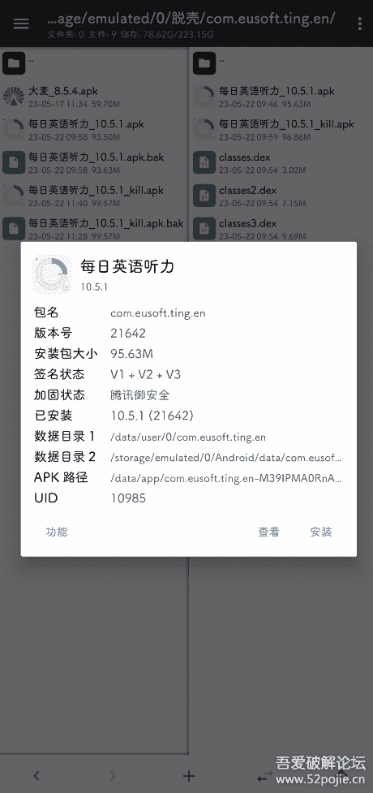
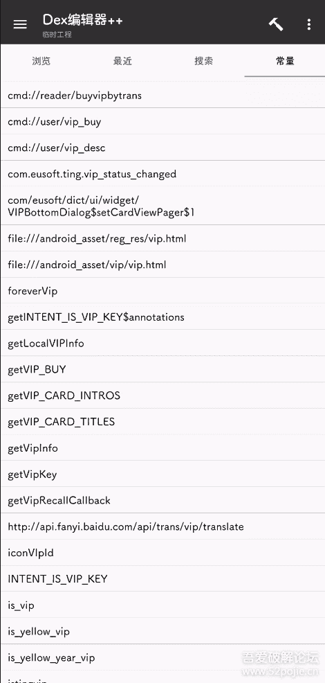
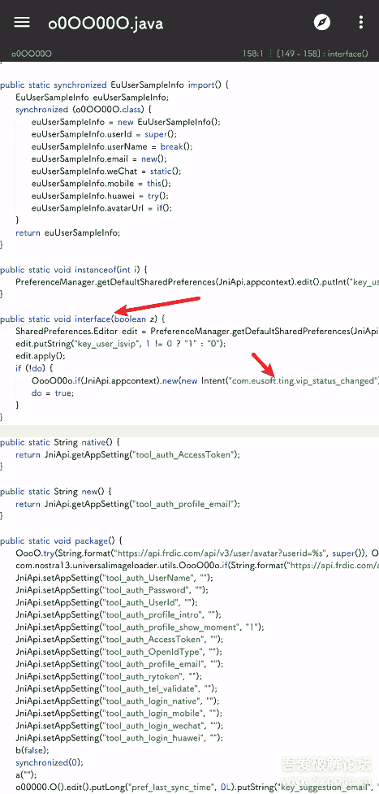
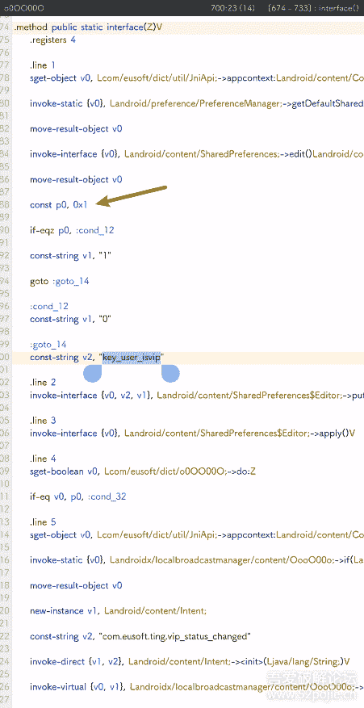

# [Android 原创] 每日英语听力解锁

- 原帖: https://www.52pojie.cn/forum.php?mod=viewthread&tid=1788325
- 抓取时间: 2026-11-01T21:42:59

我看各位铁子们对英语学习都挺感兴趣的，今天给分享一款听力磨耳朵的app。 个人用了感觉还不错的。

话不多说，还是直接打开。

[`11111.png`](https://www.52pojie.cn/forum.php?mod=attachment&aid=MjYxNjU2OXw0OWNkNDNhMXwxNzkzNTY5Mzc3fDE2ODA4NnwxNzg4MzI1&nothumb=yes) (149.6 KB, 下载次数: 0) 2023-5-22 11:53 上传

腾讯的壳，应该是最简单的了吧。 脱下来6个dex，修复，回填，改入口，删特征这些就不多说了。没什么难度。

然后直接搜索vip关键字，可以看到很多结果。这就好办了，我们可以重点关注带有is vip的几个结果。具体逻辑大家自己一个一个进去分析就ok了。

[`2222222.png`](https://www.52pojie.cn/forum.php?mod=attachment&aid=MjYxNjU3MHw4MGNhYWY2NXwxNzkzNTY5Mzc3fDE2ODA4NnwxNzg4MzI1&nothumb=yes) (129.67 KB, 下载次数: 1) 2023-5-22 11:58 上传

看完代码逻辑，大致就能定位到关键点代码了。 `interface(boolean isVip)` 是否是会员回调接口，如果为true, 将`key_user_isvip`赋值为1，保存到`SharedPreference`中。然后发送会员状态改变的全局广播，更新会员状态。 广播为`com.ensoft.ting.vip_status_changed`.

[`33333.png`](https://www.52pojie.cn/forum.php?mod=attachment&aid=MjYxNjU3MXxjYjQ0ZTA5YXwxNzkzNTY5Mzc3fDE2ODA4NnwxNzg4MzI1&nothumb=yes) (300.8 KB, 下载次数: 1) 2023-5-22 12:04 上传

所以，很简单，我们只需要将回调参数的值，重新赋值为1即可完成修改。

[`44448.png`](https://www.52pojie.cn/forum.php?mod=attachment&aid=MjYxNjU3Mnw4MDAxZGY2YXwxNzkzNTY5Mzc3fDE2ODA4NnwxNzg4MzI1&nothumb=yes) (216.01 KB, 下载次数: 2) 2023-5-22 12:10 上传

也是没什么难度。大家将就看吧，权当练习了。

[`55555.png`](https://www.52pojie.cn/forum.php?mod=attachment&aid=MjYxNjU3M3w3MTU3YzA2OHwxNzkzNTY5Mzc3fDE2ODA4NnwxNzg4MzI1&nothumb=yes) (145.35 KB, 下载次数: 2) 2023-5-22 12:13 上传

[`666666.png`](https://www.52pojie.cn/forum.php?mod=attachment&aid=MjYxNjU3NHxmM2FmNjVkY3wxNzkzNTY5Mzc3fDE2ODA4NnwxNzg4MzI1&nothumb=yes) (280.27 KB, 下载次数: 1) 2023-5-22 12:13 上传
