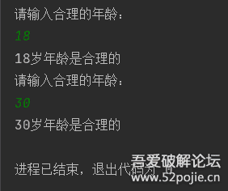
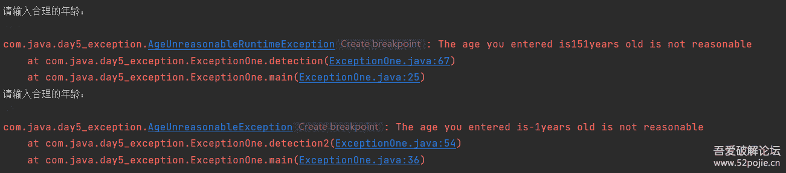
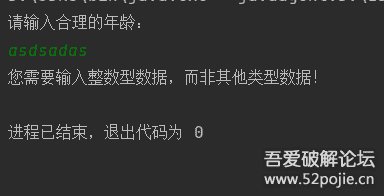
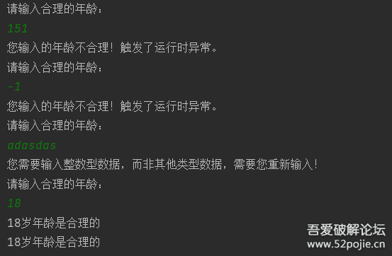
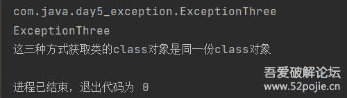
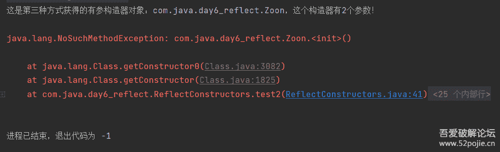
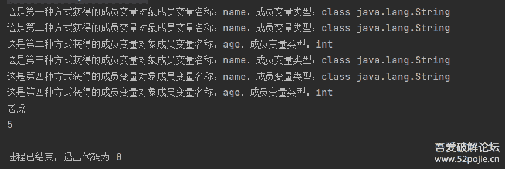
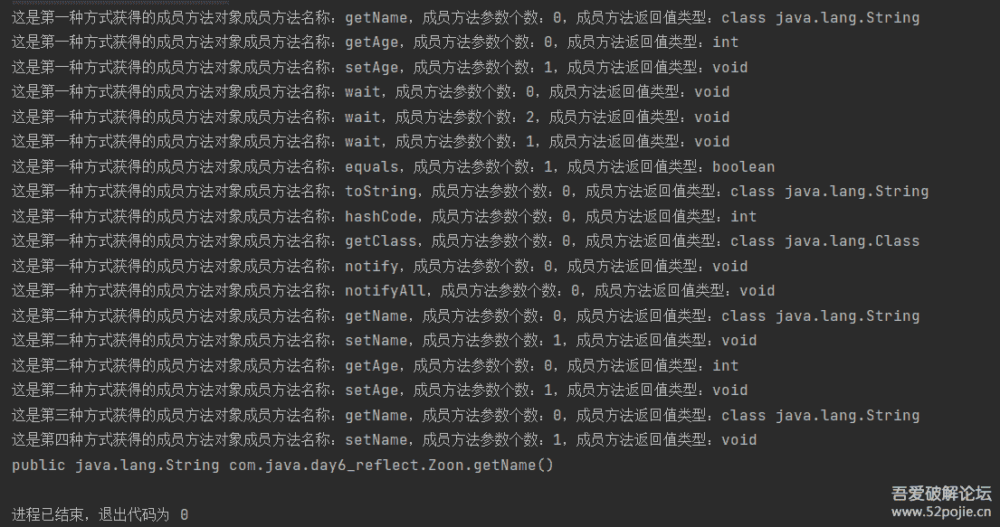

# [Android 原创] 安卓逆向入门笔记(二)——Java与smali基础

- 原帖: https://www.52pojie.cn/forum.php?mod=viewthread&tid=1797943
- 抓取时间: 2026-11-01T21:42:35

## 一、Java基础

Java作为一种面向对象语言。最为重要的两个概念那就是类和对象：
类：类是一个模板，它描述一类对象的行为和状态。
对象：对象是类的一个实例，有状态和行为。
类和对象之间的关系就像人类和某个人之间的关系，人类拥有一些行为和状态，这些行为和状态作为了人类的特征；用面向对象的思维来说，每个人可以说是人类这个类实例化的对象，在拥有人类的行为和状态下还拥有各自的特点。

### 基础数据类型

数据类型分为四大类八种，四大类是：整形、浮点型、字符型、布尔型；整形可以细分为`byte`、`short`、`int`、`long`；浮点可以细分为`float`、`double`。
1、整数类型默认为`int`类型，占4字节，当使用字节大小是大于它的`long`类型时，除了需要定义变量为`long`类型，还需要在值后面加`L`或者`l`才能将该变量表示为`long`类型。如：`long l = 123456789l`；
2、浮点类型默认为`double`类型，占8字节，在值后面加上`F`/`f`就是`float`类型了。如：`float f = 3.14f`；

### 类型转换

```
package com.java.TypeDome;

public class TypeDome {
    public static void main(String[] args) {
        // 1、自动类型转换
        // 占内存小的类型的变量可以赋值给内存占的大的类型的变量
        byte a = 10;
        int b = a;  // 发生了自动的类型转换
        System.out.println(a);
        System.out.println(b);

        System.out.println("---------------------------------------------");

        // 2、表达式的自动类型转换
        // 表达式的最终结果类型由表达式中的最高类型决定
        int i = 10;
        int j = 10;
        double ij = 1.0;
        // int ji = i + j + ij;  java: 不兼容的类型: 从double转换到int可能会有损失
        double ji = i + j + ij;
        System.out.println(ji);
        // 在表达式中，byte、short、char是直接转换成int类型参与运算的
        byte one = 20;
        byte two = 25;
        // byte three = one + two;  java: 不兼容的类型: 从int转换到byte可能会有损失
        int three = one + two;
        System.out.println(three);

        System.out.println("---------------------------------------------");

        // 3、强制类型转换
        // 强制类型转换可能造成数据的丢失
        // 下面的数据都为有符号位
        int o = 1500;  // 00000101 11011100
        byte t = (byte) o;  // 11011100
        System.out.println(t);  // 输出结果：-36
        // 小数强制转换为整数是直接舍弃小数保留整数
        double dou = 81.5;
        int interesting = (int) dou;
        System.out.println(interesting);  // 输出结果：81
    }
}
```

### 修饰符

Java提供了两类修饰符。分别是访问修饰符和非访问修饰符。

#### 访问修饰符

访问修饰符是一种用来限制类、接口、类成员（字段、方法、构造函数等）访问权限的关键字，主要包括以下四种：
- `public`：公共访问修饰符，表示该类或类成员可以被任何其他类访问。
- `private`：私有访问修饰符，表示该类或类成员只能在本类中被访问，其他类无法访问。
- `protected`：受保护的访问修饰符，表示该类或类成员只能在本类和其子类中被访问，其他类无法访问。
- `default`（默认，即不写访问修饰符）：默认访问修饰符，表示该类或类成员只能在同一包内被访问，其他包中的类无法访问。

#### 非访问修饰符

为了实现一些其他的功能，Java 提供了很多非访问修饰符，如：
- `static`：静态修饰符，表示该类成员是静态的，可以直接通过类名调用而不需要创建实例。
- `final`：最终修饰符，表示该类、方法或变量是不可修改的，一旦被赋值则无法再次修改。
- `abstract`：抽象修饰符，表示该类或方法是抽象的，不能被实例化或调用，只能被子类继承或实现。
- `synchronized`：同步修饰符，表示该方法或代码块是同步的，多个线程不能同时访问，保证线程安全。
- `transient`：瞬态修饰符，表示该变量在序列化时会被忽略，即不会被保存到文件中。
- `volatile`：易失修饰符，表示该变量是易失的，多个线程对其进行操作时不会进行缓存，保证可见性和原子性。

### 运算符

```
package com.java.operator;

public class Operators {

    public static void main(String[] args) {

        // 1、运算符有+、-、*、/、%，和c、和python中的运算符一模一样

        // 2、+除了做基本的数学运算符，在与字符串进行+运算时会被当成连接符，其结果还是字符串；加法口诀：能算则算，不能算则拼接成字符串

        int i = 10;

        String str = "Thank You";

        System.out.println((str + i));  // 输出显示：Thank You10

        System.out.println("---------------------------------------------");

        // 3、自增运算符++和自减运算符--的运算规则：++或者--在变量的前面表示先自增或者自减后再运算，在变量的后面表示先运算再自增或者自减

        int m = 10;

        int n = m++;

        System.out.println(m);  // 11

        System.out.println(n);  // 10

        System.out.println("---------------------------------------------");

        // 4、赋值运算符：+=、-=、*=、/=、%=；赋值运算符格式：变量 赋值运算符 (变量的类型) 值

        int o = 10;

        double t = 20.0;

        o += t;

        System.out.println(o);  // 显示结果：30

        System.out.println("---------------------------------------------");

        // 5、条件运算符：==、!=、>=、、= 10));

        System.out.println(d2);

        // 短路与：必须都为true，有一个false就为false，但前一个为false后一个就不执行

        System.out.println((d1 = 10));

        System.out.println(d2);

        // 逻辑或：得有一个为true，全部为false就为false。但前一个为true后一个依旧执行

        // 短路或：得有一个为true，全部为false就为false。但前一个为true后一个就不执行

        // 逻辑非：取反

        // 逻辑异或：相同是false，不同是true

        System.out.println("---------------------------------------------");

        // 7、三元运算符格式：条件表达式？条件表达式为true时返回的值: 条件表达式为false时返回的值；

        int zhen = d1 >= d2? d1: d2;

        System.out.println(zhen);

    }

}
```

### 流程控制语句

#### if……else……语句

```
package com.java.ProcessControl;

import java.util.Scanner;

public class IfElse {
    public static void main(String[] args) {
        // if(条件表达式1) {
        //  条件表达式1返回值为true时执行的代码……
        // } else if(条件表达式2) {
        //  条件表达式1不成立但条件表达式2成立时执行的代码
        // }……else {
        //  如果上面的所有条件表达式都不成立时执行的代码
        // }
        Scanner sca = new Scanner(System.in);
        System.out.println("请输入该同学的成绩：");
        int grades = sca.nextInt();
        if (grades  100) {
            System.out.println("成绩不存在");
        }else  if (grades >= 90) {
            System.out.println("该同学必成龙凤！！");
        }else if (grades >= 80) {
            System.out.println("该同学成绩优秀");
        }else if (grades >= 70) {
            System.out.println("该同学成绩一般");
        }else if (grades >= 60) {
            System.out.println("该同学成绩及格，还需努力！");
        }else {
            System.out.println("挂科");
        }
    }
}
```

#### switch语句

`switch case`语句判断一个变量与一系列值中某个值是否相等，每个值称为一个分支。

```
package com.java.ProcessControl;

import java.util.Scanner;

public class SwitchCase {

    public static void main(String[] args) {

        Scanner s = new Scanner(System.in);

        System.out.println("请输入当前汽车挡位");

        int i = s.nextInt();  // 输入一个整形数据

        switch (i) {  // switch (表达式) {}中表达式不支持double、float、long类型

            case 1:  // case给出的值不允许重复，且只能是字符串常量或字面量。

                System.out.println("很稳健！");

                break;  // 不要忘记写break，不然会往下执行，直到退出switch

            case 2:

                System.out.println("你准备加速了!");

                break;

            case 3:

                System.out.println("请注意别超速");

                break;

            case 4:

                System.out.println("请注意减速！");

                break;

            case 5:

                System.out.println("你开的太快了！");

                break;

            case '6':

                System.out.println("此车没有倒挡！");

                break;

            default:

                System.out.println("没有此挡位！");

        }

    }

}
```

`switch case`执行时，一定会先进行匹配，匹配成功就开始执行`case`语句之后的语句，再根据是否有 `break`，判断是否继续输出，或是跳出判断。

#### 循环语句

```
package com.java.circulate;

public class Circulate {
    public static void main(String[] args) {
        /*
        * for (初始化数据语句;循环条件;迭代语句) {
        *   循环代码;
        * }
        * */
        int sum=0;
        for (int i=1;i
```

### 数组

```
package com.java.ArrayDemo;

public class JavaArray {

    public static void main(String[] args) {

        // 数据类型[] 数组名称 = new 数据类型[]{元素1、元素2……}  // new代表创建的意思

        int[] arr1 = new int[] {1,2,3,4,5,6};

        // 简化写法：

        int[] arr2 = {7,8,9,10,11,12,13,14,15};

        // 取值：数组名[索引];

        System.out.println(arr2[5]);

        int i = arr1[3];

        System.out.println(i);

        // 赋值：数组名[索引] = 值;

        arr2[3] = 100;

        System.out.println(arr2[3]);

        // 获取数组最大的长度：数组名.length;

        System.out.println(arr2.length);

        // 数组其他写法：数据类型 数组名称[]

        int arr3[] = {1,2,3,4,5};

        // 什么类型的数组只能存放什么类型的数据

        // 数组一旦定义出来之后，类型和长度也就固定了

        /*

        * 动态初始化数组：当前还不清楚要存哪些数据就使用动态初始化数组

        * byte、short、char、int、long动态初始化默认值为0；float、double动态初始化默认值为0.0；boolean动态初始化默认值为false

        * 类、API接口、数组、String动态初始化数组为null

        * */

        int[] arr4 = new int[3];

        System.out.println(arr4[0]); // 0

        System.out.println(arr4[1]); // 0

        arr4[2] = 100;

        System.out.println(arr4[2]); // 100

    }

}
```

### 方法


```java
package com.java.method;

public class Methods {
    public static void main(String[] args) {
        /* 方法格式：
        *修饰符 返回值类型 方法名(形参列表){
        *   方法中要执行的代码
        *   return 要返回的值;  // 方法声明了具体的返回值类型，内部必须使用return返回对应的数据类型的数据
        * }
        * 注意：基本类型数据传入到方法中是传入的值，修改传入到方法的值是不会影响到全局变量；
        * 而引用类型数据传入到方法中的是地址，修改方法内的值是会改变全局变量的
        * */
        int s = sum(100,200);
        System.out.println(s);
    }
    public  static int sum(int a,int b) {
        return a+b;
    }
}
```

## 面向对象

面向对象是`Java`的重中之重，之间简单介绍了对象和类的关系，现在正式来讲解一下面向对象相关知识。

### 构造器

每个类都有构造器。如果没有主动的为类定义构造器，`Java`编译器将会为该类提供一个默认的无参构造器。构造器的主要作用是初始化对象的数据成员，在创建一个对象时，构造器会被自动调用来为对象的各个数据成员赋初值。

面向对象基础实例：

#### ClassMethod.java 文件

```java
package com.java.ClassObject;

/*

 * JAVA类声明中关键字public起到什么作用呢？如下ClassMethod类的声明:

 * 按着字面的意思理解是：ClassMethod类是公共的，要求ClassMethod类与类文件名必须保持一致，并且一个java文件中只能有一个public关键字声明的类。

 * public是表示公有的，private是表示私有的，私有的只能在面向对象中访问。

 * */

/*

* Java面向对象底层原理：

* Java面向对象底层是由三个区域组成，分别是方法区、栈内存、堆内存，执行流程大概如下所示：

* 1、将类加载到方法区

* 2、将类中的main方法压入栈内存当中

* 3、执行main方法中的代码，如果创建对象又会将对象对应的类加载到方法区，并且将对象的相对偏移地址压入栈内存中存储，而对象在堆内存中存储。

* 4、堆内存中的对象不仅可以存储属性数据，还可以存储方法（即对象的方法），但方法是以引用地址的形式存储在堆内存当中，方法代码需要通过引用地址去方法区调用。

* 5、方法区中存储了类的结构信息，包括类的属性、方法、常量池等。

* */

public class ClassMethod {

    public static void main(String[] args) {

        // 创建对象：类名 对象名 = new 类名();

        Zoo z = new Zoo("市中心动物园", 10);

        z.n = 1;

        z.main("长颈鹿", 11.4, 0.8);

    }

}
```

#### Zoo.java 文件

```java
package com.java.ClassObject;

public class Zoo {
    public String name;
    public int num;

    // 定义无参数构造器，构造器就是对面向对象属性进行初始化
    public Zoo() {
        System.out.println("这是无参数构造器！");
    }

    // 定义有参数构造器
    public Zoo(String name, int num) {
        this.name = name;  // this关键字代表用于存储当前对象的存储地址
        this.num = num;
        System.out.println("动物园叫" + name + "，动物园有" + num + "动物园区");
        System.out.println("这是有参数构造器！");
    }

    // 定义/初始化变量：修饰符 数据类型 变量名称 = 初始化值;
    public int n;
    public static void dong_wu(String name,double h,double w) {
        System.out.println("在动物园看到了" + name + ",它身高有" + h + "米，它宽度有" + w + "米");
    }
    public void main(String z, double h, double w) {
        for (;n!=0;n--) {
            dong_wu(z, h, w);
        }
    }
}
```

### 面向对象三大特性之封装

封装指的是将数据和操作数据的方法封装在一个单元内部，并通过访问权限控制来限制外部对该单元的访问。

例如，下面是一个简单的`Java`类，它封装了一个学生的姓名和年龄：

```java
public class Student {

    private String name;

    private int age;

    public String getName() {

        return name;

    }

    public void setName(String name) {

        this.name = name;

    }

    public int getAge() {

        return age;

    }

    public void setAge(int age) {

        this.age = age;

    }

}
```

可以看到在这个类中，姓名和年龄都是私有成员变量，只能通过公开的`getter`和`setter`方法来访问和修改。这样，我们就可以在外部控制和限制对这些成员变量的访问。

### 面向对象三大特性之继承

继承就是子类继承父类的特征和行为，使得子类对象（实例）具有父类的实例域和方法，或子类从父类继承方法，使得子类具有父类相同的行为。

`Java`中的继承是单继承的，也就是说每个子类只能继承一个父类。`Java`中通过使用关键字`"extends"`来实现继承。

继承的语法格式如下所示：

```java
class SubClass extends SuperClass {
    // SubClass 类的属性和方法
}
```

其中，`SubClass`是子类，`SuperClass`是父类。子类可以继承父类的属性和方法，同时可以添加自己的属性和方法。

`Java`中的所有类都继承自`Object`类。因此，如果没有指定父类，`Java`中的类默认继承自`Object`类。

`Java`中的继承关系可以形成继承层次结构，也就是说一个子类可以成为另一个子类的父类。`Java`中的继承层次结构可以使用继承关系图来表示。

在子类继承父类后，构造器会有以下特点：

- 子类中所有的构造器默认都会先访问父类中无参的构造器，再执行自己。这是因为子类在初始化的时候，有可能会使用到父类中的数据，如果父类没有完成初始化，子类将无法使用父类的数据。
- 如果父类中没有无参的构造器，子类必须使用`super`关键字显式调用父类的构造器，并传入相应的参数。例如：

```java
public class SubClass extends SuperClass {

  public SubClass(int x, int y) {

     super(x); // 调用父类的有参构造器

     // 子类的构造器逻辑

  }

}
```

- 子类通过`this(...)`去调用本类的其他构造器，本类其他构造器会通过`super`去手动调用父类的构造器，最终还是会调用父类构造器的。例如：

```java
public class SubClass extends SuperClass {
  public SubClass(int x) {
     this(x, 0); // 调用本类的有参构造器
  }

  public SubClass(int x, int y) {
     super(x); // 调用父类的有参构造器
     // 子类的构造器逻辑
  }
}
```

- 注意：`this(...)`和`super(...)`都只能放在构造器的第一行，所以二者不能共存在同一个构造器中。

继承的优点在于它可以提高代码的重用性和可维护性，同时可以使代码更加灵活和可扩展。通过继承，子类可以继承父类的属性和方法，从而减少了代码的编写量。此外，继承也可以使代码更加灵活，能够更好地适应需求的变化。

继承的缺点在于它可能会引入过多的复杂性，使程序难以维护和扩展。如果继承关系设计不当，会导致代码的耦合性过高，增加了代码的复杂度和维护成本。因此，在设计继承关系时，需要仔细考虑继承的层次，避免出现过多的继承关系。

### 面向对象三大特性之多态

在 `Java` 中，多态是一种基于继承、多态和重载的特性。它允许同一种类型的对象在不同的场景下表现出不同的行为。

`Java` 实现多态的方式主要有两种：继承和接口。

- 继承实现多态

子类可以继承父类的方法，并且可以重写父类的方法，从而实现多态。当子类重写了父类的方法后，当通过父类对象调用该方法时，实际上会调用子类重写后的方法。

示例代码：

```java
class Animal {

    public void makeSound() {

        System.out.println("未知的叫声");

    }

}

class Dog extends Animal {

    public void makeSound() {

        System.out.println("汪汪汪");

    }

}

class Cat extends Animal {

    public void makeSound() {

        System.out.println("喵喵喵");

    }

}

public class Test {

    public static void main(String[] args) {

        Animal animal = new Animal();

        Animal dog = new Dog();

        Animal cat = new Cat();

        animal.makeSound();

        dog.makeSound();

        cat.makeSound();

    }

}
```

输出结果：

```
未知的叫声
汪汪汪
喵喵喵
```

- 接口实现多态

接口是一种规范，它定义了一组方法，但并不提供方法的具体实现。不同的类可以实现同一个接口，并且每个类都可以根据自己的实际情况来实现接口中的方法，从而实现多态。

示例代码：

```java
interface Animal {

    void makeSound();

}

class Dog implements Animal {

    public void makeSound() {

        System.out.println("汪汪汪");

    }

}

class Cat implements Animal {

    public void makeSound() {

        System.out.println("喵喵喵");

    }

}

public class Test {

    public static void main(String[] args) {

        Animal dog = new Dog();

        Animal cat = new Cat();

        dog.makeSound();

        cat.makeSound();

    }

}
```

输出结果：

```
汪汪汪
喵喵喵
```

无论是通过继承还是接口实现多态，都可以使代码更加灵活、可扩展性更强。

### 虚方法

在`Java`中，虚方法的实现依赖于方法表和虚方法表。方法表是每个类的一部分，它包含了该类所有的方法的信息，包括方法名、参数类型、返回值类型等。虚方法表是每个类的一个隐藏的数据结构，它包含了该类所有的虚方法的信息，包括方法的地址、偏移量等。每个对象在内存中都有一个指向其所属类的虚方法表的指针，称为`vtable`指针。

当调用一个虚方法时，`Java`虚拟机首先根据对象的实际类型找到其对应的虚方法表，然后根据方法的偏移量找到要调用的方法的地址，并执行该方法。如果子类重写了父类的虚方法，则子类的虚方法表中会覆盖父类相应的方法地址，从而实现了多态。

以下是一个示例代码：

```java
class Animal {

    public void eat() {

        System.out.println("Animal is eating");

    }

}

class Cat extends Animal {

    public void eat() {

        System.out.println("Cat is eating");

    }

}

class Dog extends Animal {

    public void eat() {

        System.out.println("Dog is eating");

    }

}

public class Main {

    public static void main(String[] args) {

        Animal a = new Animal();

        Animal b = new Cat();

        Animal c = new Dog();

        a.eat(); // Animal is eating

        b.eat(); // Cat is eating

        c.eat(); // Dog is eating

    }

}
```

在上面的代码中，`Animal`、`Cat`和`Dog`都有一个`eat`方法，但是它们的行为不同。在`main`方法中，分别创建了一个`Animal`、一个`Cat`和一个`Dog`对象，并调用它们的`eat`方法。由于`eat`方法是虚方法，因此在运行时会根据对象的实际类型来确定要调用哪个方法，从而实现了多态。

### 方法重写

方法重写指的是在子类中定义一个与父类方法名、返回类型、参数列表都相同的方法，但是方法体不同的过程。

当子类对象调用被重写的方法时，将优先调用子类中的方法，而不是父类中的方法。

方法重写的条件为：

- 方法名、返回类型、参数列表必须与父类中被重写的方法相同。
- 访问权限不能低于父类中被重写的方法的访问权限。
- 子类方法抛出的异常不能大于父类方法抛出的异常。
- 静态方法不能被重写，但是可以被隐藏。

下面是一个方法重写的例子：

```java
public class Animal {
    public void move() {
        System.out.println("动物在移动");
    }
}

public class Dog extends Animal {
    @Override
    public void move() {
        System.out.println("狗在奔跑");
    }
}

public class Test {
    public static void main(String[] args) {
        Animal animal = new Animal();
        animal.move(); // 输出：动物在移动

        Dog dog = new Dog();
        dog.move(); // 输出：狗在奔跑
    }
}
```

在上面的例子中，`Animal`类中定义了一个`move()`方法，输出“动物在移动”。在`Dog`类中重写了这个方法，并输出“狗在奔跑”。当我们调用`animal.move()`时，输出的是父类`Animal`中的`move()`方法的内容；当我们调用`dog.move()`时，输出的是子类`Dog`中重写的`move()`方法的内容。

### static 修饰符

`static`是静态的意思，可以修饰成员变量和成员方法；`static`修饰的成员变量和成员方法在内存中只用存储一份，因为可以被类和对象共享访问、修改。

`static`注意事项：

1、静态方法只能访问静态成员(静态变量或者静态方法)，不能直接访问实例成员，因为静态成员是属于类的，而不是直接属于对象的，静态成员会同类一同创建。

2、实例方法可以访问静态成员，也可以访问实例成员，因为静态成员是可以被共享访问的。

3、静态方法中不可以出现`this`关键字，因为`this`只能代表当前对象，而静态方法不一定使用对象调用。

4、静态方法中也不能使用`super`关键字，因为`super`关键字代表父类对象，而静态方法没有对象的概念。

5、静态方法也不能被子类重写，因为静态方法是属于类的，而不是属于对象的。

```java
package com.java.day1_static;

public class User {

    public static int usernum;

    public static int Val(int num1, int num2) {

        return Math.max(num1, num2);

    }

}
```

### 静态代码块


## 静态代码块

```
package com.java.day2_static_code;

public class StaticCode {
    // 静态代码块：如果在启动系统时对静态资源进行初始化，则建议使用静态代码块完成数据的初始化作用
    public static String username;

    static {
        System.out.println("静态代码块对静态资源进行初始化啦！");
        username = "张三";
    }

    public static void main(String[] args) {
        System.out.println("main方法开始执行了！");
    }
}
```

## 抽象类

抽象类是不能被实例化的类，如果你是新手，那你是不是很疑惑，一个类不能被实例化那还有什么卵用？

别急嘛！抽象类的存在主要是为了被子类继承和实现。抽象类中可以包含抽象方法，抽象方法是一种没有实现的方法，只有方法的声明，没有方法体。

抽象类的特点如下：

- 抽象类不能被实例化，只能被继承。
- 抽象类可以包含抽象方法和非抽象方法。
- 抽象方法必须被子类通过方法重写实现，否则子类也必须声明为抽象类。
- 抽象类可以拥有构造方法，但抽象类不能被用来创建对象。

下面是一个抽象类的例子：

```
public abstract class Animal {  // abstract表示该类是抽象类

    private String name;

    public Animal(String name) {
        this.name = name;
    }

    public abstract void move();

    public void eat() {
        System.out.println(name + "在吃东西");
    }

    public String getName() {
        return name;
    }

}

public class Dog extends Animal {

    public Dog(String name) {
        super(name);
    }

    @Override
    public void move() {
        System.out.println(super.getName() + "在奔跑");
    }

}

public class Test {

    public static void main(String[] args) {
        Animal animal = new Dog("小狗");
        animal.move();
        animal.eat();
    }

}
```

在上面的例子中，`Animal` 类是一个抽象类，它包含了一个抽象方法 `move()`、一个非抽象方法 `eat()` 和一个非抽象方法 `getName()`。在 `Dog` 类中继承了 `Animal` 类，并实现了 `move()` 方法。在 `Test` 类中，我们创建了一个 `Animal` 类型的对象，实际上是一个 `Dog` 对象，然后调用了它的 `move()`、`eat()` 和 `getName()` 方法。由于 `Dog` 类重写了 `move()` 方法，因此输出的是“小狗在奔跑”，而 `eat()` 方法是从父类继承而来，输出的是“小狗在吃东西”，`getName()` 方法也是从父类继承而来，用来获取动物的名称。

## 接口

接口是一种特殊的抽象类，它只包含了抽象方法和常量，没有任何实现。接口中的所有方法都是公共的，不能包含实例域或构造器，因此不能被实例化。

一个类可以实现多个接口，但只能继承一个类。

接口的定义格式如下：

```
public interface 接口名 {
    // 常量定义
    // 方法声明
}
```

接口中的方法默认为 `public abstract` 类型，可以省略这两个关键字。接口中的常量必须是 `public static final` 类型的(这三个修饰符表示该变量是公共的、静态的、不可改变的，也叫该变量为常量)，可以省略这三个关键字。接口中的方法不能包含方法体，必须由实现类去实现。

下面是一个接口的例子：

```
public interface Animal {

    int LEGS = 4;

    void move();

}

public class Dog implements Animal {

    @Override
    public void move() {
        System.out.println("狗在奔跑");
    }

}

public class Test {

    public static void main(String[] args) {
        Animal animal = new Dog();
        animal.move();
        System.out.println("狗有" + Animal.LEGS + "条腿");
    }

}
```

在上面的例子中，`Animal` 是一个接口，包含了一个常量 `LEGS` 和一个抽象方法 `move()`。`Dog` 类实现了 `Animal` 接口，并实现了 `move()` 方法。在 `Test` 类中，我们创建了一个 `Animal` 类型的对象，实际上是一个 `Dog` 对象，然后调用了它的 `move()` 方法。由于 `Dog` 类实现了 `Animal` 接口，因此可以使用 `Animal` 类型来引用 `Dog` 对象，从而实现了多态性。输出的结果为“狗在奔跑，狗有4条腿”。

## 内部类

内部类其实就是在一个类里面再定义一个类，内部类可以访问其外部类的所有成员，包括私有成员。内部类可以分为成员内部类、静态内部类、局部内部类和匿名内部类。

### 成员内部类

成员内部类就是在一个类的内部定义的另一个类，它可以访问外部类的所有成员，包括私有成员，并且可以使用外部类的引用来访问外部类的成员。成员内部类的定义格式如下：

```
public class Outer {
    private int x = 10;
    public class Inner {
        public void print() {
            System.out.println("x = " + x);
        }
    }
}
```

在上面的例子中，`Inner` 是 `Outer` 的成员内部类，它可以访问 `Outer` 的私有成员 `x`。在外部类中创建 `Inner` 对象的方法如下：

```
Outer outer = new Outer();
Outer.Inner inner = outer.new Inner();
inner.print();
```

### 静态内部类

静态内部类是在一个类的内部定义的静态类，它和普通的类一样，不依赖于外部类的实例，因此可以直接通过类名来访问。静态内部类不能访问外部类的非静态成员，只能访问外部类的静态成员。静态内部类的定义格式如下：

```
public class Outer {
    private static int x = 10;
    public static class Inner {
        public void print() {
            System.out.println("x = " + x);
        }
    }
}
```

在上面的例子中，`Inner` 是 `Outer` 的静态内部类，它可以访问 `Outer` 的静态成员 `x`。在外部类中创建 `Inner` 对象的方法如下：

```
Outer.Inner inner = new Outer.Inner();
inner.print();
```

### 局部内部类

局部内部类是定义在方法内部的类，它只能在该方法内部使用，对外部不可见。局部内部类可以访问外部类的所有成员，包括私有成员。局部内部类的定义格式如下：

```
public class Outer {
    private int x = 10;
    public void test() {
        class Inner {
            public void print() {
                System.out.println("x = " + x);
            }
        }
        Inner inner = new Inner();
        inner.print();
    }
}
```

在上面的例子中，`Inner` 是 `Outer` 方法内部的局部内部类，它可以访问 `Outer` 的私有成员 `x`。在方法内部创建 `Inner` 对象的方法如下：

```
Outer outer = new Outer();
outer.test();
```

### 匿名内部类

匿名内部类是没有名字的内部类，它通常用于创建一个只需要使用一次的类。匿名内部类可以继承一个类或者实现一个接口，它没有构造方法，但可以使用构造代码块进行初始化。匿名内部类的定义格式如下：

```
new 父类构造器/接口() {
    // 匿名内部类的内容
}
```

在上面的例子中，父类构造器可以是有参数的构造器，也可以是无参数的构造器；接口可以是有多个方法的接口，也可以是只有一个方法的接口。下面是一个使用匿名内部类实现接口的例子：

```
public interface Animal {

    void move();

}

public class Test {

    public static void main(String[] args) {
        Animal animal = new Animal() {
            @Override
            public void move() {
                System.out.println("动物在移动");
            }
        };
        animal.move();
    }

}
```

在上面的例子中，我们创建了一个实现 `Animal` 接口的匿名内部类，并实现了 `move()` 方法。在 `main()` 方法中，我们创建了一个 `Animal` 类型的对象，实际上是一个匿名内部类的对象，然后调用了它的 `move()` 方法。输出的结果为“动物在移动”。

## 异常

Java中的异常指程序在运行过程中出现的错误或异常情况，例如类型错误、数组下标越界等。Java提供了异常处理机制来处理这些异常情况。

### 异常的体系

- JAVA设计的所有异常类都是有一个祖宗的，这个祖宗类叫 `Java.lang.Throwable`，代表这些异常对象都是可以向外抛出去的。
- 这个祖宗类有两个子类分支，分别是 `Error` 和 `Exception`。
- `Error`：代表系统级别的错误，属于严重的错误，比如系统出现问题，甲骨文公司就会把这些问题封装成 `Error` 对象给抛出来。所以说这个不是给开发者用的。
- `Exception`：这个才是我们熟知的异常，才是代表开发者可能会出现的问题，开发者一般都是使用该类以及其子类来封装程序出现的问题。
- `Exception` 的子类有两类异常，分别是运行时异常和编译时异常。
- 运行时异常：`RuntimeException` 类以及其子类，编译时(写代码的时候)不会出现错误提醒，运行时才会抛出异常。
- 编译时异常：写代码时会出现错误提醒。

### 自定义异常并简单处理异常

Java能提供的异常类是有限的，不可能为全世界出现的问题提供异常类来代表出现的问题。如果某个企业出现自己的问题，想要通过异常类来表示，那就需要自己来定义异常类了。接下来我们自己自定义异常类，假设我们需要收集每个用户合理的年龄，如果检测到某个用户输入的年龄不合理就抛出我们自定义的异常。

自定义运行时异常类：

```
package com.java.day5_exception;

// 1、自定义运行时异常类必须让这个类继承RuntimeException，这样才可以成为一个运行时异常类
// 2、需要重写构造器，当我们创建异常对象时可能需要将参数传给有参构造器进行初始化
public class AgeUnreasonableRuntimeException extends RuntimeException{
    public AgeUnreasonableRuntimeException() {
    }

    public AgeUnreasonableRuntimeException(String message) {  // message参数是用来封装我们自定义异常出现的原因
        // 将封装我们自定义异常出现的原因的参数传给父类的有参构造器，最后由父类来封装我们自定义异常出现的原因
        super(message);
    }
}
```

自定义编译时异常类：

```
package com.java.day5_exception;

// 1、自定义编译时异常类必须让这个类继承Exception，这样才可以成为一个编译时异常类
// 2、需要重写构造器，当我们创建异常对象时可能需要将参数传给有参构造器进行初始化
public class AgeUnreasonableException extends Exception{
    public AgeUnreasonableException() {
    }

    public AgeUnreasonableException(String message) {  // message参数是用来封装我们自定义异常出现的原因
        // 将封装我们自定义异常出现的原因的参数传给父类的有参构造器，最后由父类来封装我们自定义异常出现的原因
        super(message);
    }
}
```

创建一个Java类，用于实现收集每个用户合理的年龄，如果检测到某个用户输入的年龄不合理就抛出我们自定义的异常：


## `ExceptionOne` 示例

```java
package com.java.day5_exception;

import java.util.Scanner; //导入 java.util 包下的 Scanner 类。

public class ExceptionOne {
    public static void main(String[] args) {
        // try……catch用于捕获和处理可能出现的异常。
        try {
            System.out.println("请输入合理的年龄：");
            // 创建了一个Scanner对象，并将System.in作为其参数。System.in取得用户输入的内容后,交给Scanner来作一些处理。
            Scanner scan = new Scanner(System.in);
            // nextInt()方法会等待用户输入一个整数，并将其返回。如果用户输入的内容不是一个有效的整数，则会抛出InputMismatchException异常。
            int num = scan.nextInt();
            // 调用detection方法，如果年龄符合我们定义的合理年龄就正常执行，如果不合理detection方法就会向这里抛出AgeUnreasonableRuntimeException异常
            detection(num);
        } catch (RuntimeException e) { // 如果执行try中代码捕获到RuntimeException异常类以及其子类的对象，那就会执行catch中的代码
            // 打印异常信息
            e.printStackTrace();
        }

        try {
            System.out.println("请输入合理的年龄：");
            Scanner scan2 = new Scanner(System.in);
            int num2 = scan2.nextInt();
            // 调用detection2方法，如果年龄符合我们定义的合理年龄就正常执行，如果不合理detection2方法就会向这里抛出AgeUnreasonableException异常
            detection2(num2);
        } catch (Exception e) {  // 如果执行try中代码捕获到Exception异常类以及其子类的对象，那就会执行catch中的代码
            // 打印异常信息
            e.printStackTrace();
        }
    }

    // 编译时异常
    public static void detection2(int age) throws AgeUnreasonableException{
        if (age>0 && age0 && age
```

### 当输入的年龄合理时：



image-20230814171728096.png (12.19 KB, 下载次数: 0)

[href="forum.php?mod=attachment&aid=MjYzODQwOXxlMmJjOTRjNXwxNzkzNTY5MzUyfDE2ODA4NnwxNzk3OTQz&nothumb=yes" target="_blank"](https://www.52pojie.cn/forum.php?mod=attachment&aid=MjYzODQwOXxlMmJjOTRjNXwxNzkzNTY5MzUyfDE2ODA4NnwxNzk3OTQz&nothumb=yes)

2023-8-24 12:24 上传

### 当输入的年龄不合理时：



image-20230814171822193.png (59.74 KB, 下载次数: 0)

[href="forum.php?mod=attachment&aid=MjYzODQxMHwxMjcxNzhmNHwxNzkzNTY5MzUyfDE2ODA4NnwxNzk3OTQz&nothumb=yes" target="_blank"](https://www.52pojie.cn/forum.php?mod=attachment&aid=MjYzODQxMHwxMjcxNzhmNHwxNzkzNTY5MzUyfDE2ODA4NnwxNzk3OTQz&nothumb=yes)

2023-8-24 12:24 上传

## 5. 开发中处理异常的几种方式

虽说当将异常对象抛给`main`方法或者`main`方法出现异常都可以将异常对象抛给`JVM`虚拟机，然后`JVM`虚拟机会进行处理后将异常信息抛给用户，这对于用户来说是极其影响体验的，所以接下来讲讲开发中一般会怎么处理异常。一般情况下处理异常会用以下几种方式：

第一种、捕获异常，然后将合适的信息响应给用户。

第二种、捕获异常，然后尝试修复异常。

在前面我们简单处理异常的时候，如果用户输入非`int`型的数据，那肯定是会抛出异常的。所以我们还是围绕收集每个用户合理的年龄这个主题，使用这两种异常处理的方式将之前的代码完善。

### 捕获异常，然后将合适的信息响应给用户

```java
package com.java.day5_exception;

import java.util.Scanner;

public class ExceptionTwo {

    public static void main(String[] args) {

        try {

            runs();

        } catch (Exception e) { // 如果调用runs方法因为输入非int型的数据触发了Exception异常就打印对应的中文异常信息

            System.out.println("您需要输入整数型数据，而非其他类型数据！");

        }

    }

    public static void runs() throws Exception{

        System.out.println("请输入合理的年龄：");

        Scanner scan = new Scanner(System.in);

        int num = scan.nextInt();

        try {

            detection(num);

            detection2(num);

        } catch (AgeUnreasonableRuntimeException e) { // 如果出现我们自定义的运行时异常就打印对应的中文异常信息提醒用户

            System.out.println("您输入的年龄不合理！触发了运行时异常。");

        } catch (AgeUnreasonableException e) { // 如果出现我们自定义的编译时异常就打印对应的中文异常信息提醒用户

            System.out.println("您输入的年龄不合理！触发了编译时异常。");

        }

    }

    // 编译时异常
    public static void detection2(int age) throws AgeUnreasonableException{
        if (age>0 && age0 && age
```

我们进行输入测试结果：



image-20230814191002819.png (10.7 KB, 下载次数: 0)

[href="forum.php?mod=attachment&aid=MjYzODQxMXxmZWI3NGEzN3wxNzkzNTY5MzUyfDE2ODA4NnwxNzk3OTQz&nothumb=yes" target="_blank"](https://www.52pojie.cn/forum.php?mod=attachment&aid=MjYzODQxMXxmZWI3NGEzN3wxNzkzNTY5MzUyfDE2ODA4NnwxNzk3OTQz&nothumb=yes)

2023-8-24 12:25 上传

### 捕获异常，然后尝试修复异常

```java
package com.java.day5_exception;

import java.util.Scanner;

public class ExceptionThree {
    public static void main(String[] args) {
        // 捕获到下层抛来的异常对象就告诉用户需要重新输入，并重新执行runs方法，直到用户输入的int型数据合理就会break
        while (true) {
            try {
                runs();
                break;
            } catch (Exception e) {
                System.out.println("您需要输入整数型数据，而非其他类型数据，需要您重新输入！");
            }
        }
    }

    // 如果捕获到AgeUnreasonableRuntimeException、AgeUnreasonableException异常对象就让用户重新输入。
    // 想要终止输入，就需要用户输入的int型数据合理就会break
    // 如果捕获到Exception异常对象而非我们自定义的异常对象，就将Exception异常对象抛给上层调用者。
    public static void runs() throws Exception{
        while (true) {
            System.out.println("请输入合理的年龄：");
            Scanner scan = new Scanner(System.in);
            int num = scan.nextInt();
            try {
                detection(num);
                detection2(num);
                break;
            } catch (AgeUnreasonableRuntimeException e) {
                System.out.println("您输入的年龄不合理！触发了运行时异常。");
            } catch (AgeUnreasonableException e) {
                System.out.println("您输入的年龄不合理！触发了编译时异常。");
            }
        }
    }

    // 编译时异常
    public static void detection2(int age) throws AgeUnreasonableException{
        if (age>0 && age0 && age
```

我们进行输入测试结果：



image-20230814193849743.png (17.82 KB, 下载次数: 1)

[href="forum.php?mod=attachment&aid=MjYzODQxMnxkMGVkNTZjM3wxNzkzNTY5MzUyfDE2ODA4NnwxNzk3OTQz&nothumb=yes" target="_blank"](https://www.52pojie.cn/forum.php?mod=attachment&aid=MjYzODQxMnxkMGVkNTZjM3wxNzkzNTY5MzUyfDE2ODA4NnwxNzk3OTQz&nothumb=yes)

2023-8-24 12:26 上传

## 4. 反射

问：`Java`中的反射是什么呢？

答：在`Java`中，反射是指在程序运行时能够动态地获取类的信息并操作类的成员（属性、方法、构造方法等）的机制。

问：那`Java`中的反射需要学习些什么呢？

答：

反射学习第一步：将类的字节码文件加载到内存中，然后获取类的`class`对象。因为`Java`提供了一个`class`对象来代表字节码，所以获取类的字节码其实就是获取类的`class`对象，`class`对象会封装类的各种信息。

反射学习第二步：获取类的构造器，而构造器也是一个对象，去获取类中的构造器，那就会返回一个`constructor`对象，该对象就会封装构造器的各种信息。

反射学习第三步：获取类的成员变量和成员方法等，而成员变量和成员方法等都是一种对象。比如去获取类中的成员变量，会返回一个`Field`对象，就可以获取该对象的各种信息或者操作该对象；去获取类中的成员方法，会返回一个`Method`对象，就可以获取该对象的各种信息或者操作该对象。

总结起来反射就是学习动态地获取类的信息并学习如何操作它们。接下来我们一步一步讲。

### 反射学习第一步：将类的字节码文件加载到内存中，然后获取类的`class`对象

获取`class`对象的几种方式：

```java
package com.java.day6_reflect;

import com.java.day5_exception.ExceptionThree;

public class ReflectClass {

    public static void main(String[] args) throws Exception{

        // 第一种方式：Class 变量名 = 类名.class;
        Class a = ExceptionThree.class;

        System.out.println(a.getName());  // 获取class对象的完整类名

        // 第二种方式：调用Class提供的方法获取类的class对象。
        // 格式：Class 变量名 = Class.forName(类的完整路径);
        Class b = Class.forName("com.java.day5_exception.ExceptionThree");

        System.out.println(b.getSimpleName());  // 获取class对象的类名

        // 第三种方式：通过类的对象调用Object提供的getClass方法获取类的class对象。
        ExceptionThree c = new ExceptionThree();

        Class d = c.getClass();  // 格式：Class 变量名 = Object.getClass();

        // 这三种方式获取的ExceptionThree类的class对象是同一份class对象，只是获取方式不一样。
        // 因为ExceptionThree类的class对象在内存中肯定只有一份
        if (a == b) {
            System.out.println("这三种方式获取类的class对象是同一份class对象");
        }else {
            System.out.println("这三种方式获取类的class对象不是同一份class对象");
        }
    }
}
```

接下来通过运行结果来验证结果是否正确：



image-20230815143425450.png (15.58 KB, 下载次数: 1)

[href="forum.php?mod=attachment&aid=MjYzODQxM3xiYmFkZDNmOHwxNzkzNTY5MzUyfDE2ODA4NnwxNzk3OTQz&nothumb=yes" target="_blank"](https://www.52pojie.cn/forum.php?mod=attachment&aid=MjYzODQxM3xiYmFkZDNmOHwxNzkzNTY5MzUyfDE2ODA4NnwxNzk3OTQz&nothumb=yes)

2023-8-24 12:27 上传

### 反射学习第二步：获取类的构造器

`Class`对象既然代表类，那么`Class`肯定会提供相应的方法去获取类的各种信息。所以获取类的构造器有以下几种方法：

首先我们需要写一个简单的类来学习：


# Java 反射获取构造器

## `Zoon` 类定义

```java
package com.java.day6_reflect;

public class Zoon {
    public String name;
    public int age;

    public Zoon(String name, int age) {
        this.name = name;
        this.age = age;
    }

    private Zoon(){
    }

    public String getName() {
        return name;
    }

    public void setName(String name) {
        this.name = name;
    }

    public int getAge() {
        return age;
    }

    public void setAge(int age) {
        this.age = age;
    }
}
```

## 第一种方式：获取全部构造器（只能获取 `public` 修饰的）

```java
Class a = Zoon.class;  // 想要完成反射第二步、第三步，那都需要得到类的Class对象
```

得到类的 `Class` 对象后，可以通过 `Class` 对象调用类的 `getConstructors()` 方法得到类的全部构造器。但是这个方法会把类的每一个构造器都封装成构造器对象，然后把所有构造器对象放到一个构造器数组里面去。所以要使用以下方式获取类的全部构造器：

```java
Constructor[] b = a.getConstructors();
```

我们获取类的全部构造器后，可以进行验证：遍历构造器数组中的每一个构造器对象，并打印构造器名称和参数个数。

```java
for (Constructor constructor : b) {
    System.out.println("这是第一种方式获得的构造器对象："+constructor.getName()+"，这个构造器有"+constructor.getParameterCount()+"个参数！");
}
```

打印结果：


`image-20230816152257647.png` (13.05 KB, 下载次数: 1)

[附件下载](forum.php?mod=attachment&aid=MjYzODQxNHxkZjdmNTEwOHwxNzkzNTY5MzUyfDE2ODA4NnwxNzk3OTQz&nothumb=yes)  
[外部附件链接](https://www.52pojie.cn/forum.php?mod=attachment&aid=MjYzODQxNHxkZjdmNTEwOHwxNzkzNTY5MzUyfDE2ODA4NnwxNzk3OTQz&nothumb=yes)

2023-8-24 12:28 上传

可以看到只打印出了一个有参数构造器，而无参数构造器并没有打印出来，因为 `getConstructors()` 方法虽然可以得到类的全部构造器，但是只能获取 `public` 修饰的。

## 第二种方式：获取全部构造器（只要存在就能拿到）

```java
Class a = Zoon.class;  // 想要完成反射第二步、第三步，那都需要得到类的Class对象
```

得到类的 `Class` 对象后，想要通过 `Class` 对象得到类的全部构造器且只要存在就能拿到，那就需要使用 `getDeclaredConstructors()` 方法。但是这个方法也会把类的每一个构造器都封装成构造器对象，然后把所有构造器对象放到一个构造器数组里面去。所以要使用以下方式获取类的全部构造器：

```java
Constructor[] c = a.getDeclaredConstructors();
```

验证：遍历构造器数组中的每一个构造器对象，并打印构造器名称和参数个数。

```java
for (Constructor constructor : c) {
    System.out.println("这是第二种方式获得的构造器对象："+constructor.getName()+"，这个构造器有"+constructor.getParameterCount()+"个参数！");
}
```

打印结果：


`image-20230816163111966.png` (18.36 KB, 下载次数: 1)

[附件下载](forum.php?mod=attachment&aid=MjYzODQxNXwyYTgwNGM3OXwxNzkzNTY5MzUyfDE2ODA4NnwxNzk3OTQz&nothumb=yes)  
[外部附件链接](https://www.52pojie.cn/forum.php?mod=attachment&aid=MjYzODQxNXwyYTgwNGM3OXwxNzkzNTY5MzUyfDE2ODA4NnwxNzk3OTQz&nothumb=yes)

2023-8-24 12:29 上传

这次可以看到将所有的构造器全部都拿到了，没有了只能获取 `public` 修饰的构造器这种限制。

剩下的两种方式与前两种方式类似，我就简单讲讲。

## 第三种方式：获取某一个构造器（只能获取 `public` 修饰的）

```java
Class a = Zoon.class;  // 不管怎样，想要获取Class对象中的各种信息，第一步永远是获取类的Class对象
```

得到类的 `Class` 对象后，想要通过 `Class` 对象得到类的某一个构造器，可以通过 `getConstructor()` 方法获取到，但是问题也是只能获取 `public` 修饰的。那怎么精准获取到想要的类的构造器呢？那就需要通过参数的差别：

获取某一个构造器的格式：`Constructor 变量 = 类的class.getConstructor(Class... parameterTypes);`

### 获取有参数构造器

```java
// 获取有参构造器需要往getConstructor方法中填写对应有参构造器的参数类型来匹配有参构造器
Constructor e = a.getConstructor(String.class, int.class);
System.out.println("这是第三种方式获得的有参构造器对象："+e.getName()+"，这个构造器有"+e.getParameterCount()+"个参数！");
```

### 获取无参数构造器

```java
Constructor d = a.getConstructor();
System.out.println("这是第三种方式获得的无参构造器对象："+d.getName());
```

打印结果：



`image-20230816184323680.png` (42.16 KB, 下载次数: 0)

[附件下载](forum.php?mod=attachment&aid=MjYzODQxNnw0NWZhMmE3Y3wxNzkzNTY5MzUyfDE2ODA4NnwxNzk3OTQz&nothumb=yes)  
[外部附件链接](https://www.52pojie.cn/forum.php?mod=attachment&aid=MjYzODQxNnw0NWZhMmE3Y3wxNzkzNTY5MzUyfDE2ODA4NnwxNzk3OTQz&nothumb=yes)

2023-8-24 12:29 上传

可以看到打印出来了有参数构造器对象的名称和参数个数，但是获取无参数构造器却报错了，因为这个方式能获取 `public` 修饰的，而无参构造器却是 `private` 修饰的，所以获取不到报错了！

## 第四种方式：获取某一个构造器（只要存在就能拿到）

```java
Class a = Zoon.class;
```

得到类的 `Class` 对象后，使用 `getConstructor()` 方法去获取类的某一个构造器最大的问题就是只能获取 `public` 修饰的，而使用 `getDeclaredConstructor()` 方法去获取类的某一个构造器就没有这个问题，因为 `getDeclaredConstructor()` 方法也是只要存在就能拿到。

获取某一个构造器的格式：`Constructor 变量 = 类的class.getDeclaredConstructor(Class... parameterTypes);`

### 获取有参数构造器

```java
// 获取有参构造器需要往getDeclaredConstructor方法中填写对应有参构造器的参数类型来匹配有参构造器
Constructor e = a.getDeclaredConstructor(String.class, int.class);
System.out.println("这是第四种方式获得的有参构造器对象："+e.getName()+"，这个构造器有"+e.getParameterCount()+"个参数！");
```

### 获取无参数构造器

```java
Constructor d = a.getDeclaredConstructor();
System.out.println("这是第四种方式获得的无参构造器对象："+d.getName());
```

打印结果：


`image-20230816184740173.png` (17.82 KB, 下载次数: 1)

[附件下载](forum.php?mod=attachment&aid=MjYzODQxN3xhYTRiYWNjNnwxNzkzNTY5MzUyfDE2ODA4NnwxNzk3OTQz&nothumb=yes)  
[外部附件链接](https://www.52pojie.cn/forum.php?mod=attachment&aid=MjYzODQxN3xhYTRiYWNjNnwxNzkzNTY5MzUyfDE2ODA4NnwxNzk3OTQz&nothumb=yes)

2023-8-24 12:30 上传

这次可以看到不管是 `public` 修饰的构造器还是 `private` 修饰的构造器都打印出来了，没有了只能获取 `public` 修饰的构造器这种限制。

这四种获取类的构造器的方式全部讲完了，以下是完整代码：

## 完整代码

```java
package com.java.day6_reflect;

import org.junit.Test;

import java.lang.reflect.Constructor;

public class ReflectConstructors {

    // @Test注释是JUnit框架中用于标记测试方法的注释。通过使用@Test注释，JUnit可以识别并执行被标记的方法作为测试用例。
    // 在使用@Test注释之前，需要引入JUnit框架。可以通过在项目中添加JUnit依赖来实现。
    // 被@Test修饰的方法必须是公共的、方法必须不能带有参数、方法必须没有返回值。
    // 被@Test注释标记的方法不能抛出任何异常。如果测试方法需要测试某个异常情况，可以使用@Test注释的expected参数来指定期望的异常类型。

    @Test
    public void test() {
        // 第一种方式：获取全部构造器(只能获取public修饰的)
        Class a = Zoon.class;  // 想要完成反射第二步、第三步，那都需要得到类的Class对象

        // 调用类的getConstructors方法，可以得到类的全部构造器。但是这个方法会把类的每一个构造器都封装成构造器对象，然后把所有构造器对象放到一个构造器数组里面去。
        Constructor[] b = a.getConstructors();

        // 验证：遍历构造器数组中的每一个构造器对象，并打印构造器名称和参数个数
        for (Constructor constructor : b) {
            System.out.println("这是第一种方式获得的构造器对象："+constructor.getName()+"，这个构造器有"+constructor.getParameterCount()+"个参数！");
        }
    }

    @Test
    public void test1() {
        // 第二种方式：获取全部构造器(只要存在就能拿到)
        Class a = Zoon.class;

        Constructor[] c = a.getDeclaredConstructors();

        // 验证：遍历构造器数组中的每一个构造器对象，并打印构造器名称和参数个数
        for (Constructor constructor : c) {
            System.out.println("这是第二种方式获得的构造器对象："+constructor.getName()+"，这个构造器有"+constructor.getParameterCount()+"个参数！");
        }
    }

    @Test
    public void test2() throws Exception{
        // 第三种方式：获取某一个构造器(只能获取public修饰的)
        Class a = Zoon.class;

        // 格式：Constructor 变量 = 类的class.getConstructor(Class... parameterTypes);

        // 获取有参构造器
        // 获取有参构造器需要往getConstructor方法中填写对应有参构造器的参数类型来匹配有参构造器
        Constructor e = a.getConstructor(String.class, int.class);
        System.out.println("这是第三种方式获得的有参构造器对象："+e.getName()+"，这个构造器有"+e.getParameterCount()+"个参数！");

        Constructor d = a.getConstructor(); // 获取无参构造器
        System.out.println("这是第三种方式获得的无参构造器对象："+d.getName());
    }

    @Test
    public void test3() throws Exception{
        // 第四种方式：获取某一个构造器(只要存在就能拿到)
        Class a = Zoon.class;

        // 格式：Constructor 变量 = 类的class.getDeclaredConstructor(Class... parameterTypes);

        Constructor d = a.getDeclaredConstructor(); // 获取无参构造器
        System.out.println("这是第四种方式获得的无参构造器对象："+d.getName());

        // 获取有参构造器
        // 获取有参构造器需要往getDeclaredConstructor方法中填写对应有参构造器的参数类型来匹配有参构造器
        Constructor e = a.getDeclaredConstructor(String.class, int.class);
        System.out.println("这是第四种方式获得的有参构造器对象："+e.getName()+"，这个构造器有"+e.getParameterCount()+"个参数！");
    }
}
```

## 反射获取构造器的使用

我们获取到了构造器自然要使用，而反射获取构造器的作用主要是初始化对象并返回。要怎么使用呢？我简单地讲解一下，我先把 `Zoon` 类的有参数构造器从 `public` 修饰变为 `private` 修饰，然后如下使用反射获取的构造器：

```java
@Test
public void test4() throws Exception{
    Class a = Zoon.class;
    Constructor f = a.getDeclaredConstructor(String.class, int.class);
    f.setAccessible(true);  // 将构造器对象方法setAccessible的flag参数设置为true，表示禁止检查访问控制(暴力反射)。简而言之：就算是修饰为私有的，我也能在外面访问。
    // 通过newInstance构造器对象方法调用此构造器对象表示的构造器，并传入参数，完成对象的初始化并返回
    Zoon f2 = (Zoon) f.newInstance("长颈鹿", 3);  // 因为我们在获取类的构造器的时候，接收构造器对象的变量在接收时并不知道这个构造器是哪个类的构造器，导致构造器对象返回的类型还是Object类型，所以需要在这里强转类型。
}
```

现在反射第二步也算是完成了。

## 反射学习第三步：获取类的成员变量和成员方法

获取类的成员变量和成员方法与获取类的构造器类似，我就简单讲讲。

我先把 `Zoon` 类的成员变量 `age` 和成员方法 `setName()` 从 `public` 修饰的变为了 `private` 修饰的。

获取并使用类的成员变量：

```java
package com.java.day6_reflect;

import org.junit.Test;

import java.lang.reflect.Constructor;

import java.lang.reflect.Field;
```


# 反射示例

## 字段反射

```java
public class ReflectField {

    @Test

    public void fields1() throws Exception{

        // 第一种方式：获取类的全部成员变量(只能获取public修饰的)

        Class a = Zoon.class;

        // 调用类的getFields方法，可以得到类的全部成员变量。但是这个方法会把类的每一个成员变量都封装成成员变量对象，然后把所有成员变量对象放到一个成员变量数组中去，只是只能获取public修饰的成员变量。

        Field[] b = a.getFields();

        // 验证：遍历成员变量数组中的每一个成员变量对象，并打印成员变量名称和成员变量类型

        for (Field field : b) {

            System.out.println("这是第一种方式获得的成员变量对象" + "成员变量名称：" + field.getName() + "，" + "成员变量类型：" + field.getType());

        }

    }

    @Test

    public void fields2() throws Exception{

        // 第二种方式：获取类的全部成员变量(只要存在就能拿到)

        Class a = Zoon.class;

        // 调用类的getDeclaredFields方法，可以得到类的全部成员变量。这个方法也会把类的每一个成员变量都封装成成员变量对象，然后把所有成员变量对象放到一个成员变量数组中去，但是只要存在就能拿到。

        Field[] b = a.getDeclaredFields();

        // 验证：遍历成员变量数组中的每一个成员变量对象，并打印成员变量名称和成员变量类型

        for (Field field : b) {

            System.out.println("这是第二种方式获得的成员变量对象" + "成员变量名称：" + field.getName() + "，" + "成员变量类型：" + field.getType());

        }

    }

    @Test

    public void fields3() throws Exception{

        // 第三种方式：获取类的某个成员变量(只能获取public修饰的)

        Class a = Zoon.class;

        // 调用类的getField方法，可以得到类的某个成员变量。这个方法想要获取到某个成员变量，就需要告诉它要获取的成员变量的名字，只是只能获取public修饰的成员变量。

        Field b = a.getField("name");

        // 验证：打印获取到的某个成员变量的成员变量名称和成员变量类型

        System.out.println("这是第三种方式获得的成员变量对象" + "成员变量名称：" + b.getName() + "，" + "成员变量类型：" + b.getType());

    }

    @Test

    public void fields4() throws Exception {

        // 第四种方式：获取类的某个成员变量(只要存在就能拿到)

        Class a = Zoon.class;

        // 调用类的getDeclaredField方法，可以得到类的某个成员变量。这个方法想要获取到某个成员变量，就需要告诉它要获取的成员变量的名字，但是只要存在就能拿到。

        Field b = a.getDeclaredField("name");

        Field c = a.getDeclaredField("age");

        // 验证：打印获取到的某个成员变量的成员变量名称和成员变量类型

        System.out.println("这是第四种方式获得的成员变量对象" + "成员变量名称：" + b.getName() + "，" + "成员变量类型：" + b.getType());

        System.out.println("这是第四种方式获得的成员变量对象" + "成员变量名称：" + c.getName() + "，" + "成员变量类型：" + c.getType());

    }

    @Test

    public void fields5() throws Exception{

        // 使用类的成员变量

        Class a = Zoon.class;

        Field[] b = a.getDeclaredFields();

        Zoon c = new Zoon();

        for (Field field : b) {

            // 在使用Field类来设置值或获取值时，都需要先获取到该成员变量的对象，然后通过Field对象来进行操作。

            // 而且不管是设置值、还是获取值，都需要告诉Field对象需要对哪个对象的这个成员变量进行操作。

            if (field.getName().equals("age")) {

                field.setAccessible(true); // 禁止检查访问控制(暴力反射)

                field.set(c, 5);  // Field类.set(需要设置值的成员变量所属对象, 想要设置的值)

            }else {

                field.set(c, "老虎");

            }

            System.out.println(field.get(c));

        }

    }

}
```

### 打印结果



image-20230817141742604.png (32.64 KB, 下载次数: 0)

[href="forum.php?mod=attachment&aid=MjYzODQxOHxhMDQyNjc1OXwxNzkzNTY5MzUyfDE2ODA4NnwxNzk3OTQz&nothumb=yes" target="_blank"](https://www.52pojie.cn/forum.php?mod=attachment&aid=MjYzODQxOHxhMDQyNjc1OXwxNzkzNTY5MzUyfDE2ODA4NnwxNzk3OTQz&nothumb=yes)

2023-8-24 12:31 上传

## 方法反射

### 获取类的成员方法并执行

```java
package com.java.day6_reflect;

import org.junit.Test;

import java.lang.reflect.Method;

public class ReflectMethod {
    @Test
    public void methods1() throws Exception{
        // 第一种方式：获取类的全部成员方法(只能获取public修饰的)
        Class a = Zoon.class;
        // 调用类的getMethods方法，可以得到类的全部成员方法。但是这个方法会把类的每一个成员方法都封装成成员方法对象，然后把所有成员方法对象放到一个成员方法数组中去，只是只能获取public修饰的成员方法。
        Method[] b = a.getMethods();
        // 验证：遍历成员方法数组中的每一个成员方法对象，并打印成员方法名称和成员方法参数个数以及成员方法返回值类型
        for (Method method : b) {
            System.out.println("这是第一种方式获得的成员方法对象" + "成员方法名称：" + method.getName() + "，"
                    + "成员方法参数个数：" + method.getParameterCount() + "，"
                    + "成员方法返回值类型：" + method.getReturnType());
        }
    }

    @Test
    public void methods2() throws Exception{
        // 第二种方式：获取类的全部成员方法(只要存在就能拿到)
        Class a = Zoon.class;
        // 调用类的getDeclaredMethods方法，可以得到类的全部成员方法。这个方法也会把类的每一个成员方法都封装成成员方法对象，然后把所有成员方法对象放到一个成员方法数组中去，但是只要存在就能拿到。
        Method[] b = a.getDeclaredMethods();
        // 验证：遍历成员方法数组中的每一个成员方法对象，并打印成员方法名称和成员方法参数个数以及成员方法返回值类型
        for (Method method : b) {
            System.out.println("这是第二种方式获得的成员方法对象" + "成员方法名称：" + method.getName() + "，"
                    + "成员方法参数个数：" + method.getParameterCount() + "，"
                    + "成员方法返回值类型：" + method.getReturnType());
        }
    }

    @Test
    public void methods3() throws Exception{
        // 第三种方式：获取类的某个成员方法(只能获取public修饰的)
        Class a = Zoon.class;
        // 调用类的getMethod方法，可以得到类的某个成员方法。getMethod方法想要获取到某个成员方法，就需要告诉它要获取的成员方法的名字以及参数类型，只是只能获取public修饰的成员方法。
        Method b = a.getMethod("getName");
        // 验证：打印获取到的某个成员方法的成员方法名称和成员方法参数个数以及成员方法返回值类型
        System.out.println("这是第三种方式获得的成员方法对象" + "成员方法名称：" + b.getName() + "，"
                + "成员方法参数个数：" + b.getParameterCount() + "，"
                + "成员方法返回值类型：" + b.getReturnType());
    }

    @Test
    public void methods4() throws Exception {
        // 第四种方式：获取类的某个成员方法(只要存在就能拿到)
        Class a = Zoon.class;
        // 调用类的getDeclaredMethod方法，可以得到类的某个成员方法。getDeclaredMethod方法想要获取到某个成员方法，就需要告诉它要获取的成员方法的名字以及参数类型，但是只要存在就能拿到。
        Method b = a.getDeclaredMethod("setName", String.class);
        // 验证：打印获取到的某个成员方法的成员方法名称和成员方法参数个数以及成员方法返回值类型
        System.out.println("这是第四种方式获得的成员方法对象" + "成员方法名称：" + b.getName() + "，"
                + "成员方法参数个数：" + b.getParameterCount() + "，"
                + "成员方法返回值类型：" + b.getReturnType());
    }

    @Test
    public void methods5() throws Exception{
        // 触发类的成员方法执行
        Class a = Zoon.class;
        // 在使用Method类来触发类的成员方法执行时，需要先获取到该成员方法的对象，然后通过Method对象来进行操作。
        // 而且想要触发某个类的成员方法执行都需要告诉Method对象需要对哪个对象的这个成员方法进行操作。
        Method b = a.getDeclaredMethod("getName");
        Method c = a.getDeclaredMethod("setName", String.class);
        Zoon d = new Zoon();
        c.setAccessible(true); // 禁止检查访问控制(暴力反射)
        c.invoke(d, "熊猫");  // Method类.invoke(需要执行的成员方法所属对象, 执行成员方法所需参数)
        System.out.println(b);
    }
}
```

### 打印结果



image-20230817193851555.png (92.8 KB, 下载次数: 0)

[href="forum.php?mod=attachment&aid=MjYzODQxOXxkMzgxMjBlOHwxNzkzNTY5MzUyfDE2ODA4NnwxNzk3OTQz&nothumb=yes" target="_blank"](https://www.52pojie.cn/forum.php?mod=attachment&aid=MjYzODQxOXxkMzgxMjBlOHwxNzkzNTY5MzUyfDE2ODA4NnwxNzk3OTQz&nothumb=yes)

2023-8-24 12:32 上传

到这我们就将反射全部讲解完毕，我们已经充分认识了什么是反射，以及反射的核心作用是用来获取类的各个组成部分并执行他们。

# 二、smali基础语法

## dalvik字节码

### 1、先来了解一下dalvik虚拟机

`dalvik`虚拟机是Android 5.0以前用于运行安卓应用的虚拟机，从 Android 4.4 开始，Google 开始引入了全新的虚拟机 `ART`（Android Runtime），直到Android5.0开始`ART`虚拟机就替代了`dalvik`虚拟机。既然`dalvik`虚拟机被`ART`虚拟机替代了，那我们还有学的必要吗？`ART` 是向下兼容的，`ART`虚拟机对`DEX`字节码的运行是兼容的，因此针对 Dalvik 开发的应用也能在 ART 环境中运作。但是Dalvik 采用的一些技术并不适用于 ART，但不妨碍我们了解和学习`dalvik`字节码。

### 2、我们再来了解一下dalvik寄存器和寄存器的命名方法

`Dalvik`寄存器中的寄存器都是32位大小，支持所有类型，对于小于或等于32位的类型，使用一个寄存器就可以了；对于64位(`long`和`double`)类型，需要使用两个相邻的寄存器来存储。

寄存器的命名方法有两种：`v`命名法和`p`命名法：

`v`命名法：局部变量寄存器用`v`开头数字结尾的符号来表示，如`v0`、`v1`、`v2`。

`p`命名法：函数参数寄存器则使用`p`开头数字结尾的符号来表示，如`p0`、`p1`、`p2`。

特别注意的是，`p0`不一定是函数中的第一个参数，在非`static`函数中，`p0`代指“`this`”，`p1`表示函数的第一个 参数，`p2`代表函数中的第二个参数。而在`static`函数中`p0`才对应第一个参数(因为Java的`static`方法中没有`this`方法）

#### 寄存器赋值

```smali
const/4 p5, 0x1 //p5赋值1
const/16 v0, 0xa //v0赋值10，在16进制里a表示10
```

`const/4`和`const/16`是表示定义一个4位和16位值，这里只是修饰一下，记住`Dalvik`寄存器是32位寄存器，这只是表示32位寄存器中存的值是4位和16位而已，不要被这个给影响了。

### 3、再来了解一下dalvik字节码的类型与Java数据类型的对应关系

数据类型对应：

`smali`类型 | `java`类型 | 注释 |
`V`
