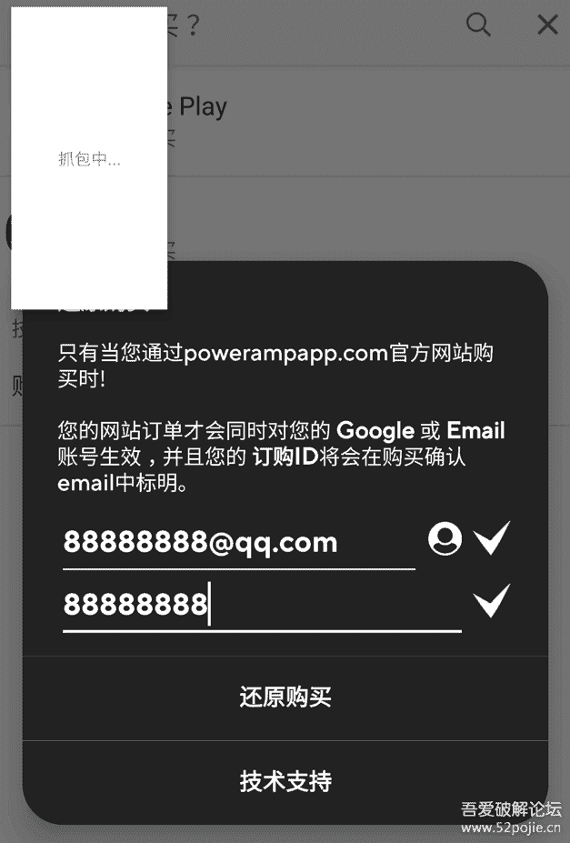
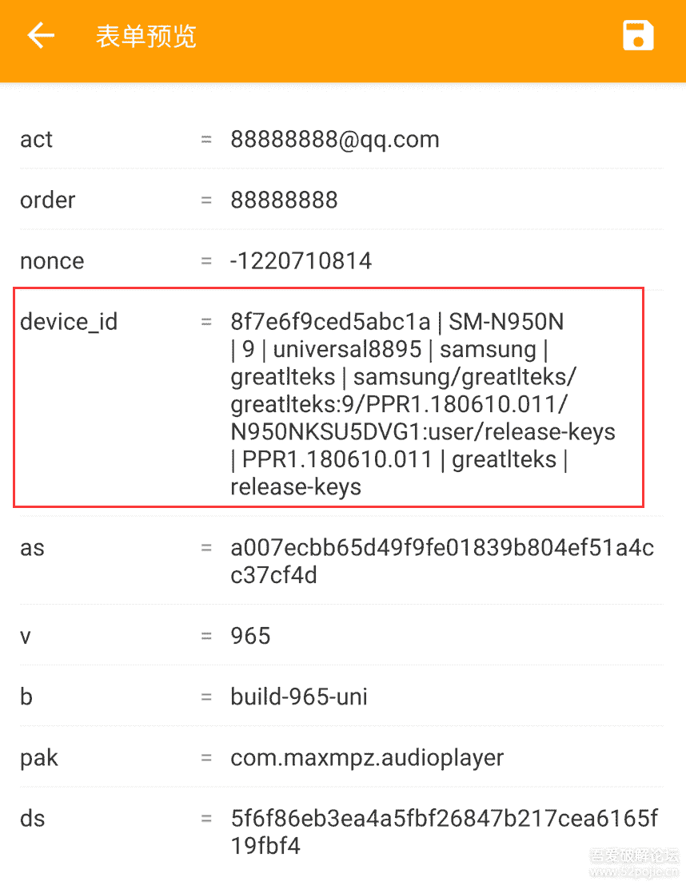
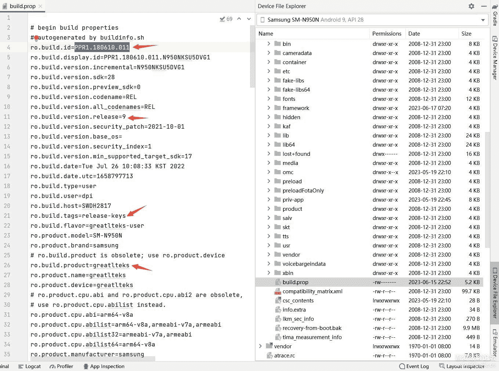

# [Android 原创] 《安卓逆向这档事》十一、实战系列 利用内嵌模块hook设备信息 完成软件破解

- 原帖: https://www.52pojie.cn/forum.php?mod=viewthread&tid=1798397
- 抓取时间: 2026-11-01T21:42:31


1.jpg (29.79 KB, 下载次数: 0)
[href="forum.php?mod=attachment&aid=MjYyMjI3MXwyYTVkYzBlM3wxNzkzNTY5MzQ4fDE2ODA4NnwxNzk4Mzk3&nothumb=yes" target="_blank"](https://www.52pojie.cn/forum.php?mod=attachment&aid=MjYyMjI3MXwyYTVkYzBlM3wxNzkzNTY5MzQ4fDE2ODA4NnwxNzk4Mzk3&nothumb=yes)
2023-6-18 09:07 上传

## 零、前言

### 1、Xposed介绍
`Xposed Framework`是一套开源的、在`Android`高权限模式下运行的框架服务，可以在不修改`APK`文件的情况下影响程序运行（修改系统）的框架服务，基于它可以制作出许多功能强大的模块，且在功能不冲突的情况下同时运作。
现在主流的框架有`LSPosed`、`Xposed框架`、`太极`等，内嵌框架有`TweakMe`、`Lspatch`等，但是我感觉最好用的就不得不提`TweakMe`了，好多地方都没有人出过用`TweakMe`破解软件的相关教程，实际上这个框架还是很不错的，作者确实厉害，可以安利一下。不过在安卓13上偶有过签失效的问题（第一次启动没问题，第二次启动就显示盗版了），不知道什么原因。

### 2、模块的编写
[//www.52pojie.cn/thread-1740944-1-1.html" target="_blank" rel="noopener noreferrer nofollow"](https://www.52pojie.cn/thread-1740944-1-1.html:href="https)
[//www.52pojie.cn/thread-1748081-1-1.html" target="_blank" rel="noopener noreferrer nofollow"](https://www.52pojie.cn/thread-1748081-1-1.html:href="https)
上面的两个帖子简单介绍了`xp`模块的编写方法，现在网上有个`AIDE`安卓版，自带`xp`模板，可一键打包成`apk`，非常推荐这个。
不过我习惯用`AS`编写，因为查错和码字都比较方便，这里有个空白模板[//github.com/lz-ang/XposedSample" target="_blank" rel="noopener noreferrer nofollow"](https://github.com/lz-ang/XposedSample:rel="nofollow noopener" href="https)，直接导入`AS`即可编译成`apk`，一些设置已经全部帮你弄好了，适合所有阶段的逆向玩家进行模块开发。

### 3、案例软件
`Poweramp`。之前改汇编虽然可以卡试用，但毕竟不是完整版。改汇编也能改成完整版，不过我试了一下有些小毛病，就放弃了。
我在贴吧注意到`APP`正常激活的时候有个提示：授权已永久存储到设备，不再需要在线检查。于是，破解的思路就开始浮现出来。

## 一、破解目标
原版有15天的使用限制，到期后无法使用。现在要用手头上的工具进行破解，使之自动激活完整版，并且能够在不同的手机上工作。

## 二、准备工具
1、`Android Studio`
2、`TweakMe`
3、小黄鸟
4、`MT`、`NP`等，视情况使用
5、一部`root`的手机
6、52.88块钱`RMB`

## 三、逆向思路
首先，这软件是把授权码保存在本地的，在注册后肯定要去私有目录里面把文件给拷贝出来，我们在破解的时候需要写个代码，在另一台设备运行的时候自动释放授权文件。
当然不会那么容易，因为唯一授权肯定包含了设备信息，要不然没法知道激活了多少次，官网也说得很清楚。
> 
此激活操作将解锁适用于Android的音乐播放器Poweramp。它将移除试用期限限制。此激活操作仅授权用于一台设备/电子邮件组合。
提供有限的激活次数。
发布/分享您的订单ID和电子邮件以及/或通过多个不同的设备重新激活将导致许可永久性禁用。
一经售出，概不退换。您将无法获得退款。
所以，逆向步骤如下：
1、明确激活时，向服务器发送了什么设备信息；
2、用`xp`模块逐个拦截，拦截后正常购买软件；
3、注册成功后前往`data/data/包名`拷贝文件备用；
4、把授权文件装入`apk`，编写`Java`文件，运行时自动释放；
5、多设备测试是否完成破解。

## 四、用小黄鸟进行抓包
直接安装软件，然后进入到激活界面，随便输入邮箱和订单号，看看它发送了什么信息。

1.png (117.37 KB, 下载次数: 0)
[href="forum.php?mod=attachment&aid=MjYyMjEzOHxmODNiZTEzMnwxNzkzNTY5MzQ4fDE2ODA4NnwxNzk4Mzk3&nothumb=yes" target="_blank"](https://www.52pojie.cn/forum.php?mod=attachment&aid=MjYyMjEzOHxmODNiZTEzMnwxNzkzNTY5MzQ4fDE2ODA4NnwxNzk4Mzk3&nothumb=yes)
2023-6-17 14:24 上传

2.png (201.66 KB, 下载次数: 0)
[href="forum.php?mod=attachment&aid=MjYyMjEzOXw1NjBlODI3MnwxNzkzNTY5MzQ4fDE2ODA4NnwxNzk4Mzk3&nothumb=yes" target="_blank"](https://www.52pojie.cn/forum.php?mod=attachment&aid=MjYyMjEzOXw1NjBlODI3MnwxNzkzNTY5MzQ4fDE2ODA4NnwxNzk4Mzk3&nothumb=yes)
2023-6-17 14:24 上传
从上图来看，一些机型、品牌、安卓`id`等都包含在里面了，看来`Deviceid`是由多个信息拼合而成的，并不是单一的元素。为了更加方便查阅，可以打开`/system/build.prop`查看对应的信息。

1.jpg (293.09 KB, 下载次数: 0)
[href="forum.php?mod=attachment&aid=MjYyMjE0MXxiZDBlNjM4NHwxNzkzNTY5MzQ4fDE2ODA4NnwxNzk4Mzk3&nothumb=yes" target="_blank"](https://www.52pojie.cn/forum.php?mod=attachment&aid=MjYyMjE0MXxiZDBlNjM4NHwxNzkzNTY5MzQ4fDE2ODA4NnwxNzk4Mzk3&nothumb=yes)
2023-6-17 14:29 上传
> 
`build.prop` 是Android系统中一个类似于Windows系统注册表的文件，该文件内定义了系统初始(或永久)的一些参数属性、功能的开放等。并且在 Android中虽然每一版都有自己独有的参数，但绝大部分都是通用的，且可以起到关键性作用的。
```
ro.build.id= #build的标识,一般在编译时产生
ro.build.version.sdk= #系统编译时,使用的SDK的版本
ro.build.version.codename= #版本编码名称
ro.build.version.release= #公布的版本,显示为手机信息的系统版本,
ro.build.date= #系统编译的时间
ro.build.type= #系统编译类型
ro.build.user= #系统用户名
ro.build.host= #系统主机名
ro.build.tags=test-keys #系统标记
ro.product.name= #机器名
ro.product.device= #设备名
ro.product.board= #主板名
ro.product.locale.language= #系统语言
ro.product.locale.region= #系统所在地区
net.bt.name= #蓝牙网络中显示的名称
ro.media.enc.jpeg.quality=100 #相机照片压缩质量,此处为100%高质量
ro.media.dec.jpeg.memcap=8000000 #相机捕捉像素,此处为800万像素
dalvik.vm.heapsize= #dalvik的虚拟内存大小
debug.sf.hw=1 #硬件GPU加速,1为开启,0为关闭
persist.adb.notify=0 #USB插入时的特别通知,1为显示,0为关闭
video.accelerate.hw=1 #视频硬件加速,1为开启,0为关闭
debug.sf.nobootanimation=1 #不显示开机动画,1为关闭动画,0为开启动画
view.touch_slop=15 #触摸屏灵敏度，数值越大越灵敏
view.minimum_fling_velocity=25 #滑动速度
view.scroll_friction=0.008 #滑动误差
wifi.interface=eth0 #WIFI界面
wifi.supplicant_scan_interval=45 #WIFI扫描间隔时间，这里值是45秒，把这个值设置越大越省电
```
