# [Android 原创] 《教我兄弟学Android逆向13 xpose改机开发01-环境设置》

- 原帖：[https://www.52pojie.cn/forum.php?mod=viewthread&tid=1799721](https://www.52pojie.cn/forum.php?mod=viewthread&tid=1799721)
- 抓取时间：2026-11-01T21:42:29

上一篇：《[https://www.52pojie.cn/thread-850885-1-1.html](https://www.52pojie.cn/thread-850885-1-1.html)》我们了解了xpose的基本原理并一起搭建了xpose的hook环境，你也很好的完成了课后作业，但是通过后面的测试练习你发现xpose在不同系统环境的安装方法是不一样的，在我们之前的低系统手机上面直接安装就能用了，但是到高一点的系统上面会提示Xposed框架未安装，你感到很疑惑，百度了很多资料也是乱乱的，并不能有效的解决实际问题。你现在手里面有一台7.1.2系统的小米5s手机，那么本节课我们重现一下你所遇到的问题，并带你怎么去解决xpose在高系统上面安装的一些问题。

要么学！要么不学！学和不学之间没有中间值 不学就放弃，学就要去认真的学！ --致选择

编译环境：
- AndroidStudio2016.1.3

测试手机：
- 小米5s

测试系统：
- 7.1.2

所需附件列表：
- `5s一键刷入TWRP.zip`
- `lineage-14.1-UNOFFICIAL-capricorn.zip`
- `Magisk-v19.3.zip`
- `XposedInstaller_3.1.5.apk`
- `xposed-sdk25.zip`

附件下载链接：[https://pan.baidu.com/s/1so0iVZQwi3oTRnqSlWe6xA](https://pan.baidu.com/s/1so0iVZQwi3oTRnqSlWe6xA)
提取码：h9sx

## 一、刷机

小米5s刷入TWRP

01. 手机关机状态下同时长按按住音量下键+电源键进入到FASTBOOT模式

`01.png` (2.57 MB, 下载次数: 2) · 2023-6-20 14:24 上传 · [下载附件](https://www.52pojie.cn/forum.php?mod=attachment&aid=MjYyMjU3N3w3MDVhMGYzM3wxNzkzNTY5MzQ3fDE2ODA4NnwxNzk5NzIx&nothumb=yes)

02. 电脑用数据线连接手机，解压附件中的`5s一键刷入TWRP.zip`，双击打开`小米5s工具箱.bat`，输入数字2后按回车键

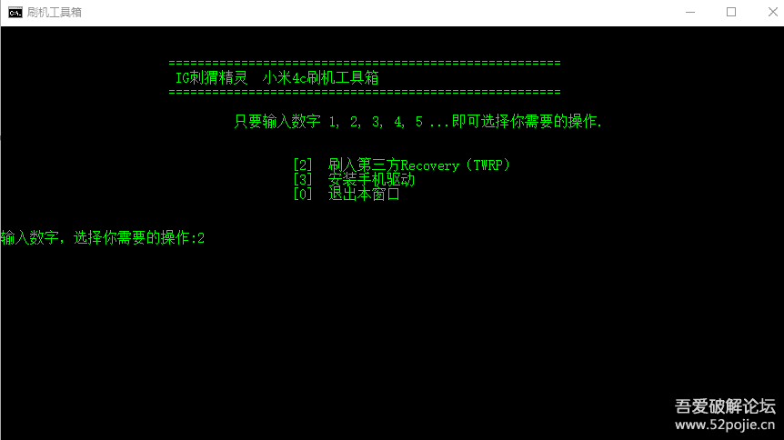

`02.png` (13.78 KB, 下载次数: 0) · 2023-6-20 14:24 上传 · [下载附件](https://www.52pojie.cn/forum.php?mod=attachment&aid=MjYyMjU3OHxlOGJmM2Q1MnwxNzkzNTY5MzQ3fDE2ODA4NnwxNzk5NzIx&nothumb=yes)

03. 出现成功刷入，此时手机已经进入到了TWRP Recovery界面

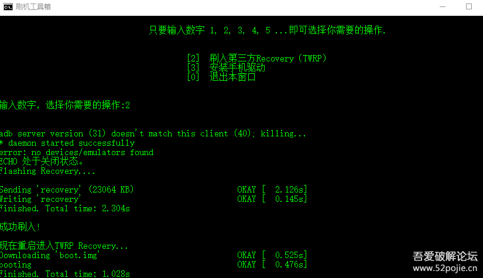

`03.png` (18.8 KB, 下载次数: 0) · 2023-6-20 14:24 上传 · [下载附件](https://www.52pojie.cn/forum.php?mod=attachment&aid=MjYyMjU3OXw5MmUzYmVhYXwxNzkzNTY5MzQ3fDE2ODA4NnwxNzk5NzIx&nothumb=yes)

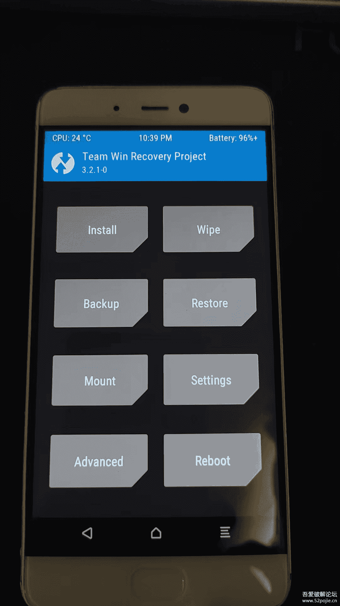

`04.png` (565.68 KB, 下载次数: 0) · 2023-6-20 14:24 上传 · [下载附件](https://www.52pojie.cn/forum.php?mod=attachment&aid=MjYyMjU4MHxiYzUxZGZkZXwxNzkzNTY5MzQ3fDE2ODA4NnwxNzk5NzIx&nothumb=yes)

04. 下面进行手机系统内存双清，点wipe后点Advanced Wipe全部打钩滑动，红色的报错不用问

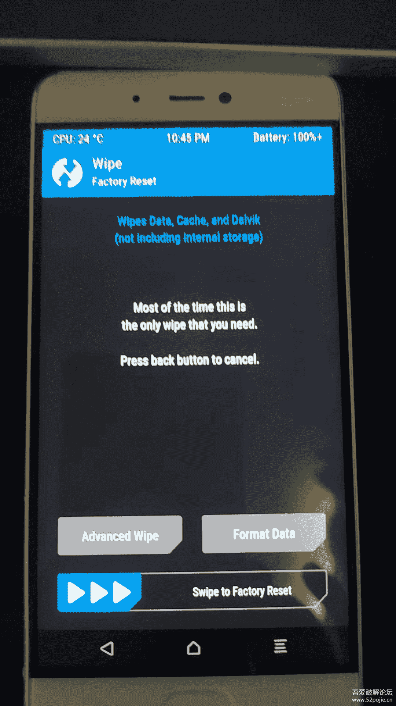

`05.png` (848.36 KB, 下载次数: 2) · 2023-6-20 14:24 上传 · [下载附件](https://www.52pojie.cn/forum.php?mod=attachment&aid=MjYyMjU4MXw0OTJmNDU4M3wxNzkzNTY5MzQ3fDE2ODA4NnwxNzk5NzIx&nothumb=yes)

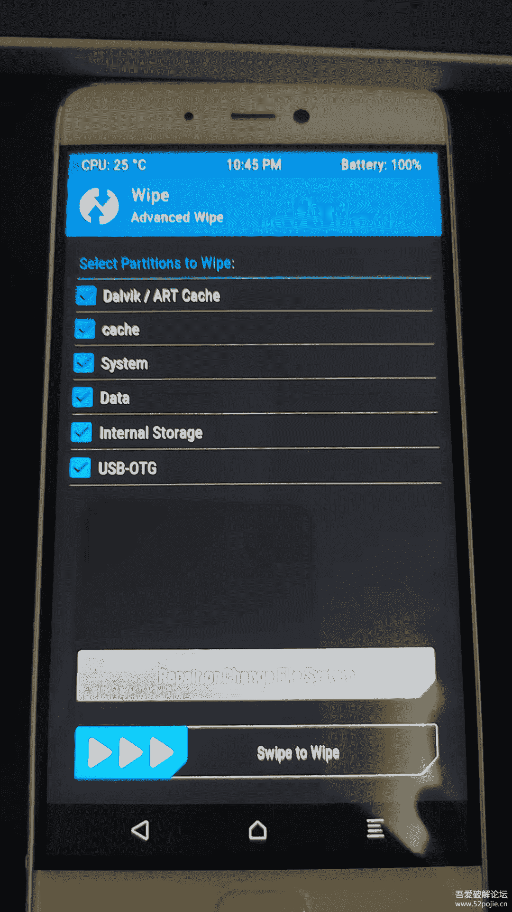

`06.png` (863.84 KB, 下载次数: 1) · 2023-6-20 14:25 上传 · [下载附件](https://www.52pojie.cn/forum.php?mod=attachment&aid=MjYyMjU4MnwxMmIzM2E1MHwxNzkzNTY5MzQ3fDE2ODA4NnwxNzk5NzIx&nothumb=yes)

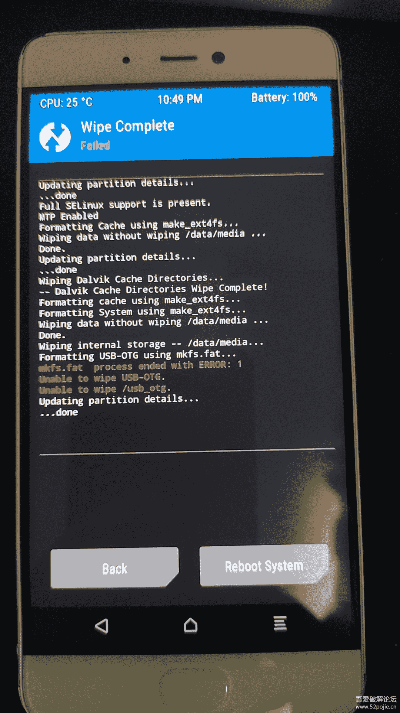

`07.png` (2.36 MB, 下载次数: 1) · 2023-6-20 14:25 上传 · [下载附件](https://www.52pojie.cn/forum.php?mod=attachment&aid=MjYyMjU4M3xiZjQ1MWQwZnwxNzkzNTY5MzQ3fDE2ODA4NnwxNzk5NzIx&nothumb=yes)

05. 返回到Wipe界面，点Format Date，输入`yes`后点右下角的√

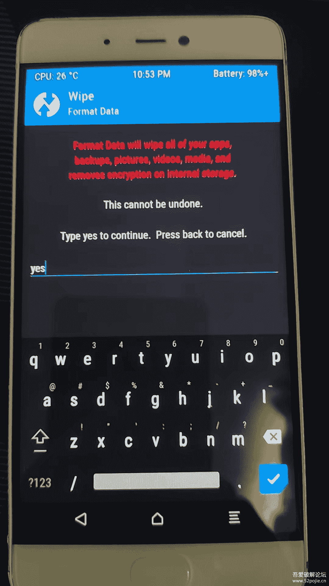

`08.png` (1001.65 KB, 下载次数: 2) · 2023-6-20 14:25 上传 · [下载附件](https://www.52pojie.cn/forum.php?mod=attachment&aid=MjYyMjU4NHw3ZTNkMGI4OHwxNzkzNTY5MzQ3fDE2ODA4NnwxNzk5NzIx&nothumb=yes)

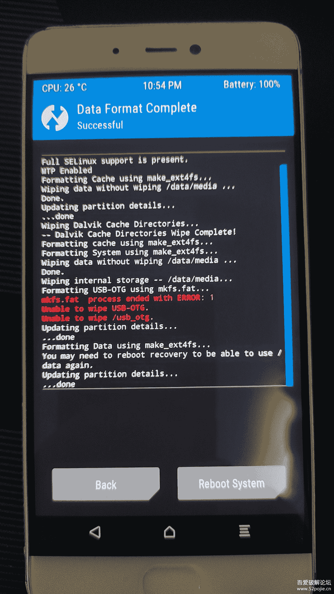

`09.png` (2.5 MB, 下载次数: 2) · 2023-6-20 14:25 上传 · [下载附件](https://www.52pojie.cn/forum.php?mod=attachment&aid=MjYyMjU4NXw1NTliOWFjMXwxNzkzNTY5MzQ3fDE2ODA4NnwxNzk5NzIx&nothumb=yes)

06. 刷入系统低包，附件中下载`lineage-14.1-UNOFFICIAL-capricorn.zip`，下载完成后放到手机sd卡中

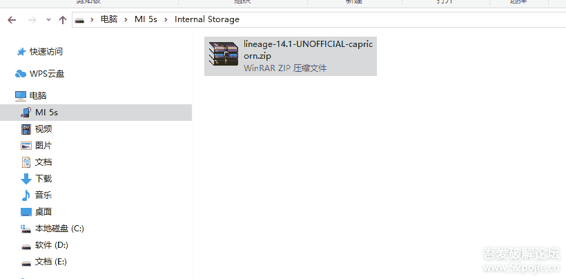

`10.png` (29.68 KB, 下载次数: 0) · 2023-6-20 14:25 上传 · [下载附件](https://www.52pojie.cn/forum.php?mod=attachment&aid=MjYyMjU4NnwyNDczYTgwOHwxNzkzNTY5MzQ3fDE2ODA4NnwxNzk5NzIx&nothumb=yes)

07. 返回到TWRP的主界面，点Install选择系统包后直接滑动刷入系统包，刷入完成后点Reboot System重启系统

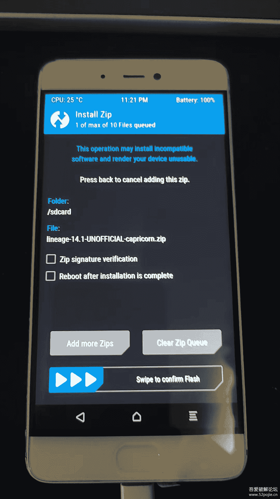

`11.png` (913.93 KB, 下载次数: 1) · 2023-6-20 14:25 上传 · [下载附件](https://www.52pojie.cn/forum.php?mod=attachment&aid=MjYyMjU4N3xiYTlmOGJiNXwxNzkzNTY5MzQ3fDE2ODA4NnwxNzk5NzIx&nothumb=yes)

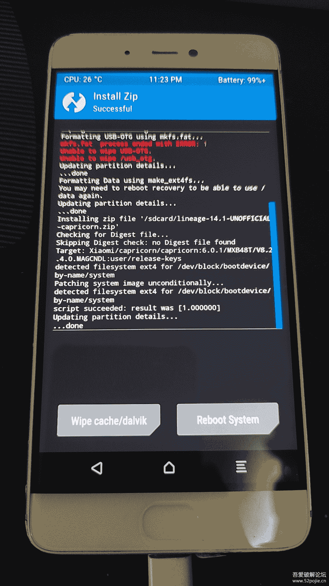

`12.png` (2.46 MB, 下载次数: 1) · 2023-6-20 14:25 上传 · [下载附件](https://www.52pojie.cn/forum.php?mod=attachment&aid=MjYyMjU4OHw5MzQ1NzIyZnwxNzkzNTY5MzQ3fDE2ODA4NnwxNzk5NzIx&nothumb=yes)

08. 重启后进入系统一路点next进入新系统

`13.png` (1.14 MB, 下载次数: 2) · 2023-6-20 14:25 上传 · [下载附件](https://www.52pojie.cn/forum.php?mod=attachment&aid=MjYyMjU4OXw0YmU4NTc3ZXwxNzkzNTY5MzQ3fDE2ODA4NnwxNzk5NzIx&nothumb=yes)

`14.png` (2.73 MB, 下载次数: 2) · 2023-6-20 14:25 上传 · [下载附件](https://www.52pojie.cn/forum.php?mod=attachment&aid=MjYyMjU5MHwwMjY5OWU4OHwxNzkzNTY5MzQ3fDE2ODA4NnwxNzk5NzIx&nothumb=yes)

## 二、刷入magisk

01. 手机关机，同时按电源键和音量上键等到屏幕亮后松开电源键进入到TWRP界面，把附件中的`Magisk-v19.3.zip`通过电脑放入到手机sd卡目录下，点Install选择magisk进行刷入，刷入完成后点Reboot System重启系统

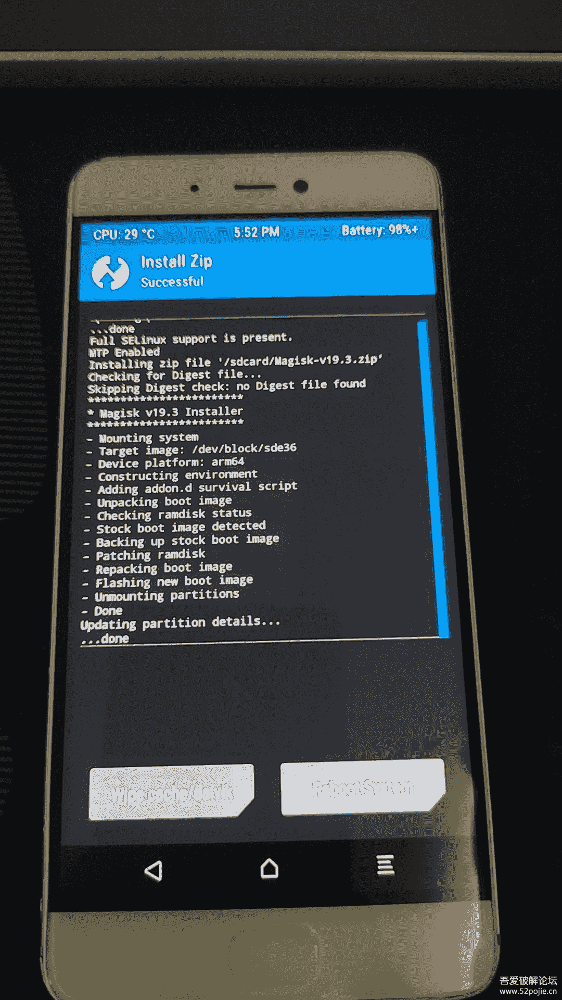

`15.jpg` (233.48 KB, 下载次数: 0) · 2023-6-20 14:26 上传 · [下载附件](https://www.52pojie.cn/forum.php?mod=attachment&aid=MjYyMjU5MnxlMDkyNmZhNXwxNzkzNTY5MzQ3fDE2ODA4NnwxNzk5NzIx&nothumb=yes)

02. 重启系统后打开Magisk应用，打开设置，把自动响应设置为允许，超级用户通知设置为无

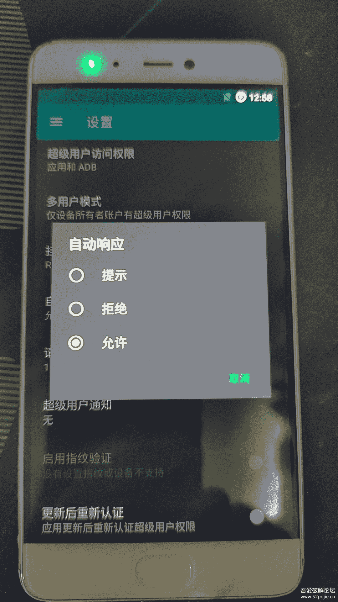

`16.png` (2.72 MB, 下载次数: 0) · 2023-6-20 14:26 上传 · [下载附件](https://www.52pojie.cn/forum.php?mod=attachment&aid=MjYyMjU5M3xmNjIxZmRkN3wxNzkzNTY5MzQ3fDE2ODA4NnwxNzk5NzIx&nothumb=yes)

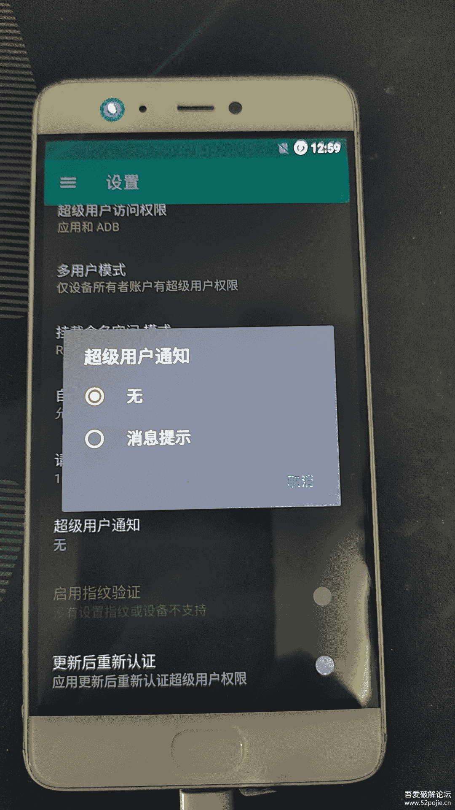

`17.png` (2.72 MB, 下载次数: 1) · 2023-6-20 14:26 上传 · [下载附件](https://www.52pojie.cn/forum.php?mod=attachment&aid=MjYyMjU5NHwzMzhjODljM3wxNzkzNTY5MzQ3fDE2ODA4NnwxNzk5NzIx&nothumb=yes)

## 三、xpose环境安装

01. 从附件下载安装`XposedInstaller_3.1.5.apk`并打开，明显看到显示Xposed框架未安装

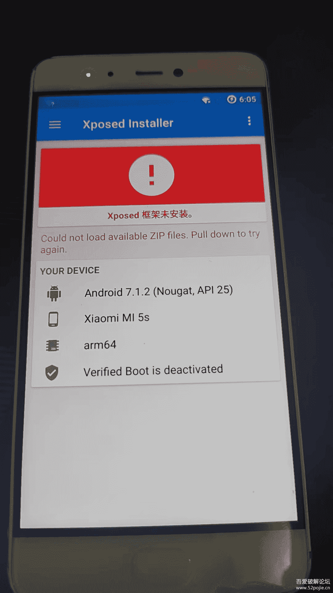

`18.png` (750.38 KB, 下载次数: 1)

## 02. 从附件下载 `xposed-sdk25.zip` 放到手机，进入 Recovery 点 Install 并刷入

[附件下载](https://www.52pojie.cn/forum.php?mod=attachment&aid=MjYyMjU5NXw5MDRlMzY3OHwxNzkzNTY5MzQ3fDE2ODA4NnwxNzk5NzIx&nothumb=yes)

2023-6-20 14:26 上传

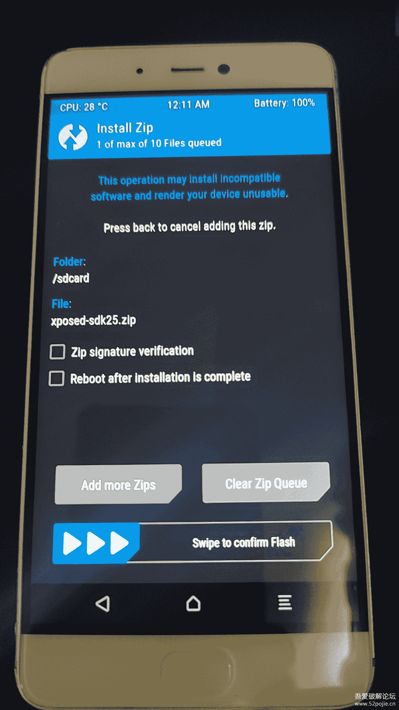

`19.png` (2.29 MB, 下载次数: 0)

[附件下载](https://www.52pojie.cn/forum.php?mod=attachment&aid=MjYyMjU5Nnw5MWRkN2EyMnwxNzkzNTY5MzQ3fDE2ODA4NnwxNzk5NzIx&nothumb=yes)

2023-6-20 14:26 上传

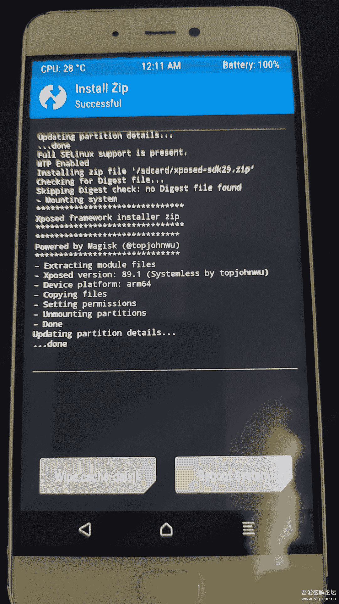

`20.png` (2.48 MB, 下载次数: 2)

## 03. 重启后进入 xpose 发现 Xposed 框架已经激活

[附件下载](https://www.52pojie.cn/forum.php?mod=attachment&aid=MjYyMjU5N3w2NzQ3MzIxY3wxNzkzNTY5MzQ3fDE2ODA4NnwxNzk5NzIx&nothumb=yes)

2023-6-20 14:26 上传

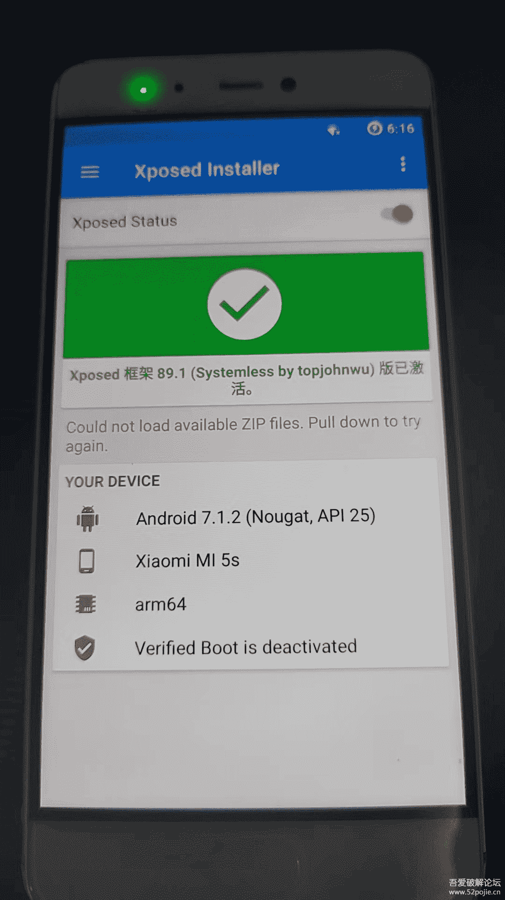

`21.png` (932.21 KB, 下载次数: 1)

## 三.总结

本节课我们主要复现解决了xp在高系统安装出现的问题，之所以刷入magisk是因为xp需要手机root才能使用，而我们本节课所用到的系统是不自带root的。相信你也学习到了一些刷机的知识，看不懂的地方一定要多百度，在Android逆向的这条路上最终是离不开改机的，那么下节课我将带你进行xp改机的开发。

下一篇《[https://www.52pojie.cn/thread-1800156-1-1.html](https://www.52pojie.cn/thread-1800156-1-1.html)》
