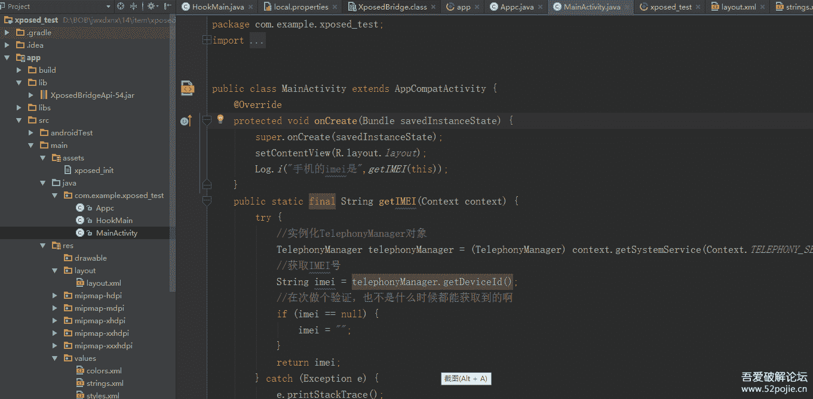
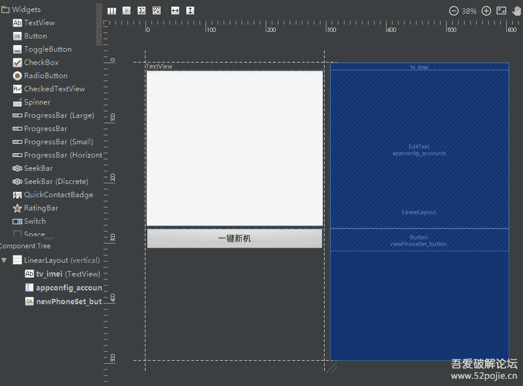
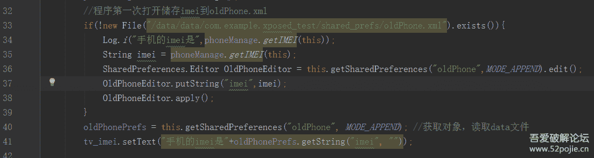
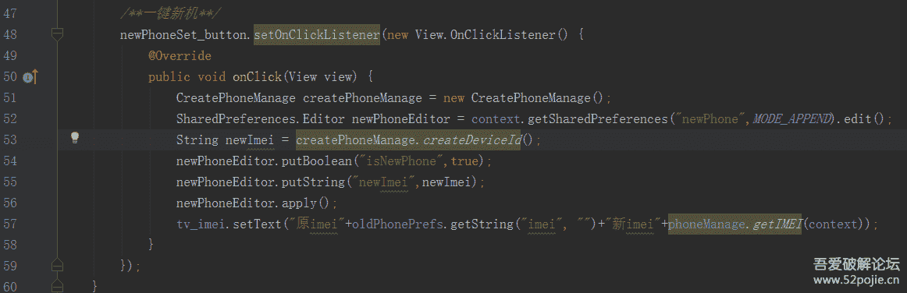
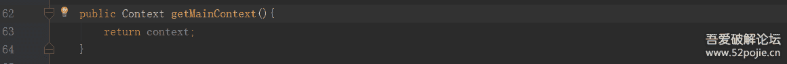
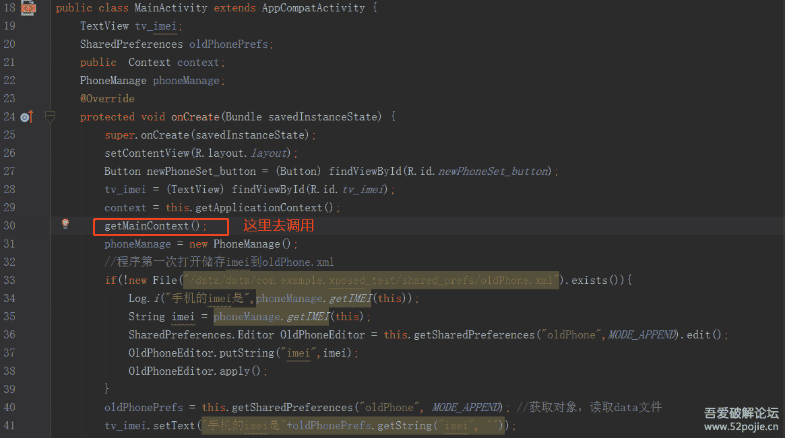
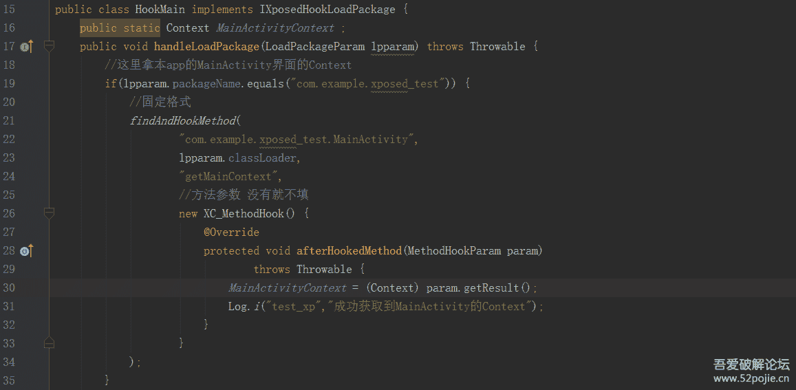
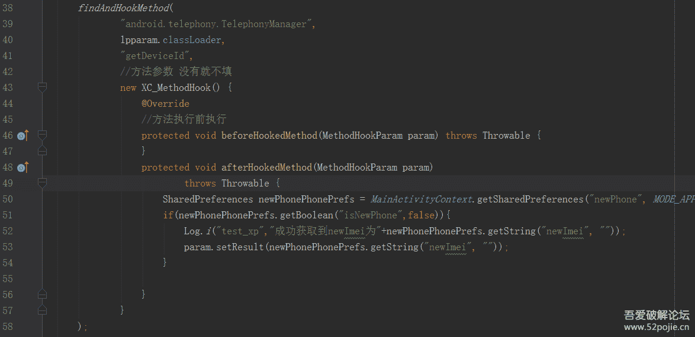
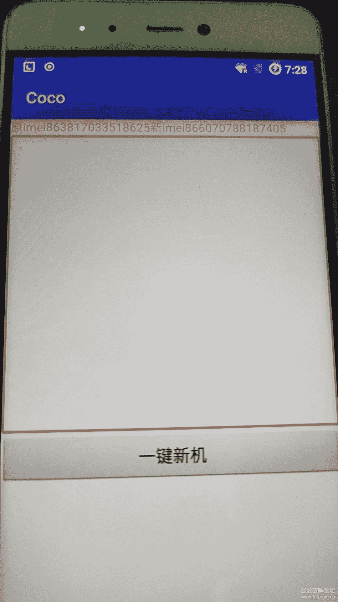
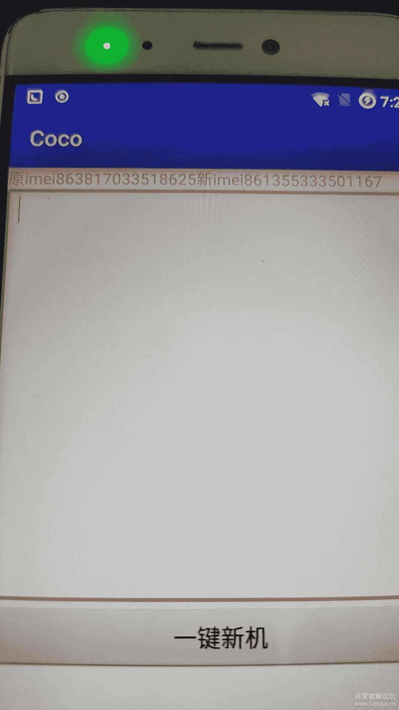

# [Android 原创] 《教我兄弟学Android逆向14 xpose改机开发02-改机代码基础编写》

- 原帖：<https://www.52pojie.cn/forum.php?mod=viewthread&tid=1800156>
- 抓取时间：2026-11-01T21:42:26

上一篇《[链接](https://www.52pojie.cn/thread-1799721-1-1.html)》我们学习到了在高系统上面安装xpose的方法，并学习到了一些刷机知识，课后通过百度也了解了一下TWRP，Magisk和lineageOs系统。既然xp的基础环境搭建完成了，那么本节课我带你来编写xp改机的代码，但是学习本节课之前你有几个疑问，什么是改机？改机有什么用处？我们为什么要去学习改机？

改机是让自己的机型设备信息发生改变，改机主要是应用于账号的批量注册，手机群控等等。这节课的目的当然不是去教大家去变坏。师夷长技以制夷，你肯定也是有一颗成为白帽子的心的。

要么学！要么不学！学和不学之间没有中间值 不学就放弃，学就要去认真的学！ --致选择

- 编译环境：AndroidStudio2016.1.3
- 测试手机：小米5s
- 测试系统：7.1.2

## 一.代码编写

### 01. 用 As 打开课堂 Demo
用As打开《教我兄弟学Android逆向12 编写xposed模块》最后附件里的课堂Demo。


01.png（112.87 KB，下载次数：2，2023-6-21 14:37 上传）  
[附件](https://www.52pojie.cn/forum.php?mod=attachment&aid=MjYyMjgwNnxiZDY0ZjYzMHwxNzkzNTY5MzQ0fDE2ODA4NnwxODAwMTU2&nothumb=yes)

### 02. 打开 `layout.xml` 进入 `text`
打开`layout.xml`进入`text`将下面的代码复制进去。

[XML] 纯文本查看 复制代码
```xml
```

### 03. 查看 Design 界面
完成后点Design现在界面大概是这个样子。


02.png（57.72 KB，下载次数：2，2023-6-21 14:37 上传）  
[附件](https://www.52pojie.cn/forum.php?mod=attachment&aid=MjYyMjgwN3xhYjkyMWJjY3wxNzkzNTY5MzQ0fDE2ODA4NnwxODAwMTU2&nothumb=yes)

### 04. 存储原机 `imei`
我们本节课要实现的是手动点击一键新机左上角显示出本机系统原本的`imei`和改机后的`imei`，这里我们选用`SharedPreferences`储存，程序刚安装完成第一次打开的时候会获取到本机的设备信息然后储存到`/data/data/com.example.xposed_test/shared_prefs/oldPhone.xml`中。


03.png（56.13 KB，下载次数：1，2023-6-21 14:37 上传）  
[附件](https://www.52pojie.cn/forum.php?mod=attachment&aid=MjYyMjgwOHw5YTUxOTU4ZnwxNzkzNTY5MzQ0fDE2ODA4NnwxODAwMTU2&nothumb=yes)

### 05. 生成新机 `imei`
一键新机要做的是点击一键新机左上角显示出系统原本的`imei`和改机后的`imei`，点一键新机的时候我们这里创建出新的`imei`的数据储存在`newPhone.xml`里面，然后hook的代码通过这个xml去取数据用来改机。


04.png（57.9 KB，下载次数：3，2023-6-21 14:37 上传）  
[附件](https://www.52pojie.cn/forum.php?mod=attachment&aid=MjYyMjgwOXw5YzAxOTM5ZnwxNzkzNTY5MzQ0fDE2ODA4NnwxODAwMTU2&nothumb=yes)

### 06. 获取当前界面的 `content`
关于hook的代码我们知道直接用`SharedPreferences`需要当前界面的`content`，这里我们可以在`MainActivity`中写一个`getMainContext()`方法去获取到当前界面的`content`，然后程序启动的时候调用，最后用hook去获取到这个`content`，这样hook代码就可以获取到`SharedPreferences`的存储数据。


05.png（13.49 KB，下载次数：3，2023-6-21 14:37 上传）  
[附件](https://www.52pojie.cn/forum.php?mod=attachment&aid=MjYyMjgxMHw1YWI3NTNjNnwxNzkzNTY5MzQ0fDE2ODA4NnwxODAwMTU2&nothumb=yes)


06.png（107.12 KB，下载次数：3，2023-6-21 14:37 上传）  
[附件](https://www.52pojie.cn/forum.php?mod=attachment&aid=MjYyMjgxMXw2ODYzNDg4YnwxNzkzNTY5MzQ0fDE2ODA4NnwxODAwMTU2&nothumb=yes)

### 07. 编写 `HookMain.java` 中的 hook 代码
打开`HookMain.java`编写hook代码，这里第一步去hook `getMainContext()`方法获取`content`，第二步去hook `getDeviceId()`设置成我们一键新机的值。


07.png（73.67 KB，下载次数：2，2023-6-21 14:37 上传）  
[附件](https://www.52pojie.cn/forum.php?mod=attachment&aid=MjYyMjgxMnwxNWFjNzFjY3wxNzkzNTY5MzQ0fDE2ODA4NnwxODAwMTU2&nothumb=yes)


08.png（70.34 KB，下载次数：1，2023-6-21 14:37 上传）  
[附件](https://www.52pojie.cn/forum.php?mod=attachment&aid=MjYyMjgxM3xlOWViMDJiN3wxNzkzNTY5MzQ0fDE2ODA4NnwxODAwMTU2&nothumb=yes)

### 08. 最终效果
最终效果，每次点击一键新机`imei`都会变成我们随机的值，说明新机成功。


09.jpg（128.79 KB，下载次数：2，2023-6-21 14:37 上传）  
[附件](https://www.52pojie.cn/forum.php?mod=attachment&aid=MjYyMjgxNHw2OTRmMWFjY3wxNzkzNTY5MzQ0fDE2ODA4NnwxODAwMTU2&nothumb=yes)


10.jpg（131.17 KB，下载次数：2，2023-6-21 14:37 上传）  
[附件](https://www.52pojie.cn/forum.php?mod=attachment&aid=MjYyMjgxNXw1NzNjOGI3OHwxNzkzNTY5MzQ0fDE2ODA4NnwxODAwMTU2&nothumb=yes)

## 二.总结

本节课用一键新机改系统`imei`的例子带你熟悉了一下改机的流程，搭建了改机的基础代码，本节课我们选用的是`SharedPreferences`存储，点一键新机的时候创建设备信息储存到xml中，hook的时候从xml取数据完成hook。其实也是可以把新机数据储存为json保存到手机存储目录中，json格式更方便将改机的设备信息数据上传到服务器。下节课我们将会在本节课的基础上继续hook更多的数据来完善改机。

## 课后作业

1. 完成本节课代码的编写
2. 用json存储新机数据完成对`imei`的hook

下一篇《[链接](https://www.52pojie.cn/thread-1885167-1-1.html)》
