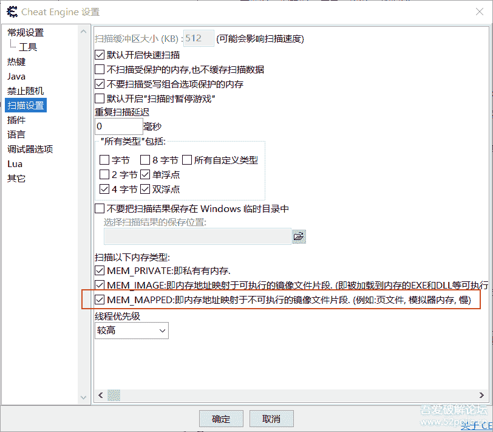
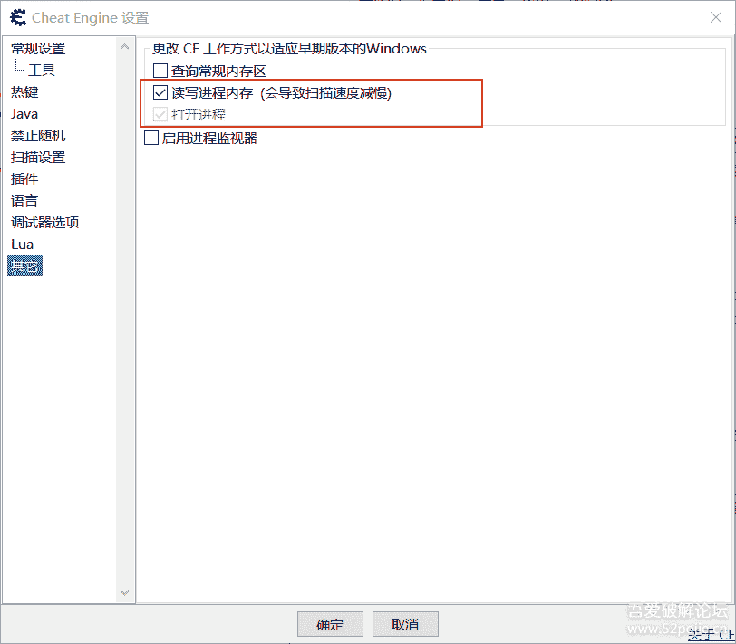
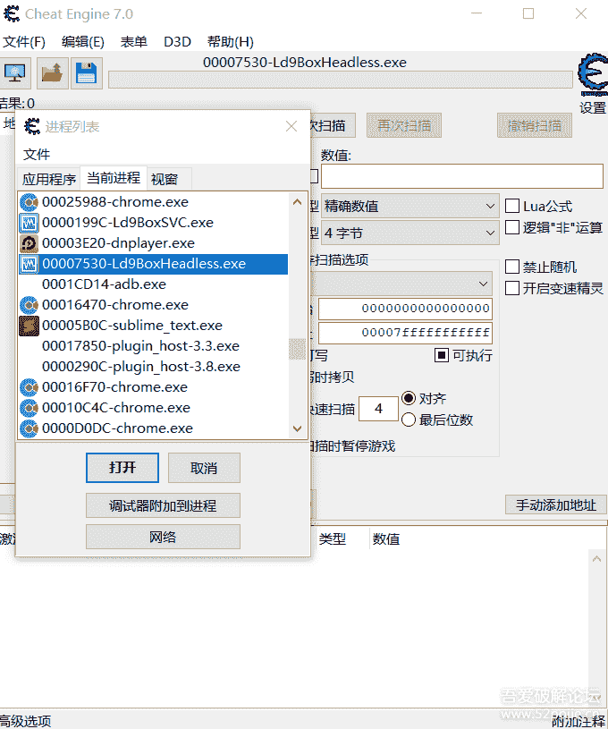
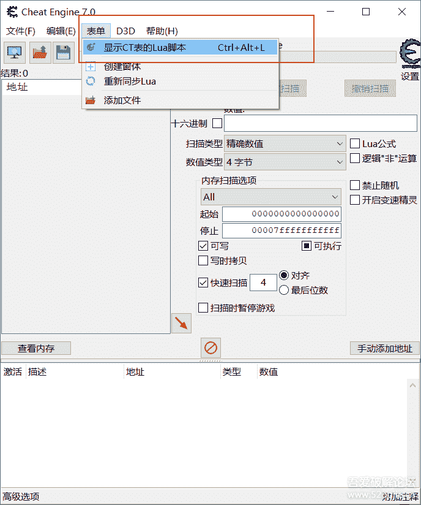
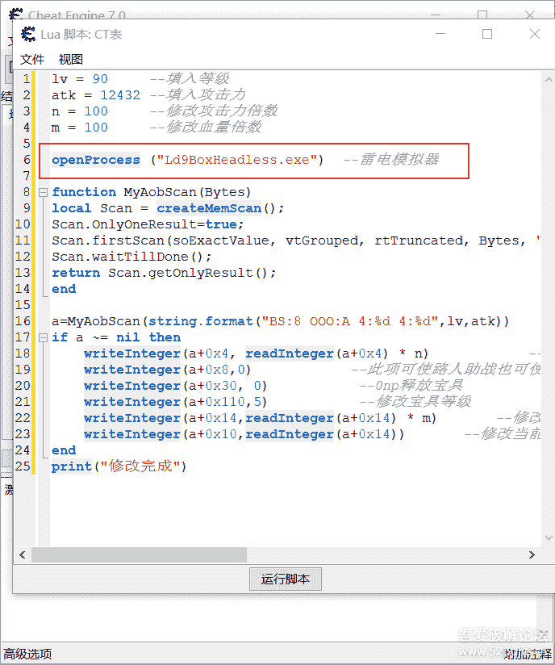
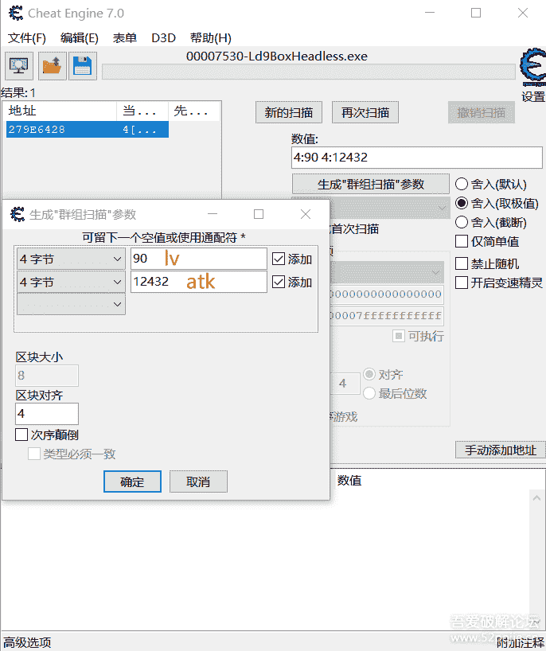
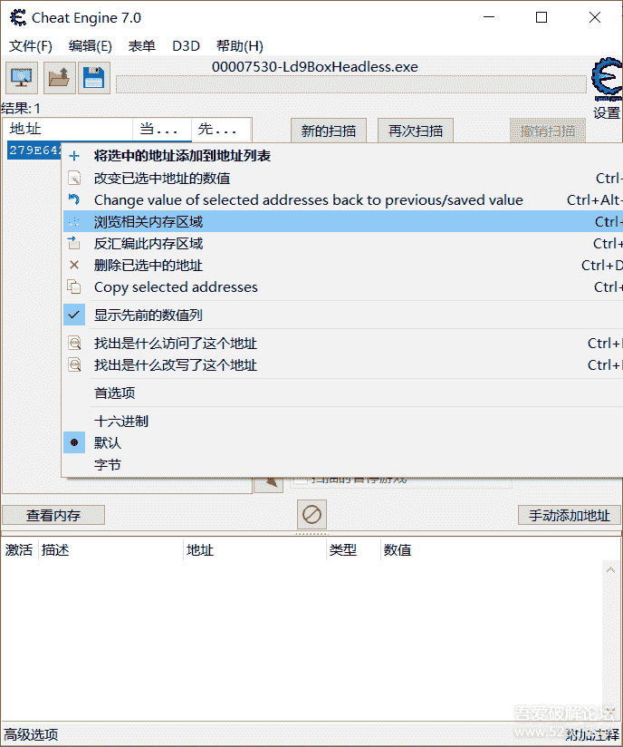
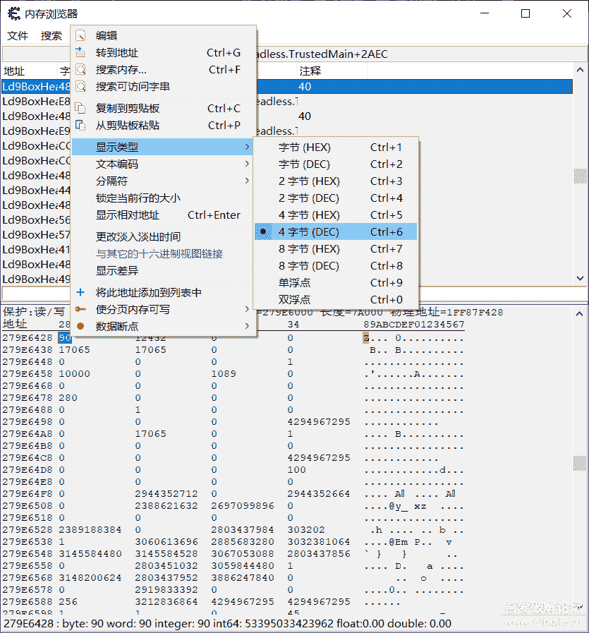
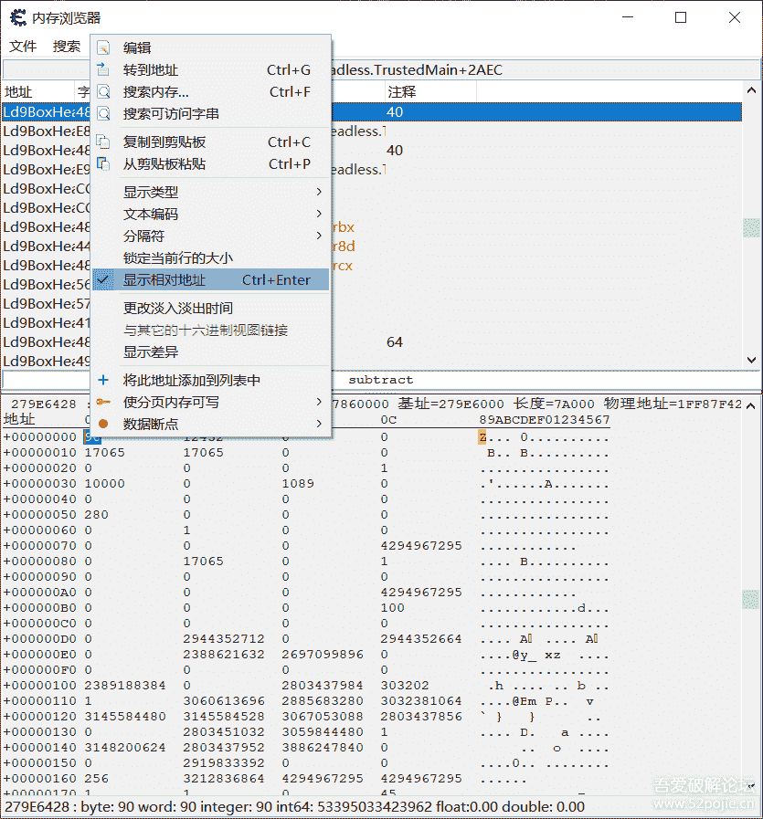
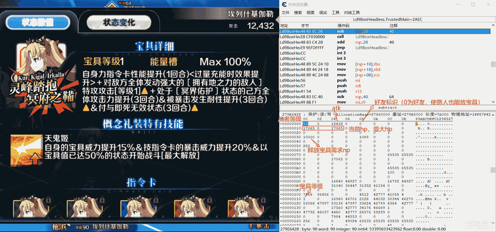

# [Android 分享] 【新手向】使用CE脚本修改FGO属性

- 原帖: https://www.52pojie.cn/forum.php?mod=viewthread&tid=1800825
- 抓取时间: 2026-11-01T21:42:19

本帖基于论坛里的几位大佬的修改教程进行整合：[//www.52pojie.cn/home.php?mod=space&uid=889687" target="_blank"](https://www.52pojie.cn/home.php?mod=space&uid=889687:href="https) [//www.52pojie.cn/home.php?mod=space&uid=1170006" target="_blank"](https://www.52pojie.cn/home.php?mod=space&uid=1170006:href="https)

先附上两位大佬的帖子

[//www.52pojie.cn/thread-1278394-1-1.html" target="_blank"](https://www.52pojie.cn/thread-1278394-1-1.html:href="https)

[//www.52pojie.cn/thread-996348-1-1.html" target="_blank"](https://www.52pojie.cn/thread-996348-1-1.html:href="https)

lua文件在文章末尾放出

## 准备工作：设置`CE`

1.png (62.79 KB, 下载次数: 1)
[href="forum.php?mod=attachment&aid=MjYyMzE5NnwxNDUzZGUwOXwxNzkzNTY5MzM2fDE2ODA4NnwxODAwODI1&nothumb=yes" target="_blank"](https://www.52pojie.cn/forum.php?mod=attachment&aid=MjYyMzE5NnwxNDUzZGUwOXwxNzkzNTY5MzM2fDE2ODA4NnwxODAwODI1&nothumb=yes)
2023-6-23 23:38 上传

2.png (32.7 KB, 下载次数: 0)
[href="forum.php?mod=attachment&aid=MjYyMzE5NXw4N2I0NDM1MHwxNzkzNTY5MzM2fDE2ODA4NnwxODAwODI1&nothumb=yes" target="_blank"](https://www.52pojie.cn/forum.php?mod=attachment&aid=MjYyMzE5NXw4N2I0NDM1MHwxNzkzNTY5MzM2fDE2ODA4NnwxODAwODI1&nothumb=yes)
2023-6-23 23:38 上传

找到后缀为`Headless.exe`的进程，将进程名填入脚本中（或者直接在`CE`中选中进程打开，就不用在脚本中填写进程名）
脚本中修改从者对应的等级`lv`值及攻击力`atk`值，点击运行

3.png (82.19 KB, 下载次数: 2)
[href="forum.php?mod=attachment&aid=MjYyMzE5N3w2YmE3Zjg0ZHwxNzkzNTY5MzM2fDE2ODA4NnwxODAwODI1&nothumb=yes" target="_blank"](https://www.52pojie.cn/forum.php?mod=attachment&aid=MjYyMzE5N3w2YmE3Zjg0ZHwxNzkzNTY5MzM2fDE2ODA4NnwxODAwODI1&nothumb=yes)
2023-6-23 23:44 上传

5.png (59.45 KB, 下载次数: 0)
[href="forum.php?mod=attachment&aid=MjYyMzE5OXw5MGU4YTg3ZnwxNzkzNTY5MzM2fDE2ODA4NnwxODAwODI1&nothumb=yes" target="_blank"](https://www.52pojie.cn/forum.php?mod=attachment&aid=MjYyMzE5OXw5MGU4YTg3ZnwxNzkzNTY5MzM2fDE2ODA4NnwxODAwODI1&nothumb=yes)
2023-6-23 23:51 上传

4.png (87.55 KB, 下载次数: 1)
[href="forum.php?mod=attachment&aid=MjYyMzE5OHwwMTMwODIyYXwxNzkzNTY5MzM2fDE2ODA4NnwxODAwODI1&nothumb=yes" target="_blank"](https://www.52pojie.cn/forum.php?mod=attachment&aid=MjYyMzE5OHwwMTMwODIyYXwxNzkzNTY5MzM2fDE2ODA4NnwxODAwODI1&nothumb=yes)
2023-6-23 23:44 上传

## 演示例：

4.11.png (1.57 MB, 下载次数: 2)
[href="forum.php?mod=attachment&aid=MjYyMzIwN3wzMjk4MGViM3wxNzkzNTY5MzM2fDE2ODA4NnwxODAwODI1&nothumb=yes" target="_blank"](https://www.52pojie.cn/forum.php?mod=attachment&aid=MjYyMzIwN3wzMjk4MGViM3wxNzkzNTY5MzM2fDE2ODA4NnwxODAwODI1&nothumb=yes)
2023-6-24 00:28 上传

4.21.png (1.25 MB, 下载次数: 1)
[href="forum.php?mod=attachment&aid=MjYyMzIwOHxmOGQ3YThkMnwxNzkzNTY5MzM2fDE2ODA4NnwxODAwODI1&nothumb=yes" target="_blank"](https://www.52pojie.cn/forum.php?mod=attachment&aid=MjYyMzIwOHxmOGQ3YThkMnwxNzkzNTY5MzM2fDE2ODA4NnwxODAwODI1&nothumb=yes)
2023-6-24 00:28 上传

4.22.png (1.56 MB, 下载次数: 2)
[href="forum.php?mod=attachment&aid=MjYyMzIwOXxkY2YwOGYwMXwxNzkzNTY5MzM2fDE2ODA4NnwxODAwODI1&nothumb=yes" target="_blank"](https://www.52pojie.cn/forum.php?mod=attachment&aid=MjYyMzIwOXxkY2YwOGYwMXwxNzkzNTY5MzM2fDE2ODA4NnwxODAwODI1&nothumb=yes)
2023-6-24 00:28 上传

4.23.png (1.68 MB, 下载次数: 0)
[href="forum.php?mod=attachment&aid=MjYyMzIxMHwxYWM5ZmE3M3wxNzkzNTY5MzM2fDE2ODA4NnwxODAwODI1&nothumb=yes" target="_blank"](https://www.52pojie.cn/forum.php?mod=attachment&aid=MjYyMzIxMHwxYWM5ZmE3M3wxNzkzNTY5MzM2fDE2ODA4NnwxODAwODI1&nothumb=yes)
2023-6-24 00:29 上传

## 原理解释：

通过群组扫描得到对应从者的等级属性地址，根据得到的地址通过偏移值定位其他属性并修改
举例几个常用偏移值（以等级为基址）
未来若是因版本更新导致各属性间地址的偏移量发生改变，也可通过该方法自行修改偏移量

`+0x4` --攻击力
`+0x8` --好友标识（0为好友，可使非好友使用宝具）
`+0x30` --释放宝具最低需求`np`
`+0x110` --宝具等级
`+0x14` --最大血量
`+0x10` --当前血量

8.png (68.74 KB, 下载次数: 0)
[href="forum.php?mod=attachment&aid=MjYyMzIwMXw4NGZjM2Q2NHwxNzkzNTY5MzM2fDE2ODA4NnwxODAwODI1&nothumb=yes" target="_blank"](https://www.52pojie.cn/forum.php?mod=attachment&aid=MjYyMzIwMXw4NGZjM2Q2NHwxNzkzNTY5MzM2fDE2ODA4NnwxODAwODI1&nothumb=yes)
2023-6-24 00:10 上传

8.5.png (62.8 KB, 下载次数: 0)
[href="forum.php?mod=attachment&aid=MjYyMzIwM3w4YmJjMmQ4N3wxNzkzNTY5MzM2fDE2ODA4NnwxODAwODI1&nothumb=yes" target="_blank"](https://www.52pojie.cn/forum.php?mod=attachment&aid=MjYyMzIwM3w4YmJjMmQ4N3wxNzkzNTY5MzM2fDE2ODA4NnwxODAwODI1&nothumb=yes)
2023-6-24 00:10 上传

7.1.png (114.28 KB, 下载次数: 0)
[href="forum.php?mod=attachment&aid=MjYyMzIwNHxmNWUyYjkzNXwxNzkzNTY5MzM2fDE2ODA4NnwxODAwODI1&nothumb=yes" target="_blank"](https://www.52pojie.cn/forum.php?mod=attachment&aid=MjYyMzIwNHxmNWUyYjkzNXwxNzkzNTY5MzM2fDE2ODA4NnwxODAwODI1&nothumb=yes)
2023-6-24 00:17 上传

7.2.png (95.37 KB, 下载次数: 0)
[href="forum.php?mod=attachment&aid=MjYyMzIwNXwxMDUxYmE0ZHwxNzkzNTY5MzM2fDE2ODA4NnwxODAwODI1&nothumb=yes" target="_blank"](https://www.52pojie.cn/forum.php?mod=attachment&aid=MjYyMzIwNXwxMDUxYmE0ZHwxNzkzNTY5MzM2fDE2ODA4NnwxODAwODI1&nothumb=yes)
2023-6-24 00:17 上传

7.5.png (1.27 MB, 下载次数: 1)
[href="forum.php?mod=attachment&aid=MjYyMzIwMnxmNGIwMDUyMXwxNzkzNTY5MzM2fDE2ODA4NnwxODAwODI1&nothumb=yes" target="_blank"](https://www.52pojie.cn/forum.php?mod=attachment&aid=MjYyMzIwMnxmNGIwMDUyMXwxNzkzNTY5MzM2fDE2ODA4NnwxODAwODI1&nothumb=yes)
2023-6-24 00:10 上传

## lua文件下载：

https://amiya.lanzoup.com/iaYPK0zvvp2f 密码:2333

[href="forum.php?mod=attachment&aid=MjYyMzIxMnxkMDFhYTFmZHwxNzkzNTY5MzM2fDE2ODA4NnwxODAwODI1" target="_blank"](https://www.52pojie.cn/forum.php?mod=attachment&aid=MjYyMzIxMnxkMDFhYTFmZHwxNzkzNTY5MzM2fDE2ODA4NnwxODAwODI1)
(974 Bytes, 下载次数: 242)
2023-6-24 00:40 上传
点击文件名下载附件
下载积分: 吾爱币 -1 CB

注意：该脚本无法在战斗后锁定属性值，每次进战斗都需要运行一次修改
