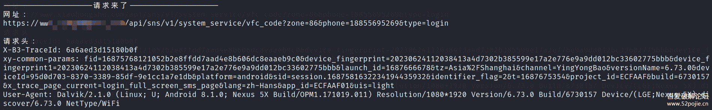
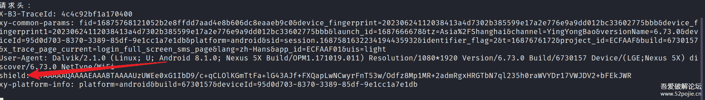
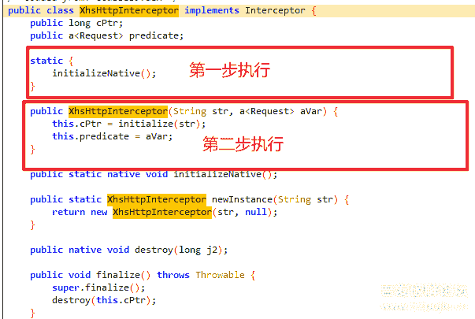
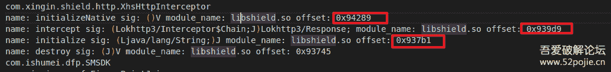
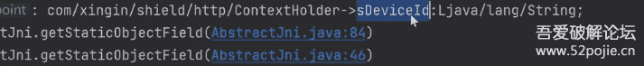
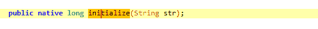
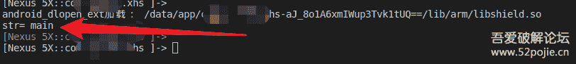
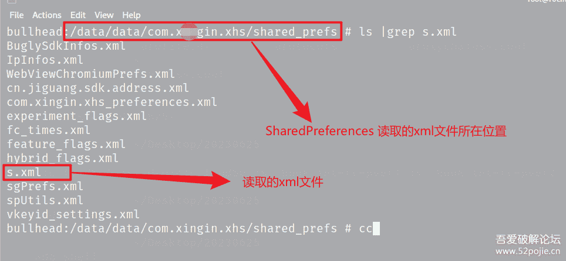
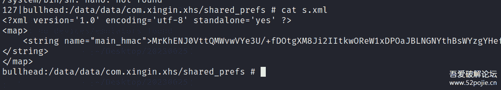
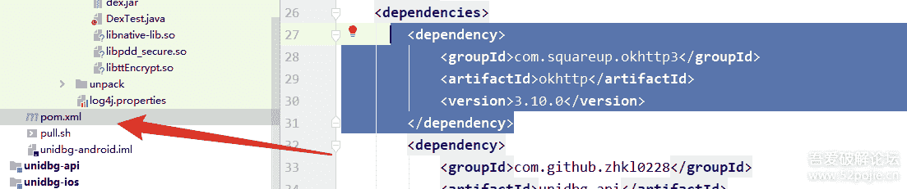

# [Android 原创] 小红书APP Unidbg shield 分享知识点

- 原帖: `https://www.52pojie.cn/forum.php?mod=viewthread&tid=1801751`
- 抓取时间: `2026-11-01T21:42:14`

## shield 分享知识点

### 1、hook NewStringUTF

找到在so层 c语言字符串转化为jni中的jstring类型 使用的函数`NewStringUTF(env,c中字符串)`。

```
var symbols = Module.enumerateSymbolsSync("libart.so");
var addrNewStringUTF = null;
for (var i = 0; i = 0 && symbol.name.indexOf("CheckJNI") 
```

### 2、hook 所有的interceptor

`public class XhsHttpInterceptor implements Interceptor {`

//在so中创建请求头的值，并添加到request对象中，在继续执行下一个拦截器

`public native Response intercept(Interceptor.Chain chain, long j2) throws IOException;`

`}`

拦截器中做的事情：

- `public native Response intercept(Interceptor.Chain chain, long j2)`
- 1、获取request对象 `request = chain.request()`
- 2、使用request对象添加请求头 
- 3、执行下一个拦截器 `chain.proceed(request)`

```
//hook所有拦截器
Java.perform(function () {
  var Builder = Java.use('okhttp3.OkHttpClient$Builder');

  Builder.addInterceptor.implementation = function (inter) {
      //console.log("实例化：");

      console.log(JSON.stringify(inter) );
      //console.log(Java.use("android.util.Log").getStackTraceString(Java.use("java.lang.Throwable").$new()));
      return this.addInterceptor(inter);
  };
})

//  frida -U -f com.xingin.xhs  -l 6.all_inter.js
```

### 3、验证前后两个拦截器的内容 是否是在某个拦截器中生成的参数

验证1： `com.xingin.shield.http.XhsHttpInterceptor`

```
Java.perform(function () {
  var XhsHttpInterceptor = Java.use('com.xxx.shield.http.XhsHttpInterceptor');
  var Buffer = Java.use("okio.Buffer");
  var Charset = Java.use("java.nio.charset.Charset");

  XhsHttpInterceptor.intercept.overload('okhttp3.Interceptor$Chain').implementation = function (chain, j2) {
      console.log('\n--------------------请求来了--------------------');
      var request = chain.request();

      var urlString = request.url().toString();
      console.log("网址：")
      console.log(urlString)
      console.log("\n请求头：")
      console.log(request.headers().toString());

      var requestBody = request.body();
      if (requestBody) {
          var buffer = Buffer.$new();
          requestBody.writeTo(buffer);
          console.log("请求体：")
          console.log(buffer.readString(Charset.forName("utf8")));
      }

      var res = this.intercept(chain);
      return res;
  };
})
//  frida -UF  -l 8.next_request.js
```



1.png (238.8 KB, 下载次数: 0)

[href="forum.php?mod=attachment&aid=MjcyODE5NXxiOWVlYWJmNXwxNzkzNTY5MzMyfDE2ODA4NnwxODAxNzUx&nothumb=yes" target="_blank"](https://www.52pojie.cn/forum.php?mod=attachment&aid=MjcyODE5NXxiOWVlYWJmNXwxNzkzNTY5MzMyfDE2ODA4NnwxODAxNzUx&nothumb=yes)

2024-10-12 12:20 上传

验证2 ： `p.d0.v1.e0.n0.h`

```
Java.perform(function () {

  var XhsHttpInterceptor = Java.use('p.d0.v1.e0.n0.h');

  var Buffer = Java.use("okio.Buffer");

  var Charset = Java.use("java.nio.charset.Charset");

  XhsHttpInterceptor.intercept.overload('okhttp3.Interceptor$Chain').implementation = function (chain, j2) {

      console.log('\n--------------------请求来了--------------------');

      var request = chain.request();

      var urlString = request.url().toString();

      console.log("网址：")

      console.log(urlString)

      console.log("\n请求头：")

      console.log(request.headers().toString());

      var requestBody = request.body();

      if (requestBody) {

          var buffer = Buffer.$new();

          requestBody.writeTo(buffer);

          console.log("请求体：")

          console.log(buffer.readString(Charset.forName("utf8")));

      }

      var res = this.intercept(chain);

      return res;

  };

})

//  frida -UF  -l 8.next_request.js
```



2.png (119.75 KB, 下载次数: 0)

[href="forum.php?mod=attachment&aid=MjcyODE5Nnw2ZTUzNzFkZnwxNzkzNTY5MzMyfDE2ODA4NnwxODAxNzUx&nothumb=yes" target="_blank"](https://www.52pojie.cn/forum.php?mod=attachment&aid=MjcyODE5Nnw2ZTUzNzFkZnwxNzkzNTY5MzMyfDE2ODA4NnwxODAxNzUx&nothumb=yes)

2024-10-12 12:20 上传

### 4、逆向

判断so方法是静态方法 还是 实例方法

静态方法 ：

方法格式如： `public static native Response intercept()` 注意`static`

直接 类.方法

实例方法：

格式 ： `public native Response intercept(Interceptor.Chain chain, long j2)`

需要实例化类对象：

- 1 、 `XhsHttpInterceptor i1 = new XhsHttpInterceptor()`
- 2 、 `Builder.addInterceptor(i1)`
- 3、  `i1.intercept(chain, 10)`

注意：

- 1  `static`中的内容要补全
- 2  构造方法中的事情要补全



3.png (34.89 KB, 下载次数: 0)

[href="forum.php?mod=attachment&aid=MjcyODE5N3wxZjlkOWY1MXwxNzkzNTY5MzMyfDE2ODA4NnwxODAxNzUx&nothumb=yes" target="_blank"](https://www.52pojie.cn/forum.php?mod=attachment&aid=MjcyODE5N3wxZjlkOWY1MXwxNzkzNTY5MzMyfDE2ODA4NnwxODAxNzUx&nothumb=yes)

2024-10-12 12:20 上传


4.png (6.29 KB, 下载次数: 0)

[href="forum.php?mod=attachment&aid=MjcyODE5OHxiMzdiNWFlMHwxNzkzNTY5MzMyfDE2ODA4NnwxODAxNzUx&nothumb=yes" target="_blank"](https://www.52pojie.cn/forum.php?mod=attachment&aid=MjcyODE5OHxiMzdiNWFlMHwxNzkzNTY5MzMyfDE2ODA4NnwxODAxNzUx&nothumb=yes)

2024-10-12 12:21 上传

```
static {
      initializeNative();
  }

1 public static native void initializeNative();

public XhsHttpInterceptor(String str, a aVar) {
      this.cPtr = initialize(str);
      this.predicate = aVar;
  }

2 public native long initialize(String str);

3 public native Response intercept(Interceptor.Chain chain, long j2) throws IOException;
```

注意： `shield` 请求头的值 不是通过返回值获取的 ，在`intercept`内部

- `request = chain.request()`
- `request.addHeader("shield","zzzxxx")`
- 补环境时遇到`request`对象和`addHeader` 方法时 注意看一下参数 是否是`shield`

### 5、补环境 initializeNative

签名调用

```
DvmClass cls = vm.resolveClass("com/xxx/shield/http/XhsHttpInterceptor");

// 调用方法 StringObject---unidbg中

cls.callStaticJniMethodObject(

        emulator,

        "initializeNative()V",

);
```

偏移地址调用

hook 函数地址的偏移

```
var symbols = Module.enumerateSymbolsSync("libart.so");
var addrRegisterNatives = null;
for (var i = 0; i = 0 &&
    symbol.name.indexOf("JNI") >= 0 &&
    symbol.name.indexOf("RegisterNatives") >= 0 &&
    symbol.name.indexOf("CheckJNI") 
```

```
if (addrRegisterNatives != null) {

Interceptor.attach(addrRegisterNatives, {

onEnter: function (args) {

var env = args[0];

var java_class = args[1];

var class_name = Java.vm.tryGetEnv().getClassName(java_class);

// 只有类名为com.xxx.nativelibrary.LibBili，才打印输出

console.log(class_name);

var taget_class = "com.xxx.shield.http.XhsHttpInterceptor";
```

```
        if (class_name === taget_class) {

            // console.log("\n[RegisterNatives] method_count:", args[3]);

            var methods_ptr = ptr(args[2]);

            var method_count = parseInt(args[3]);

            for (var i = 0; i 
```

-----------------------------------或者下面----------------------------------------

```
function find_RegisterNatives(params) {

var symbols = Module.enumerateSymbolsSync("libart.so");

var addrRegisterNatives = null;

for (var i = 0; i     //_ZN3art3JNI15RegisterNativesEP7_JNIEnvP7_jclassPK15JNINativeMethodi

    if (symbol.name.indexOf("art") >= 0 &&

            symbol.name.indexOf("JNI") >= 0 && 

            symbol.name.indexOf("RegisterNatives") >= 0 && 

            symbol.name.indexOf("CheckJNI") 
```

```
function hook_RegisterNatives(addrRegisterNatives) {
```

```
if (addrRegisterNatives != null) {
    Interceptor.attach(addrRegisterNatives, {
        onEnter: function (args) {
            console.log("[RegisterNatives] method_count:", args[3]);
            var java_class = args[1];
            var class_name = Java.vm.tryGetEnv().getClassName(java_class);
            //console.log(class_name);

            var methods_ptr = ptr(args[2]);

            var method_count = parseInt(args[3]);
            for (var i = 0; i 
```

```
setImmediate(find_RegisterNatives);
```




5.png (44.51 KB, 下载次数: 1)

[href="forum.php?mod=attachment&aid=MjcyODE5OXw1ZTk5ZjMyM3wxNzkzNTY5MzMyfDE2ODA4NnwxODAxNzUx&nothumb=yes" target="_blank"](https://www.52pojie.cn/forum.php?mod=attachment&aid=MjcyODE5OXw1ZTk5ZjMyM3wxNzkzNTY5MzMyfDE2ODA4NnwxODAxNzUx&nothumb=yes)

2024-10-12 12:21 上传

```
ArrayList args = new ArrayList<>(10);
args.add(vm.getJNIEnv());   args.add(vm.addLocalObject(vm.resolveClass("com/xxx/shield/http/XhsHttpInterceptor")));
module.callFunction(
  emulator,
  0x94289,
  args.toArray()
      );

--------------------------------------------------------------
module.callFunction(emulator,
               0x94289,
               vm.getJNIEnv(),
  vm.addLocalObject(vm.resolveClass("com/xxx/shield/http/XhsHttpInterceptor")) //jclass
              );
```

补环境

```
java.lang.UnsupportedOperationException: java/nio/charset/Charset->defaultCharset()Ljava/nio/charset/Charset;

      at com.github.unidbg.linux.android.dvm.AbstractJni.callStaticObjectMethodV(AbstractJni.java:503)
```

```
@Override
public DvmObject callStaticObjectMethodV(BaseVM vm, DvmClass dvmClass, String signature, VaList vaList) {
    if (signature.equals("java/nio/charset/Charset->defaultCharset()Ljava/nio/charset/Charset;")){
        return vm.resolveClass("java/nio/charset/Charset").newObject(Charset.defaultCharset());
    }
    return super.callStaticObjectMethodV(vm, dvmClass, signature, vaList);
}
```

需要hook一下参数   静态字段  `.value` 获取值



6.png (61.07 KB, 下载次数: 2)

[href="forum.php?mod=attachment&aid=MjcyODIwMHwwNWQxMGIxNHwxNzkzNTY5MzMyfDE2ODA4NnwxODAxNzUx&nothumb=yes" target="_blank"](https://www.52pojie.cn/forum.php?mod=attachment&aid=MjcyODIwMHwwNWQxMGIxNHwxNzkzNTY5MzMyfDE2ODA4NnwxODAxNzUx&nothumb=yes)

2024-10-12 12:21 上传

```
Java.perform(function () {

var ContextHolder = Java.use('com.xxxx.shield.http.ContextHolder');

console.log('sAppId=',ContextHolder.sAppId.value);

console.log('sDeviceId=',ContextHolder.sDeviceId.value);

})
```

### 3> 6、 补环境 initialize



7.png (2.56 KB, 下载次数: 1)

[href="forum.php?mod=attachment&aid=MjcyODIwMXxmMzY5MDIwY3wxNzkzNTY5MzMyfDE2ODA4NnwxODAxNzUx&nothumb=yes" target="_blank"](https://www.52pojie.cn/forum.php?mod=attachment&aid=MjcyODIwMXxmMzY5MDIwY3wxNzkzNTY5MzMyfDE2ODA4NnwxODAxNzUx&nothumb=yes)

2024-10-12 12:21 上传

注意返回值是`long`

```
public long initialize (){

      Number number = module.callFunction(emulator,

              0x937B1,

              vm.getJNIEnv(),

              vm.addLocalObject(vm.resolveClass("com/xingin/shield/http/XhsHttpInterceptor")), //jclass

              vm.addLocalObject(new StringObject(vm,"main"))

      );

      return number.longValue();

  }
```

hook时机： 在加载so文件后进行hook

```
function do_hook() {
setTimeout(function () {
    Java.perform(function () {
        var XhsHttpInterceptor = Java.use('com.xxx.shield.http.XhsHttpInterceptor');
        XhsHttpInterceptor.initialize.implementation = function (str) {
            console.log("str=", str);
            return this.initialize(str);
        };
    })
}, 40);
}

function load_so_and_hook() {

var dlopen = Module.findExportByName(null, "dlopen");

var android_dlopen_ext = Module.findExportByName(null, "android_dlopen_ext");

Interceptor.attach(dlopen, {

    onEnter: function (args) {

        var path_ptr = args[0];

        var path = ptr(path_ptr).readCString();

        // console.log("[dlopen:]", path);

        this.path = path;

    }, onLeave: function (retval) {

        if (this.path.indexOf("libshield.so") !== -1) {

            console.log("[dlopen:]", this.path);

            do_hook();

        }

    }

});

Interceptor.attach(android_dlopen_ext, {

    onEnter: function (args) {

        var path_ptr = args[0];

        var path = ptr(path_ptr).readCString();

        this.path = path;

    }, onLeave: function (retval) {

        if (this.path.indexOf("libshield.so") !== -1) {

            console.log("\nandroid_dlopen_ext加载：", this.path);

            do_hook();

        }

    }

});

}

load_so_and_hook();
```



8.png (21.97 KB, 下载次数: 1)

[href="forum.php?mod=attachment&aid=MjcyODIwMnwxMWRiNDk5MnwxNzkzNTY5MzMyfDE2ODA4NnwxODAxNzUx&nothumb=yes" target="_blank"](https://www.52pojie.cn/forum.php?mod=attachment&aid=MjcyODIwMnwxMWRiNDk5MnwxNzkzNTY5MzMyfDE2ODA4NnwxODAxNzUx&nothumb=yes)

2024-10-12 12:21 上传

### 4> getSharedPreferences

开发时 读取xml文件会使用这个api

```
SharedPreferences  sp  = getSharedPreferences("s",0)//第一个参数是xml文件的名字，第二个参数是模式

String  token = sp.getString("main","");//读取xml文件中内容
```

```
public DvmObject callObjectMethodV(BaseVM vm, DvmObject dvmObject, String signature, VaList vaList) {
      if (signature.equals("android/content/Context->getSharedPreferences(Ljava/lang/String;I)Landroid/content/SharedPreferences;")){
          String xmlName =  vaList.getObjectArg(0).getValue().toString();
          System.out.println("xmlName : " + xmlName);
          return vm.resolveClass("android.content.SharedPreferences")
                  .newObject(null);
      }
      if (signature.equals("android/content/SharedPreferences->getString(Ljava/lang/String;Ljava/lang/String;)Ljava/lang/String;")){
          String arg1 = vaList.getObjectArg(0).getValue().toString();
          String arg2 = vaList.getObjectArg(1).getValue().toString();
          System.out.println("key : " + arg1);
          System.out.println(arg2);
      }
      return super.callObjectMethodV(vm, dvmObject, signature, vaList);
  }
```


9.png (8.53 KB, 下载次数: 1)

[href="forum.php?mod=attachment&aid=MjcyODIwM3w3MTE4YmM5NXwxNzkzNTY5MzMyfDE2ODA4NnwxODAxNzUx&nothumb=yes" target="_blank"](https://www.52pojie.cn/forum.php?mod=attachment&aid=MjcyODIwM3w3MTE4YmM5NXwxNzkzNTY5MzMyfDE2ODA4NnwxODAxNzUx&nothumb=yes)

2024-10-12 12:21 上传



10.png (114.81 KB, 下载次数: 1)

[href="forum.php?mod=attachment&aid=MjcyODIwNHwwODRkYjk0MHwxNzkzNTY5MzMyfDE2ODA4NnwxODAxNzUx&nothumb=yes" target="_blank"](https://www.52pojie.cn/forum.php?mod=attachment&aid=MjcyODIwNHwwODRkYjk0MHwxNzkzNTY5MzMyfDE2ODA4NnwxODAxNzUx&nothumb=yes)

2024-10-12 12:21 上传



11.png (73.78 KB, 下载次数: 1)

[href="forum.php?mod=attachment&aid=MjcyODIwNXxiZTYxMDFhZHwxNzkzNTY5MzMyfDE2ODA4NnwxODAxNzUx&nothumb=yes" target="_blank"](https://www.52pojie.cn/forum.php?mod=attachment&aid=MjcyODIwNXxiZTYxMDFhZHwxNzkzNTY5MzMyfDE2ODA4NnwxODAxNzUx&nothumb=yes)

2024-10-12 12:21 上传

没有`mian`的值 返回空即可

### 4> Base64

`base64` 补的是标准的`base64`   注意不要导包导错了

```
import org.apache.commons.codec.binary.Base64;

byte[] decode = Base64.decodeBase64(arg1);
```

### 3> 7、 补环境 intercept

```
public native Response intercept(Interceptor.Chain chain, long j2) throws IOException;
```

如果要执行  必须要传入参数

`chain` 这个参数流程可以猜测如下

1. `request = chain.request`
2. 读取`request`中的内容

1 可以直接传空值  然后看后面读取什么补什么

2 在Unidbg中引用`okhttp3`  构造一个真的`chain`对象

### 4> 引用okhttp3

```
  com.squareup.okhttp3
  okhttp
  3.10.0
```



12.png (40.89 KB, 下载次数: 1)

[href="forum.php?mod=attachment&aid=MjcyODIwNnwxNWIxNDc4MHwxNzkzNTY5MzMyfDE2ODA4NnwxODAxNzUx&nothumb=yes" target="_blank"](https://www.52pojie.cn/forum.php?mod=attachment&aid=MjcyODIwNnwxNWIxNDc4MHwxNzkzNTY5MzMyfDE2ODA4NnwxODAxNzUx&nothumb=yes)

2024-10-12 12:21 上传
