# [Android 原创] android-pixel4a-刷机系列-(5)kernelsu编译问题解决及使用

- 原帖: https://www.52pojie.cn/forum.php?mod=viewthread&tid=1805683
- 抓取时间: 2026-11-01T21:41:53

## android-pixel4a-刷机系列-(5)kernelsu编译问题解决及使用

上一节编译的`kernelSu`有点问题,本次就进行修复重新编译

### 重编译

上一篇出现 `savedefconfig` 不匹配的问题

```
....
--- private/msm-google/arch/arm64/configs/sunfish_defconfig        2023-06-27 15:56:28.068070234 +0800
+++ ~/aosp/android-kernel/out/android-msm-pixel-4.14/private/msm-google/defconfig        2023-06-27 22:37:59.857566122 +0800
@@ -685,7 +685,6 @@
 CONFIG_QUOTA_NETLINK_INTERFACE=y
 CONFIG_QFMT_V2=y
 CONFIG_FUSE_FS=y
-CONFIG_OVERLAY_FS=y
 CONFIG_INCREMENTAL_FS=m
 CONFIG_VFAT_FS=y
 CONFIG_TMPFS_POSIX_ACL=y
++ RES=1
++ '[' 1 -ne 0 ']'
++ echo ERROR: savedefconfig does not match private/msm-google/arch/arm64/configs/sunfish_defconfig
ERROR: savedefconfig does not match private/msm-google/arch/arm64/configs/sunfish_defconfig
++ return 1
```

之前我们的解决方案是 注释掉 `KernelSu` 的 `Kconfig` 中的 `select OVERLAY_FS` 选项

```
menu "KernelSU"
config KSU
        tristate "KernelSU function support"
        #select OVERLAY_FS
        default y
        help
        Enable kernel-level root privileges on Android System.
```

这样确实 ok 了。但总感觉这样不是正确的解决办法。

下面提供了解决方案

#### 4> 去掉 `check_defconfig`

这个参考了`debug_cat`的解决方案,亲测,确实方便有效！

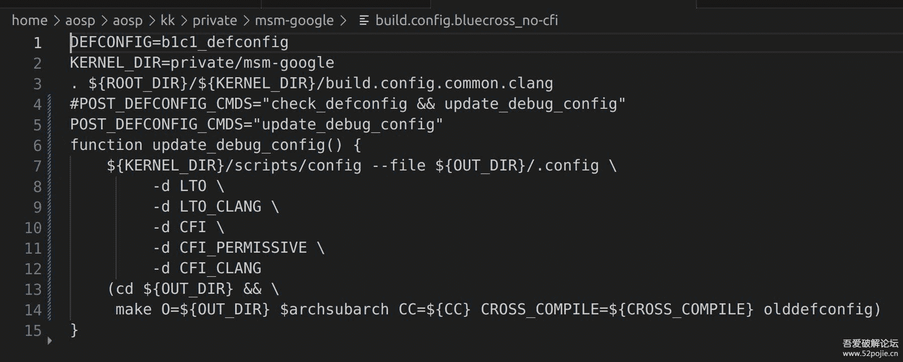
image01.png (148.06 KB, 下载次数: 0)
[href="forum.php?mod=attachment&aid=MjYyNTY0N3xhZTUwMGRhOXwxNzkzNTY5MzExfDE2ODA4NnwxODA1Njgz&nothumb=yes" target="_blank"](https://www.52pojie.cn/forum.php?mod=attachment&aid=MjYyNTY0N3xhZTUwMGRhOXwxNzkzNTY5MzExfDE2ODA4NnwxODA1Njgz&nothumb=yes)
2023-7-7 03:56 上传

首先我们看下 `private/msm-google/build.config` 文件

```
KERNEL_DIR=private/msm-google
. ${ROOT_DIR}/${KERNEL_DIR}/build.config.common.clang
POST_DEFCONFIG_CMDS="check_defconfig"
```

发现他调用了 `check_defconfig` 方法,这个方法在哪里呢？

回到 `build` 目录下你会发现一个叫 `_setup_env.sh` 的文件

```
echo

echo "PATH=${PATH}"

echo

# verifies that defconfig matches the DEFCONFIG

function check_defconfig() {

    (cd ${OUT_DIR} && \
     make "${TOOL_ARGS[@]}" O=${OUT_DIR} savedefconfig)

    [ "$ARCH" = "x86_64" -o "$ARCH" = "i386" ] && local ARCH=x86

    echo Verifying that savedefconfig matches ${KERNEL_DIR}/arch/${ARCH}/configs/${DEFCONFIG}

    RES=0

    diff -u ${KERNEL_DIR}/arch/${ARCH}/configs/${DEFCONFIG} ${OUT_DIR}/defconfig ||

      RES=$?

    if [ ${RES} -ne 0 ]; then

        echo ERROR: savedefconfig does not match ${KERNEL_DIR}/arch/${ARCH}/configs/${DEFCONFIG}

    fi

    return ${RES}

}
```

它里面就有 `check_defconfig` 方法,可以看到它通过 `make ... savedefconfig` 从 `.config` 提取的 `defconfig`。
并使用 `diff` 进行比较差异。
这就难受了,因为我修改 `arch/arm64/configs/xxx_defconfig` 后,他会和默认值进行比较,无论如何都不相等的。
当然,砸门可以去掉这个。

查看 `build_sunfish.sh` 脚本

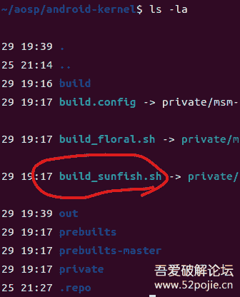
image02.png (42.13 KB, 下载次数: 1)
[href="forum.php?mod=attachment&aid=MjYyNTY0OHw1YTBmNWIyNXwxNzkzNTY5MzExfDE2ODA4NnwxODA1Njgz&nothumb=yes" target="_blank"](https://www.52pojie.cn/forum.php?mod=attachment&aid=MjYyNTY0OHw1YTBmNWIyNXwxNzkzNTY5MzExfDE2ODA4NnwxODA1Njgz&nothumb=yes)
2023-7-7 03:56 上传

它里面的配置指向了 `build.config.sunfish_no-cfi`,所以我们改这个

```
BUILD_CONFIG=private/msm-google/build.config.sunfish_no-cfi build/build.sh "$@"
```

改成如下

```
KERNEL_DIR=private/msm-google
. ${ROOT_DIR}/${KERNEL_DIR}/build.config.sunfish.common.clang
#去掉check_defconfig
#POST_DEFCONFIG_CMDS="check_defconfig && update_nocfi_config"
POST_DEFCONFIG_CMDS="update_nocfi_config"
function update_nocfi_config() {
  # Disable clang-specific options
  ${KERNEL_DIR}/scripts/config --file ${OUT_DIR}/.config \
    -d LTO \
    -d LTO_CLANG \
    -d CFI \
    -d CFI_PERMISSIVE \
    -d CFI_CLANG
  (cd ${OUT_DIR} && \
   make ${CC_LD_ARG} O=${OUT_DIR} olddefconfig)
}
```

只不过构建的时候不是调用 `build/build.sh` 了,而是直接调用 `build_sunfish.sh`

#### 4> kprobe 配置

`kernelSu` 通过 `kprobe` 去 `hook` 内核 实现的功能。所以我们得让编译的内核支持 `kprobe`

在 `arch/arm64/configs/xxx_defconfig` 添加如下配置

```
CONFIG_KPROBES=y
CONFIG_HAVE_KPROBES=y
CONFIG_KPROBE_EVENTS=y
```

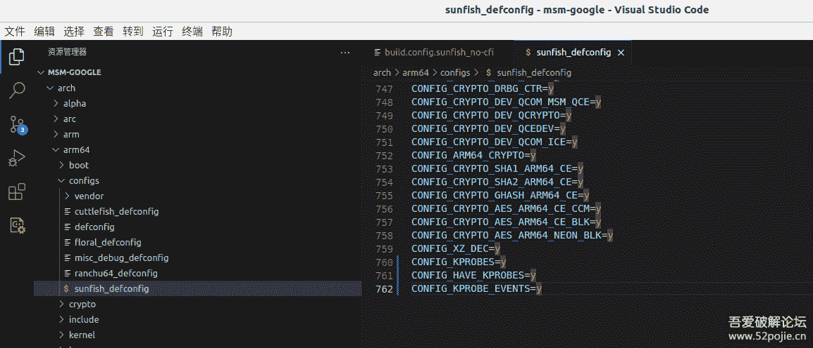
image03.png (119.83 KB, 下载次数: 0)
[href="forum.php?mod=attachment&aid=MjYyNTY0OXxhYWNjNWI3OXwxNzkzNTY5MzExfDE2ODA4NnwxODA1Njgz&nothumb=yes" target="_blank"](https://www.52pojie.cn/forum.php?mod=attachment&aid=MjYyNTY0OXxhYWNjNWI3OXwxNzkzNTY5MzExfDE2ODA4NnwxODA1Njgz&nothumb=yes)
2023-7-7 03:56 上传

#### 4> xxx_defconfig 正确配置方式

前面说的虽然也可以完成编译工作,但是我在浏览 `defconfig` 的时候发现了个不错的文章:

[//www.adtxl.com/index.php/archives/124.html" target="_blank" rel="noopener noreferrer nofollow"](https://www.adtxl.com/index.php/archives/124.html:rel="nofollow noopener" href="https)

按照文章所指示,我们应该这样操作:

- `make ARCH=arm64 sunfish_defconfig` 生成 `.config` 文件
- `make ARCH=arm64 menuconfig` 根据 `.config` 中 `arm64` 进行配置

此时您应该进入了配置界面,输入 `/`,搜索 `KPROBE`。
这里你要记住几个地方,`KPROBES` 以及 `KPROBE_EVENTS` 这几个是没有开的:

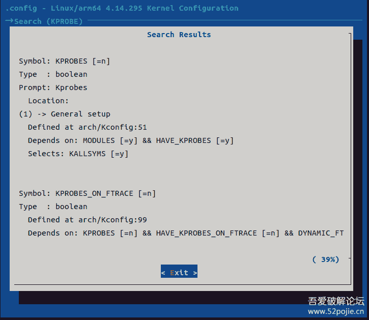
image08.png (60.68 KB, 下载次数: 0)
[href="forum.php?mod=attachment&aid=MjYyNTY1NHwzZDhmNTk1ZHwxNzkzNTY5MzExfDE2ODA4NnwxODA1Njgz&nothumb=yes" target="_blank"](https://www.52pojie.cn/forum.php?mod=attachment&aid=MjYyNTY1NHwzZDhmNTk1ZHwxNzkzNTY5MzExfDE2ODA4NnwxODA1Njgz&nothumb=yes)
2023-7-7 03:56 上传

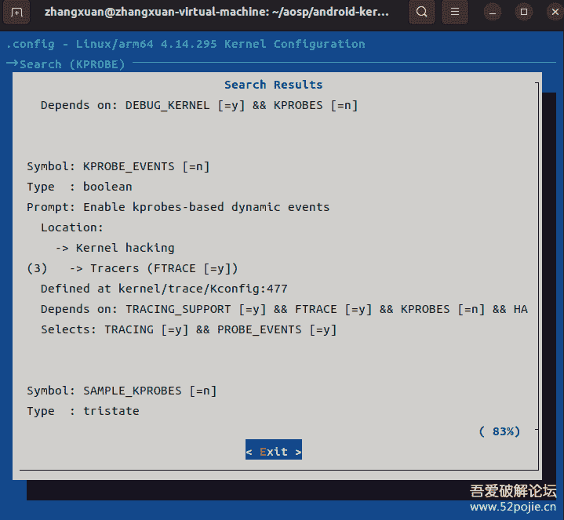
image09.png (70.77 KB, 下载次数: 0)
[href="forum.php?mod=attachment&aid=MjYyNTY1NXw1ZjM3MDI4ZHwxNzkzNTY5MzExfDE2ODA4NnwxODA1Njgz&nothumb=yes" target="_blank"](https://www.52pojie.cn/forum.php?mod=attachment&aid=MjYyNTY1NXw1ZjM3MDI4ZHwxNzkzNTY5MzExfDE2ODA4NnwxODA1Njgz&nothumb=yes)
2023-7-7 03:56 上传

以此找到地方后,按空格进行选中:

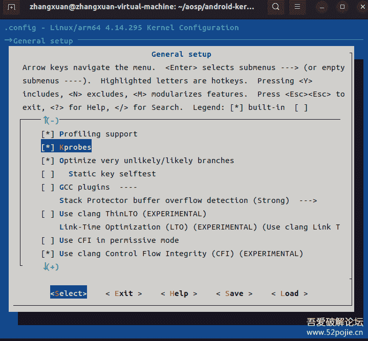
image10.png (88.12 KB, 下载次数: 1)
[href="forum.php?mod=attachment&aid=MjYyNTY1NnwxMTlhMmNmNHwxNzkzNTY5MzExfDE2ODA4NnwxODA1Njgz&nothumb=yes" target="_blank"](https://www.52pojie.cn/forum.php?mod=attachment&aid=MjYyNTY1NnwxMTlhMmNmNHwxNzkzNTY5MzExfDE2ODA4NnwxODA1Njgz&nothumb=yes)
2023-7-7 03:56 上传

对于 `KPROBE_EVENTS` 只要选择 `KPROBE` 就自动选中了:

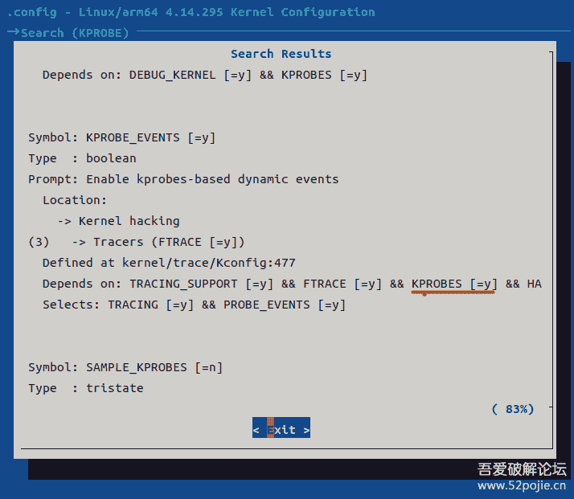
image11.png (63.95 KB, 下载次数: 0)
[href="forum.php?mod=attachment&aid=MjYyNTY1N3xiYTQ2NWM1YnwxNzkzNTY5MzExfDE2ODA4NnwxODA1Njgz&nothumb=yes" target="_blank"](https://www.52pojie.cn/forum.php?mod=attachment&aid=MjYyNTY1N3xiYTQ2NWM1YnwxNzkzNTY5MzExfDE2ODA4NnwxODA1Njgz&nothumb=yes)
2023-7-7 03:56 上传

选择 `save` 进行保存

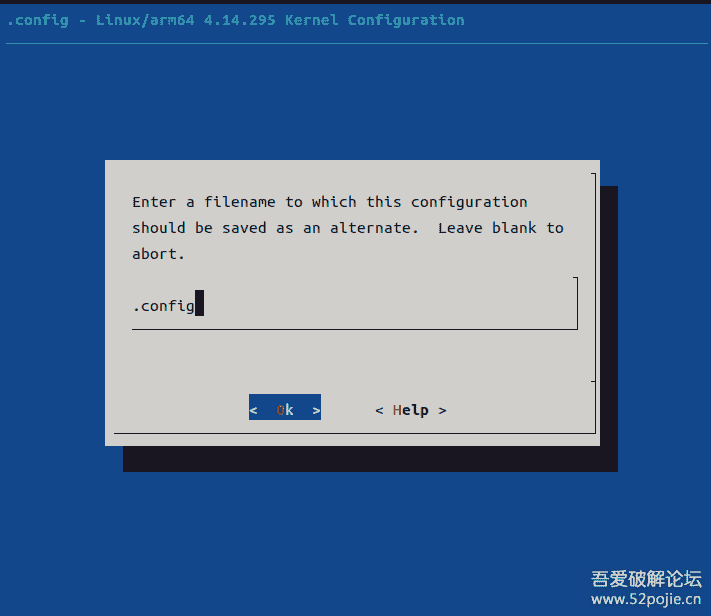
image12.png (27.28 KB, 下载次数: 1)
[href="forum.php?mod=attachment&aid=MjYyNTY1OHw4NTM1NTc3OXwxNzkzNTY5MzExfDE2ODA4NnwxODA1Njgz&nothumb=yes" target="_blank"](https://www.52pojie.cn/forum.php?mod=attachment&aid=MjYyNTY1OHw4NTM1NTc3OXwxNzkzNTY5MzExfDE2ODA4NnwxODA1Njgz&nothumb=yes)
2023-7-7 03:56 上传

接下来,我们需要生成修改过的 `defconfig`,将 `sunfish_defconfig` 进行覆盖

- `make ARCH=arm64 savedefconfig` 根据 `.config` 生成 `defconfig`
- `cp defconfig arch/arm64/configs/sunfish_defconfig` 覆盖 `sunfish_defconfig`

> 

这样确实就没问题了,`check_defconfig` 也不用去掉,但是我也没搞明白为什么这样生成的 `defconfig` 为什么可以一直保持,
而手动修改的 `sunfish_defconfig` 确会导致 `check_defconfig` 不同

接下来重新进行构建

#### 4> 构建时候强调点问题

如果构建的时候出现了下面的错误:

```
aosp/android-kernel/private/msm-google is not clean, please run 'make mrproper'
```

这代表某些配置没有删除干净。

这段错误在 `/private/msm-google/Makefile` 中

```
# prepare3 is used to check if we are building in a separate output directory,
# and if so do:
# 1) Check that make has not been executed in the kernel src $(srctree)
prepare3: include/config/kernel.release
ifneq ($(KBUILD_SRC),)
        @$(kecho) '  Using $(srctree) as source for kernel'
        $(Q)if [ -f $(srctree)/.config -o -d $(srctree)/include/config ]; then \
                echo >&2 "  $(srctree) is not clean, please run 'make mrproper'"; \
                echo >&2 "  in the '$(srctree)' directory.";\
                /bin/false; \
        fi;
endif
```

意思大概是说,您需要保证 `.config` 和 `include/config` 是空的
使用 `rm -f .config` 和 `rm -rf include/config`。
如果发现你从未见过的错误,那代表你可能乱改了某些地方。可通过 `git checkout .` 重新检出覆盖下内容,那么你将会需要重新配置。
实在不行,全部清理重构,参考我下面的代码:
```


# 只删除代码，不删除 `repo` 仓库

```
rm -rf !(".repo")
```

## 重新同步

```
repo sync
cd private/msm-google
curl -LSs "https://raw.githubusercontent.com/tiann/KernelSU/main/kernel/setup.sh" | bash -s main

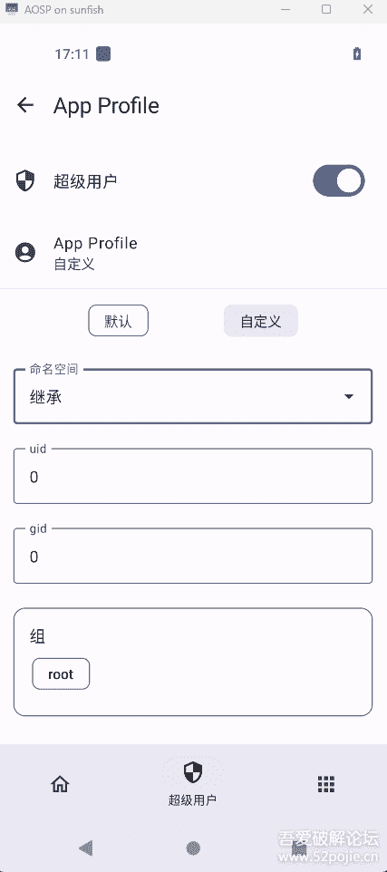

```

然后按照之前的配置重新打包 `boot.img` 进行刷入即可。

## 3. kernelsu 使用

按照作者的介绍，`kernelSu` 除了可以直接给 `root` 外，还可以更细腻地分配权限。

当然，官网没有给出详细的使用方法，我是从作者的 B站看到的；搜索“术哥喜欢皮卡丘”您应该可以找到。
`image04.png`（52.11 KB，下载次数：0）

[附件下载](https://www.52pojie.cn/forum.php?mod=attachment&aid=MjYyNTY1MHxkYTUzMTYwMXwxNzkzNTY5MzExfDE2ODA4NnwxODA1Njgz&nothumb=yes)

2023-7-7 03:56 上传

## 4. kernelsu 模块

`kernelsu` 使用 `Magisk` 的 `BusyBox` 和 `overlayfs mount` 机制完成与 `magisk` 相同的模块功能。

所以理论上，大部分 `magisk` 模块都可以适用在 `kernelsu` 上面。

当然与 `magisk` 模块也有差异。

具体参考：<https://kernelsu.org/zh_CN/guide/difference-with-magisk.html>

`kernelsu` 不像 `magisk` 那样自动携带 `zygisk`，所以要提供 `zygisk` 支持，需要使用 `ZygiskOnKernelSu` 模块。

模块地址：<https://github.com/Dr-TSNG/ZygiskOnKernelSU>

首先，我们将 `ZygiskOnKernelSu` 进行下载：

```
wget "https://github.com/Dr-TSNG/ZygiskOnKernelSU/releases/download/v4-0.7.1/Zygisk-on-KernelSU-v4-0.7.1-89-release.zip" -O "Zygisk-on-KernelSU-v4-0.7.1-89-release.zip"
adb push .\Zygisk-on-KernelSU-v4-0.7.1-89-release.zip /sdcard/

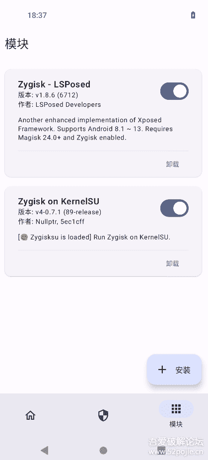


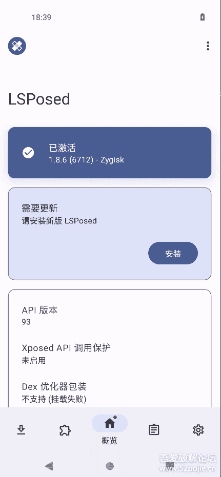

```

随后通过 `kernelsu` app 进行安装。

安装完后，再安装 `Zygisk - Lsposed`，并进行查看。
`image05.png`（90.94 KB，下载次数：1）

[附件下载](https://www.52pojie.cn/forum.php?mod=attachment&aid=MjYyNTY1MXwyNDQyNTQ0MHwxNzkzNTY5MzExfDE2ODA4NnwxODA1Njgz&nothumb=yes)

2023-7-7 03:56 上传
`image06.png`（84.49 KB，下载次数：1）

[附件下载](https://www.52pojie.cn/forum.php?mod=attachment&aid=MjYyNTY1MnwwY2NkNjhlNnwxNzkzNTY5MzExfDE2ODA4NnwxODA1Njgz&nothumb=yes)

2023-7-7 03:56 上传

但此时 `zygisk` 暴露出来了，所以还需要安装 `shamiko`：

```
wget "https://github.com/LSPosed/LSPosed.github.io/releases/download/shamiko-174/Shamiko-v0.7.3-174-release.zip" -O "Shamiko-v0.7.3-174-release.zip"
adb push Shamiko-v0.7.3-174-release.zip /sdcard/
```

查看下 `momo`：

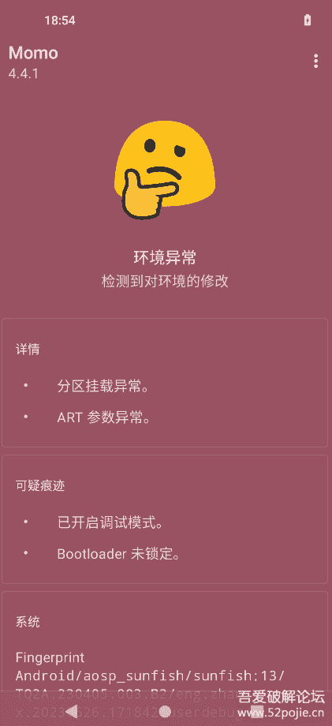

`image07.png`（101.31 KB，下载次数：1）

[附件下载](https://www.52pojie.cn/forum.php?mod=attachment&aid=MjYyNTY1M3xjZTlhM2NhNHwxNzkzNTY5MzExfDE2ODA4NnwxODA1Njgz&nothumb=yes)

2023-7-7 03:56 上传

`kernelsu` 的 `root` 未检查到，`zygisk` 也未检测到。

但是因为现在的 `aosp` 采用的是 `userdebug` 构建的，并且使用 `adb remount` 挂载了分区，所以被检测到了异常。

所以下一节我打算直接采用官方出厂镜像覆盖 `kernel` 启动镜像重试一遍。

也打算结束此次教程了。
