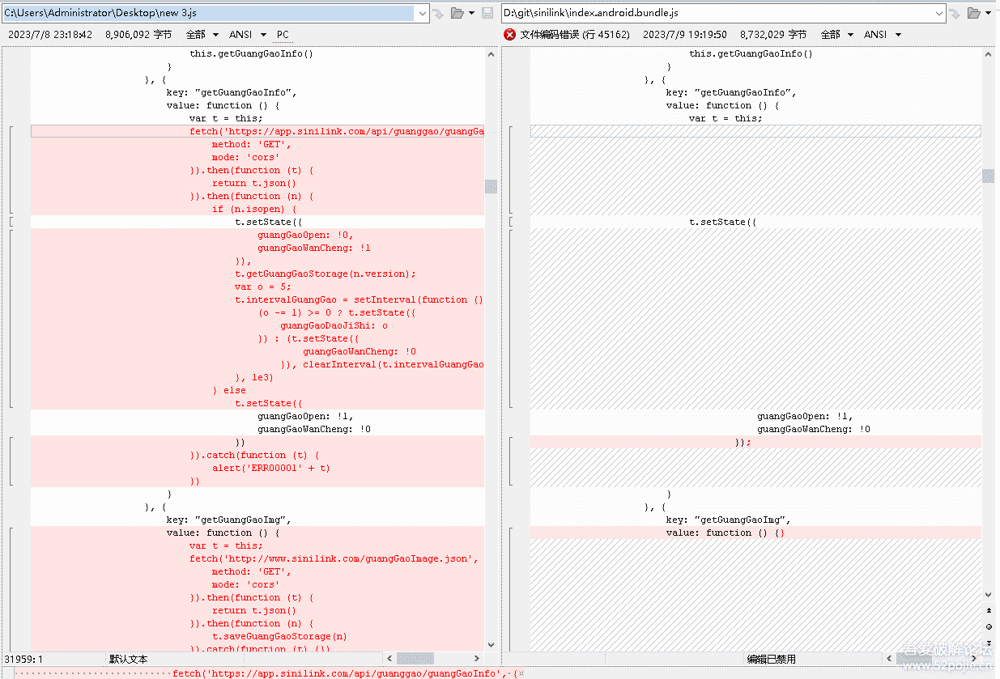
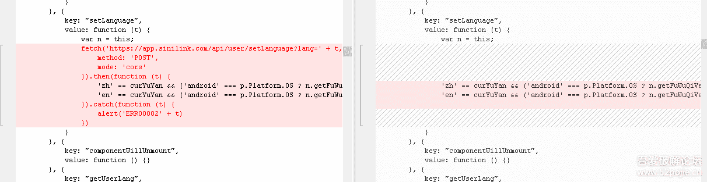
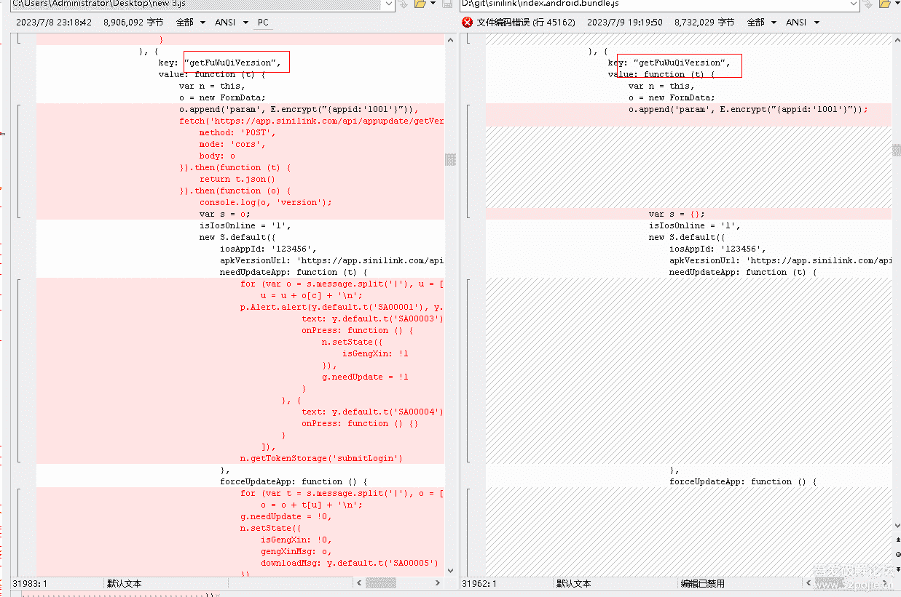
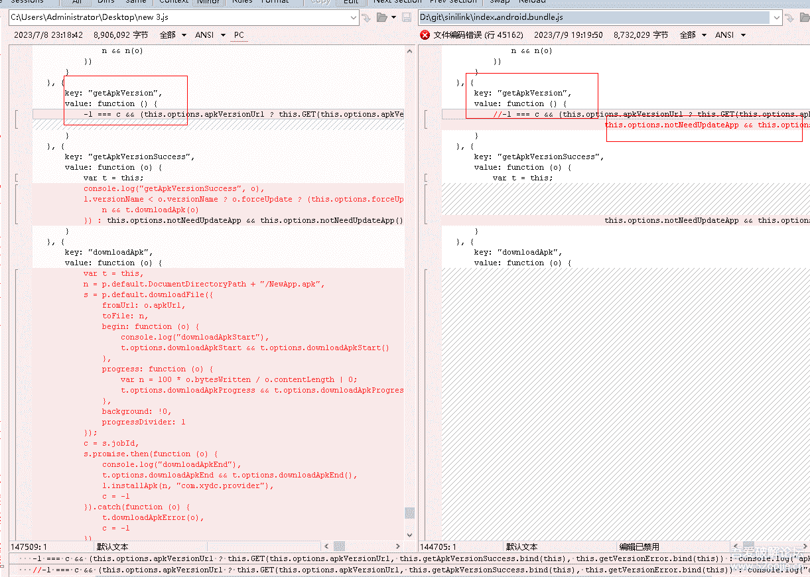
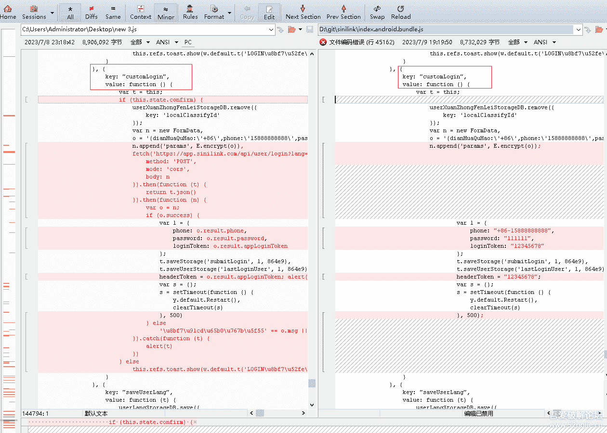
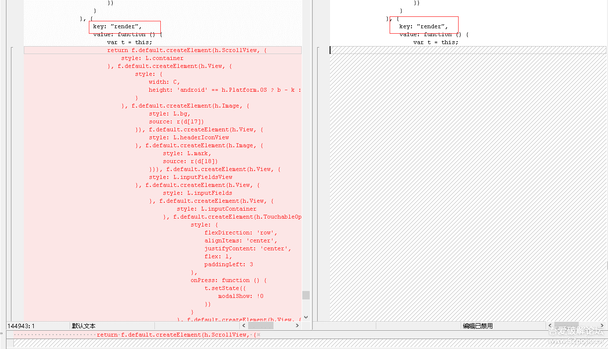
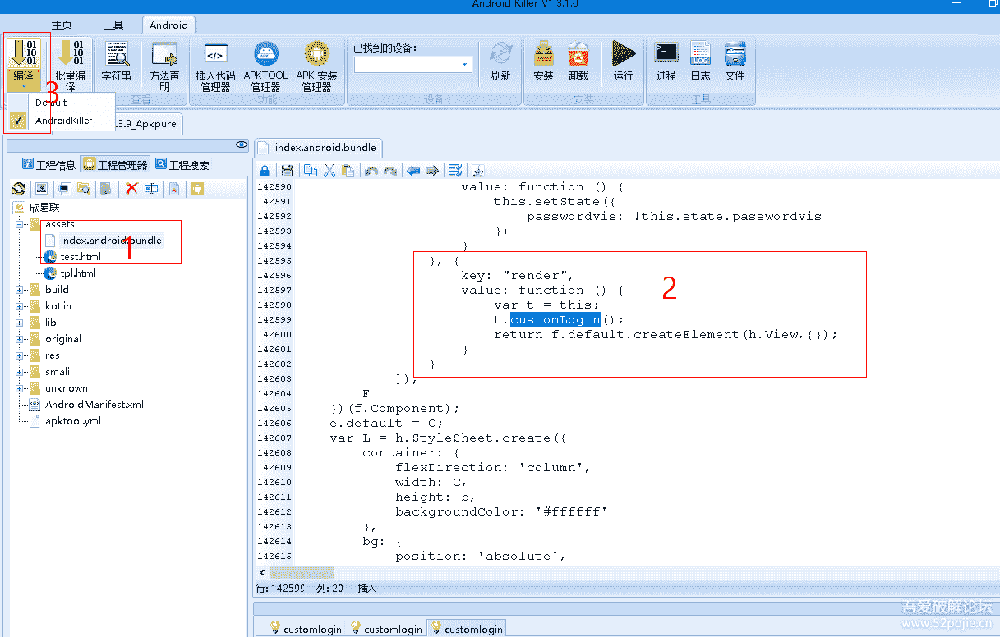
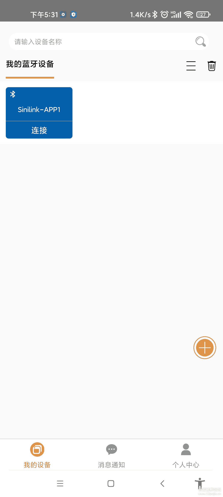
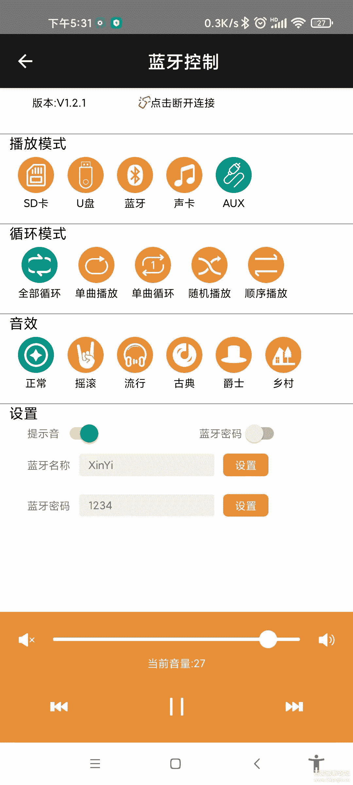
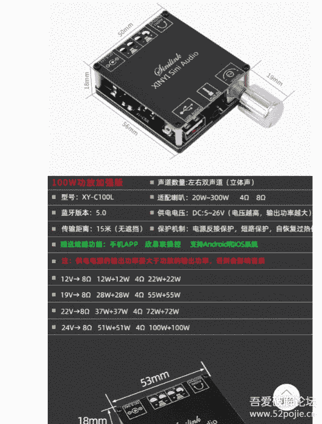

# [Android 原创] 入门破解一个无壳蓝牙音响控制app，去除联网登录，去广告

- 原帖：<https://www.52pojie.cn/forum.php?mod=viewthread&tid=1806939>
- 抓取时间：2026-11-01T21:41:50

一个蓝牙控制 app，必须联网登录才能使用，在无网络时使用很不方便，试试 [www.52pojie.cn](https://www.52pojie.cn/)。

## 1. Android Killer 打开 `sinilink` app

## 2. 格式化 `assets/index.android.bundle` 并修改

格式化 `assets/index.android.bundle`，然后修改。主要修改的地方如下图：

### 2-a. 去除广告

`去广告.png`（43.53 KB，下载次数：1）

[附件下载](https://www.52pojie.cn/forum.php?mod=attachment&aid=MjYyNjIyMXxlMThiMTcxYnwxNzkzNTY5MzA4fDE2ODA4NnwxODA2OTM5&nothumb=yes)

上传时间：2023-7-10 18:36

### 2-b. 去除版本检查更新

`去更新1-set_language.png`（19.49 KB，下载次数：2）

[附件下载](https://www.52pojie.cn/forum.php?mod=attachment&aid=MjYyNjIyMnwyNmEzZjFkNXwxNzkzNTY5MzA4fDE2ODA4NnwxODA2OTM5&nothumb=yes)

上传时间：2023-7-10 18:37

`去更新2.png`（44.05 KB，下载次数：1）

[附件下载](https://www.52pojie.cn/forum.php?mod=attachment&aid=MjYyNjIyM3wxMTJlMWU3NXwxNzkzNTY5MzA4fDE2ODA4NnwxODA2OTM5&nothumb=yes)

上传时间：2023-7-10 18:37

`去更新3.png`（50.28 KB，下载次数：2）

[附件下载](https://www.52pojie.cn/forum.php?mod=attachment&aid=MjYyNjIyNHwzYjcyZDU5Y3wxNzkzNTY5MzA4fDE2ODA4NnwxODA2OTM5&nothumb=yes)

上传时间：2023-7-10 18:37

### 2-c. 直接游客本地登录，绕过服务器

`跳过登录界面1.png`（56.09 KB，下载次数：3）

[附件下载](https://www.52pojie.cn/forum.php?mod=attachment&aid=MjYyNjIyNXwzNWFmZTg5NnwxNzkzNTY5MzA4fDE2ODA4NnwxODA2OTM5&nothumb=yes)

上传时间：2023-7-10 18:37

`跳过登录界面2.png`（33.04 KB，下载次数：2）

[附件下载](https://www.52pojie.cn/forum.php?mod=attachment&aid=MjYyNjIyNnwxMzUwNWRiY3wxNzkzNTY5MzA4fDE2ODA4NnwxODA2OTM5&nothumb=yes)

上传时间：2023-7-10 18:37

## 3. Android -> 编译（选择 AndroidKiller 签名）

`修改.png`（92.59 KB，下载次数：2）

[附件下载](https://www.52pojie.cn/forum.php?mod=attachment&aid=MjYyNjIyN3w0NDA0YTY5ZnwxNzkzNTY5MzA4fDE2ODA4NnwxODA2OTM5&nothumb=yes)

上传时间：2023-7-10 18:37

## 4. 安卓 11 重新签名

在安卓 11 上，还需要用 MT管理器重新签一次名才能安装。

## 5. 无网络添加控制蓝牙设备

安装后无网络直接添加控制蓝牙设备：

`ok1.jpg`（87.09 KB，下载次数：2）

[附件下载](https://www.52pojie.cn/forum.php?mod=attachment&aid=MjYyNjIyOHxlYzU3MzI0OHwxNzkzNTY5MzA4fDE2ODA4NnwxODA2OTM5&nothumb=yes)

上传时间：2023-7-10 18:38

`ok2.jpg`（187.31 KB，下载次数：3）

[附件下载](https://www.52pojie.cn/forum.php?mod=attachment&aid=MjYyNjIyOXw4NGRhMDM0YXwxNzkzNTY5MzA4fDE2ODA4NnwxODA2OTM5&nothumb=yes)

上传时间：2023-7-10 18:38

`device.png`（352.38 KB，下载次数：2）

[附件下载](https://www.52pojie.cn/forum.php?mod=attachment&aid=MjYyNjIzMHwxNTE2ZWE2NnwxNzkzNTY5MzA4fDE2ODA4NnwxODA2OTM5&nothumb=yes)

上传时间：2023-7-10 18:38
