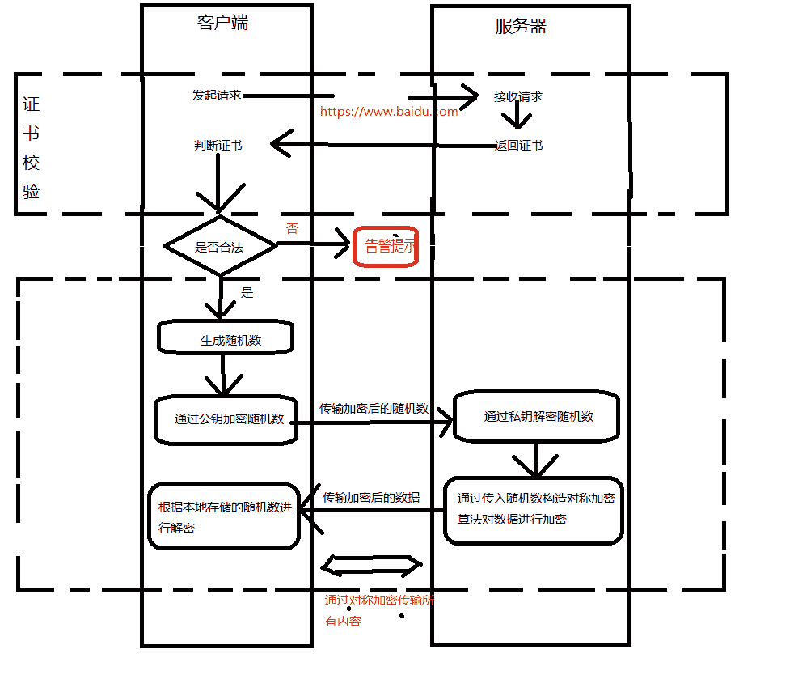
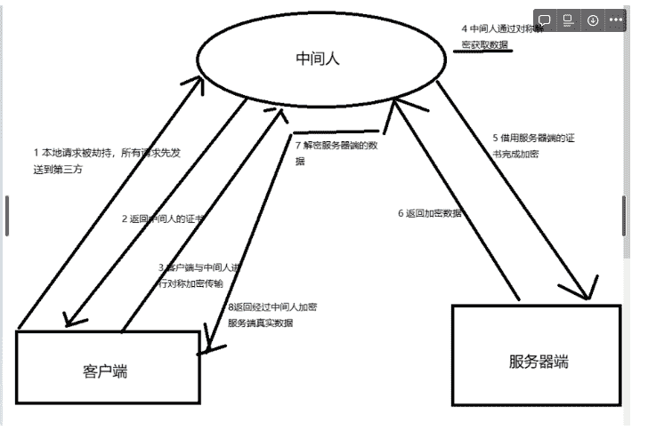

# [Android 原创] HTTPS加密解析

- 原帖：https://www.52pojie.cn/forum.php?mod=viewthread&tid=1809886
- 抓取时间：2026-11-01T21:41:36

## HTTPS加密解析

## HTTPS灵魂拷问

- 1 为什么用了HTTPS就是安全的
- 2 HTTPS底层原理如何实现
- 3 用了HTTPS就一定安全吗

## 一、HTTPS实现原理

> HTTPS在内容传输的加密上使用的是对称加密，非对称加密只作用在证书验证阶段。

- HTTPS的整体过程分为证书校验和数据传输阶段 具体交互过程如下

- 证书校验阶段
  - 1 客户端发起HTTPS请求
  - 2 服务器返回HTTPS证书
  - 3 客户端验证证书是否合法 不合法提示告警
- 数据传输阶段
  - 1 当证书验证通过后，在客户端本地生成随机数
  - 2 通过公钥加密随机数，并把加密后的随机数传输到服务器端‘
  - 3 服务器端通过私钥对随机数进行解密
  - 4 服务器端通过客户端传入的随机数构造对称加密算法 对返回结果内容加密后进行传输

## 二、为什么数据传输使用对称加密？

- 首先：非对称加密的加密效率非常低，而http的应用场景通常端与端之间存在大量的交互，非对称加密的效率是无法接受的
- 另外：在HTTPS的场景中只有服务器端保存了私钥，一对公私钥只能实现单向的加解密，所以HTTPS中内容传输加密采用的是对称加密

## 三、为什么需要CA认证机构颁发证书

- 为了防止中间人攻击
- 具体过程如下：

- 流程：
  - 1 本地请求被劫持（DNS劫持等），所有请求均发送到中间人的服务器
  - 2 中间人服务器返回中间人自己的证书】
  - 3 客户端创建随机数 通过中间人证书的公钥对随机数加密后传送给中间人，然后凭随机数构造的对称加密对传输内容进行加密传输
  - 4 中间人因为拥有客户端的随机数，可以通过对称加密算法进行内容解密
  - 5 中间人以客户端的请求内容再向正规网站发起请求
  - 6 因为中间人与服务器的通信过程是合法的 正规网站通过建立的安全通道返回加密后的数据
  - 7 中间人凭借与正规网站建立的对称加密算法对内容进行解密
  - 8 中间人通过与客户端建立的对称加密算法对正规网站返回的数据进行加密传输
  - 9 客户端通过与中间人建立的对称加密算法对返回结果数据进行解密

## 四、如何保证CA证书的合法性？

### 4.1 证书包含什么信息

- 1 颁发机构信息
- 2 公钥
- 3 公司信息
- 4 域名
- 5 有效期
- 6 指纹
- 7 。。。。

### 4.2 证书的合法性依据

- 1）首先：权威机构是要有认证的，不是随便一个机构都有资格颁发证书，不然也不叫做权威机构；
- 2）另外：证书的可信性基于信任制，权威机构需要对其颁发的证书进行信用背书，只要是权威机构生成的证书，我们就认为是合法的。

所以权威机构会对申请者的信息进行审核，不同等级的权威机构对审核的要求也不一样，于是证书也分为免费的、便宜的和贵的。

### 4.3 浏览器如何验证证书的合法性

浏览器发起HTTPS请求时，服务器会返回网站的SSL证书，浏览器需要对证书做以下验证：

- 1 验证域名、有效期等信息是否正确
- 2 判断证书来源是否合法，每份签发证书都可以根据验证链找到对应的根证书，操作系统、浏览器会在本地存储权威机构的根证书，利用本地根证书可以对对应机构签发证书完成来源验证
- 3 判断证书是否被篡改，需要与CA服务器进行校验
- 4 判断证书是否吊销：通过CRL （Certificate Revocation List 证书注销列表） 和 OCSP （Online Certificate Status Protocol在线证书状态协议 ） 实现 ，其中 OCSP 可用于第3步中以减少与 CA 服务器的交互，提高验证效率。
- 以上任意一步都满足的情况下浏览器才认为证书是合法的。
- 既然证书是公开的，如果要发起中间人攻击，我在官网上下载一份证书作为我的服务器证书，那客户端肯定会认同这个证书是合法的，如何避免这种证书冒用的情况？
- 其实这就是非加密对称中公私钥的用处，虽然中间人可以得到证书，但私钥是无法获取的，一份公钥是不可能推算出其对应的私钥，中间人即使拿到证书也无法伪装成合法服务端，因为无法对客户端传入的加密数据进行解密。

## 五、本地随机数被窃取怎么办

- 证书的校验使用非对称加密实现，数据传输使用对称加密实现，其中的对称加密算法中重要的随机数是由本地生成并且存储本地的
- HTTPS并不包含对随机数的安全保证，HTTPS保证的知识传输过程的安全，而随机数存储在本地，本地的安全属于另一安全范畴，应对的措施有安装杀毒软件、反木马、浏览器升级修复漏洞等。

## 六、用了HTTPS会被抓包吗

- HTTPS的数据是加密的 常规下抓包工具代{过}{滤}理请求后抓到的包内容是加密状态 无法直接查看
- 解决方法：使用抓包工具生成一个证书安装到客户端中，模拟中间人攻击
- 既然会被抓包 那么HTTPS有什么意义？
- HTTPS可以防止用户在不知情的情况下通信链路被监听，对于主动授权证书抓包操作是不提供防护的，因为这个场景用户是已经对风险知情。
- 要防止被抓包 需要采用应用级的安全防护，例如采用私有的对称加密，同时做好移动端的反编译加固，防止本地算法被破解

## 七、本文小结

- Q HTTPS为什么安全？
- 因为HTTPS保证了传输安全，防止传输过程中被监听，防止数据被窃取，可以确认网站的真实性。
- Q HTTPS的传输过程是怎样的？
- 客户端发起HTTPS请求，服务端返回证书，客户端校验证书合法性，校验成功生成随机数，通过证书中的公钥对随机数进行加密传输给服务器端，服务器端使用私钥解密得到随机数，然后使用解密后的随机数构造对称加密算法，将加密后的数据返回给客户端，
- Q 为什么使用证书？
- 防止中间人攻击
- Q 使用HTTPS会被抓包吗
- 会，HTTPS只防护用户在不知情的情况下通信被监听，主动安装证书授权可以进行解密抓包。
- Q HTTPS使用的是对称加密还是非对称加密
- HTTPS在内容传输过程中使用的是对称加密，在证书校验阶段使用的是非对称加密。
