# [Android 原创] 对比法偷师破解某电路仿真软件

- 原帖：https://www.52pojie.cn/forum.php?mod=viewthread&tid=1811551
- 抓取时间：2026-11-01T21:41:27

## 前言

先编个小故事，一直在用某电路仿真软件，奈何网上只有老版本的破解资源，强迫症追新。然而这软件没破解=没法用，自己破吧，学艺不精不会搞，想买正版吧，又不支持蓝绿万能修改器。一直处于搁置状态。

昨天突然想到一个思路，版本相近的软件一般不会改动验证的地方，那么我可不可以通过对比老版本大佬们修改的地方，应用到新版本呢？然后我就去试了一下，结果还真行。

本文使用工具：

- MT管理器（或者同样dex解包的软件）
- Beyond Compare（可选，或上边那个开会员，或同样文件对比工具）
- JEB（可选，第一个工具也行，反编译java用，只看smali的话甚至记事本都行）

apk需要：老版本纯净破解（不加弹窗，没加固的），同版本的原文件，新版本文件

## 操作步骤

### 筛选文件

首先是筛选改动的文件，使用MT或同类工具将原版和破解版dex转为smali，分别放在两个文件夹里，（这里使用`pojie`代表破解版本文件夹，`yuan`代表原版）然后可以使用两种方法来分辨。

#### 1. 使用终端模拟器

进入`pojie`文件夹，然后输入命令计算每个文件的`md5`：

```
find ./ -type f -print0| xargs -0 md5sum >>../md5.md5
```

接着进入`yuan`文件夹里，输入命令验证`md5`：

```
md5sum -c ../md5.md5 | grep -v OK >>../test
```

然后就可以在上层文件夹找到`test`文件，打开就可以显示出来哪个文件被改动了。

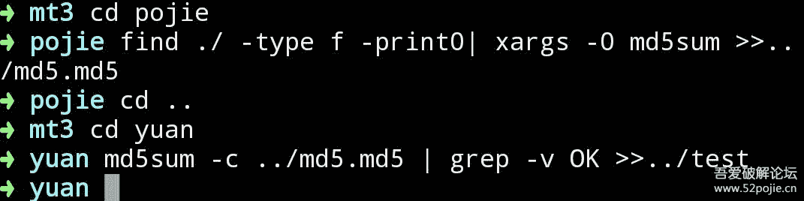
[附件链接](https://www.52pojie.cn/forum.php?mod=attachment&aid=MjYyODgyOXxlZTA4MzhlOXwxNzkzNTY5Mjg1fDE2ODA4NnwxODExNTUx&nothumb=yes)（2023-7-22 16:11 上传）

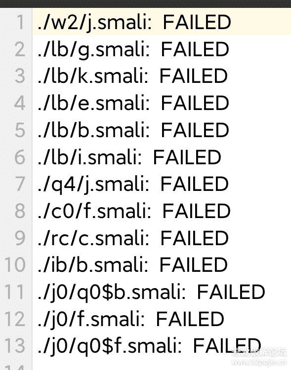
[附件链接](https://www.52pojie.cn/forum.php?mod=attachment&aid=MjYyODgzMHw4NzJlODFjYXwxNzkzNTY5Mjg1fDE2ODA4NnwxODExNTUx&nothumb=yes)（2023-7-22 16:11 上传）

#### 2. 使用 Beyond Compare

文件夹比较，拖入`yuan`和`pojie`，点击规则，取消比较时间戳，勾选比较内容，按确定即可。

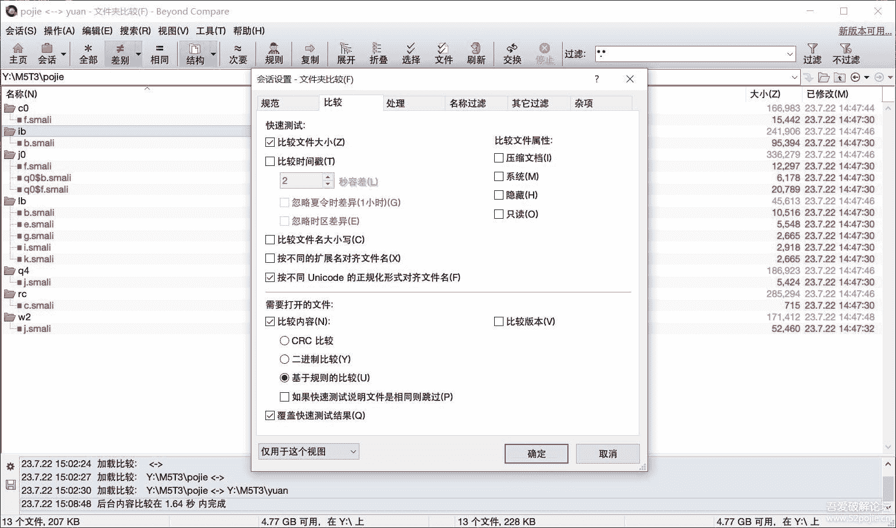
[附件链接](https://www.52pojie.cn/forum.php?mod=attachment&aid=MjYyODgzMXw5MzI0Y2Y3ZXwxNzkzNTY5Mjg1fDE2ODA4NnwxODExNTUx&nothumb=yes)（2023-7-22 16:11 上传）

### 进一步筛选文件

通过对比，筛选出一部分文件，挨个点开看看，有的长这样，很明显这种改动是无效的，又可以筛掉一部分了。

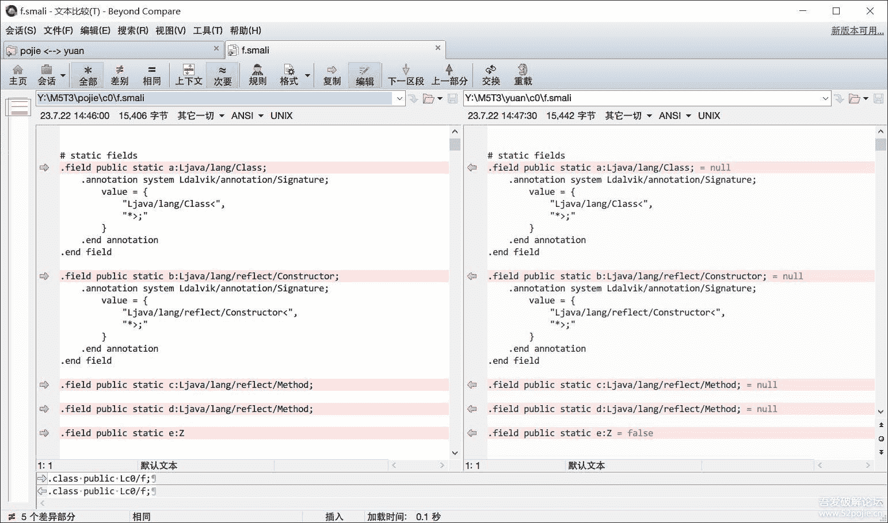
[附件链接](https://www.52pojie.cn/forum.php?mod=attachment&aid=MjYyODgzMnwyOTYwMDQ0MXwxNzkzNTY5Mjg1fDE2ODA4NnwxODExNTUx&nothumb=yes)（2023-7-22 16:11 上传）

删掉多余的，剩下这几个文件

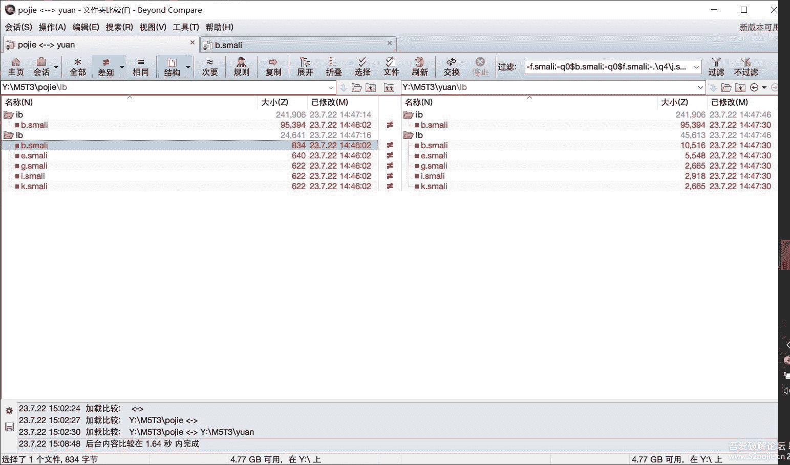
[附件链接](https://www.52pojie.cn/forum.php?mod=attachment&aid=MjYyODgzM3w0NjZmZDVkZXwxNzkzNTY5Mjg1fDE2ODA4NnwxODExNTUx&nothumb=yes)（2023-7-22 16:11 上传）

### 分析改动

文件太多，`lb`里的内容改动相同，所以举个例子，打开`lb/b.smali`，破解的内容是

```
sget-object p1, Llb/l;->A:Llb/l;
return-object p1
```

而原版是有一大堆判断的。

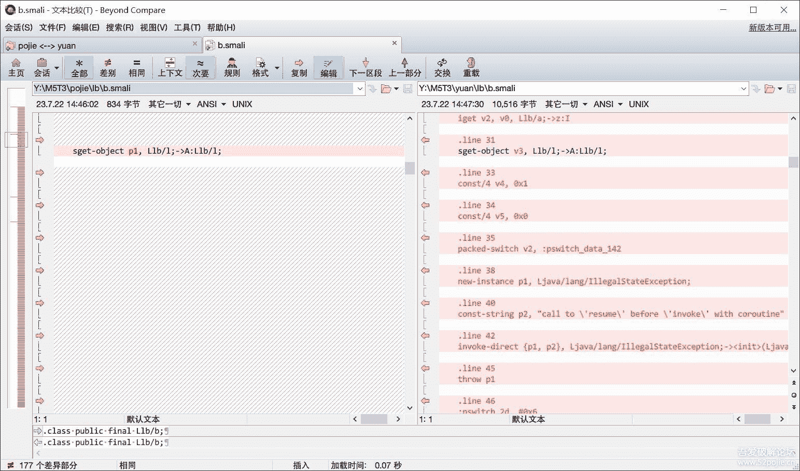
[附件链接](https://www.52pojie.cn/forum.php?mod=attachment&aid=MjYyODgzNHxiNDIzNDA4M3wxNzkzNTY5Mjg1fDE2ODA4NnwxODExNTUx&nothumb=yes)（2023-7-22 16:11 上传）

使用JEB打开原版apk和新版本的apk，你会发现，两个版本包名打乱不相同，那么怎么找到是哪一个呢。

点开`lb/a.smali`，发现有一下字符串

```
f = "ComponentIapValidator.kt"
```

用这个足以定位新版本的位置了。

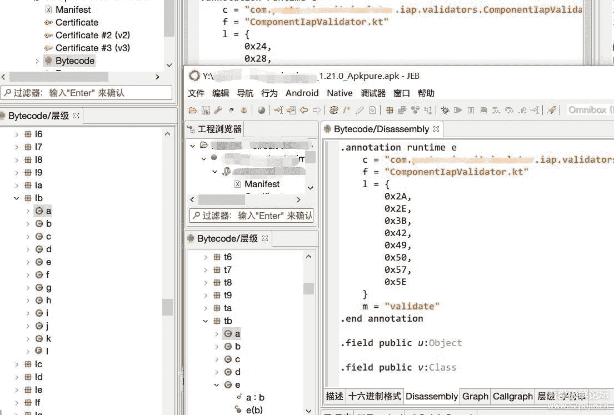
[附件链接](https://www.52pojie.cn/forum.php?mod=attachment&aid=MjYyODgzNXw4YjcyYzEzY3wxNzkzNTY5Mjg1fDE2ODA4NnwxODExNTUx&nothumb=yes)（2023-7-22 16:11 上传）

话说回来，在JEB中定位`lb/b`文件，按`tab`反编译一个java看看。（这里需要会一点点java）

从右边可以看到，某些条件下，返回`l0`，而`l0`就是破解版改动的`Llb/l;->A:Llb/l;`

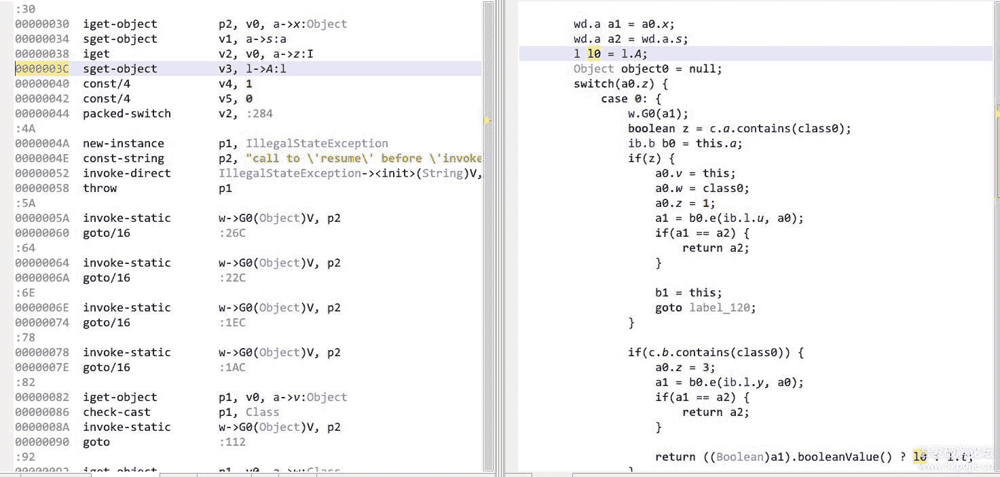
[附件链接](https://www.52pojie.cn/forum.php?mod=attachment&aid=MjYyODgzNnxhYTRjOWI3OXwxNzkzNTY5Mjg1fDE2ODA4NnwxODExNTUx&nothumb=yes)（2023-7-22 16:11 上传）

然后在看新版的，可以看到，新版需要改成以下代码

```
sget-object p1, Llb/l;->B:Llb/l;
return-object p1
```

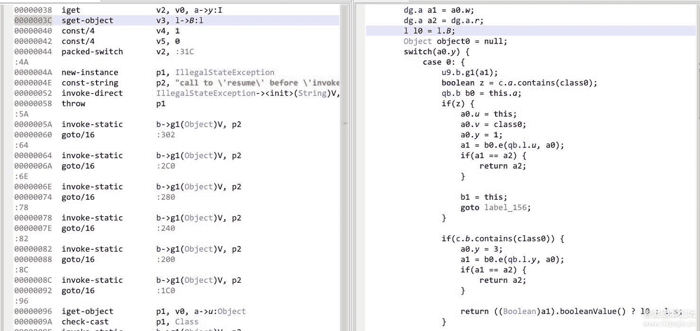
[附件链接](https://www.52pojie.cn/forum.php?mod=attachment&aid=MjYyODgzN3w2Y2E2MjBhNHwxNzkzNTY5Mjg1fDE2ODA4NnwxODExNTUx&nothumb=yes)（2023-7-22 16:11 上传）

如此改动其他smali回编即可。

（`ib/b.smail`，只改动了一个值，需要联系上下文来判断新版本具体改哪句）

### 破解后效果

#### 原版

原版集成电路里只有3个，其他的需要购买扩展包

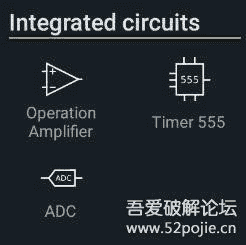
[附件链接](https://www.52pojie.cn/forum.php?mod=attachment&aid=MjYyODgzOXxjMTBkNDM0ZHwxNzkzNTY5Mjg1fDE2ODA4NnwxODExNTUx&nothumb=yes)（2023-7-22 16:11 上传）

#### 破解版

破解后可用使用所有扩展

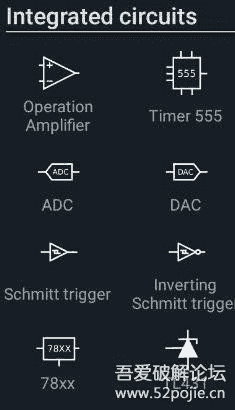
[附件链接](https://www.52pojie.cn/forum.php?mod=attachment&aid=MjYyODg0MHw1OTlhN2JlYXwxNzkzNTY5Mjg1fDE2ODA4NnwxODExNTUx&nothumb=yes)（2023-7-22 16:11 上传）

## 结语

本文写的比较混乱，只是想做一个备忘。另外本文只提供思路，无法提供练手文件。希望对您能有所帮助，如果看不懂的话，也不用怎么细看，本来就是一种取巧的方法，局限性非常大，甚至有可能只有这个软件可以使用。作者不懂安卓，具体展开讲smali和java什么的也不会，只能演示一下操作给大家看看了。想学安卓逆向的话，论坛还是有不少0基础教学贴的，可以看看了解一下入个门。当然如果本文有错误之处，还请大佬们多多指教。
