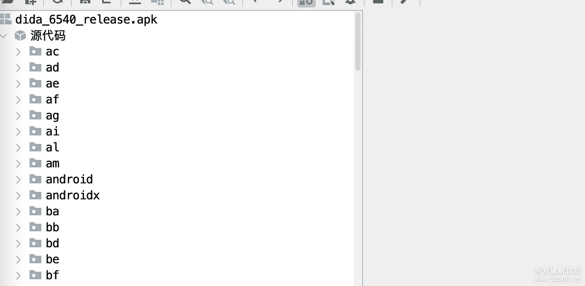
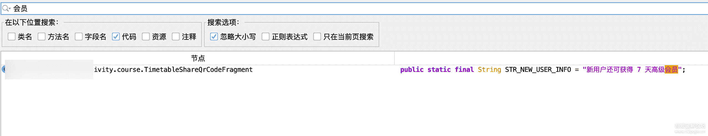
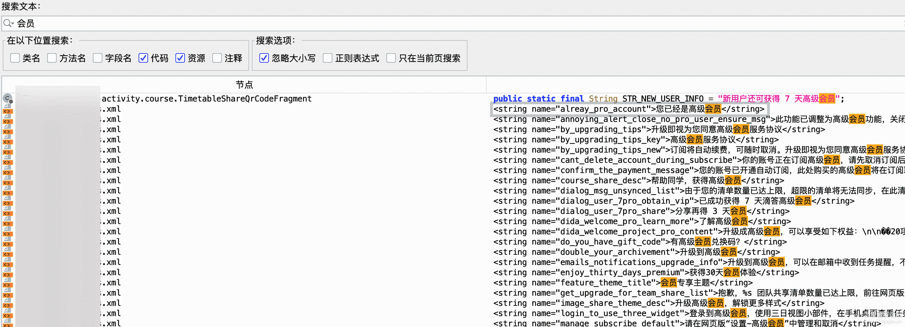
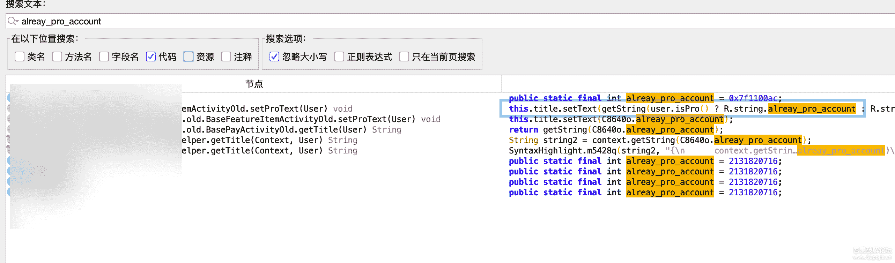
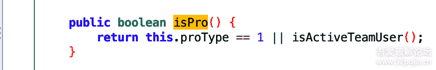
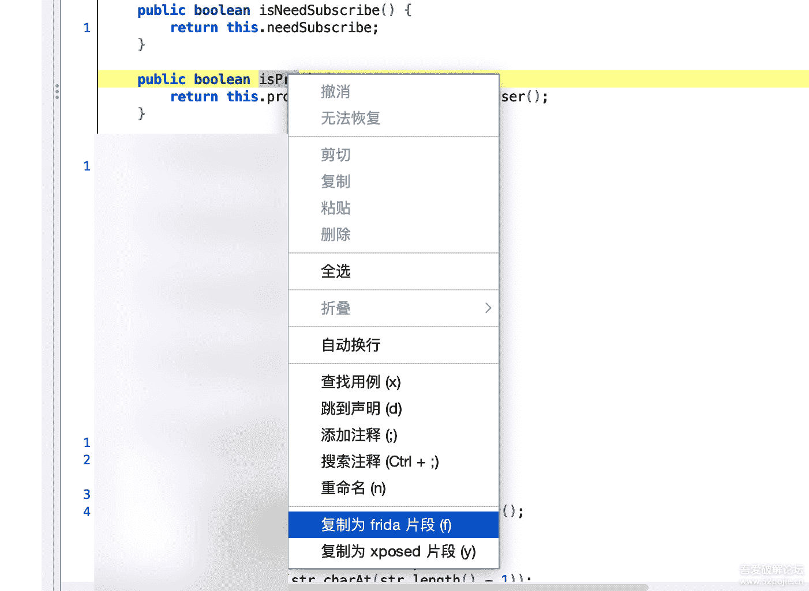
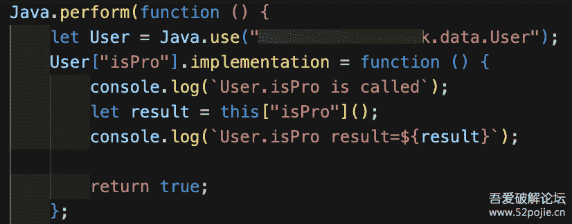
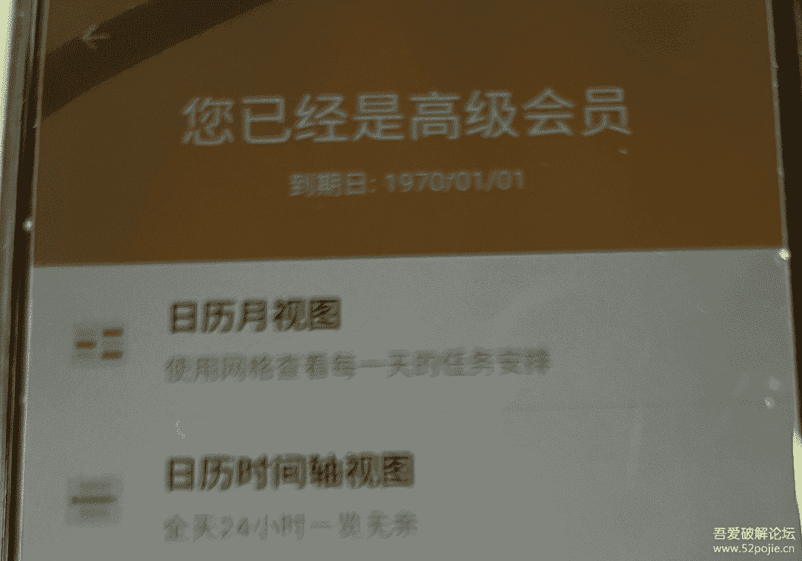

# [Android 原创] 使用`frida`获取滴答xx6.5.4.0本地会员

- 原帖: https://www.52pojie.cn/forum.php?mod=viewthread&tid=1814416
- 抓取时间: 2026-11-01T21:41:22

首先提供帖子来源：

[滴答清单6.6.7.0-巧用MT管理器解锁本地会员](https://www.52pojie.cn/thread-1814157-1-1.html)

写帖子目的只是为了折腾练习`frida`，不是为了其他，看帖主教程感觉很简单，所以过来尝试一下。

## 第一步：下载 App

去官网下载，通过二维码只下载到了6.5.4.0版本，故就用这个版本进行处理。

## 使用`jadx`解压apk数据包

混淆的很好，下次别混淆了，挨个翻的话是真难，还好我用搜索。



直接搜索会员，只找到了这一处，看来要看一下xml文件，说不等能给我点指引。



搜索会员，勾选资源，现在有了好多处。找一下什么字段标志着已经有了会员。

现在的思路是：是否是会员-》会员判断，通过修改判断条件或者判断结果来达到冒充会员的目的。

根据思路找到了这个字段`alreay_pro_account`。



搜索这个字段看看能否关联判断条件。找到如下判断条件，我感觉已经很近了。



跳转到相关方法进行测试。



右键复制出来`frida`脚本。使用脚本进行测试。







貌似已经获得了会员，回顾了一下，跟帖子来源走的是一套方法，那应该就没问题了。

有兴趣就去自行尝试，代码如下：

```
Java.perform(function () {
    let User = Java.use("xxxxxx.data.User");
    User["isPro"].implementation = function () {
        console.log(`User.isPro is called`);
        let result = this["isPro"]();
        console.log(`User.isPro result=${result}`);
        return true;
    };
});
```
