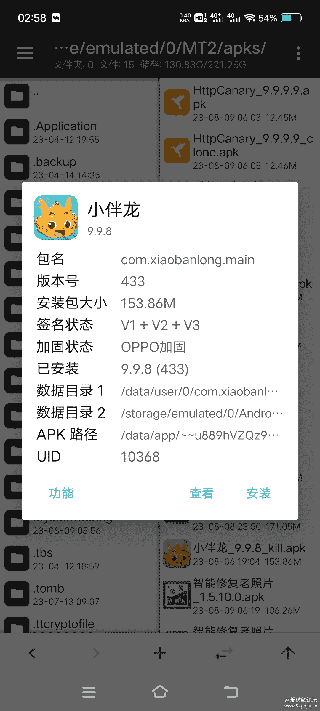
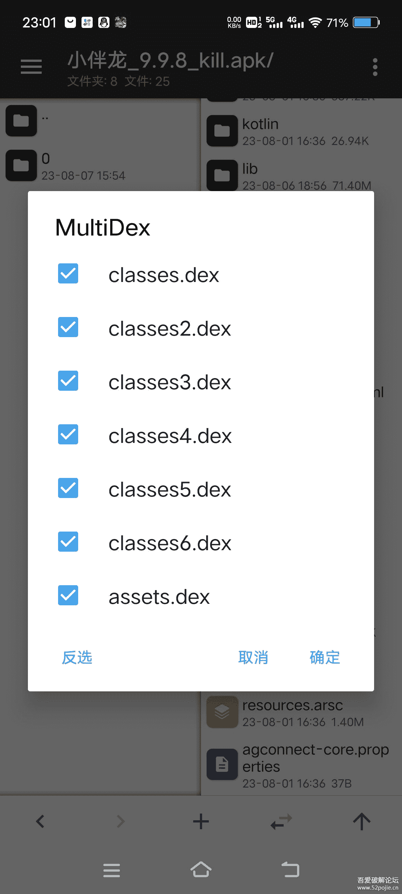
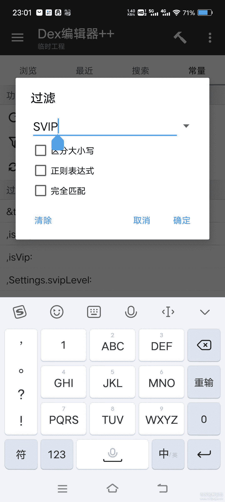
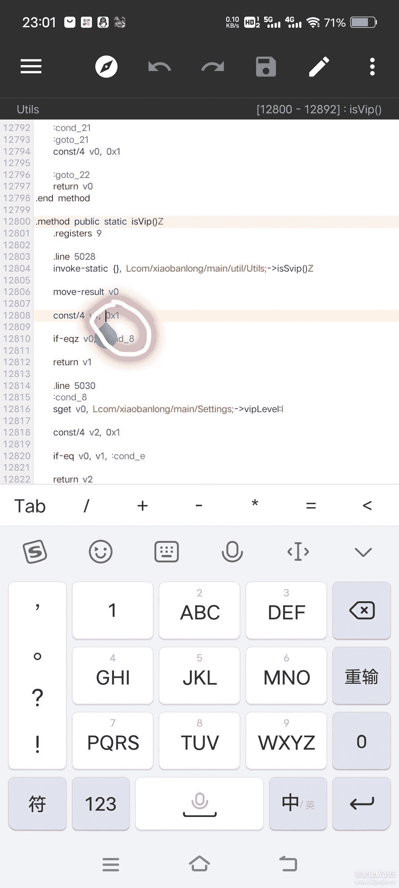

# [Android 原创] 小伴龙破解过程

- 原帖：[`https://www.52pojie.cn/forum.php?mod=viewthread&tid=1819391`](https://www.52pojie.cn/forum.php?mod=viewthread&tid=1819391)
- 抓取时间：2026-11-01T21:41:00

新手第一次[`//www.52pojie.cn`](https://www.52pojie.cn)，之前一定要对原版去签名验证，这点很重要，否则会闪退。

## 第一步：提取安装包

在 `MT2` 最新版中，提取安装包，找到安装包，点击“查看”按钮，打开安装包。

`Screenshot_20230810_025817.jpg`（231.97 KB，下载次数：2）

[附件下载](https://www.52pojie.cn/forum.php?mod=attachment&aid=MjYzNTQxN3w3MWVmOTEzMXwxNzkzNTY5MjU4fDE2ODA4NnwxODE5Mzkx&nothumb=yes)

2023-8-13 20:46 上传

## 第二步：选择 Dex 文件

找到 `dex` 文件，点击“选Dex编辑器++”，这里有 `dex` 文件，全选都打勾，然后点击“确定”。

`Screenshot_20230808_230154.jpg`（157.51 KB，下载次数：1）

[附件下载](https://www.52pojie.cn/forum.php?mod=attachment&aid=MjYzNTQxOHxhMTcxZTEzN3wxNzkzNTY5MjU4fDE2ODA4NnwxODE5Mzkx&nothumb=yes)

2023-8-13 20:46 上传

打开后，上面右侧“常量”里面有个“过滤”。搜索 `SVIP`。

点搜索，出现下图：

`Screenshot_20230808_230138.jpg`（172.86 KB，下载次数：1）

[附件下载](https://www.52pojie.cn/forum.php?mod=attachment&aid=MjYzNTQxOXwyNzZmMzU5MXwxNzkzNTY5MjU4fDE2ODA4NnwxODE5Mzkx&nothumb=yes)

2023-8-13 20:46 上传

`Screenshot_20230808_230052.jpg`（128.99 KB，下载次数：1）

[附件下载](https://www.52pojie.cn/forum.php?mod=attachment&aid=MjYzNTQyMXxlNDg2NzQzZnwxNzkzNTY5MjU4fDE2ODA4NnwxODE5Mzkx&nothumb=yes)

2023-8-13 20:47 上传

## 第三步：修改标记值

打开吧，标记处 `0x0` 改成 `0x1`，我这里已经改好了。

`IMG_20230810_031237.jpg`（198.13 KB，下载次数：2）

[附件下载](https://www.52pojie.cn/forum.php?mod=attachment&aid=MjYzNTQyMnxjZDJlN2QyYnwxNzkzNTY5MjU4fDE2ODA4NnwxODE5Mzkx&nothumb=yes)

2023-8-13 20:47 上传

好了，保存，退出自动编译。
