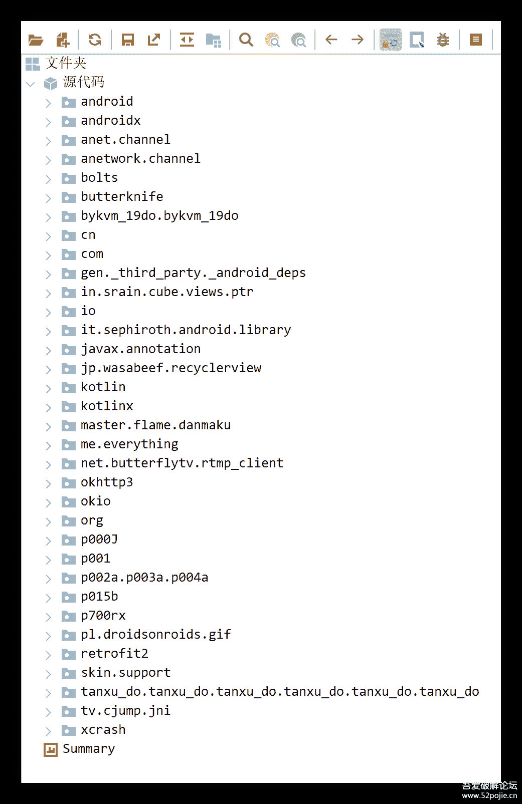
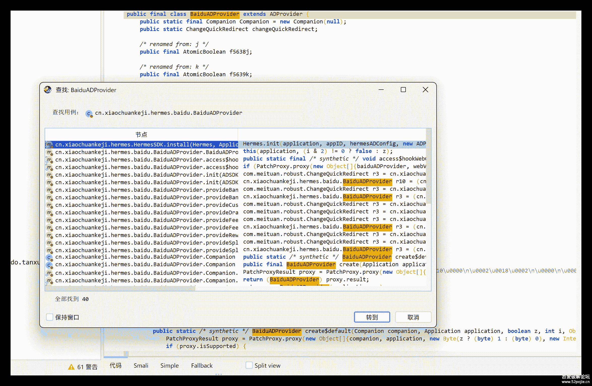
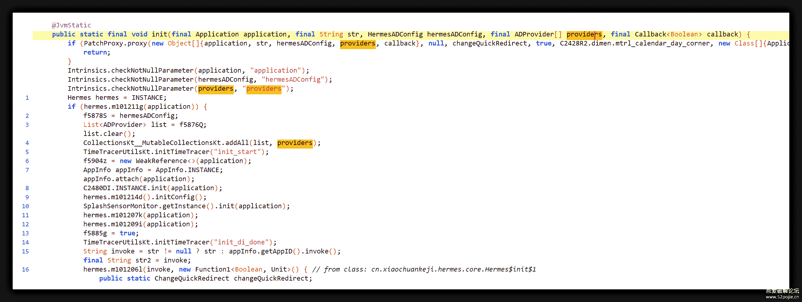
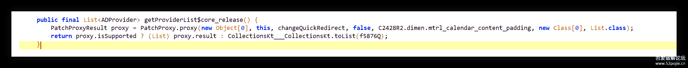
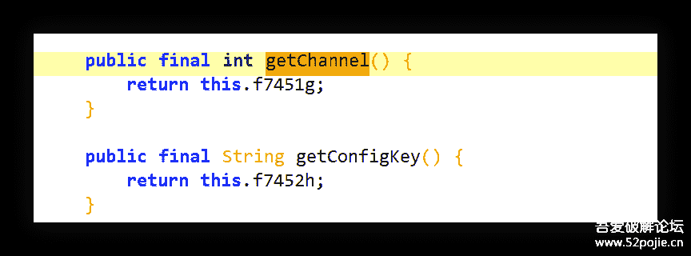
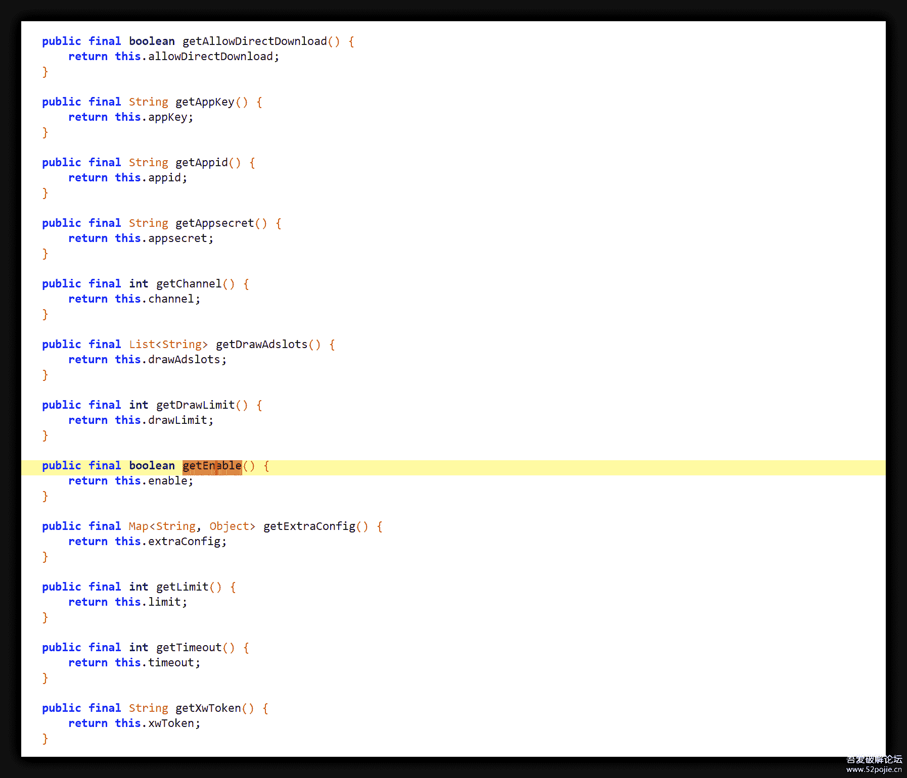
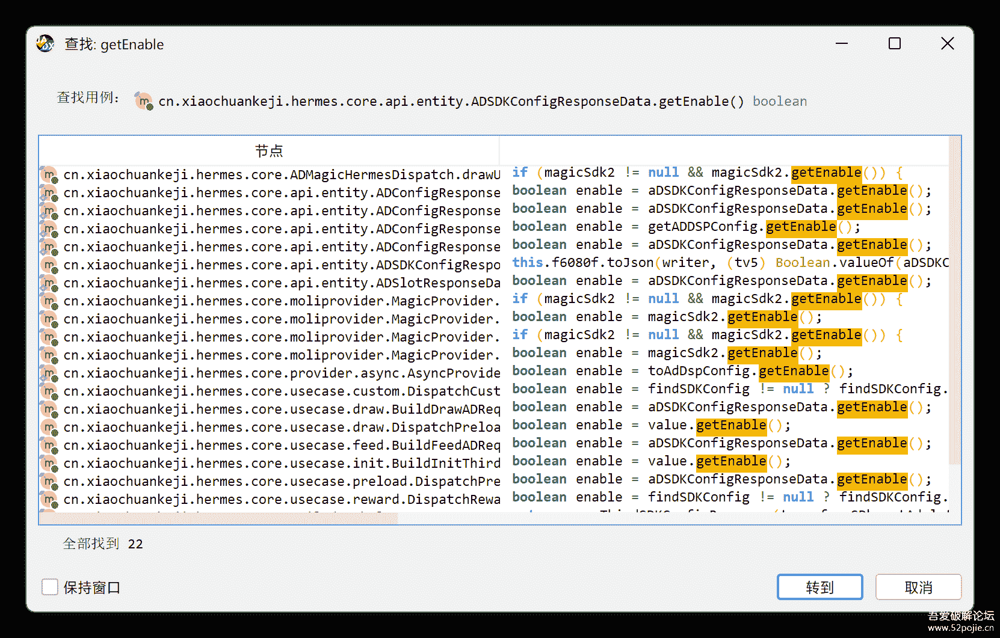
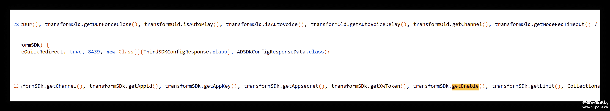
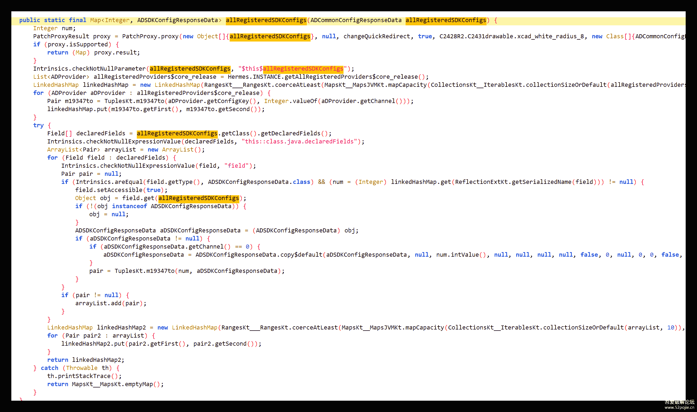

# [Android 原创] 某右的五种去广告思路暨 YukiHook 简介

- 原帖：`https://www.52pojie.cn/forum.php?mod=viewthread&tid=1821144`
- 抓取时间：2026-11-01T21:40:54

## 一、前言

在许多情况下，对一个软件进行 hook 有许多不同的角度。优秀的 hook 往往具有代码简洁且高度适应性的特点，能够在相当长的一段时间内适应原始软件的更新而不需要频繁修改。例如我之前的 [anti-dingtalk-recall](https://github.com/kazutoiris/anti-dingtalk-recall) 仅使用不到 50 行代码就实现了功能，而且无需任何修改就已经适应了足足超过一年的版本更新。因此，hook 可以被视为一门精炼的艺术。本文旨在以点带面，提供多种思路供学习，通过小范例展示如何做到在不同层面上实现 hook，从而达到事半功倍的效果。

`YukiHookAPI` 是一个基于 Kotlin 的 hook 框架，它为实现精巧的 hook 功能和便捷的异常捕捉提供了强大支持。可以毫不夸张地称之为现代 hook 技术的首选之一。而在吾爱破解中似乎尚未有文章详细介绍这个强大的框架。

## 二、简介

某右是一款社交媒体应用，用户可以在平台上分享短视频、图片和文字，展示自己的创意和生活。用户可以互动，通过点赞、评论和分享来表达对内容的喜爱。此外，某右也提供了关注功能，用户可以关注感兴趣的其他用户，及时获取他们的更新内容。这款 APP 通过个性化的推荐算法，向用户推荐符合其兴趣的内容，使用户能够更好地发现有趣的话题和创作者。

鉴于某右 APP 存在大量广告，其中包括开屏广告、信息流广告以及评论区广告等形式，为提升使用体验，采取 hook 技术，以有效清除这些广告干扰。

## 三、工具

- `jadx`：`https://github.com/skylot/jadx`
- Android Studio
- `YukiHookAPI`：`https://github.com/fankes/YukiHookAPI`

## 四、实现思路

### 1. 小试牛刀

现在用 `jadx` 加载导出的 `dex` 文件，在左边可以加载出所有的类。`dex` 文件可以用 `frida` 等得到，这里就不再赘述。



[下载附件](https://www.52pojie.cn/forum.php?mod=attachment&aid=MjYzNTY1NnxlZGZiOTdhNHwxNzkzNTY5MjUyfDE2ODA4NnwxODIxMTQ0&nothumb=yes)

2023-8-14 21:08 上传

那么，这么多的类中哪一个才是我们需要的呢？

首先，已知的情况是：广告都是由各种广告商提供并推送的。因此，如果一个软件能够显示广告，那么显然它已经集成了各类广告 SDK。

于是，第一个思路就呼之欲出了：直接 hook 掉广告的 SDK 就可以了。



[下载附件](https://www.52pojie.cn/forum.php?mod=attachment&aid=MjYzNTY1N3xiMjNhZDZjN3wxNzkzNTY5MjUyfDE2ODA4NnwxODIxMTQ0&nothumb=yes)

2023-8-14 21:08 上传

通过搜索，很容易就找到了 `BaiduADProvider`，这便是百度广告。通过搜索引用，可以发现，在 `cn.xiaochuankeji.hermes.HermesSDK.install` 使用了这一个类。

```java
public static final void install(Hermes install, Application application, String appID, HermesADConfig hermesADConfig, boolean z, Callback callback) {
        if (PatchProxy.proxy(new Object[]{install, application, appID, hermesADConfig, new Byte(z ? (byte) 1 : (byte) 0), callback}, null, changeQuickRedirect, true, C2428R2.attr.tabContentStart, new Class[]{Hermes.class, Application.class, String.class, HermesADConfig.class, Boolean.TYPE, Callback.class}, Void.TYPE).isSupported) {
            return;
        }
        Intrinsics.checkNotNullParameter(install, "$this$install");
        Intrinsics.checkNotNullParameter(application, "application");
        Intrinsics.checkNotNullParameter(appID, "appID");
        Intrinsics.checkNotNullParameter(hermesADConfig, "hermesADConfig");
        Hermes.init(application, appID, hermesADConfig, new ADProvider[]{PangleADProvider.Companion.create$default(PangleADProvider.Companion, application, z, null, 4, null), TencentADProvider.Companion.create(application, z), MimoADProvider.Companion.create(application, z), XinguADProvider.Companion.create(application, z), KuaishouADProvider.Companion.create$default(KuaishouADProvider.Companion, application, z, null, 4, null), (ADProvider) JingdongADProvider.Companion.create$default(JingdongADProvider.Companion, application, z, (InfoProvider) null, 4, (Object) null), XcADProvider.Companion.create$default(XcADProvider.Companion, application, z, null, 4, null), BJXinguADProvider.Companion.create(application, z), BaiduADProvider.Companion.create(application, z), QuMengADProvider.Companion.create(application, z), GroMoreADProvider.Companion.create(application, z), TanxADProvider.Companion.create(application, z)}, callback);
    }
```

可以看到，在第 9 行初始化了 `PangleADProvider`、`TencentADProvider`、`MimoADProvider`、`XinguADProvider`、`KuaishouADProvider`、`JingdongADProvider`、`XcADProvider`、`BaiduADProvider`、`QuMengADProvider`、`GroMoreADProvider`、`TanxADProvider`。



[下载附件](https://www.52pojie.cn/forum.php?mod=attachment&aid=MjYzNTY1OHw5MGVlM2I4Y3wxNzkzNTY5MjUyfDE2ODA4NnwxODIxMTQ0&nothumb=yes)

2023-8-14 21:09 上传

那么思路就是清空 `providers`。

但是问题来了，怎么清空呢？由于 `ADProvider[]` 是一种不可变类型，所以是没有 `clear()` 方法的，因此直接操作传入参数不太方便。

于是，看到第 3 行，`provider` 转换为 `MutableList` 并保存在 `f5876Q` 中。`MutableList` 就可变了，内置了 `clear()` 方法，这可比改传入参数方便多了。那么，这时候可以在 `afterHook` 通过反射调用 `f5876Q` 的 `clear()` 方法。

不过，这样写并不优雅，以下提供了一小段 Java 伪代码。

```java
Class c = XposedHelpers.findClass("cn.xiaochuankeji.hermes.core.Hermes", lpparam.classLoader);
Field field = XposedHelpers.findField(c, "Q");
field.setAccessible(true);
field.clear()
```

可以看到这段代码有两个问题：

- 代码行数太多，调用 `clear()` 就 1 行，却使用了 3 行来搜索 `field`。
- `Q` 会随着版本更新或者加壳混淆工具的升级而自动重命名，并不具有通用性。例如重新加壳说不定就变成 `R` 等等了。

通过查找引用，在不远的之前可以找到一个函数 `getProviderList$core_release`，这个函数会返回同样的变量。



[下载附件](https://www.52pojie.cn/forum.php?mod=attachment&aid=MjYzNTY1OXxkOTc3MmE0MXwxNzkzNTY5MjUyfDE2ODA4NnwxODIxMTQ0&nothumb=yes)

2023-8-14 21:09 上传

在这里，一方面是不用再通过反射调用 `clear()`，其 `result` 原生就支持 `clear()`；另一方面，这个函数名是加壳混淆不会进行修改的，因此具有一定的通用性。

```kotlin
"cn.xiaochuankeji.hermes.core.Hermes".hook {
    injectMember {
        method {
            name = "getProviderList\$core_release"
        }
        afterHook {
            (result as MutableList).clear()
        }
    }.onAllFailure {
        loggerE(msg = "Hook getProviderList fail: ${it.message}")
    }
}
```

以上代码通过一行就直接清空了，代码相当的少。

### 2. 换个角度

首先，已知的情况是：广告都是由各种广告商提供并推送的。因此，如果一个软件能够显示广告，那么显然它已经集成了各类广告 SDK。

现在来想这么一个问题：如果要接入广告需要怎么做？是不是需要登录广告商官网，注册账户，获取广告位 ID，然后将 SDK 集成到应用代码中，按照指南进行配置和调用。

那么，如果没有进行正确的配置，SDK 不就不能拉取到广告了嘛。

于是，很容易的就找到了配置的位置。



[下载附件](https://www.52pojie.cn/forum.php?mod=attachment&aid=MjYzNTY2MHw3ODk4MTExY3wxNzkzNTY5MjUyfDE2ODA4NnwxODIxMTQ0&nothumb=yes)

2023-8-14 21:09 上传

直接返回为空就可以了，这样广告 SDK 就没办法获得正确的配置，也就无法展示广告了。

这种 hook 方式比之前虽然代码量增加了，但是写起来更为干净，只需要处理基本的数据结构，而不需要进行 `List` 等等类的处理。

```kotlin
"cn.xiaochuankeji.hermes.core.provider.ADProvider".hook {
    injectMember {
        method {
            name = "getChannel"
        }
        beforeHook {
            result = 0
        }
    }.onAllFailure {
        loggerE(msg = "Hook getChannel fail: ${it.message}")
    }
}

"cn.xiaochuankeji.hermes.core.provider.ADProvider".hook {
    injectMember {
        method {
            name = "getConfigKey"
        }
        beforeHook {
            result = ""
        }
    }.onAllFailure {
        loggerE(msg = "Hook getConfigKey fail: ${it.message}")
    }
}
```

### 3. 看看有没有更简单的

其实上下翻一翻代码，不远处可以看到一个 `getEnable()` 方法。



[下载附件](https://www.52pojie.cn/forum.php?mod=attachment&aid=MjYzNTY2MXxiOGVmMTZlZHwxNzkzNTY5MjUyfDE2ODA4NnwxODIxMTQ0&nothumb=yes)

2023-8-14 21:10 上传

首先，需要确认以下这个方法有没有被使用。往往 IDE 会自动生成所有字段的 `getter/setter` 方法，有些不一定会用到。所以不能够盲目地 hook。




`image-20230814203423225.png` (214.09 KB, 下载次数: 1)

[下载附件](https://www.52pojie.cn/forum.php?mod=attachment&aid=MjYzNTY2MnxmYjEyOTM4M3wxNzkzNTY5MjUyfDE2ODA4NnwxODIxMTQ0&nothumb=yes)

2023-8-14 21:10 上传

检查引用可以看到，这个方法确实被使用，而且被用于状态切换。如果没有被设置为启用，就不会加载。所以直接 hook 这个方法，返回 `false` 就行了。

因此，可以写出新的代码。新的代码就比上面更少了。

```
"cn.xiaochuankeji.hermes.core.api.entity.ADSDKConfigResponseData".hook {
    injectMember {
        method {
            name = "getEnable"
        }
        replaceToFalse()
    }.onAllFailure {
        loggerE(msg = "Hook getEnable fail: ${it.message}")
    }
}
```

### 4. 看一看赋值的来源

查找一下引用就可以找到，在 `new ADSDKConfigResponseData` 传入的 `enable` 来自于 `transformSDk.getEnable()`。



`image-20230814204052998.png` (43.52 KB, 下载次数: 1)

[下载附件](https://www.52pojie.cn/forum.php?mod=attachment&aid=MjYzNTY2M3w0MzQxY2FiYXwxNzkzNTY5MjUyfDE2ODA4NnwxODIxMTQ0&nothumb=yes)

2023-8-14 21:10 上传

所以，直接 hook 掉 `transformSDk.getEnable()` 比前面更为彻底。尽管代码行数没有任何变化，但是覆盖面要比前面的广。

```
"cn.xiaochuankeji.hermes.core.api.entity.ThirdSDKConfigResponse".hook {
    injectMember {
        method {
            name = "getEnable"
        }
        replaceToFalse()
    }.onAllFailure {
        loggerE(msg = "Hook getEnable fail: ${it.message}")
    }
}
```

### 5. 从热更新就拦截

其实，上面七七八八说了一大堆，都是得调用类的一些方法才可以达到效果。假如没有任何类，即下发的配置为空，那不就没有上面这么多事了。



`image-20230814204642521.png` (214.76 KB, 下载次数: 0)

[下载附件](https://www.52pojie.cn/forum.php?mod=attachment&aid=MjYzNTY2NHwyNjM2NTU2ZXwxNzkzNTY5MjUyfDE2ODA4NnwxODIxMTQ0&nothumb=yes)

2023-8-14 21:11 上传

于是，可以直接 hook 掉 `allRegisteredSDKConfigs`，使得返回的每次都是空的字典对。

```
"cn.xiaochuankeji.hermes.core.api.entity.ADConfigResponseDataKt".hook {
    injectMember {
        method {
            name = "allRegisteredSDKConfigs"
            paramCount = 1
        }
        beforeHook {
            result = emptyMap()
        }
    }.onAllFailure {
        loggerE(msg = "Hook allRegisteredSDKConfigs fail: ${it.message}")
    }
}
```

## 五、为什么使用 `YukiHookAPI`

```
package com.xxx.adfree

import com.highcapable.yukihookapi.annotation.xposed.InjectYukiHookWithXposed
import com.highcapable.yukihookapi.hook.factory.configs
import com.highcapable.yukihookapi.hook.factory.encase
import com.highcapable.yukihookapi.hook.log.loggerE
import com.highcapable.yukihookapi.hook.xposed.proxy.IYukiHookXposedInit

@InjectYukiHookWithXposed
object HookEntry : IYukiHookXposedInit {
    override fun onInit() = configs {
        isDebug = false
    }

    override fun onHook() = encase {
        loadApp("xxx") {
            "yyy".hook {
                injectMember {
                    method {
                        name = "getEnable"
                    }
                    replaceToFalse()
                }.onAllFailure {
                    loggerE(msg = "Hook getEnable fail: ${it.message}")
                }
            }
        }
    }
}
```

以上代码通过 `YukiHookAPI` 完整的实现了一个 hook 的方式。可以看出，相比于原始的 Xposed 的方式，它可以自动管理包名，不需要手动修改 `array.xml` 来管理适配应用。而且写法也比较符合正常语言书写逻辑，不需要提供参数的具体类型，只要提供数量即可。错误捕捉日志打印也比较现代化，可以说一用就回不去了。

## 六、横向对比

目前已有的一些项目是通过 hook 每一个广告 SDK 的 `init` 方法实现的，代码行数比较多。而且，一旦广告 SDK 增加或删除就需要修改代码，不太能跟随原始软件的版本更新而保持通用，在最新版就已经失效了。

在我的仓库 [//github.com/kazutoiris/zuiyou-adfree](https://github.com/kazutoiris/zuiyou-adfree) 中将五种方法全部都开启了。实际上，采用任何一种都足以达到最后的效果。可以看到，我上文所写的每一种方法代码都只有 ~10 行左右，并没有使用任何的 magic number，通用性也应当会好很多。

欢迎各位 Issue、 Pull Requests、 Star、 Fork。
