# [Android 原创] 小程序游戏破解括弧新人之路（二），最详解反编译

- 原帖: https://www.52pojie.cn/forum.php?mod=viewthread&tid=1822825
- 抓取时间: 2026-11-01T21:40:48

上一篇帖子讲述了运用 `fiddler` 和 `postman` 进行抓包和发包修改未加密小程序游戏里的数据

相关软件已经传在上一个帖子中，如有需要请移步

小程序游戏括弧新人之路，最详解

https://www.52pojie.cn/thread-1822624-1-1.html

(出处: 论坛)

实战案例异常难找，大多数的小程序游戏要么是加密，要么是存储在本地

接下来就是如何处理加密的小程序游戏

这就好比如给你一道高数题

你觉得是从答案逆推过程容易，还是在过程中算出答案容易？

显而易见，我们需要从小程序的源代码中推出来加密的方法

而反编译便是得出源代码的其中一个途径

站中我看到已经有了几个有关反编译的帖子，奈何年代久远

我测试了几个，几乎都会出现各种问题

于是我整合了一下，问了几个大哥，梳理出几种方法

故本文的核心是如何进行反编译，至于解密稍后再说。

## 正文来啦

## 一：微信电脑版的准备

### 1. 微信→设置→文件管理→打开文件夹

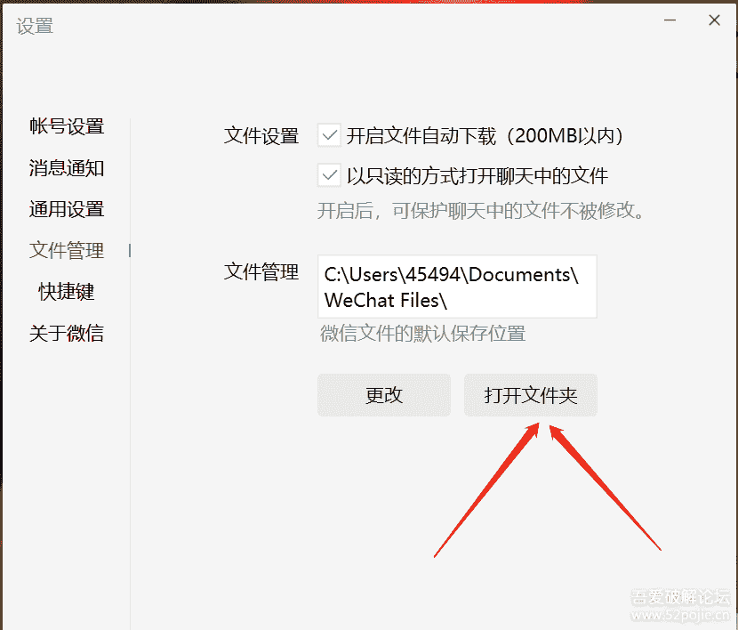

找到 `applet` 文件夹→里面的东西全部删掉

这就是个缓存啥都不影响，方便我们下次寻找

### 2. 这里我以大麦网为例子

点开你要反编译的小程序→尽量全部页面均打开一次→回到 `applet` 文件夹找到新生成的文件

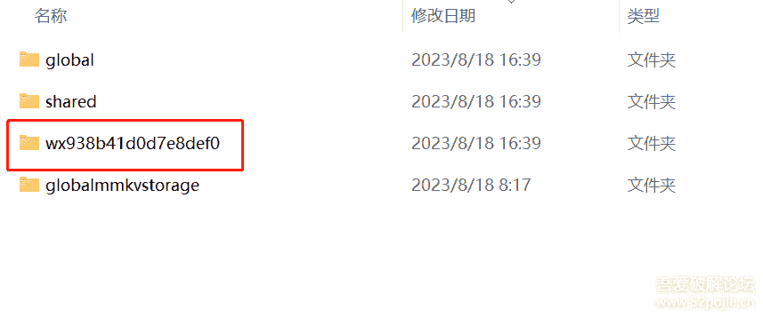

这个便是我们所要小程序的加密文件了

### 3. 对加密文件进行解密

前人栽树后人乘凉，站里有好多解密的软件，在此先谢过大佬们的成果了

#### 1）第一个软件

链接：https://pan.baidu.com/s/1Wpgv64olo3nWSkN-3ZsI2w?pwd=ttzj

提取码：ttzj

链接：https://pan.quark.cn/s/2f006b76c5e3

提取码：i8E9

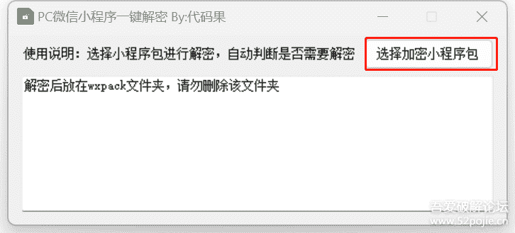

选择刚才生成的文件直接解密就行

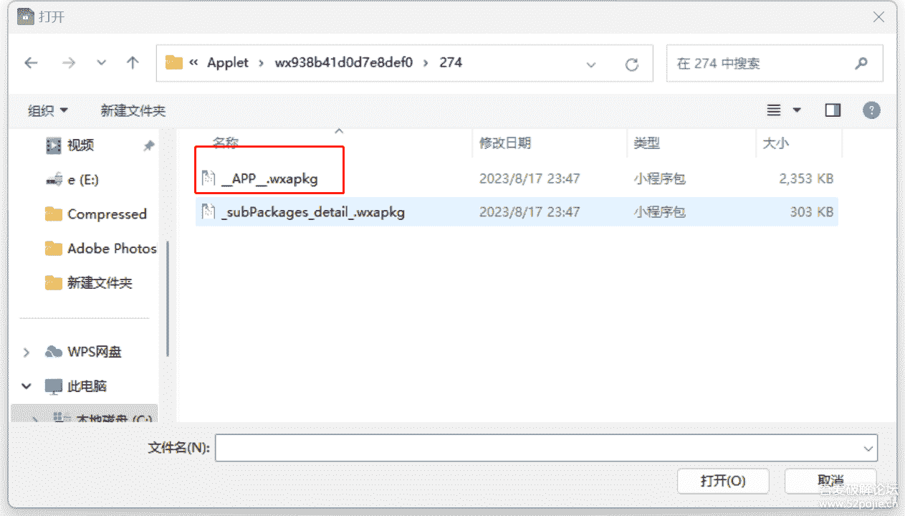

注意：此软件同目录下须创建一个 `wxpack` 为名字的文件夹，否则会报错

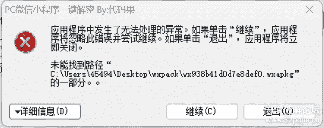

#### 2）第二个软件

链接：https://pan.baidu.com/s/1vrFdaL8gR4qJXYbFYqithQ?pwd=gt4b

提取码：gt4b

这个压缩包里面东西挺多我就直接在盘里面分享了，不给大家夸克网盘共享了

怕少打包东西导致用不了，百度网盘低速下载耐心一下

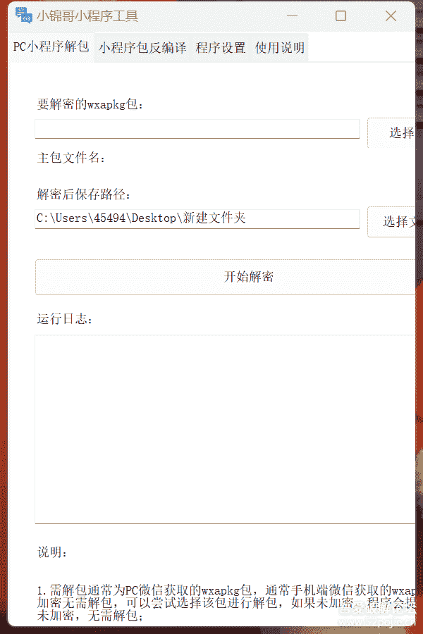

用法大同小异，不多赘述了，下面是解密成功后的文件

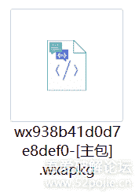

解密告一段落，接下来开始反编译

### 4. 反编译软件的准备

#### 1）`unveilr` 我比较推荐使用这种方法，大部分都能够进行反编译

链接：https://pan.quark.cn/s/695dc52f159f

提取码：D7Ht

链接：https://pan.baidu.com/s/1DZz8UPEyUjG0FvfoLDuGrw?pwd=gwh7

提取码：gwh7

将这个软件与前面解密后的文件放在一个文件夹里

安装 `node.js` 环境，我这里有现成的，怕毁坏只放了百度网盘

链接：https://pan.baidu.com/s/13dxNkvH7hj4ZUJ29n8k9uQ?pwd=ih7m

提取码：ih7m

### 5. 进行反编译

安装后在文件夹里右键→在终端里打开

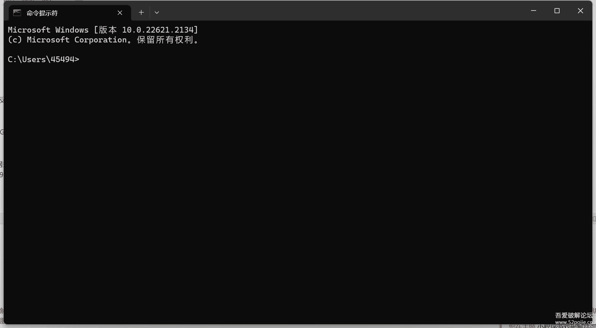

输入 `node -v` 检查一下是否安装上了

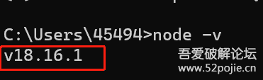

输入 `cd` + 刚才解密之后的文件地址

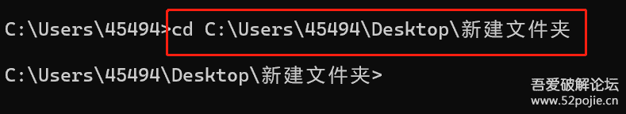

输入 `./unveilr ./解密后文件名字`

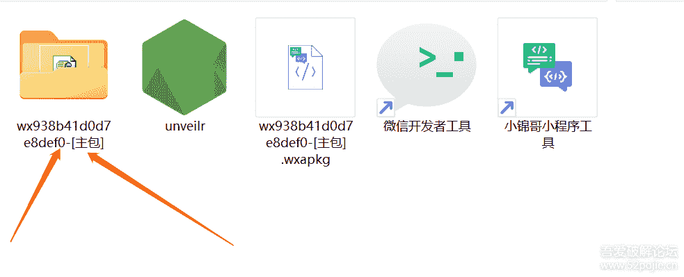

然后你就会发现文件夹里多出来了一个新文件

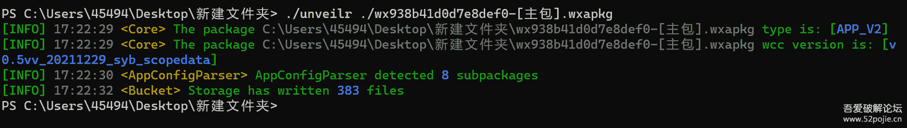

那么恭喜你大功告成了

接着导入微信开发者平台就完成啦

## 接下来是 `cmd` 几个常见报错

- `4048` ------权限不够，开启管理员权限就行
- `Read file error` ----文件不存在，应该是 `cd` 那里没有整好，我重新运行完就好了

其他报错我还没遇到过，欢迎讨论

最后免费评分走一个走一个！

如有不足欢迎指出改正，如有会加密解密大佬，评论区万请赐教，遇到难题了

最后免费评分走一个走一个！

最后免费评分走一个走一个！
