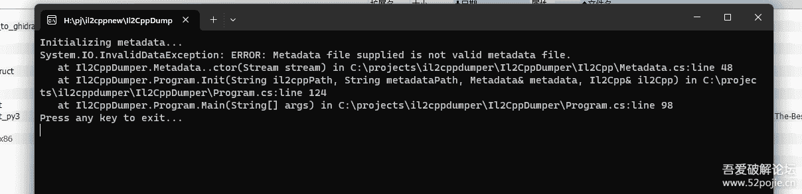
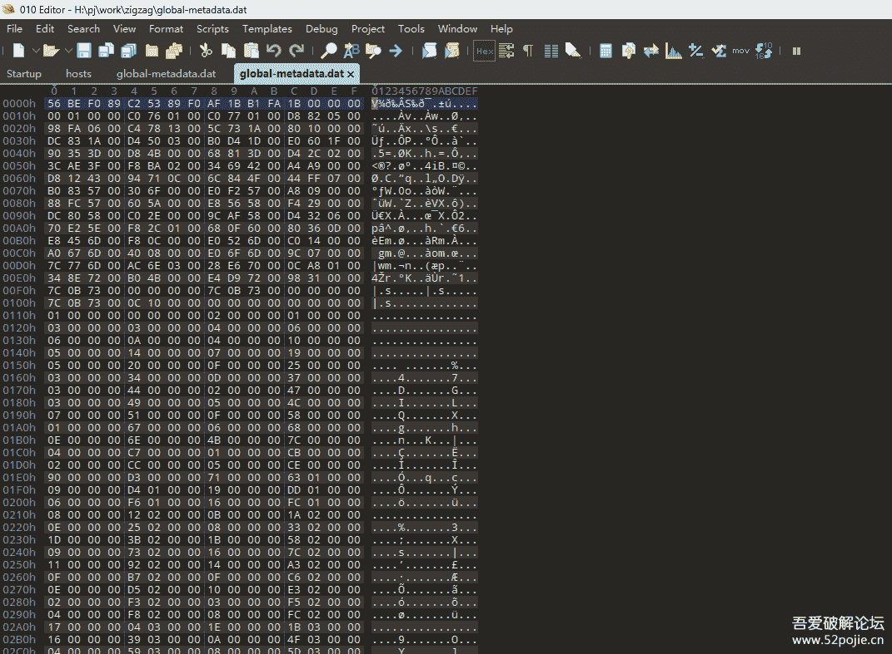
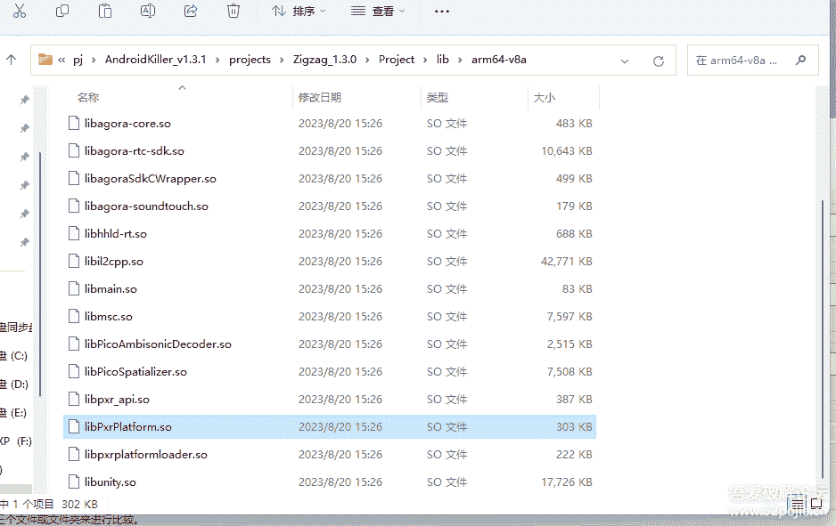
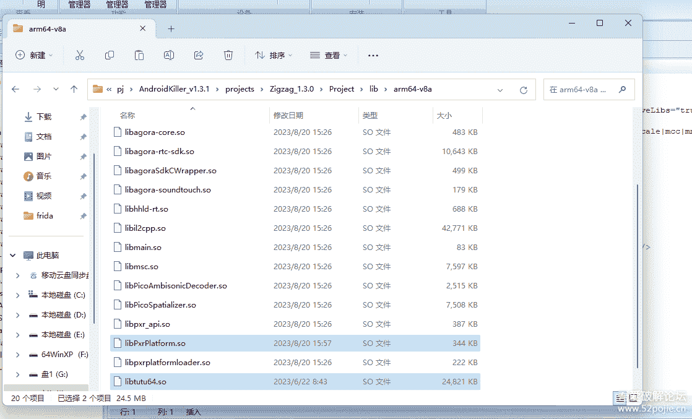
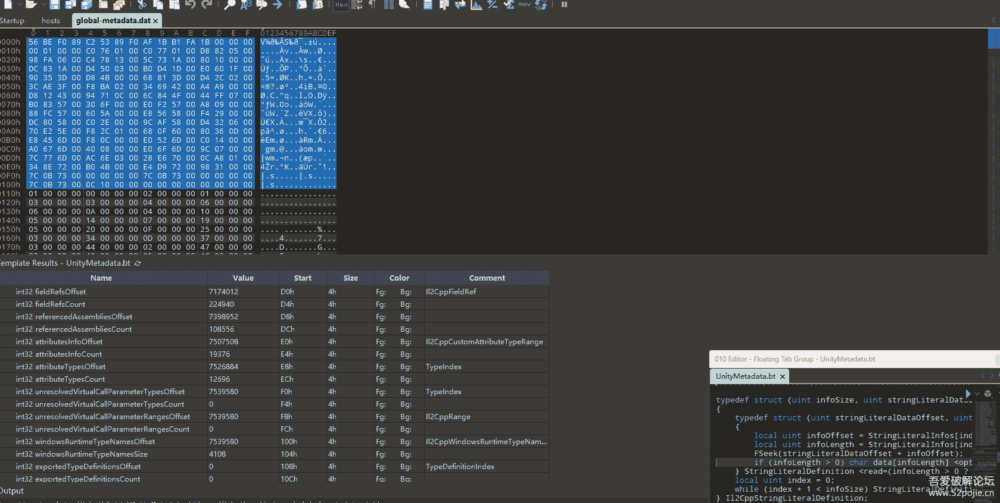
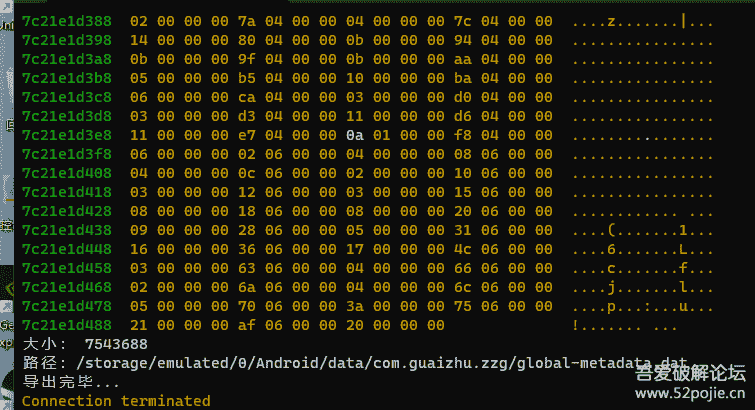
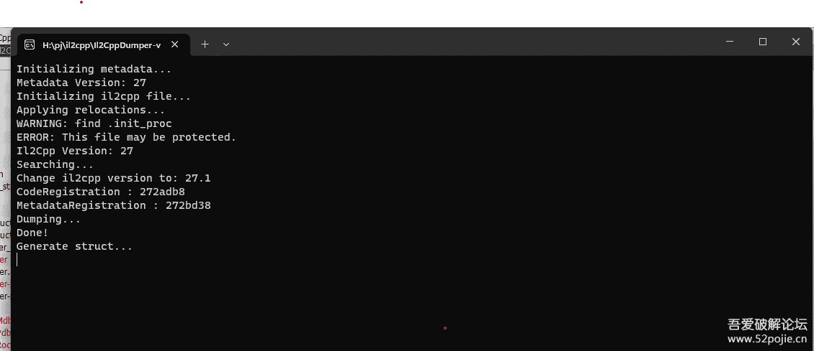

# [Android 原创] 新手向！记一次unity游戏的metadata的解密流水账

- 原帖: https://www.52pojie.cn/forum.php?mod=viewthread&tid=1823445
- 抓取时间: 2026-11-01T21:40:40

最近在练习`i2cpp`

然后发现以下错误



0.png (44.87 KB, 下载次数: 1)

[href="forum.php?mod=attachment&aid=MjYzNzI1Nnw2NjE2OWNlOHwxNzkzNTY5MjM3fDE2ODA4NnwxODIzNDQ1&nothumb=yes" target="_blank"](https://www.52pojie.cn/forum.php?mod=attachment&aid=MjYzNzI1Nnw2NjE2OWNlOHwxNzkzNTY5MjM3fDE2ODA4NnwxODIzNDQ1&nothumb=yes)

2023-8-20 18:10 上传

然后打开

`global-metadata`



3.png (112.78 KB, 下载次数: 1)

[href="forum.php?mod=attachment&aid=MjYzNzI1M3w3YjczYWU4YXwxNzkzNTY5MjM3fDE2ODA4NnwxODIzNDQ1&nothumb=yes" target="_blank"](https://www.52pojie.cn/forum.php?mod=attachment&aid=MjYzNzI1M3w3YjczYWU4YXwxNzkzNTY5MjM3fDE2ODA4NnwxODIzNDQ1&nothumb=yes)

2023-8-20 18:10 上传

发现文件头不是 "`AF 1B B1 FA`";//`global-metadata.dat`头部特征 那么就可以判断 `global-metadata`加密了 那么只能实机内存抠了

先逆向反编译`apk`

随手找个`so`



1.png (68.61 KB, 下载次数: 1)

[href="forum.php?mod=attachment&aid=MjYzNzI1NXxhYmFlNGQxZXwxNzkzNTY5MjM3fDE2ODA4NnwxODIzNDQ1&nothumb=yes" target="_blank"](https://www.52pojie.cn/forum.php?mod=attachment&aid=MjYzNzI1NXxhYmFlNGQxZXwxNzkzNTY5MjM3fDE2ODA4NnwxODIzNDQ1&nothumb=yes)

2023-8-20 18:10 上传

然后注入`fridagadget`// 因为目的实机锁定了不能`root`，无法直接`frida` 所以只能用`gadget` 我是用`pyton`注入的 `python` `h:\pj\frida\inject.py` `h:\pj\frida\libPxrPlatform.so` `libtutu64.so` //后面的`gadget`我为了防检测 改名了



2.png (102.34 KB, 下载次数: 2)

[href="forum.php?mod=attachment&aid=MjYzNzI1NHwzZTFhNGM5M3wxNzkzNTY5MjM3fDE2ODA4NnwxODIzNDQ1&nothumb=yes" target="_blank"](https://www.52pojie.cn/forum.php?mod=attachment&aid=MjYzNzI1NHwzZTFhNGM5M3wxNzkzNTY5MjM3fDE2ODA4NnwxODIzNDQ1&nothumb=yes)

2023-8-20 18:10 上传

把注入之后的 重新拷回去 连带我改名的`gadget`一起 重编译打包 推送到实机安装

运行之后 就来到扣内存环节了 我用的脚本如下

[Java] 纯文本查看 复制代码
```
/*

获取解密后的global-metadata.dat
github:https://github.com/350030173/global-metadata_dump

用法：
frida -U -l global-metadata_dump.js packagename

导出的文件在/data/data/yourPackageName/global-metadata.dat

*/

//
//get_self_process_name()获取当前运行进程包名
//参考：https://github.com/lasting-yang/frida_dump/blob/master/dump_dex_class.js
function get_self_process_name()
{
	var openPtr = Module.getExportByName('libc.so', 'open');
	var open = new NativeFunction(openPtr, 'int', ['pointer', 'int']);

	var readPtr = Module.getExportByName("libc.so", "read");
	var read = new NativeFunction(readPtr, "int", ["int", "pointer", "int"]);

	var closePtr = Module.getExportByName('libc.so', 'close');
	var close = new NativeFunction(closePtr, 'int', ['int']);

	var path = Memory.allocUtf8String("/proc/self/cmdline");
	var fd = open(path, 0);
	if (fd != -1)
	{
		var buffer = Memory.alloc(0x1000);

		var result = read(fd, buffer, 0x1000);
		close(fd);
		result = ptr(buffer).readCString();
		return result;
	}

	return "-1";
}

var pattern = "AF 1B B1 FA";//global-metadata.dat头部特征

function TUMemory()
{
    Java.perform(function ()
    {
        console.log("头部标识:" + pattern);
        var addrArray = Process.enumerateRanges("r--");//使用函数 Process.enumerateRanges('r--') 枚举读出可以读出的内存区块
		
        for (var i = 0; i 
```



4.png (165.33 KB, 下载次数: 2)

[href="forum.php?mod=attachment&aid=MjYzNzI1MnxmZWU2MWQxMHwxNzkzNTY5MjM3fDE2ODA4NnwxODIzNDQ1&nothumb=yes" target="_blank"](https://www.52pojie.cn/forum.php?mod=attachment&aid=MjYzNzI1MnxmZWU2MWQxMHwxNzkzNTY5MjM3fDE2ODA4NnwxODIzNDQ1&nothumb=yes)

2023-8-20 18:10 上传

100h和104h 的值相加就是文件大小 也就是我上面脚本的7543688

然后运行已经注入的`apk` 用`frida -U -l h:\pj\frida\dao.js gadget` 执行一下我们改好的脚本



6.png (65.01 KB, 下载次数: 1)

[href="forum.php?mod=attachment&aid=MjYzNzI1MXwzODIwZWMyZHwxNzkzNTY5MjM3fDE2ODA4NnwxODIzNDQ1&nothumb=yes" target="_blank"](https://www.52pojie.cn/forum.php?mod=attachment&aid=MjYzNzI1MXwzODIwZWMyZHwxNzkzNTY5MjM3fDE2ODA4NnwxODIzNDQ1&nothumb=yes)

2023-8-20 18:10 上传

这样就扣出来了，用扣出来的`metadata`

再次执行`Il2CppDumper`就正常解析了



7.png (43.75 KB, 下载次数: 1)

[href="forum.php?mod=attachment&aid=MjYzNzI4NXw4YzgzYjE0YnwxNzkzNTY5MjM3fDE2ODA4NnwxODIzNDQ1&nothumb=yes" target="_blank"](https://www.52pojie.cn/forum.php?mod=attachment&aid=MjYzNzI4NXw4YzgzYjE0YnwxNzkzNTY5MjM3fDE2ODA4NnwxODIzNDQ1&nothumb=yes)

2023-8-20 18:58 上传
