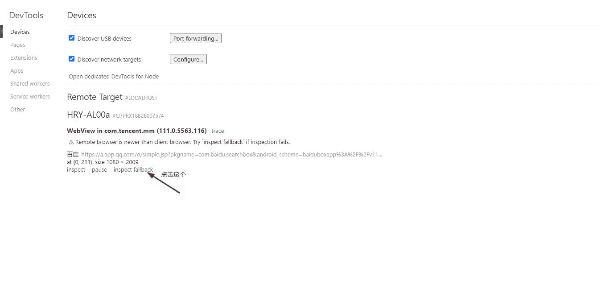
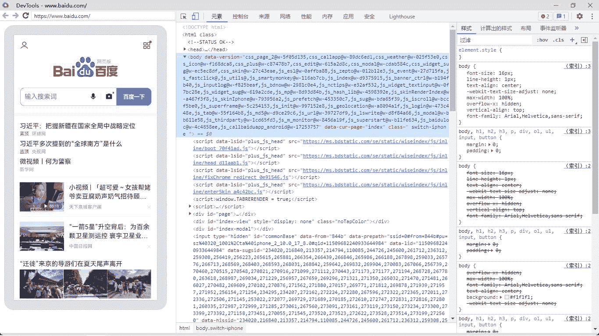

# [Android 分享] [教程] 微信抓不到包？根本不存在！----一招搞定微信内置浏览器抓包

- 原帖：`https://www.52pojie.cn/forum.php?mod=viewthread&tid=1826013`
- 抓取时间：2026-11-01T21:40:35

## 所需工具

1. 一部手机
2. 一台电脑
3. 一条数据线

## 情景模拟

> 某个网页只能在微信中打开，但我想要抓包调试怎么办？

### 1. `HttpCannary`（小黄鸟）

这时候你可能会打开 `HttpCannary`（小黄鸟）。

目标应用选择微信。

回到主界面，点击按钮开始抓包。

打开微信，打开想要的网页。

回到小黄鸟发现抓到的都是 UDP 连接，和网页没有半毛钱关系。

### 2. `fiddler`

打开电脑，手机用数据线连接上。

打开 `fiddler`，配置好端口信息。

手机用微信打开对应的网页。

电脑上 `fiddler` 查看抓到的包。

但是这里只能看到数据包，不方便调试。

### 一招解决以上问题！

## 正文开始

1. 首先用数据线把手机连接到电脑。
2. 手机打开 USB 调试。
3. 手机进入微信，随便打开一个聊天窗口，输入并发送：`http://debugxweb.qq.com/?inspector=true`

   点击打开这个链接，弹出“执行成功”，即可。
4. 手机微信打开想要抓包调试的网页。
5. 电脑上打开 `chrome` 内核的浏览器或 `edge` 浏览器。

   `chrome` 内核的浏览器输入 `chrome://inspect/#devices`

   `edge` 浏览器输入：`edge://inspect/#devices`

   打开后稍等片刻。

   然后在打开的界面中点击这个：

   

   点击后会跳转到这个界面：

   

   到这里你就可以像在电脑浏览器的开发人员工具一样调试这个网页，打断点，审查元素等。

## 最后

这个方法适合电脑群体开发者使用，非常方便！

本文已同步发至作者博客：[教程 - 微信抓不到包？根本不存在！一招搞定微信内置浏览器抓包](https://blog.wystudio.xyz/index.php/2023/08/26/%e6%95%99%e7%a8%8b-%e5%be%ae%e4%bf%a1%e6%8a%93%e4%b8%8d%e5%88%b0%e5%8c%85%ef%bc%9f%e6%a0%b9%e6%9c%ac%e4%b8%8d%e5%ad%98%e5%9c%a8%ef%bc%81-%e4%b8%80%e6%8b%9b%e6%90%9e%e5%ae%9a%e5%be%ae%e4%bf%a1/)（无联系方式）
