# [Android 原创] 某Q阅读免广告领取奖励思路

- 原帖：[https://www.52pojie.cn/forum.php?mod=viewthread&tid=1826731](https://www.52pojie.cn/forum.php?mod=viewthread&tid=1826731)
- 抓取时间：2026-11-01T21:40:30

## 某Q阅读 8.0.2-900 免广告领取奖励思路

> 仅供学习研究，请勿用于其他用途!!!

### 用到的工具

- 任意反编译 Apk 的工具：Jeb、MT管理器2（反编译分析用）
- 开发者助手（类似“可查看当前页面”功能的都可）
- 谷歌浏览器
- 某Q阅读

### 定位 `WebView` 中的交互函数

使用开发者助手，已知调用界面为 `WebBrowserForFullScreenContents`，并且具体由 `WebView` 展示界面。

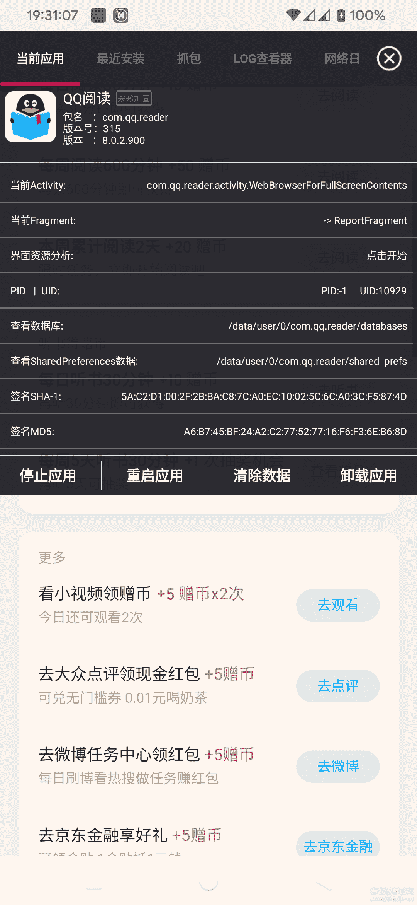

`0-0.png`（368.67 KB，下载次数：0；2023-8-28 21:01 上传） [附件下载](https://www.52pojie.cn/forum.php?mod=attachment&aid=MjYzOTQ1OXxiMmZlMzk2N3wxNzkzNTY5MjI4fDE2ODA4NnwxODI2NzMx&nothumb=yes)

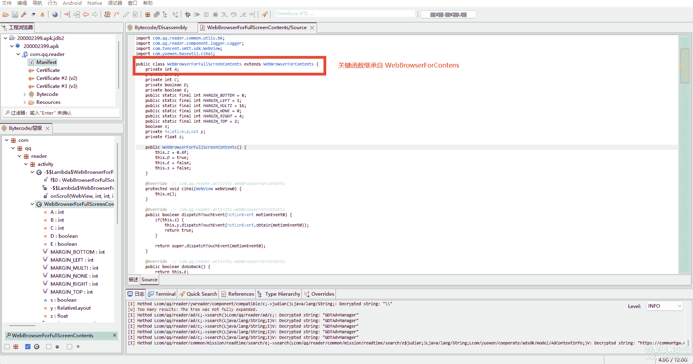

`0-1.png`（161.85 KB，下载次数：0；2023-8-28 21:01 上传） [附件下载](https://www.52pojie.cn/forum.php?mod=attachment&aid=MjYzOTQ2MHwxMGIyNWQ5YnwxNzkzNTY5MjI4fDE2ODA4NnwxODI2NzMx&nothumb=yes)

这个类没有什么有用的信息，关键都在父类，暂时先不管。

手机启用开发者调试，连上电脑，打开谷歌浏览器，输入（这是基于谷歌浏览器的调试 Web 页面）：`chrome://inspect/#devices`。

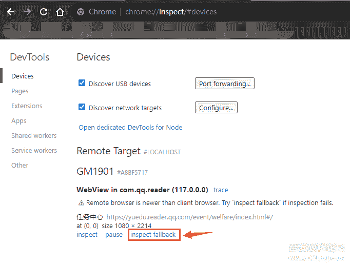

`1-0.png`（46.34 KB，下载次数：0；2023-8-28 21:01 上传） [附件下载](https://www.52pojie.cn/forum.php?mod=attachment&aid=MjYzOTQ2M3xkODQ0NTJmMHwxNzkzNTY5MjI4fDE2ODA4NnwxODI2NzMx&nothumb=yes)

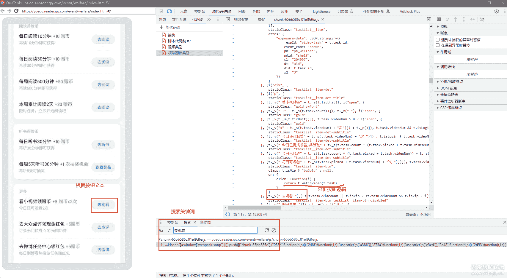

`1-1.png`（350.5 KB，下载次数：0；2023-8-28 21:01 上传） [附件下载](https://www.52pojie.cn/forum.php?mod=attachment&aid=MjYzOTQ2NHw1YTcwOGZjOXwxNzkzNTY5MjI4fDE2ODA4NnwxODI2NzMx&nothumb=yes)

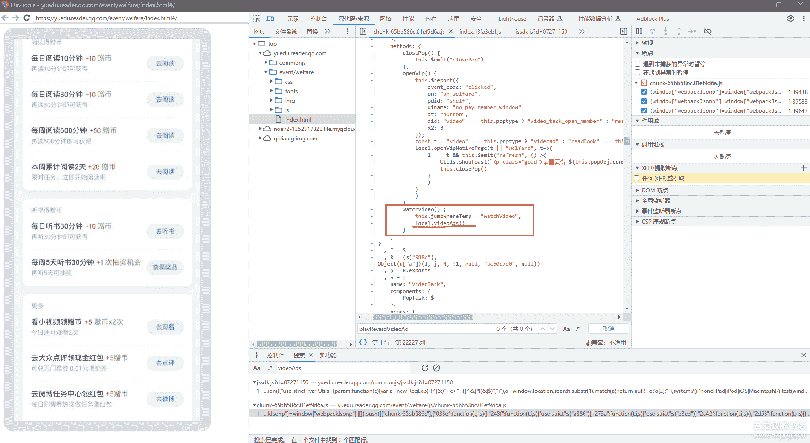

`1-2.png`（352.85 KB，下载次数：0；2023-8-28 21:01 上传） [附件下载](https://www.52pojie.cn/forum.php?mod=attachment&aid=MjYzOTQ2NXw3MzBkZjdmN3wxNzkzNTY5MjI4fDE2ODA4NnwxODI2NzMx&nothumb=yes)

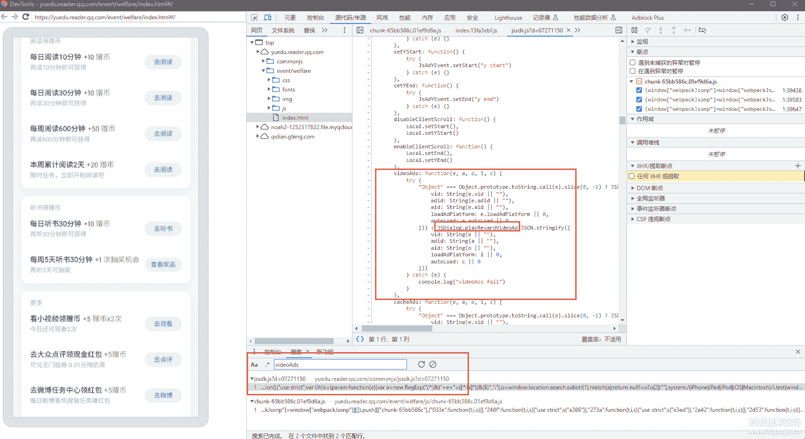

`1-3.png`（356.99 KB，下载次数：0；2023-8-28 21:01 上传） [附件下载](https://www.52pojie.cn/forum.php?mod=attachment&aid=MjYzOTQ2Nnw5YTNkZTI5ZXwxNzkzNTY5MjI4fDE2ODA4NnwxODI2NzMx&nothumb=yes)

### 分析交互函数

发现这里是和 Andorid 交互的一个函数。

在 Jeb 中全局搜索 `JSDialog`，找到了同名函数的调用位置。

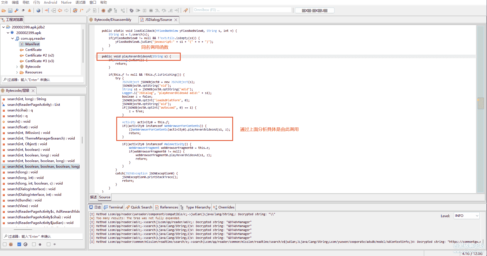

`1-4.png`（165.88 KB，下载次数：0；2023-8-28 21:01 上传） [附件下载](https://www.52pojie.cn/forum.php?mod=attachment&aid=MjYzOTQ2N3wwZTBjZjljZHwxNzkzNTY5MjI4fDE2ODA4NnwxODI2NzMx&nothumb=yes)

分析 `WebBrowserForFullScreenContents` 的父类 `WebBrowserForContents`，也看到了同名函数；经过分析后确定就是交互函数。

`0-2.png`（48.03 KB，下载次数：0；2023-8-28 21:01 上传） [附件下载](https://www.52pojie.cn/forum.php?mod=attachment&aid=MjYzOTQ2MXw0ZGJkZGM3NHwxNzkzNTY5MjI4fDE2ODA4NnwxODI2NzMx&nothumb=yes)

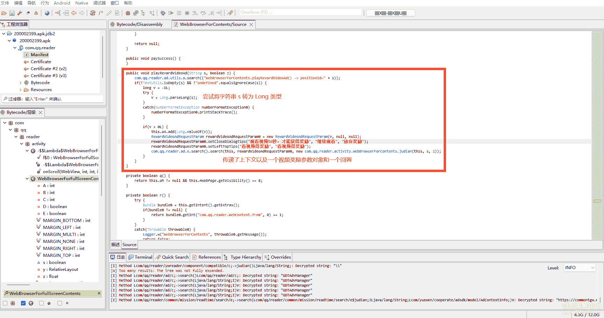

`1-5.png`（162.14 KB，下载次数：0；2023-8-28 21:01 上传） [附件下载](https://www.52pojie.cn/forum.php?mod=attachment&aid=MjYzOTQ2OHxjNWI4NWNiNnwxNzkzNTY5MjI4fDE2ODA4NnwxODI2NzMx&nothumb=yes)

### 分析接口实现

先看看这个接口的实现。

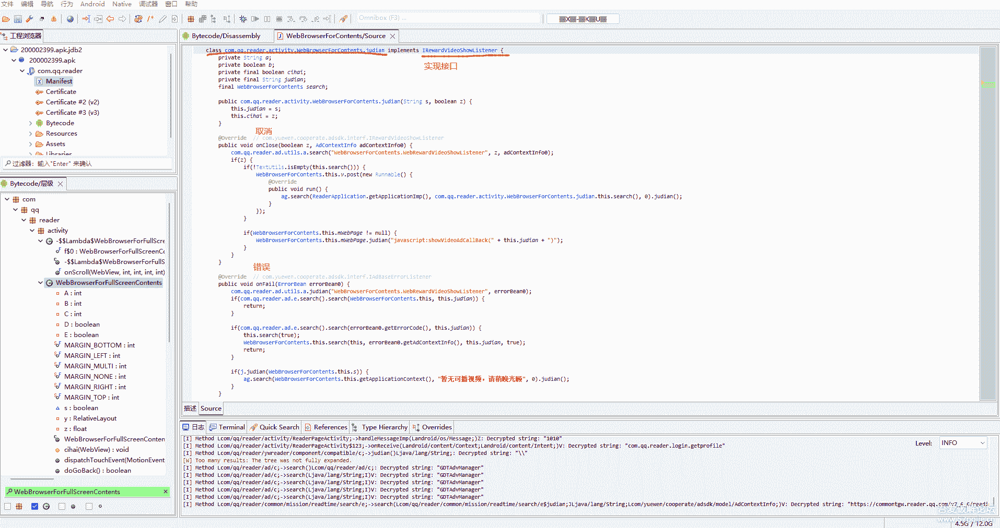

`1-6.png`（190.73 KB，下载次数：0；2023-8-28 21:01 上传） [附件下载](https://www.52pojie.cn/forum.php?mod=attachment&aid=MjYzOTQ2OXw5M2JjNGNiMnwxNzkzNTY5MjI4fDE2ODA4NnwxODI2NzMx&nothumb=yes)

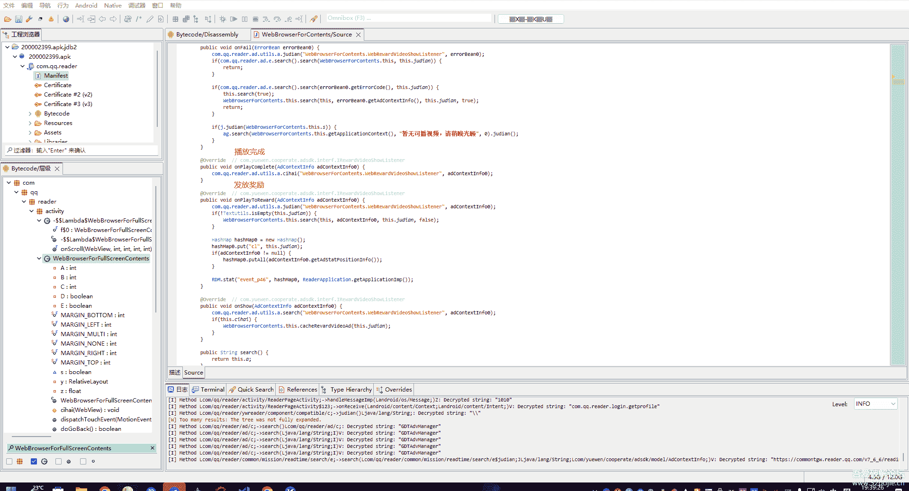

`1-7.png`（213.39 KB，下载次数：0；2023-8-28 21:01 上传） [附件下载](https://www.52pojie.cn/forum.php?mod=attachment&aid=MjYzOTQ3MHw5OWU2Nzg5ZHwxNzkzNTY5MjI4fDE2ODA4NnwxODI2NzMx&nothumb=yes)

这里名称就暴露了函数的作用。

简单对比了一下失败和成功的执行过程，发现只有一个参数不同，其他大差不差，大胆假设了一下。

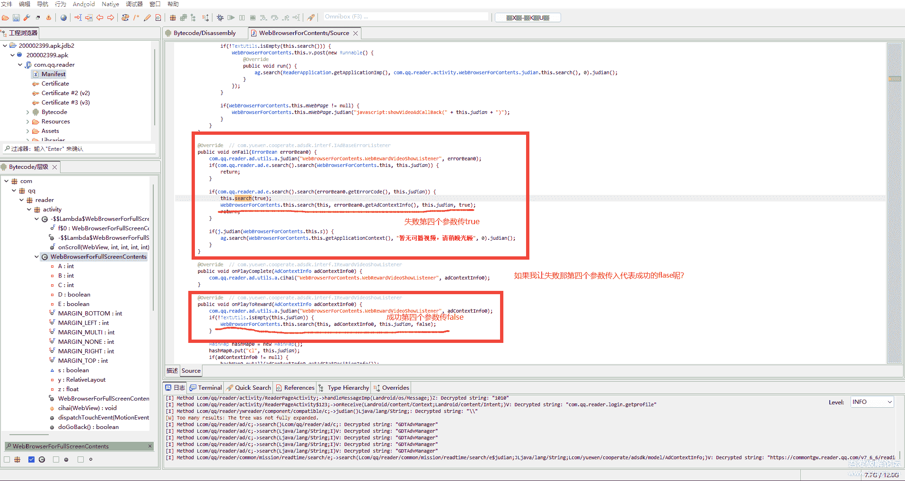

`1-8.png`（205.48 KB，下载次数：0；2023-8-28 21:09 上传） [附件下载](https://www.52pojie.cn/forum.php?mod=attachment&aid=MjYzOTQ3MXxhMDVkNGYwM3wxNzkzNTY5MjI4fDE2ODA4NnwxODI2NzMx&nothumb=yes)

### 让流程进入 `onFail`

现在来看刚刚的函数具体调用。

想办法让它不管什么都进入 `onFail` 函数。

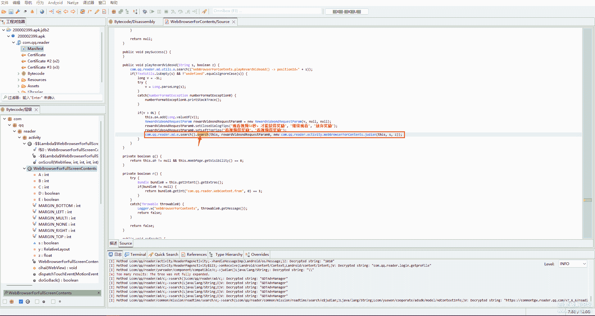

`1-9.png`（177.24 KB，下载次数：0；2023-8-28 21:01 上传） [附件下载](https://www.52pojie.cn/forum.php?mod=attachment&aid=MjYzOTQ3MnwyZDJkOTBhZHwxNzkzNTY5MjI4fDE2ODA4NnwxODI2NzMx&nothumb=yes)

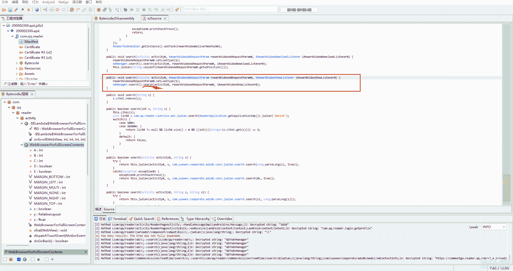

`1-10.png`（186.91 KB，下载次数：0；2023-8-28 21:01 上传） [附件下载](https://www.52pojie.cn/forum.php?mod=attachment&aid=MjYzOTQ3M3xhYTg0ZDQ5YXwxNzkzNTY5MjI4fDE2ODA4NnwxODI2NzMx&nothumb=yes)

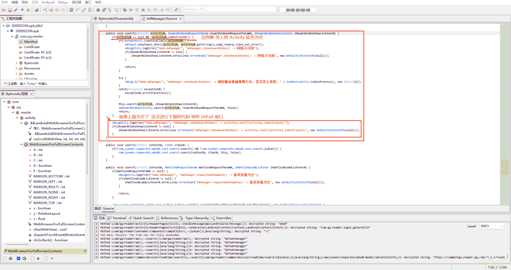

`1-11.png`（202.99 KB，下载次数：0；2023-8-28 21:01 上传） [附件下载](https://www.52pojie.cn/forum.php?mod=attachment&aid=MjYzOTQ3NHwwNDU4Y2E3Y3wxNzkzNTY5MjI4fDE2ODA4NnwxODI2NzMx&nothumb=yes)

### Hook 测试

编写 Hook 代码测试，代码大概如下。

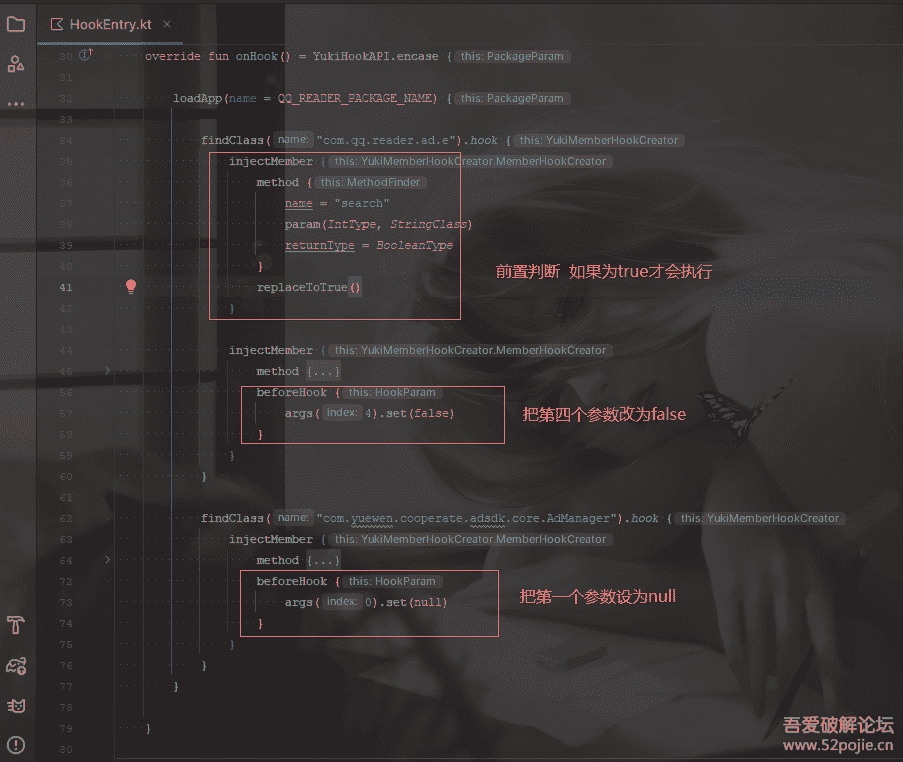

`1-12.png`（595.1 KB，下载次数：0；2023-8-28 21:02 上传） [附件下载](https://www.52pojie.cn/forum.php?mod=attachment&aid=MjYzOTQ3NXw3Y2EyZGQ3OHwxNzkzNTY5MjI4fDE2ODA4NnwxODI2NzMx&nothumb=yes)

成功。

`0-3.gif`（376.45 KB，下载次数：0；2023-8-28 21:01 上传） [附件下载](https://www.52pojie.cn/forum.php?mod=attachment&aid=MjYzOTQ2Mnw2ZjdlZTYyYnwxNzkzNTY5MjI4fDE2ODA4NnwxODI2NzMx&nothumb=yes)
