# [Android 原创] 【安卓】拿注册码的两种方式

- 原帖: https://www.52pojie.cn/forum.php?mod=viewthread&tid=1826802
- 抓取时间: 2026-11-01T21:40:28

言归正传，前段时间和朋友聊到某项功能，他说他是之前买的一个手机设备，那个手机可以实现这个功能，我当时就来了兴致，做了底层修改这么牛？
后来拿来看了看，手机刷了第三方rom和Magisk，利用一个app实现了这个功能（虽然爱思助手就有这个功能），但是有现成的app就想着研究一番，结果好家伙要验证码？于是就有了下文（在安卓逆向中属于非常基础了）

## 1. java理逻辑

打开软件，图片如下

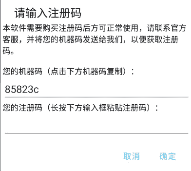

随便填写点信息，然后点确定

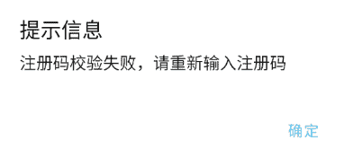

查一下有没有壳

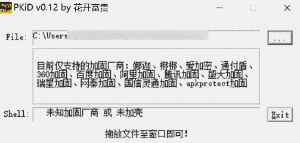

没有壳，直接拖进`jadx`，然后搜索关键字校验失败，发现两处，并且都在一个类中，先看第一处如下图所示，主要是有两个判断分支，首先我们要知道我们想要激活成功肯定是需要让代码不能走到`else`分支里

- 先看最外层`if`语句判断了`regCode`的长度是否大于6，这个`regCode`看出是从控件中获得，也就是我们输入的注册码，所以这里得到信息，我们的注册码长度要大于6
- 紧接着看内层的

```
//可以看出它new了一个Date也就是当前的日期，然后判断finalDate是否大于当前的日期

//finalDate的值为aqnuzcxq.getFinalDate(date)，这个date是我的当初输入的注册码字符串从下标为6（也就是第七个数）到最后的截断

//所以接下来我们需要跟进，看下getFinalDate函数

if (finalDate.compareTo(new Date()) > 0) 
```

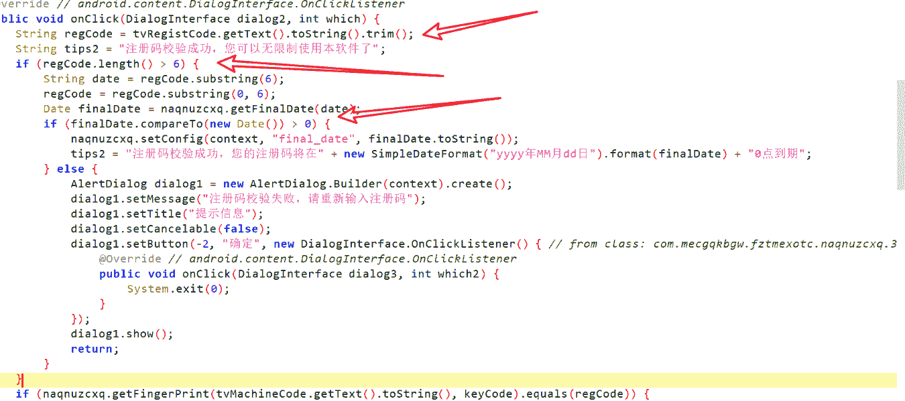

为了注释方便，我将看下`getFinalDate`函数直接粘贴到下方

```
public static Date getFinalDate(String num) {
        //声明一个calendar对象
        Calendar c = Calendar.getInstance();
        //设定其日期为2019/12/1
        c.setTime(new Date("2019/12/1"));
        //调用add函数增加日期，其中6代表增加数字代表的是天数（依据如下图），增加的值为hexDecode(num)，也就是对num进行16进制转10进制后得到的数字
        c.add(6, hexDecode(num));
        //返回日期
        return c.getTime();
    }
```

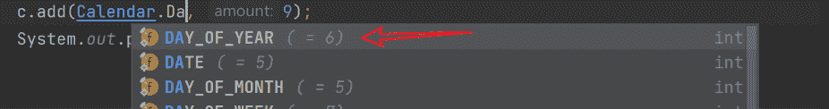

至此，整理得到逻辑，当我们输入注册码的时候，软件会截取从第7个起到末尾的字符串，然后利用`hexDecode`函数对其解码得到一个数字，计算2019年12月1日加上这个数字并到的新的日期，用这个新的日期去对比今天的日期，判断是否过期。

`hexDecode`和`hexEncode`在代码中都有，比如我这里想让其增加9999天，那么解码前的原字符串应该为多少呢，我这里写了个demo，字符串为38259

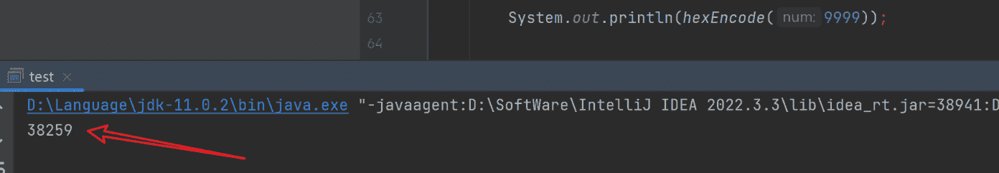

加完之后，日期是多少呢？2047年，可以够用了，所以这里我们得出我们激活码的第后半部分可以写个38259

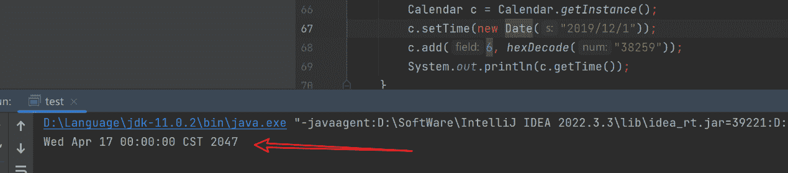

既然后半部分有了，就差前半部分了，前办部分的逻辑如下

可以看到代码正常走的话，又会触发校验失败的提示，所以我们要让其走到前面的`if`分支即可，因为前面的`if`分支有`return`关键字，我们看一下这个`if`分支，它获取了`tvMachineCode`这个控件的值作为第一个参数，这个控件为前面图中的机器码字段，并调用`getFingerPrint`函数，将返回值于`regCode`进行比对

`regCode`从前面的代码中声明了（在第一张代码图中），它是我们注册码的前6位

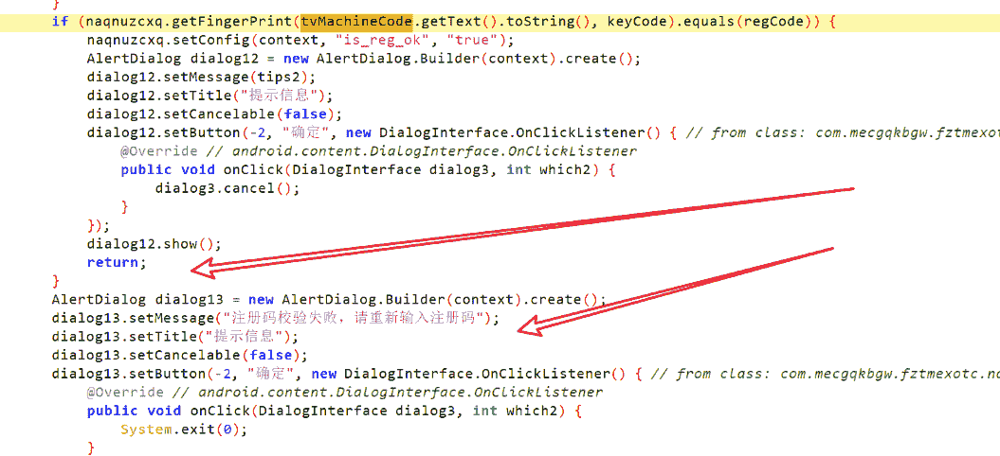

我们跟进一下`getFingerPrint`函数，如下很简单，它就是将传入的两个参数想加然后进行`md5`加密，然后获取前6位，看上图，第一个参数我们知道了是机器码，第二个参数是`keyCode`

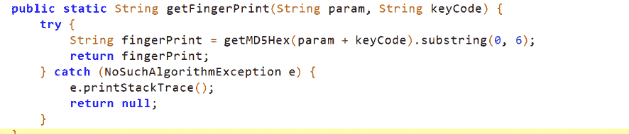

接下来找这个`keyCode`，从下向上看，最后追溯到`show`函数的第三个参数，这里我们只需找到哪里调用了`show`函数即可，在`show`函数上按x，找到调用

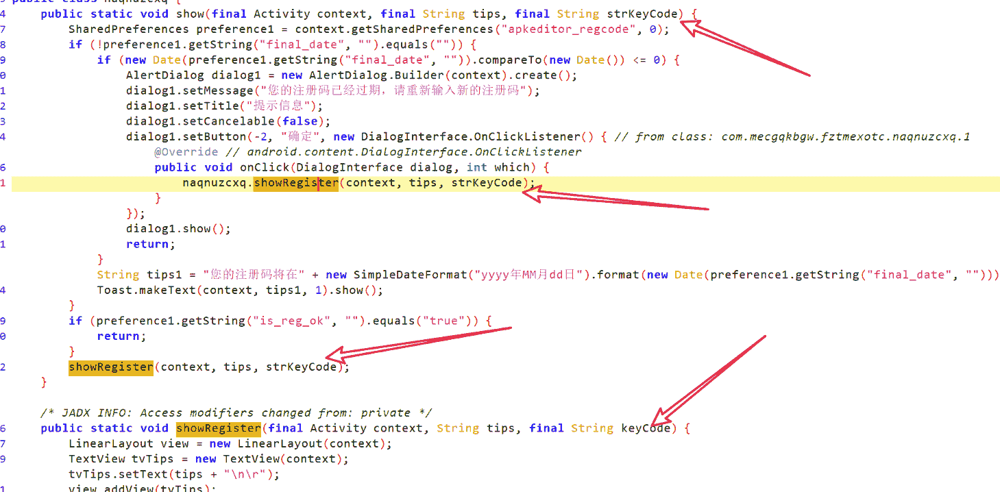

只找到一处调用，就是它了，看第三个参数123456（脱敏了）

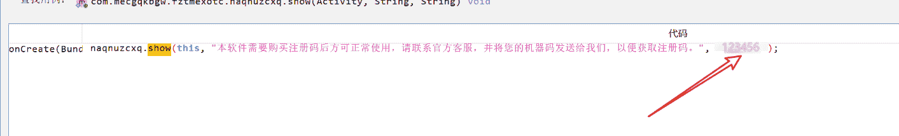

ok，既然如此我们前6位字符串也知道了，将机器码和123456拼接，然后进行`md5`加密，然后取前6位，最后拼接上我们之前逆出来的38259得到的字符串拿去激活

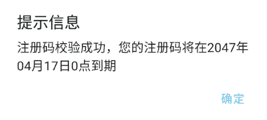

## 2. 改smali代码的判断分支

打开`dex`，搜索校验失败，翻到第一个判断分支如下，这里`v7`是6，应该是判断长度大于6那个位置，`if-le`表示a小于等于b则调，所以我们默认长度大于6这里不跳，接着往下看下一个判断分支出现

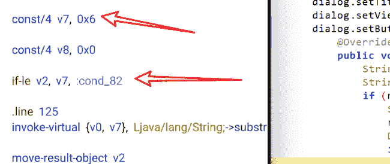

这里的`if-gtz`表示如果`v9`大于0则跳，所以我们这里需要将其改成反过来小于等于0则跳，所以这里改成`if-ltz`

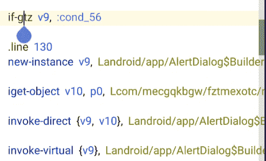

第一个判断分支解决，继续向下找第二个，如图这个位置正对代码中的`equals`比较处，这里`if-eqz`表示a等于0则跳，那我们改成a不等于0，也就是`if-nez`

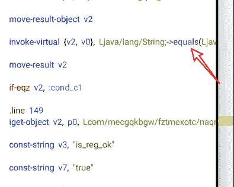

然后胡乱输入即可

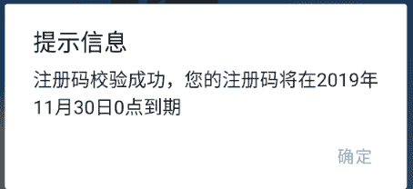

​     这种方法不推荐，因为每次进应用会有检验是否过期函数，当然也可以对这个函数进行修改或置空，当然还有其它方式例如用`frida`进行`hook`，这里由于时间关系就不多做赘述了。
