# [Android 原创] Android逆向学习（一）vscode进行android逆向修改并重新打包

- 原帖：https://www.52pojie.cn/forum.php?mod=viewthread&tid=1828789
- 抓取时间：2026-11-01T21:40:11

## 写在前面

其实我不知道这个文章能不能写下去，其实我已经开了很多坑但是都没填上，现在专利也发出去了，就开始填坑了，本坑的主要内容是关于android逆向，主要的教程来源来自52破解论坛的大佬课程，但是那是windows版，我喜欢用linux，所以这是一个有比较大改动的学习教程，不过我确信你在windows上也可以运行，let's go.

## 一、软件准备

如上文所说，我是linux用户，所以就是用的linux下相同的替代品（我感觉linux下的软件更好用）

### 1、模拟器

我使用的模拟器叫做xdroid，为认为这个做得要比android studio的好（当然指分析起来的时候），因为很多软件用的native code是arm架构下的，而android studio下模拟器主要是x86架构，很多软件无法进行分析。当然如果安装xdroid需要关闭security boot，就是在bios里面关闭。

然后我们下载xdroid的安装包，直接 `./` 运行就好了，记得不要使用 `sudo ./`，会提示不可以。

我们还需要安装的软件有开发助手，NP管理器，主要就是这两个用来进行逆向分析，而且这个是已经root好的，我们还可以直接使用 `adb` 进行调试，注意将右上角的这个android 7换成android 9，不然有的吾爱的那个软件安装不上。

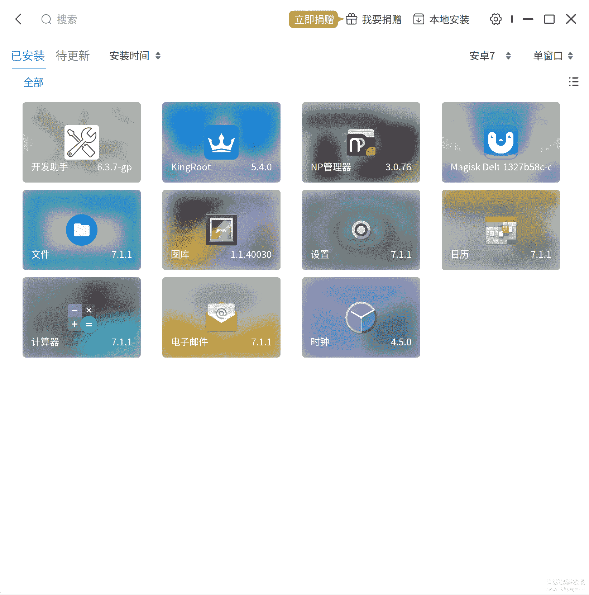

[附件下载](https://www.52pojie.cn/forum.php?mod=attachment&aid=MjY0NzE2MXxmNmViN2Y3M3wxNzkzNTY5MjA5fDE2ODA4NnwxODI4Nzg5&nothumb=yes)

2023-10-6 19:53 上传

`adb` 的命令：

```
adb devices
adb -s xxxx root
adb -s xxxx shell
```

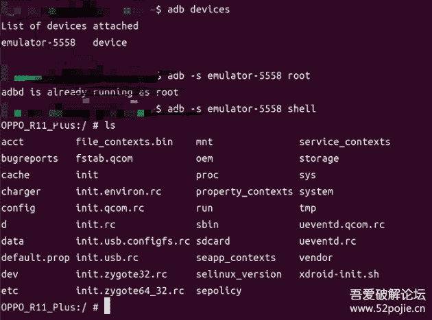

[附件下载](https://www.52pojie.cn/forum.php?mod=attachment&aid=MjY0NzE2Nnw1MTkxMzM5YnwxNzkzNTY5MjA5fDE2ODA4NnwxODI4Nzg5&nothumb=yes)

2023-10-6 19:53 上传

### 2、逆向使用的软件

教程中使用的是NP管理器和开发助手，当然我感觉直接用NP管理器的话，不是特别优雅，毕竟最好还是直接逆向后在电脑上修改，这样会显得我们比较专业，所以我用到的软件是vscode和 `apktool`，`apktool` 这个我就不讲了，我在之前的博客中就介绍过这个东西。

VScode的话我是用的APKLab拓展，这样可以更加方便的使用 `apktool` 以及其他的反编译软件，打包apk什么的也是非常的方便。

我vscode的插件主要是：

- `smalise`：用来查看smali代码的，是apklab的前置软件
- `apklab`：主要的插件，是一个十分强大的插件，能够把 `apktool` 等各种工具给整合起来，直接使用键盘就可以直接操作了
- `luna paint`：这是一个用来编辑图片的软件，能够比较好的用来修改图片，当然这个不下载也可以，这个不影响
- `smali2java`：这是一个很好用的反编译的插件，能够将代码转化为java代码能够比较清晰的去查看代码的逻辑

### 3、软件的配置过程

我们主要配置的就只有apklab这个软件。

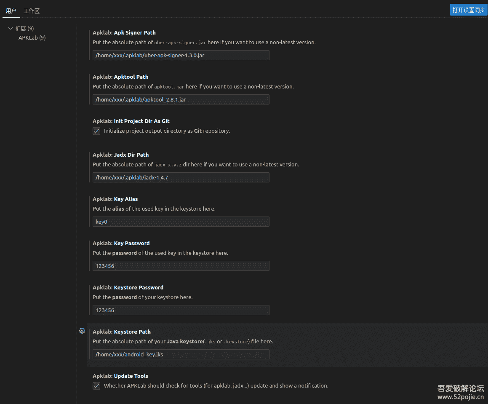

[附件下载](https://www.52pojie.cn/forum.php?mod=attachment&aid=MjY0NzE2NHwwNjk2MzY1MHwxNzkzNTY5MjA5fDE2ODA4NnwxODI4Nzg5&nothumb=yes)

2023-10-6 19:53 上传

前三个就是你的工具的路径，这个不用动就可以，这个会自动下载的。

后面的 `Keyalias` 是你个android开发签名，每个apk包是要有一个签名才可以进行安装的，既然反编译重新修改了，就得找个key重新进行签名才可以，这个生成的方法就是使用android studio进行生成，具体我不再讲解，这个直接查就好。

## 二、对android文本进行修改并重新打包

下面到了吾爱的第一个作业，就是修改图片文本，我们这样作，首先按下（`Ctrl+Shift+P`）选择 `open apk`，就可以打开你的那个安装包了，这是我们逆向之后的结构。

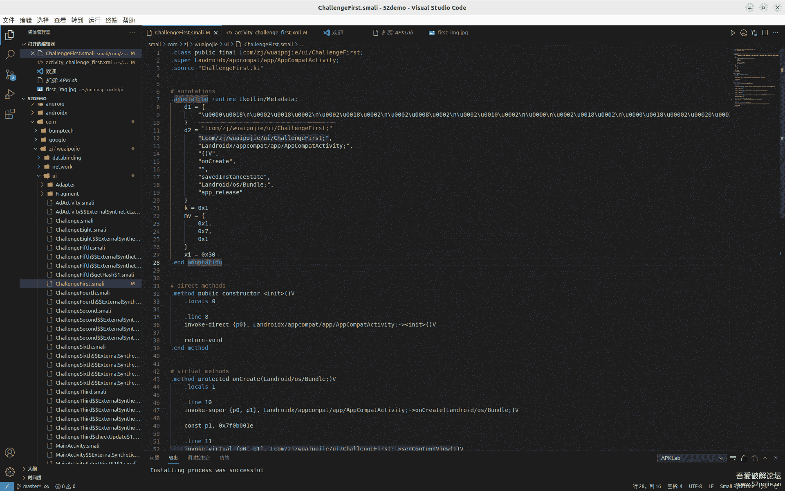

[附件下载](https://www.52pojie.cn/forum.php?mod=attachment&aid=MjY0NzE2Mnw5ZDRhMWJiNHwxNzkzNTY5MjA5fDE2ODA4NnwxODI4Nzg5&nothumb=yes)

2023-10-6 19:53 上传

然后我们需要使用开发助手查看我们当前的 `activity` 是哪一个，打开开发助手，然后点击当前 `activity`，就可以看到页面上显示的类名了，然后我们再运行需要破解的软件，就可以看到当前的 `activity` 了。

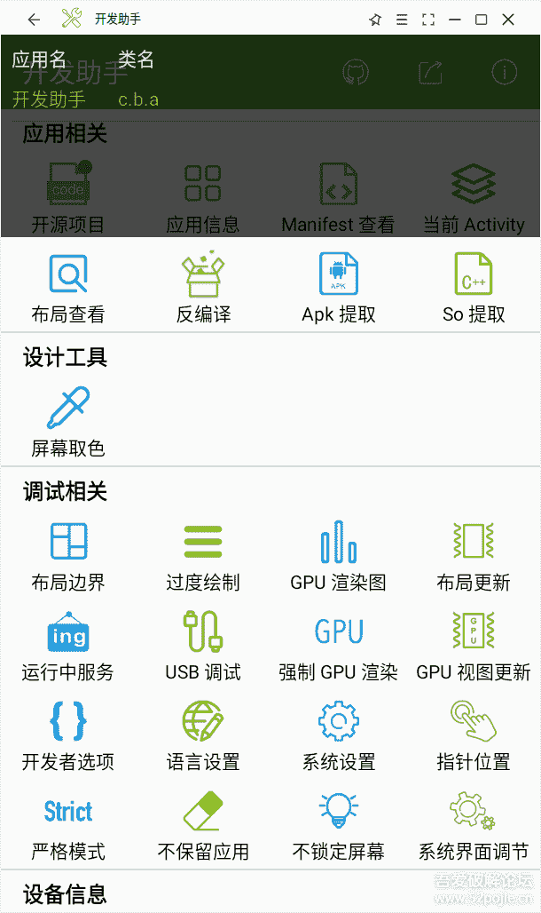

[附件下载](https://www.52pojie.cn/forum.php?mod=attachment&aid=MjY0NzE2M3xjMmU4MDg5OXwxNzkzNTY5MjA5fDE2ODA4NnwxODI4Nzg5&nothumb=yes)

2023-10-6 19:53 上传

然后就会显示这个东西。

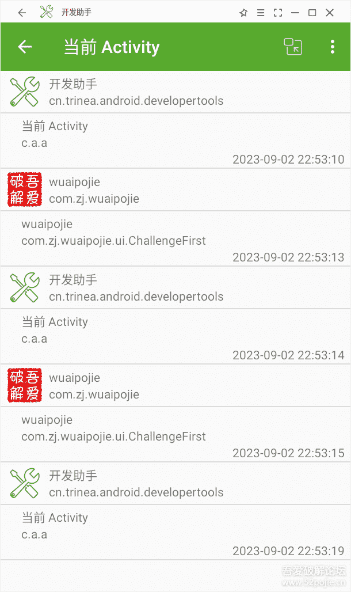

[附件下载](https://www.52pojie.cn/forum.php?mod=attachment&aid=MjY0NzE2NXxjYTkyN2QyNHwxNzkzNTY5MjA5fDE2ODA4NnwxODI4Nzg5&nothumb=yes)

2023-10-6 19:53 上传

我们在vscode的安装包里查找这个 `activity` 的相关资源。

我们在 `smali` 代码中发现了第一句。

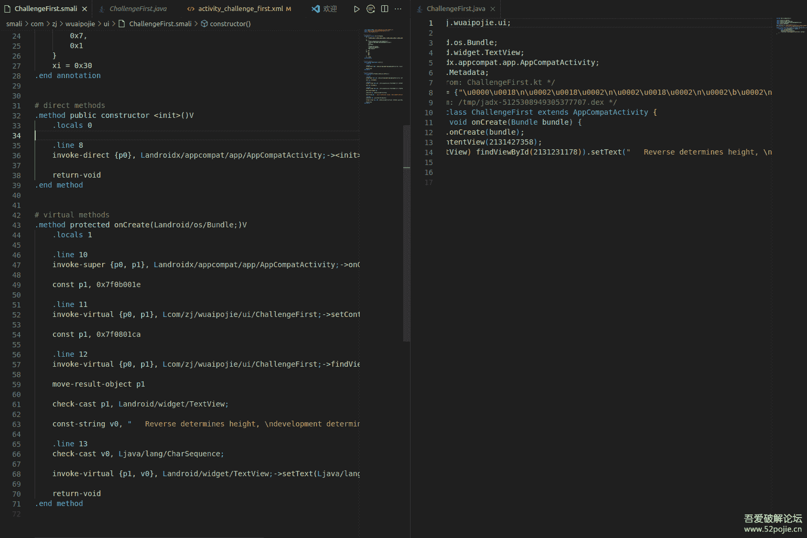

[附件下载](https://www.52pojie.cn/forum.php?mod=attachment&aid=MjY0NzE2N3xmYzAzNjkzNnwxNzkzNTY5MjA5fDE2ODA4NnwxODI4Nzg5&nothumb=yes)

2023-10-6 19:53 上传

修改了就好。

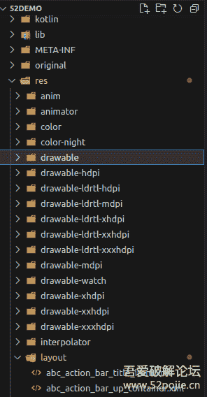

[附件下载](https://www.52pojie.cn/forum.php?mod=attachment&aid=MjY0NzE2OHxkMTU2Yzc5MnwxNzkzNTY5MjA5fDE2ODA4NnwxODI4Nzg5&nothumb=yes)

2023-10-6 19:53 上传

我们在 `res` 里面可以发现 `layout`，里面是布局文件，然后这里还有一个文本，修改即可。

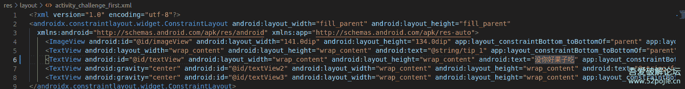

[附件下载](https://www.52pojie.cn/forum.php?mod=attachment&aid=MjY0NzE2OXxlNDg4ZDFmNHwxNzkzNTY5MjA5fDE2ODA4NnwxODI4Nzg5&nothumb=yes)

2023-10-6 19:53 上传

然后 `mipmap-xxxhdpi` 里面有图片，给他替换了。

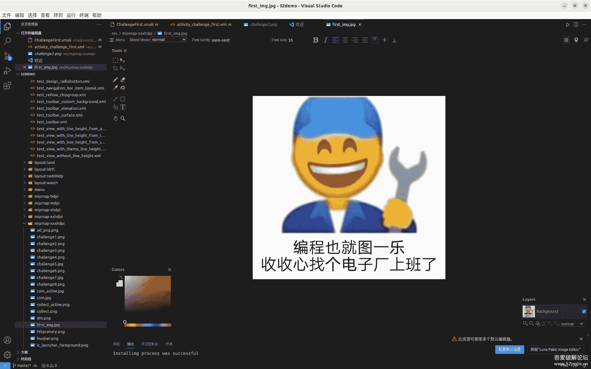

[附件下载](https://www.52pojie.cn/forum.php?mod=attachment&aid=MjY0NzE3MHwyZmYwZmRjZnwxNzkzNTY5MjA5fDE2ODA4NnwxODI4Nzg5&nothumb=yes)

2023-10-6 19:54 上传

然后我们根据之前的布局文件发现里面的文案是 `@string` 里面的，所以我们应该去查 `values` 里面找 `string.xml`，修改 `tip1` 和 `first_tv`，果然我们发现了相关的东西。

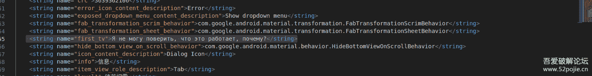

[附件下载](https://www.52pojie.cn/forum.php?mod=attachment&aid=MjY0NzE3MXw1ZWNlOTk2MHwxNzkzNTY5MjA5fDE2ODA4NnwxODI4Nzg5&nothumb=yes)

2023-10-6 19:54 上传

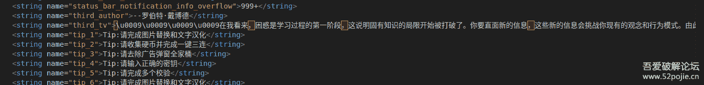

[附件下载](https://www.52pojie.cn/forum.php?mod=attachment&aid=MjY0NzE3MnwzYmM1NTdiYnwxNzkzNTY5MjA5fDE2ODA4NnwxODI4Nzg5&nothumb=yes)

2023-10-6 19:54 上传

我们照样进行修改。

修改完成后，别忘保存，然后我们右键 `apktool.yml`，进行打包安装，打包的文件在你路度的 `dist` 文件里面，注意这个有点bug，容我慢慢给你讲。

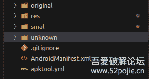

[附件下载](https://www.52pojie.cn/forum.php?mod=attachment&aid=MjY0NzE3M3xhZDYxMGExNXwxNzkzNTY5MjA5fDE2ODA4NnwxODI4Nzg5&nothumb=yes)

2023-10-6 19:54 上传

- 需要你打开其中一个软件后，你的 `adb` 才能查找到模拟器，所以记得打开开发助手或者其他软件让模拟器运行着，你再安装
- 安装后里面没有这个图标，这个就是模拟器的bug了，可以通过开发助手来打开，所以凑合用就行，只要输出控制台显示没有问题就好

所以我们安装后打开应用的方式就是在 `Manifest` 查看 -> 软件名 -> 右上角点打开应用，然后打开应用之后我们就是可以看到修改后的文件（这个安装包可以在真机上安装的，我试过了）

然后我们看到了虎哥和一眼万年的图片。

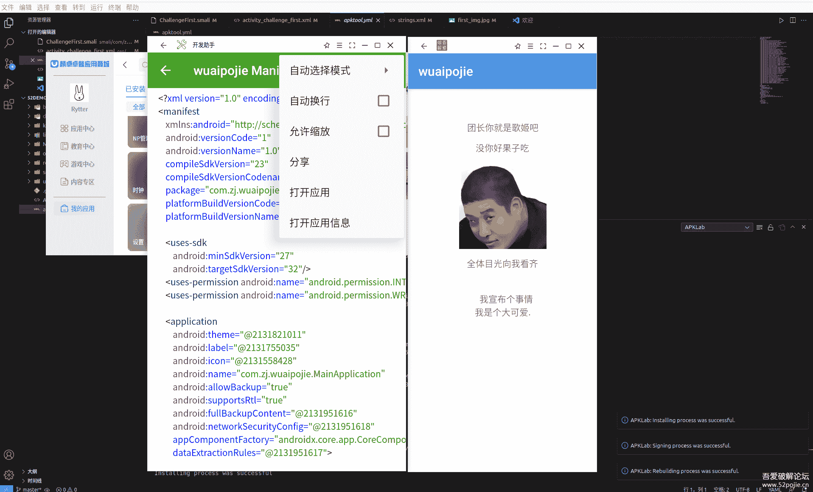

[附件下载](https://www.52pojie.cn/forum.php?mod=attachment&aid=MjY0NzE3NHw0MTBkNTFhMXwxNzkzNTY5MjA5fDE2ODA4NnwxODI4Nzg5&nothumb=yes)

2023-10-6 19:54 上传
